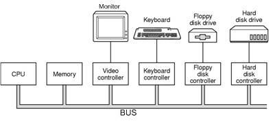
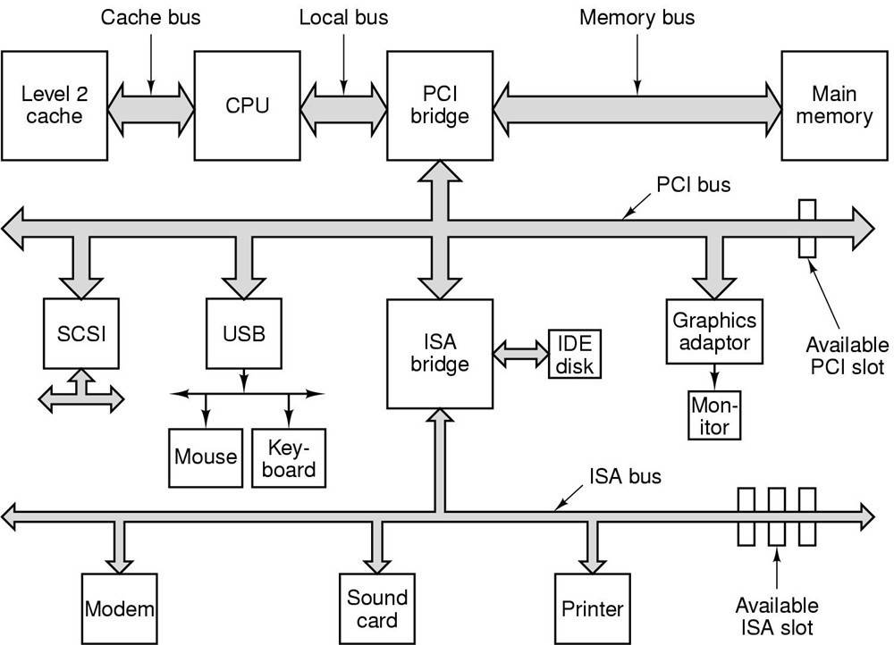

<h2>1.2 萬變不離其宗</h2>

計算機是個非常廣泛的概念，大到佔用數層樓的用於科學計算的超級計算機，小到手機上的嵌入式晶片都可以被稱為計算機。雖然它們的外形、結構和效能都千差萬別，但至少它們都有“計算”這個概念。在本書裡面，我們將計算機的範圍限定在最為流行、使用最廣泛的PC機，更具體地講是採用相容x86指令集的32位CPU的個人計算機。原因很簡單：因為筆者手上目前只有這種型別的計算機可供操作和實驗，不過相信90%以上的讀者也是，所以在這一點上我們很快能達成共識。其實選擇具體哪種平台並不是最關鍵的，雖然各種平台的軟硬體差別很多，但是本質上它們的基本概念和工作原理都是一樣的，只要我們能夠掌握一種平台上的技術，那麼其他的平台都是大同小異的，很輕鬆地可以舉一反三。所以我們相信，只有你能夠深刻地理解x86平台下的系統軟體背後的機理，當有一天你需要在MIPS指令集的嵌入式平台上做開發，或者需要為64位的Windows或Linux開發應用程式的時候，你很快就能找到它們之間的相通之處。

撇開計算機硬體中紛繁複雜的各種裝置、晶片及外圍介面等，站在軟體開發者的角度看，我們只需要抓住硬體的幾個關鍵部件。對於系統程式開發者來說，計算機多如牛毛的硬體裝置中，有三個部件最為關鍵，它們分別是中央處理器CPU、記憶體和I/O控制晶片，這三個部件幾乎就是計算機的核心了；對於普通應用程式開發者來說，他們似乎除了要關心CPU以外，其他的硬體細節基本不用關心，對於一些高階平台的開發者來說（如Java、.NET或指令碼語言開發者），連CPU都不需要關心，因為這些平台為它們提供了一個通用的抽象的計算機，他們只要關心這個抽象的計算機就可以了。

早期的計算機沒有很複雜的圖形功能，CPU的核心頻率也不高，跟記憶體的頻率一樣，它們都是直接連線在同一個匯流排（Bus）上的。由於I/O裝置諸如顯示裝置、鍵盤、軟盤和磁碟等速度與CPU和記憶體相比還是慢很多，當時也沒有複雜的圖形裝置，顯示裝置大多是只能輸出字元的終端。為了協調I/O裝置與匯流排之間的速度，也為了能夠讓CPU能夠和I/O裝置進行通訊，一般每個裝置都會有一個相應的I/O控制器。早期的計算機硬體結構如圖1-1所示。

 圖1-1 早期的計算機硬體結構 …

後來由於CPU核心頻率的提升，導致記憶體跟不上CPU的速度，於是產生了與記憶體頻率一致的系統匯流排，而CPU採用倍頻的方式與系統匯流排進行通訊。接著隨著圖形化的作業系統普及，特別是3D遊戲和多媒體的發展，使得圖形晶片需要跟CPU和記憶體之間大量交換資料，慢速的I/O匯流排已經無法滿足圖形裝置的巨大需求。為了協調CPU、記憶體和高速的圖形裝置，人們專門設計了一個高速的北橋晶片，以便它們之間能夠高速地交換資料。

由於北橋執行的速度非常高，所有相對低速的裝置如果全都直接連線在北橋上，北橋既須處理高速裝置，又須處理低速裝置，設計就會十分複雜。於是人們又設計了專門處理低速裝置的南橋（Southbridge）晶片，磁碟、USB、鍵盤、滑鼠等裝置都連線在南橋上，由南橋將它們彙總後連線到北橋上。20世紀90年代的PC機在系統匯流排上採用的是PCI結構，而在低速裝置上採用的ISA匯流排，採用PCI/ISA及南北橋設計的硬體構架如圖1-2所示。

位於中間是連線所有高速晶片的北橋（Northbridge，PCI Bridge），它就像人的心髒，連線並驅動身體的各個部位；它的左邊是CPU，負責所有的控制和運算，就像人的大腦。北橋還連線著幾個高速部件，包括左邊的記憶體和下面的PCI匯流排。

PCI的速度最高為133 MHz，它還是不能滿足人們的需求，於是人們又發明瞭AGP、

 圖1-2 硬體結構框架 …

PCI Express等諸多匯流排結構和相應控制晶片。雖然硬體結構看似越來越複雜，但實際上它還是沒有脫離最初的CPU、記憶體，以及I/O的基本結構。我們從程式開發的角度看待硬體時可以簡單地將它看成最初的硬體模型。

SMP與多核

人們總是希望計算機越來越快，這是毫無疑問的。在過去的50年裡，CPU的頻率從幾十KHz到現在的4GHz，整整提高了數十萬倍，基本上每18個月頻率就會翻倍。但是自2004年以來，這種規律似乎已經失效，CPU的頻率自從那時開始再也沒有發生質的提高。原因是人們在製造CPU的工藝方面已經達到了物理極限，除非CPU製造工藝有本質的突破，否則CPU的頻率將會一直被目前4GHz的“天花板”所限製。

在頻率上短期內已經沒有提高的餘地了，於是人們開始想辦法從另外一個角度來提高CPU的速度，就是增加CPU的數量。一個計算機擁有多個CPU早就不是什麼新鮮事了，很早以前就有了多CPU的計算機，其中最常見的一種形式就是對稱多處理器（SMP，Symmetrical Multi-Processing），簡單地講就是每個CPU在系統中所處的地位和所發揮的功能都是一樣的，是相互對稱的。理論上講，增加CPU的數量就可以提高運算速度，並且理想情況下，速度的提高與CPU的數量成正比。但實際上並非如此，因為我們的程式並不是都能分解成若幹個完全不相幹的子問題。就比如一個女人可以花10個月生出一個孩子，但是10個女人並不能在一個月就生出一個孩子一樣。

當然很多時候多處理器是非常有用的，最常見的情況就是在大型的資料庫、網路伺服器上，它們要同時處理大量的請求，而這些請求之間往往是相互獨立的，所以多處理器就可以最大效能地發揮威力。

多處理器應用最多的場合也是這些商用的伺服器和需要處理大量計算的環境。而在個人電腦中，使用多處理器則是比較奢侈的行為，畢竟多處理器的成本是很高的。於是處理器的廠商開始考慮將多個處理器“合並在一起打包出售”，這些“被打包”的處理器之間共享比較昂貴的快取部件，只保留多個核心，並且以一個處理器的外包裝進行出售，售價比單核心的處理器只貴了一點，這就是多核處理器（Multi-core Processor）的基本想法。多核處理器實際上就是SMP的簡化版，當然它們在細節上還有一些差別，但是從程式設計師的角度來看，它們之間區別很小，邏輯上來看它們是完全相同的。只是多核和SMP在快取共享等方面有細微的差別，使得程式在最佳化上可以有針對性地處理。簡單地講，除非想把CPU的每一滴油水都榨幹，否則可以把多核和SMP看成同一個概念。

推薦閱讀：“Free Lunch is Over”（免費午餐已經結束了）

http://www.gotw.ca/publications/concurrency-ddj.htm

隨著CPU頻率碰到了“天花板”，多核處理器越來越普及，對程式設計師開發程式的方式也將發生極大的變化，這篇文章很好地分析了將要到來的多核時代對程式開發的挑戰和機遇。

