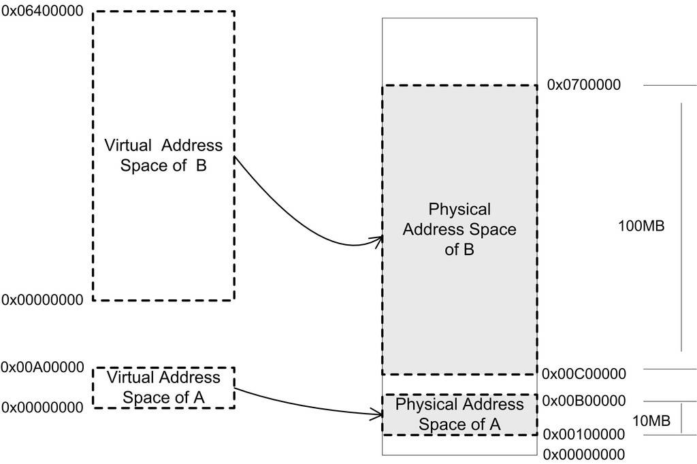
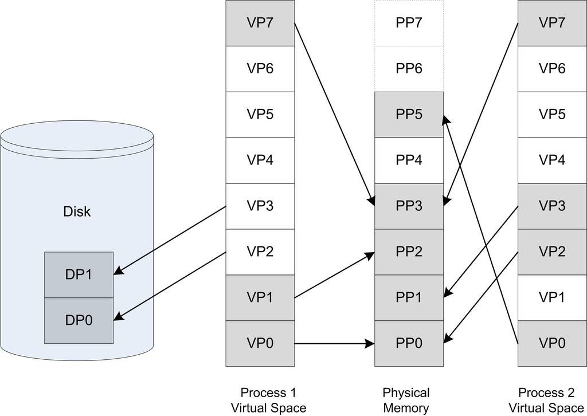

<h2>1.5 記憶體不夠怎麼辦</h2>

上面一節中我們提到了程式的概念，程式的總體目標是希望每個程式從邏輯上來看都可以獨佔計算機的資源。作業系統的多工功能使得CPU能夠在多個程式之間很好地共享，從程式的角度看好像是它獨佔了CPU而不用考慮與其他程式分享CPU的事情。作業系統的I/O抽象模型也很好地實現了I/O裝置的共享和抽象，那麼唯一剩下的就是主存，也就是記憶體的分配問題了。

在早期的計算機中，程式是直接執行在實體記憶體上的，也就是說，程式在執行時所訪問的地址都是實體地址。當然，如果一個計算機同時只執行一個程式，那麼只要程式要求的記憶體空間不要超過實體記憶體的大小，就不會有問題。但事實上為了更有效地利用硬體資源，我們必須同時執行多個程式，正如前面的多道程式、分時系統和多工中一樣，當我們能夠同時執行多個程式時，CPU的利用率將會比較高。那麼很明顯的一個問題是，如何將計算機上有限的實體記憶體分配給多個程式使用。

假設我們的計算機有128 MB記憶體，程式A執行需要10 MB，程式B需要100 MB，程式C需要20 MB。如果我們需要同時執行程式A和B，那麼比較直接的做法是將記憶體的前10 MB分配給程式A，10 MB～110 MB分配給B。這樣就能夠實現A和B兩個程式同時執行，但是這種簡單的記憶體分配策略問題很多。

• 地址空間不隔離 所有程式都直接訪問實體地址，程式所使用的記憶體空間不是相互隔離的。惡意的程式可以很容易改寫其他程式的記憶體資料，以達到破壞的目的；有些非惡意的、但是有臭蟲的程式可能不小心修改了其他程式的資料，就會使其他程式也崩潰，這對於需要安全穩定的計算環境的使用者來說是不能容忍的。使用者希望他在使用計算機的時候，其中一個任務失敗了，至少不會影響其他任務。

• 記憶體使用效率低 由於沒有有效的記憶體管理機制，通常需要一個程式執行時，監控程式就將整個程式裝入記憶體中然後開始執行。如果我們忽然需要執行程式C，那麼這時記憶體空間其實已經不夠了，這時候我們可以用的一個辦法是將其他程式的資料暫時寫到磁碟裡面，等到需要用到的時候再讀回來。由於程式所需要的空間是連續的，那麼這個例子裡面，如果我們將程式A換出到磁碟所釋放的記憶體空間是不夠的，所以只能將B換出到磁碟，然後將C讀入到記憶體開始執行。可以看到整個過程中有大量的資料在換入換出，導致效率十分低下。

• 程式執行的地址不確定 因為程式每次需要裝入執行時，我們都需要給它從記憶體中分配一塊足夠大的空閑區域，這個空閑區域的位置是不確定的。這給程式的編寫造成了一定的麻煩，因為程式在編寫時，它訪問資料和指令跳轉時的目標地址很多都是固定的，這涉及程式的重定位問題，我們在第2部分和第3部分還會詳細探討重定位的問題。

解決這幾個問題的思路就是使用我們前文提到過的法寶：增加中間層，即使用一種間接的地址訪問方法。整個想法是這樣的，我們把程式給出的地址看作是一種虛擬地址（Virtual Address），然後透過某些對映的方法，將這個虛擬地址轉換成實際的實體地址。這樣，只要我們能夠妥善地控制這個虛擬地址到實體地址的對映過程，就可以保證任意一個程式所能夠訪問的實體記憶體區域跟另外一個程式相互不重疊，以達到地址空間隔離的效果。

1.5.1 關於隔離

讓我們回到程式的執行本質上來。使用者程式在執行時不希望介入到這些複雜的儲存器管理過程中，作為普通的程式，它需要的是一個簡單的執行環境，有一個單一的地址空間、有自己的CPU，好像整個程式佔有整個計算機而不用關心其他的程式（當然程式間通訊的部分除外，因為這是程式主動要求跟其他程式通訊和聯繫）。所謂的地址空間是個比較抽象的概念，你可以把它想象成一個很大的陣列，每個陣列的元素是一個位元組，而這個陣列大小由地址空間的地址長度決定，比如32位的地址空間的大小為 2^32 = 4 294 967 296 位元組，即4GB，地址空間有效的地址是 0～4 294 967 295，用十六進位表示就是0x00000000～0xFFFFFFFF。地址空間分兩種：虛擬地址空間（Virtual Address Space）和實體地址空間（Physical Address Space）。實體地址空間是實實在在存在的，存在於計算機中，而且對於每一台計算機來說只有唯一的一個，你可以把物理空間想象成實體記憶體，比如你的計算機用的是Intel的Pentium 4的處理器，那麼它是32位的機器，即計算機地址線有32條（實際上是36條地址線，不過我們暫時認為它只是32條），那麼物理空間就有4GB。但是你的計算機上只裝了512MB的記憶體，那麼其實實體地址的真正有效部分只有0x00000000～0x1FFFFFFF，其他部分都是無效的（實際上還有一些外部I/O裝置對映到物理空間的，也是有效的，但是我們暫時無視其存在）。虛擬地址空間是指虛擬的、人們想象出來的地址空間，其實它並不存在，每個程式都有自己獨立的虛擬空間，而且每個程式只能訪問自己的地址空間，這樣就有效地做到了程式的隔離。

1.5.2 分段（Segmentation）

最開始人們使用的是一種叫做分段（Segmentation）的方法，基本思路是把一段與程式所需要的記憶體空間大小的虛擬空間對映到某個地址空間。比如程式A需要10 MB記憶體，那麼我們假設有一個地址從0x00000000到0x00A00000的10MB大小的一個假象的空間，也就是虛擬空間，然後我們從實際的實體記憶體中分配一個相同大小的實體地址，假設是實體地址0x00100000開始到0x00B00000結束的一塊空間。然後我們把這兩塊相同大小的地址空間一一對映，即虛擬空間中的每個位元組相對應於物理空間中的每個位元組。這個對映過程由軟體來設定，比如作業系統來設定這個對映函式，實際的地址轉換由硬體完成。比如當程式A中訪問地址0x00001000時，CPU會將這個地址轉換成實際的實體地址0x00101000。那麼比如程式A和程式B在執行時，它們的虛擬空間和物理空間對映關係可能如圖1-5所示。

 圖1-5 段對映機制 …

分段的方法基本解決了上面提到的3個問題中的第一個和第三個。首先它做到了地址隔離，因為程式A和程式B被對映到了兩塊不同的物理空間區域，它們之間沒有任何重疊，如果程式A訪問虛擬空間的地址超出了0x00A00000這個範圍，那麼硬體就會判斷這是一個非法的訪問，拒絕這個地址請求，並將這個請求報告給作業系統或監控程式，由它來決定如何處理。再者，對於每個程式來說，無論它們被分配到實體地址的哪一個區域，對於程式來說都是透明的，它們不需要關心實體地址的變化，它們只需要按照從地址0x00000000到0x00A00000來編寫程式、放置變數，所以程式不再需要重定位。

但是分段的這種方法還是沒有解決我們的第二個問題，即記憶體使用效率的問題。分段對記憶體區域的對映還是按照程式為單位，如果記憶體不足，被換入換出到磁碟的都是整個程式，這樣勢必會造成大量的磁碟訪問操作，從而嚴重影響速度，這種方法還是顯得粗糙，粒度比較大。事實上，根據程式的區域性性原理，當一個程式在執行時，在某個時間段內，它只是頻繁地用到了一小部分資料，也就是說，程式的很多資料其實在一個時間段內都是不會被用到的。人們很自然地想到了更小粒度的記憶體分割和對映的方法，使得程式的區域性性原理得到充分的利用，大大提高了記憶體的使用率。這種方法就是分頁（Paging）。

1.5.3 分頁（Paging）

分頁的基本方法是把地址空間人為地等分成固定大小的頁，每一頁的大小由硬體決定，或硬體支援多種大小的頁，由作業系統選擇決定頁的大小。比如Intel Pentium係列處理器支援4KB或4MB的頁大小，那麼作業系統可以選擇每頁大小為4KB，也可以選擇每頁大小為4MB，但是在同一時刻只能選擇一種大小，所以對整個系統來說，頁就是固定大小的。目前幾乎所有的PC上的作業系統都使用4KB大小的頁。我們使用的PC機是32位的虛擬地址空間，也就是4GB，那麼按4KB每頁分的話，總共有1 048 576個頁。物理空間也是同樣的分法。

下面我們來看一個簡單的例子，如圖1-6所示，每個虛擬空間有8頁，每頁大小為1KB，那麼虛擬地址空間就是8KB。我們假設該計算機有13條地址線，即擁有2^13的物理定址能力，那麼理論上物理空間可以多達8KB。但是出於種種原因，購買記憶體的資金不夠，只買得起6KB的記憶體，所以物理空間其實真正有效的只是前6KB。

那麼，當我們把程式的虛擬地址空間按頁分割，把常用的資料和內碼表載入到記憶體中，把不常用的程式碼和資料儲存在磁碟裡，當需要用到的時候再把它從磁碟裡取出來即可。以圖1-6為例，我們假設有兩個程式Process1和Process2，它們程式中的部分虛擬頁面被對映到了物理頁面，比如VP0、VP1和VP7對映到PP0、PP2和PP3；而有部分頁面卻在磁碟中，比如VP2和VP3位於磁碟的DP0和DP1中；另外還有一些頁面如VP4、VP5和VP6可能尚未被用到或訪問到，它們暫時處於未使用的狀態。在這裡，我們把虛擬空間的頁就叫虛擬頁（VP，Virtual Page），把實體記憶體中的頁叫做物理頁（PP，Physical Page），把磁碟中的頁叫做磁碟頁（DP，Disk Page）。圖中的線表示對映關係，我們可以看到虛擬空間的有些頁被對映到同一個物理頁，這樣就可以實現記憶體共享。

圖1-6中Process1的VP2和VP3不在記憶體中，但是當程式需要用到這兩個頁的時候，硬體會捕獲到這個訊息，就是所謂的頁錯誤（Page Fault），然後作業系統接管程式，負責將VP2和VP3從磁碟中讀出來並且裝入記憶體，然後將記憶體中的這兩個頁與VP2和VP3之間建立對映關係。以頁為單位來存取和交換這些資料非常方便，硬體本身就支援這種以頁為單位的操作方式。

 圖1-6 程式虛擬空間、物理空間和磁碟之間的頁對映關係 …

保護也是頁對映的目的之一，簡單地說就是每個頁可以設定許可權屬性，誰可以修改，誰可以訪問等，而只有作業系統有許可權修改這些屬性，那麼作業系統就可以做到保護自己和保護程式。對於保護，我們這裡只是簡單介紹，詳細的介紹和為什麼要保護我們將會在本書的第2部分再介紹。

虛擬儲存的實現需要依靠硬體的支援，對於不同的CPU來說是不同的。但是幾乎所有的硬體都採用一個叫MMU（Memory Management Unit）的部件來進行頁對映，如圖1-7所示。

 圖1-7 虛擬地址到實體地址的轉換 …

在頁對映模式下，CPU發出的是Virtual Address，即我們的程式看到的是虛擬地址。經過MMU轉換以後就變成了Physical Address。一般MMU都整合在CPU內部了，不會以獨立的部件存在。

