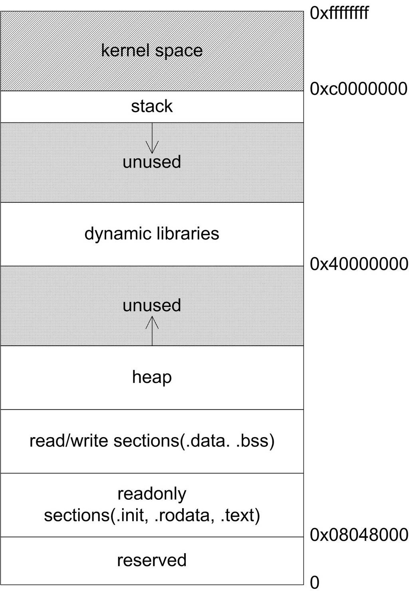

<h2>10.1 程式的記憶體佈局</h2>

在前面的章節中，我們已經瞭解到執行檔是如何對映到計算機記憶體裡的，本節將再深化一下對這方面的理解，順便結合上一章中關於動態連結的內容，看看加上動態連結之後程式的地址空間是如何分佈的。

現代的應用程式都執行在一個記憶體空間裡，在32位的系統裡，這個記憶體空間擁有4GB（2的32次方）的定址能力。相對於16位時代i386的段地址加段內偏移的定址模式，如今的應用程式可以直接使用32位的地址進行定址，這被稱為平坦(flat)的記憶體模型。在平坦的記憶體模型中，整個記憶體是一個統一的地址空間，使用者可以使用一個32位的指標訪問任意記憶體位置。例如：

<pre>int *p = (int*)0x12345678;
++*p;
</pre>

這段程式碼展示瞭如何直接讀寫指定地址的記憶體資料。不過，盡管當今的記憶體空間號稱是平坦的，但實際上記憶體仍然在不同的地址區間上有著不同的地位，例如，大多數作業系統都會將4GB的記憶體空間中的一部分挪給核心使用，應用程式無法直接訪問這一段記憶體，這一部分記憶體地址被稱為核心空間。Windows在預設情況下會將高地址的2GB空間分配給核心（也可配置為1GB），而Linux預設情況下將高地址的1GB空間分配給核心，這些在前文中都已經介紹過了。

使用者使用的剩下2GB或3GB的記憶體空間稱為使用者空間。在使用者空間裡，也有許多地址區間有特殊的地位，一般來講，應用程式使用的記憶體空間裡有如下“預設”的區域。

棧：棧用於維護函式呼叫的上下文，離開了棧函式呼叫就沒法實現。在10.2節中將對棧作詳細的介紹。棧通常在使用者空間的最高地址處分配，通常有數兆位元組的大小。

堆：堆是用來容納應用程式動態分配的記憶體區域，當程式使用malloc或new分配記憶體時，得到的記憶體來自堆裡。堆會在10.3節詳細介紹。堆通常存在於棧的下方（低地址方向），在某些時候，堆也可能沒有固定統一的儲存區域。堆一般比棧大很多，可以有幾十至數百兆位元組的容量。

執行檔映像：這裡儲存著執行檔在記憶體裡的映像，在第6章已經提到過，由載入器在載入時將執行檔的記憶體讀取或對映到這裡。在此不再詳細說明。

保留區：保留區並不是一個單一的記憶體區域，而是對記憶體中受到保護而禁止訪問的記憶體區域的總稱，例如，大多數作業系統裡，極小的地址通常都是不允許訪問的，如NULL。通常C語言將無效指標賦值為0也是出於這個考慮，因為0地址上正常情況下不可能有有效的可訪問資料。

圖10-1是Linux下一個程式裡典型的記憶體佈局。

 圖10-1 Linux程式地址空間佈局（核心版本2.4.x） …

在圖10-1中，有一個沒有介紹的區域：“動態連結庫對映區”，這個區域用於對映載入的動態連結庫。在Linux下，如果執行檔依賴其他共用函式庫，那麼系統就會為它在從0x40000000開始的地址分配相應的空間，並將共用函式庫載入到該空間。

圖中的箭頭標明瞭幾個大小可變的區的尺寸增長方向，在這裡可以清晰地看出棧向低地址增長，堆向高地址增長。當棧或堆現有的大小不夠用時，它將按照圖中的增長方向擴大自身的尺寸，直到預留的空間被用完為止。

在接下來的兩節中，會詳細介紹上述幾個區域中的棧和堆，讓讀者對應用程式執行時記憶體的狀況有一個更加深入的理解。

Q&amp;A

Q：我寫的程式常常出現“段錯誤(segment fault)”或者“非法操作，該記憶體地址不能read/write”的錯誤資訊，這是怎麼回事？

A：這是典型的非法指標解引用造成的錯誤。當指標指向一個不允許讀或寫的記憶體地址，而程式卻試圖利用指標來讀或寫該地址的時候，就會出現這個錯誤。在Linux或Windows的記憶體佈局中，有些地址是始終不能讀寫的，例如0地址。還有些地址是一開始不允許讀寫，應用程式必須事先請求獲取這些地址的讀寫權，或者某些地址一開始並沒有對映到實際的實體記憶體，應用程式必須事先請求將這些地址對映到實際的實體地址（commit），之後才能夠自由地讀寫這片記憶體。當一個指標指向這些區域的時候，對它指向的記憶體進行讀寫就會引發錯誤。造成這樣的最普遍原因有兩種：

A：這是典型的非法指標解引用造成的錯誤。當指標指向一個不允許讀或寫的記憶體地址，而程式卻試圖利用指標來讀或寫該地址的時候，就會出現這個錯誤。在Linux或Windows的記憶體佈局中，有些地址是始終不能讀寫的，例如0地址。還有些地址是一開始不允許讀寫，應用程式必須事先請求獲取這些地址的讀寫權，或者某些地址一開始並沒有對映到實際的實體記憶體，應用程式必須事先請求將這些地址對映到實際的實體地址（commit），之後才能夠自由地讀寫這片記憶體。當一個指標指向這些區域的時候，對它指向的記憶體進行讀寫就會引發錯誤。造成這樣的最普遍原因有兩種：

1. 程式設計師將指標初始化為NULL，之後卻沒有給它一個合理的值就開始使用指標。

2. 程式設計師沒有初始化棧上的指標，指標的值一般會是隨機數，之後就直接開始使用指標。

因此，如果你的程式出現了這樣的錯誤，請著重檢查指標的使用情況。

