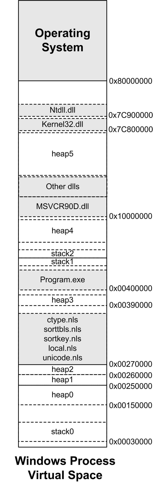
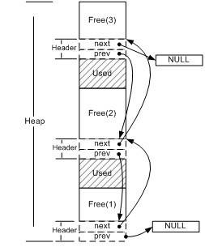
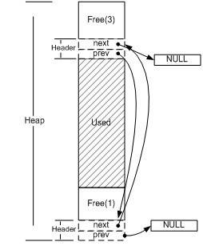
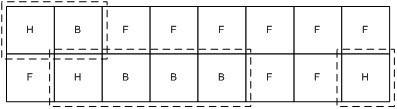

<h2>10.3 堆與記憶體管理</h2>

相對於棧而言，堆這片記憶體面臨一個稍微複雜的行為模式：在任意時刻，程式可能發出請求，要麼申請一段記憶體，要麼釋放一段已申請過的記憶體，而且申請的大小從幾個位元組到數GB都是有可能的，我們不能假設程式會一次申請多少堆空間，因此，堆的管理顯得較為複雜。下面讓我們來瞭解一下堆的工作原理。

10.3.1 什麼是堆

光有棧對於面向過程的程式設計還遠遠不夠，因為棧上的資料在函式返回的時候就會被釋放掉，所以無法將資料傳遞至函式外部。而全域性變數沒有辦法動態地產生，只能在編譯的時候定義，有很多情況下缺乏表現力。在這種情況下，堆（Heap）是唯一的選擇。

堆是一塊巨大的記憶體空間，常常佔據整個虛擬空間的絕大部分。在這片空間裡，程式可以請求一塊連續記憶體，並自由地使用，這塊記憶體在程式主動放棄之前都會一直保持有效。下面是一個申請堆空間最簡單的例子。

<pre>int main()
{
    char * p = (char*)malloc(1000);
    /* use p as an array of size 1000*/
    free(p);
}
</pre>

在第3行用malloc申請了1000個位元組的空間之後，程式可以自由地使用這1000個位元組，直到程式用free函式釋放它。

那麼malloc到底是怎麼實現的呢？有一種做法是，把程式的記憶體管理交給作業系統核心去做，既然核心管理著程式的地址空間，那麼如果它提供一個系統呼叫，可以讓程式使用這個系統呼叫申請記憶體，不就可以了嗎？當然這是一種理論上可行的做法，但實際上這樣做的效能比較差，因為每次程式申請或者釋放堆空間都需要進行系統呼叫。我們知道系統呼叫的效能開銷是很大的，當程式對堆的操作比較頻繁時，這樣做的結果是會嚴重影響程式的效能的。比較好的做法就是程式向作業系統申請一塊適當大小的堆空間，然後由程式自己管理這塊空間，而具體來講，管理著堆空間分配的往往是程式的執行庫。

執行庫相當於是向作業系統“批發”了一塊較大的堆空間，然後“零售”給程式用。當全部“售完”或程式有大量的記憶體需求時，再根據實際需求向作業系統“進貨”。當然執行庫在向程式零售堆空間時，必須管理它批發來的堆空間，不能把同一塊地址出售兩次，導致地址的衝突。於是執行庫需要一個演算法來管理堆空間，這個演算法就是堆的分配演算法。不過在瞭解具體的分配演算法之前，我們先來看看執行庫是怎麼向作業系統批發記憶體的。

10.3.2 Linux程式堆管理

從本章的第一節可知，程式的地址空間中，除了執行檔、共用函式庫和棧之外，剩餘的未分配的空間都可以被用來作為堆空間。Linux下的程式堆管理稍微有些複雜，因為它提供了兩種堆空間分配的方式，即兩個系統呼叫：一個是<code>brk()</code>系統呼叫，另外一個是<code>mmap()。</code><code>brk()</code>的C語言形式宣告如下：

<pre>int brk(void* end_data_segment)</pre>

<code>brk()</code>的作用實際上就是設定程式資料段的結束地址，即它可以擴大或者縮小資料段（Linux下資料段和BSS合並在一起統稱資料段）。如果我們將資料段的結束地址向高地址移動，那麼擴大的那部分空間就可以被我們使用，把這塊空間拿來作為堆空間是最常見的做法之一（我們還將在第12章詳細介紹brk的實現）。Glibc中還有一個函式叫sbrk，它的功能與brk類似，只不過引數和返回值略有不同。sbrk以一個增量（Increment）作為引數，即需要增加（負數為減少）的空間大小，返回值是增加（或減少）後資料段結束地址，這個函式實際上是對brk系統呼叫的包裝，它是透過<code>brk()</code>實現的。

<code>mmap()</code>的作用和Windows系統下的VirtualAlloc很相似，它的作用就是向作業系統申請一段虛擬地址空間，當然這塊虛擬地址空間可以對映到某個檔案（這也是這個系統呼叫的最初的作用），當它不將地址空間對映到某個檔案時，我們又稱這塊空間為匿名（Anonymous）空間，匿名空間就可以拿來作為堆空間。它的宣告如下：

<pre>void *mmap(
   void *start, 
   size_t length, 
   int prot, 
   int flags,
   int fd, 
   off_t offset);
</pre>

mmap的前兩個引數分別用於指定需要申請的空間的起始地址和長度，如果起始地址設定為0，那麼Linux系統會自動挑選合適的起始地址。prot/flags這兩個引數用於設定申請的空間的許可權（可讀、可寫、可執行）以及對映型別（檔案對映、匿名空間等），最後兩個引數是用於檔案對映時指定檔案描述符和檔案偏移的，我們在這裡並不關心它們。

glibc的malloc函式是這樣處理使用者的空間請求的：對於小於128KB的請求來說，它會在現有的堆空間裡面，按照堆分配演算法為它分配一塊空間並返回；對於大於128KB的請求來說，它會使用<code>mmap()</code>函式為它分配一塊匿名空間，然後在這個匿名空間中為使用者分配空間。當然我們直接使用mmap也可以輕而易舉地實現malloc函式：

<pre>void *malloc(size_t nbytes)
{
    void* ret = mmap(0, nbytes, PROT_READ | PROT_WRITE,
        MAP_PRIVATE | MAP_ANONYMOUS, 0, 0);
    if (ret == MAP_FAILED)
        return 0;
    return ret;
}
</pre>

mmap的詳細使用說明請查閱Linux的manpage

由於<code>mmap()</code>函式與<code>VirtualAlloc()</code>類似，它們都是系統虛擬空間申請函式，它們申請的空間的起始地址和大小都必須是系統頁的大小的整數倍，對於位元組數很小的請求如果也使用mmap的話，無疑是會浪費大量的空間的，所以上述的做法僅僅是演示而已，不具有實用性。

瞭解了Linux系統對於堆的管理之後，可以再來詳細分析一下第6章裡面的一個問題，那就是malloc到底一次能夠申請的最大空間是多少？為了回答這個問題，就不得不再回頭仔細研究一下圖9-1了。我們可以看到在有共用函式庫的情況下，留給堆可以用的空間還有兩處。第一處就是從BSS段結束到0x40 000 000，即大約1 GB不到的空間；第二處是從共用函式庫到棧的這塊空間，大約是2 GB不到。這兩塊空間大小都取決於棧、共用函式庫的大小和數量。於是可以估算到malloc最大的申請空間大約是2 GB不到，這似乎與在第6章中得到的2.9 GB的實驗結論並不一致。

那麼事實是怎麼樣的呢？實際上2.9GB的結論是對的，2GB的推論也並沒有錯。造成這種差異的是因為不同的Linux核心版本造成的。因為在圖9-1裡面所看到的共用函式庫的載入地址為0x40 000 000，這實際上已經是過時了的，在Linux核心2.6版本裡面，共用函式庫的載入地址已經被挪到了靠近棧的位置，即位於0xbfxxxxxx附近（這一點從前面的章節中察看/proc/xxx/maps也可以驗證），所以從0xbfxxxxxx到程式用brk()設定的邊界末尾簡直是一馬平川，中間沒有任何空間佔用的情況（如果使用靜態連結來產生執行檔，這樣就更沒有共用函式庫的幹擾了）。所以從理論可以推論，2.6版的Linux的malloc的最大空間申請數應該在2.9GB左右（其中執行檔佔去一部分、0x080 400 000之前的地址佔去一部分、棧佔去一部分、共用函式庫佔去一部分）。

還有其他諸多因素會影響malloc的最大空間大小，比如系統的資源限製（ulimit）、實體記憶體和交換空間的總和等。我曾經在一台只有512MB記憶體和1.5GB交換空間的機器上測試malloc的最大空間申請數，無論怎樣結果都不會超過1.9GB左右，讓我十分困惑。後來發現原來是記憶體+交換空間的大小太小，導致mmap申請空間失敗。因為mmap申請匿名空間時，系統會為它在記憶體或交換空間中預留地址，但是申請的空間大小不能超出空閑記憶體+空閑交換空間的總和。

10.3.3 Windows程式堆管理

為了了解Windows作業系統是如何“批發”堆空間給應用程式的，還是得先來回顧一下Windows系統中程式的地址空間的分佈。一個普通的Windows程式的地址空間分佈可以如圖10-14所示。

可以看到，Windows的程式將地址空間分配給了各種EXE、DLL檔案、堆、棧。其中EXE檔案一般位於0x00 400 000起始的地址；而一部分DLL位於0x10 000 000起始的地址，如執行庫DLL；還有一部分DLL位於接近0x80 000 000的位置，如系統DLL，NTDLL.DLL、Kernel32.DLL。

棧的位置則在0x00 030 000和EXE檔案後面都有分佈，可能有讀者奇怪為什麼Windows需要這麼多棧呢？我們知道，每個執行緒的棧都是獨立的，所以一個程式中有多少個執行緒，就應該有多少個對應的棧，對於Windows來說，每個執行緒預設的棧大小是1MB，線上程啟動時，系統會為它在程式地址空間中分配相應的空間作為棧，執行緒棧的大小可以由建立執行緒時CreateThread的引數指定。

在分配完上面這些地址以後，Windows的程式地址空間已經是支離破碎了。當程式向系統申請堆空間時，只好從這些剩下的還沒有被佔用的地址上分配。Windows系統提供了一個API叫做VirtualAlloc()，用來向系統申請空間，它與Linux下的mmap非常相似。實際上VirtualAlloc()申請的空間不一定只用於堆，它僅僅是向系統預留了一塊虛擬地址，應用程式可以按照需要隨意使用。

 圖10-14 Window程式地址空間分佈 …

在使用<code>VirtualAlloc()</code>函式申請空間時，系統要求空間大小必須為頁的整數倍，即對於x86系統來說，必須是4096位元組的整數倍。很明顯，這就是作業系統的“批發”記憶體的介面函式了，4096位元組起批，而且只能是4096位元組的整數倍，多了少了都不行。那麼應用程式作為最終的“消費者”，如果它直接向作業系統申請記憶體的話，難免會造成大量的浪費，比如程式只需要4097個位元組的空間，它也必須申請8192位元組。

當然，在Windows下我們也可以自己實現一個分配的演算法，首先透過VirtualAlloc向作業系統一次性批發大量空間，比如10MB，然後再根據需要分配給程式。不過這麼常用的分配演算法已經被各種系統、庫實現了無數遍，一般情況下我們沒有必要再重複發明輪子，自己再實現一個，用現成的就可以了。在Windows中，這個演算法的實現位於堆管理器（Heap Manager）。堆管理器提供了一套與堆相關的API可以用來建立、分配、釋放和銷毀堆空間：

HeapCreate：建立一個堆。

HeapAlloc：在一個堆裡分配記憶體。

HeapFree：釋放已經分配的記憶體。

HeapDestroy：摧毀一個堆。

這四個API的作用很明顯，HeapCreate就是建立一個堆空間，它會向作業系統批發一塊記憶體空間（它也是透過VirtualAlloc()實現的），而HeapAlloc就是在堆空間裡面分配一塊小的空間並返回給使用者，如果堆空間不足的話，它還會透過VirtualAlloc向作業系統批發更多的記憶體直到作業系統也沒有空間可以分配為止。HeapFree和HeapDestroy的作用就更不言而喻了。

Windows 堆管理器的位置

上面四個函式HeapCreate、HeapAlloc、HeapFree和HeapDestroy其實就是堆管理器的核心介面，堆管理器實際上存在於Windows的兩個位置。一份是位於NTDLL.DLL中，這個DLL是Windows作業系統使用者層的最底層DLL，它負責Windows子系統DLL與Windows核心之間的介面（我們在後面還會介紹Windows子系統），所有使用者程式、執行時庫和子系統的堆分配都是使用這部分的程式碼；而在Windows核心Ntoskrnl.exe中，還存在一份類似的堆管理器，它負責Windows核心中的堆空間分配（核心堆和使用者的堆不是同一個），Windows核心、核心元件、驅動程式使用堆時用到的都是這份堆分配程式碼，核心堆管理器的介面都由RtlHeap開頭。

每個程式在建立時都會有一個預設堆，這個堆在程式啟動時建立，並且直到程式結束都一直存在。預設堆的大小為1MB，不過我們可以透過連結器的/HEAP引數指定執行檔的預設堆大小，這樣系統在建立程式時就會按照執行檔所指定的大小建立預設堆。當然1MB的堆空間對很多程式來說是不夠用的，如果使用者申請的空間超過1MB，堆管理器就會擴充套件堆的大小，它會透過VirtualAlloc向系統申請更多的空間。

透過前面介紹的Windows程式地址空間分佈我們知道，一個程式中能夠分配給堆用的空間不是連續的。所以當一個堆的空間已經無法再擴充套件時，我們必須建立一個新的堆。但是這一切都不需要使用者操作，因為執行庫的malloc函式已經解決了這一切，它實際上是對Heapxxxx係列函式的包裝，當一個堆空間不夠時，它會在程式中建立額外的堆。

所以程式中可能存在多個堆，但是一個程式中一次效能夠分配的最大的堆空間取決於最大的那個堆。從上面的圖中我們可以看到，Heap5應該是最大的一個堆，它的大小大約是1.5GB～1.7GB，這取決於程式所載入的DLL數量和大小。我們在前面的章節中說過的Windows下能夠透過malloc申請的最大的一塊堆空間大約是1.5GB就很好解釋了。

Q&amp;A

Q：我可以重複釋放兩次堆裡的同一片記憶體嗎？

A：不能。幾乎所有的堆實現裡，都會在重複釋放同一片堆裡的記憶體時產生錯誤。glibc甚至能檢測出這樣的錯誤，並給出確切的錯誤資訊。

Q：我在有些書裡看到說堆總是向上增長，是這樣的嗎？

A：不是，有些較老的書籍針對當時的系統曾做出過這樣的斷言，這在當時可能是正確的。因為當時的系統多是類unix系統，它們使用類似於brk的方法來分配堆空間，而brk的增長方向是向上的。但隨著Windows的出現，這個規律被打破了。在Windows裡，大部分堆使用HeapCreate產生，而HeapCreate係列函式卻完全不遵照向上增長這個規律。

Q：呼叫malloc會不會最後呼叫到系統呼叫或者API？

A：這個取決於當前程式向作業系統批發的那些空間還夠不夠用，如果夠用了，那麼它可以直接在倉庫裡取出來賣給使用者；如果不夠用了，它就只能透過系統呼叫或者API向作業系統再進一批貨了。

Q：malloc申請的記憶體，程式結束以後還會不會存在？

A：這是一個很常見的問題，答案是很明確的：不會存在。因為當程式結束以後，所有與程式相關的資源，包括程式的地址空間、實體記憶體、開啟的檔案、網路連結等都被作業系統關閉或者收回，所以無論malloc申請了多少記憶體，程式結束以後都不存在了。

Q：malloc申請的空間是不是連續的？

A：在分析這個問題之前，我們首先要分清楚“空間”這個詞所指的意思。如果“空間”是指虛擬空間的話，那麼答案是連續的，即每一次malloc分配後返回的空間都可以看做是一塊連續的地址；如果空間是指“物理空間”的話，則答案是不一定連續，因為一塊連續的虛擬地址空間有可能是若幹個不連續的物理頁拚湊而成的。

10.3.4 堆分配演算法

我們在前面的章節中已經詳細介紹了堆在程式中的地址空間是如何分佈的，對於程式來說，堆空間只是程式向作業系統申請劃出來的一大塊地址空間。而程式在透過malloc申請記憶體空間時的大小卻是不一定的，從數個位元組到數個GB都是有可能的。於是我們必須將堆空間管理起來，將它分塊地按照使用者需求出售給最終的程式，並且還可以按照一定的方式收回記憶體。其實這個問題可以歸結為：如何管理一大塊連續的記憶體空間，能夠按照需求分配、釋放其中的空間，這就是堆分配的演算法。堆的分配演算法有很多種，有很簡單的（比如這裡要介紹的幾種方法），也有些很複雜、適用於某些高效能或者有其他特殊要求的場合。

1. 空閑連結串列

空閑連結串列（Free List）的方法實際上就是把堆中各個空閑的塊按照連結串列的方式連線起來，當使用者請求一塊空間時，可以遍曆整個列表，直到找到合適大小的塊並且將它拆分；當使用者釋放空間時將它合並到空閑連結串列中。

我們首先需要一個資料結構來登記堆空間裡所有的空閑空間，這樣才能知道程式請求空間的時候該分配給它哪一塊記憶體。這樣的結構有很多種，這裡介紹最簡單的一種——空閑連結串列。

空閑連結串列是這樣一種結構，在堆裡的每一個空閑空間的開頭（或結尾）有一個頭（header），頭結構裡記錄了上一個（prev）和下一個（next）空閑塊的地址，也就是說，所有的空閑塊形成了一個連結串列。如圖10-15所示。

 圖10-15 空閑連結串列分配 …

在這樣的結構下如何分配空間呢？

首先在空閑連結串列裡查詢足夠容納請求大小的一個空閑塊，然後將這個塊分為兩部分，一部分為程式請求的空間，另一部分為剩餘下來的空閑空間。下面將連結串列裡對應原來空閑塊的結構更新為新的剩下的空閑塊，如果剩下的空閑塊大小為0，則直接將這個結構從連結串列裡刪除。圖10-16演示了使用者請求一塊和空閑塊2恰好相等的記憶體空間後堆的狀態。

 圖10-16 空閑連結串列分配（2） …

這樣的空閑連結串列實現盡管簡單，但在釋放空間的時候，給定一個已分配塊的指標，堆無法確定這個塊的大小。一個簡單的解決方法是當使用者請求k個位元組空間的時候，我們實際分配k+4個位元組，這4個位元組用於儲存該分配的大小，即k+4。這樣釋放該記憶體的時候只要看看這4個位元組的值，就能知道該記憶體塊的大小，然後將其插入到空閑連結串列裡就可以了。

當然這僅僅是最簡單的一種分配策略，這樣的思路存在很多問題。例如，一旦連結串列被破壞，或者記錄長度的那4位元組被破壞，整個堆就無法正常工作，而這些資料恰恰很容易被越界讀寫所接觸到。

2. 點陣圖

針對空閑連結串列的弊端，另一種分配方式顯得更加穩健。這種方式稱為點陣圖（Bitmap），其核心思想是將整個堆劃分為大量的塊（block），每個塊的大小相同。當使用者請求記憶體的時候，總是分配整數個塊的空間給使用者，第一個塊我們稱為已分配區域的頭（Head），其餘的稱為已分配區域的主體（Body）。而我們可以使用一個整數陣列來記錄塊的使用情況，由於每個塊只有頭/主體/空閑三種狀態，因此僅僅需要兩位即可表示一個塊，因此稱為點陣圖。

Q&amp;A

假設堆的大小為1MB，那麼我們讓一個塊大小為128位元組，那麼總共就有1M/128=8k個塊，可以用8k/(32/2)=512個int來儲存。這有512個int的陣列就是一個點陣圖，其中每兩位代表一個塊。當使用者請求300位元組的記憶體時，堆分配給使用者3個塊，並將點陣圖的相應位置標記為頭或軀體。

圖10-17為一個這樣的堆的例項。

 圖10-17 點陣圖分配方式 …

這個堆分配了3片記憶體，分別有2/4/1個塊，用虛線框標出。其對應的點陣圖將是：

(HIGH) 11 00 00 10 10 10 11 00 00 00 00 00 00 00 10 11 (LOW)

其中11表示H（Head），10表示主體（Body），00表示空閑（Free）。

這樣的實現方式有幾個優點：

速度快：由於整個堆的空閑資訊儲存在一個陣列內，因此訪問該陣列時cache容易命中。

穩定性好：為了避免使用者越界讀寫破壞資料，我們只需要簡單地備份一下點陣圖即可。而且即使部分資料被破壞，也不會導致整個堆無法工作。

塊不需要額外資訊，易於管理。

當然缺點也是顯而易見的：

分配記憶體的時候容易產生碎片。例如分配300位元組時，實際分配了3個塊即384個位元組，浪費了84個位元組。

如果堆很大，或者設定的一個塊很小（這樣可以減少碎片），那麼點陣圖將會很大，可能失去cache命中率高的優勢，而且也會浪費一定的空間。針對這種情況，我們可以使用多級的點陣圖。

3. 物件池

以上介紹的堆管理方法是最為基本的兩種，實際上在一些場合，被分配物件的大小是較為固定的幾個值，這時候我們可以針對這樣的特徵設計一個更為高效的堆演算法，稱為物件池。

物件池的思路很簡單，如果每一次分配的空間大小都一樣，那麼就可以按照這個每次請求分配的大小作為一個單位，把整個堆空間劃分為大量的小塊，每次請求的時候只需要找到一個小塊就可以了。

物件池的管理方法可以採用空閑連結串列，也可以採用點陣圖，與它們的區別僅僅在於它假定了每次請求的都是一個固定的大小，因此實現起來很容易。由於每次總是只請求一個單位的記憶體，因此請求得到滿足的速度非常快，無須查詢一個足夠大的空間。

實際上很多現實應用中，堆的分配演算法往往是採取多種演算法複合而成的。比如對於glibc來說，它對於小於64位元組的空間申請是採用類似於物件池的方法；而對於大於512位元組的空間申請採用的是最佳適配演算法；對於大於64位元組而小於512位元組的，它會根據情況採取上述方法中的最佳摺中策略；對於大於128KB的申請，它會使用mmap機制直接向作業系統申請空間。

