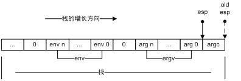
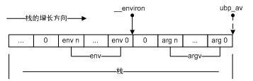
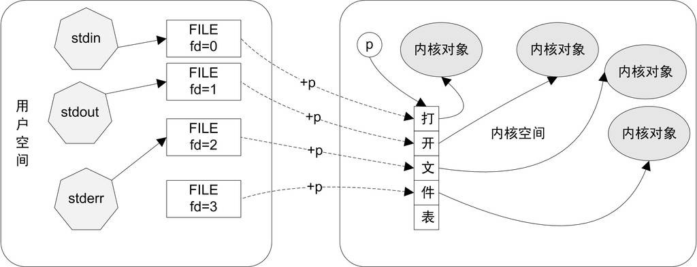
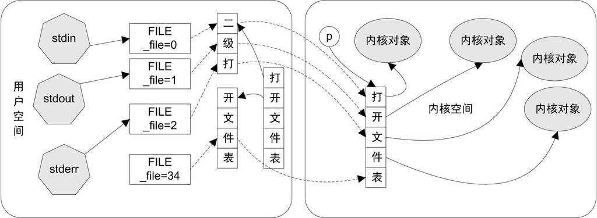
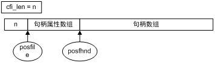

<h2>11.1 入口函式和程式初始化</h2>

11.1.1 程式從main開始嗎

正如基督徒認為世界的誕生起於7天創世一樣，任何一個合格的C/C++程式設計師都應該知道一個事實：程式從main函式開始。但是事情的真相真是如此嗎？如果你善於觀察，就會發現當程式執行到main函式的第一行時，很多事情都已經完成了：

【鐵證1】下面是一段C語言程式碼：

<pre>#include &lt;stdio.h&gt;
#include &lt;stdlib.h&gt;

int a = 3;

int main(int argc, char* argv[])
{
    int * p = (int *)malloc(sizeof(int));
    scanf("%d", p);
    printf("%d", a + *p);
    free(p);
}
</pre>

從程式碼中我們可以看到，在程式剛剛執行到main的時候，全域性變數的初始化過程已經結束了（a的值已經確定），main函式的兩個引數（argc和argv）也被正確傳了進來。此外，在你不知道的時候，堆和棧的初始化悄悄地完成了，一些系統I/O也被初始化了，因此可以放心地使用printf和malloc。

【鐵證2】而在C++裡，main之前能夠執行的程式碼還會更多，例如如下程式碼：

<pre>#include &lt;string&gt;
using namespace std;
string v;
double foo()
{
    return 1.0;
}

double g = foo();
int main(){}
</pre>

在這裡，物件v的建構函式，以及用於初始化全域性變數g的函式foo都會在main之前呼叫。

【鐵證3】atexit也是一個特殊的函式。atexit接受一個函式指標作為引數，並保證在程式正常退出（指從main裡返回或呼叫exit函式）時，這個函式指標指向的函式會被呼叫。例如：

<pre>void foo(void)
{
    printf("bye!\n");
}
int main()
{
    atexit(&amp;foo);
    printf("endof main\n");
}
</pre>

用atexit函式註冊的函式的呼叫時機是在main結束之後，因此這段程式碼的輸出是：

<pre>endof main
bye!
</pre>

所有這些事實都在為“main創論”提供不利的證據：作業系統載入程式之後，首先執行的程式碼並不是main的第一行，而是某些別的程式碼，這些程式碼負責準備好main函式執行所需要的環境，並且負責呼叫main函式，這時候你才可以在main函式裡放心大膽地寫各種程式碼：申請記憶體、使用系統呼叫、觸發異常、訪問I/O。在main返回之後，它會記錄main函式的返回值，呼叫atexit註冊的函式，然後結束程式。

執行這些程式碼的函式稱為入口函式或入口點（Entry Point），視平台的不同而有不同的名字。程式的入口點實際上是一個程式的初始化和結束部分，它往往是執行庫的一部分。一個典型的程式執行步驟大致如下：

作業系統在建立程式後，把控制權交到了程式的入口，這個入口往往是執行庫中的某個入口函式。

入口函式對執行庫和程式執行環境進行初始化，包括堆、I/O、執行緒、全域性變數構造，等等。

入口函式在完成初始化之後，呼叫main函式，正式開始執行程式主體部分。

main函式執行完畢以後，返回到入口函式，入口函式進行清理工作，包括全域性變數析構、堆銷毀、關閉I/O等，然後進行系統呼叫結束程式。

11.1.2 入口函式如何實現

大部分程式設計師在平時都接觸不到入口函式，為了對入口函式進行詳細的瞭解，本節我們將深入剖析glibc和MSVC的入口函式實現。

GLIBC入口函式

glibc的啟動過程在不同的情況下差別很大，比如靜態的glibc和動態的glibc的差別，glibc用於執行檔和用於共用函式庫的差別，這樣的差別可以組合出4種情況，這裡只選取最簡單的靜態glibc用於執行檔的時候作為例子，其他情況諸如共用函式庫的全域性物件構造和析構跟例子中稍有出入，我們在本書中不一一詳述了，有興趣的讀者可以根據這裡的介紹自己閱讀glibc和gcc的原始碼，相信能起到舉一反三的效果。下面所有關於Glibc和MSVC CRT的相關程式碼分析在不額外說明的情況下，都預設為靜態/執行檔連結的情況。

讀者可以免費下載到Linux下glibc的原始碼，在其中的子目錄libc/csu裡，有關於程式啟動的程式碼。glibc的程式入口為_start（這個入口是由ld連結器預設的連結指令碼所指定的，我們也可以透過相關引數設定自己的入口）。_start由組譯實現，並且和平台相關，下面可以單獨看i386的_start實現：

<pre>libc\sysdeps\i386\elf\Start.S:
_start:
    xorl %ebp, %ebp
    popl %esi
    movl %esp, %ecx

    pushl %esp
    pushl %edx    
    pushl $__libc_csu_fini
    pushl $__libc_csu_init
    pushl %ecx    
    pushl %esi    
    pushl main
    call __libc_start_main 

    hlt
</pre>

這裡省略了一些不重要的程式碼，可以看到<code>_start</code>函式最終呼叫了名為<code>__lib_start_main</code>的函式。加粗部分的程式碼是對該函式的完整呼叫過程，其中開始的7個壓棧指令用於給函式傳遞引數。在最開始的地方還有3條指令，它們的作用分別為：

<code>xor %ebp, %ebp</code>：這其實是讓ebp暫存器清零。xor的用處是把後面的兩個運算元異或，結果儲存在第一個運算元裡。這樣做的目的表明當前是程式的最外層函式。

<code>ebp</code>設為0正好可以體現出這個最外層函式的尊貴地位。

<code>pop %esi及mov %esp, %ecx</code>：在呼叫<code>_start</code>前，載入器會把使用者的引數和環境變數壓入棧中，按照其壓棧的方法，實際上棧頂的元素是argc，而接著其下就是argv和環境變數的陣列。圖11-1為此時的棧佈局，其中虛線箭頭是執行<code>pop %esi</code>之前的棧頂<code>（%esp</code>），而實線箭頭是執行之後的棧頂（%<code>esp</code>）。

 圖11-1 環境變數和引數陣列 …

<code>pop %esi</code>將argc存入了esi，而<code>mov %esp、%ecx</code>將棧頂地址（此時就是argv和環境變數（env）陣列的起始地址）傳給<code>%ecx</code>。現在<code>%esi</code>指向argc<code>，%ecx</code>指向argv及環境變數陣列。

綜合以上分析，我們可以把<code>_start</code>改寫為一段更具有可讀性的偽程式碼：

<pre>void _start()
{
    %ebp = 0;
    int argc = pop from stack
    char** argv = top of stack;
    __libc_start_main( main, argc, argv, __libc_csu_init, __libc_csu_fini, 
                       edx, top of stack );
}
</pre>

其中argv除了指向參數列外，還隱含緊接著環境變數表。這個環境變數表要在<code>__libc_start_main</code>裡從argv內提取出來。

環境變數

環境變數是存在於系統中的一些公用資料，任何程式都可以訪問。通常來說，環境變數儲存的都是一些系統的公共資訊，例如系統搜尋路徑，當前OS版本等。環境變數的格式為key=value的字串，C語言裡可以使用getenv這個函式來獲取環境變數資訊。

在Windows裡，可以直接在控制面板→系統→高階→環境變數查閱當前的環境變數，而在Linux下，直接在命令列裡輸入export即可。

實際執行程式碼的函式是<code>__libc_start_main</code>，由於程式碼很長，下面我們一段一段地看：

<pre>_start -&gt; __libc_start_main:

int __libc_start_main (
            int (*main) (int, char **, char **),
            int argc, 
            char * __unbounded *__unbounded ubp_av,
            __typeof (main) init,
            void (*fini) (void),
            void (*rtld_fini) (void), 
            void * __unbounded stack_end)
{
#if __BOUNDED_POINTERS__
    char **argv;
#else
# define argv ubp_av
#endif
      int result;
</pre>

這是<code>__libc_start_main</code>的函式頭部，可見和<code>_start</code>函式裡的呼叫一致，一共有7個引數，其中main由第一個引數傳入，緊接著是argc和argv（這裡稱為<code>ubp_av</code>，因為其中還包含了環境變數表）。除了main的函式指標之外，外部還要傳入3個函式指標，分別是：

<code>init</code>：main呼叫前的初始化工作。

<code>fini</code>：main結束後的收尾工作。

<code>rtld_fini</code>：和動態載入有關的收尾工作，rtld是runtime loader的縮寫。

最後的<code>stack_end</code>標明瞭棧底的地址，即最高的棧地址。

bounded pointer

GCC支援bounded型別指標（bounded指標用__bounded關鍵字標出，若預設為bounded指標，則普通指標用__unbounded標出），這種指標佔用3個指標的空間，在第一個空間裡儲存原指標的值，第二個空間裡儲存下限值，第三個空間裡儲存上限值。__ptrvalue、__ptrlow、__ptrhigh 分別返回這3個值，有了3個值以後，記憶體越界錯誤便很容易查出來了。 並且要定義__BOUNDED_POINTERS__這個宏才有作用，否則這3個宏定義是空的。

不過，盡管bounded指標看上去似乎很有用，但是這個功能卻在2003年被去掉了。因此現在所有關於bounded指標的關鍵字其實都是一個空的宏。鑒於此，我們接下來在討論libc程式碼時都預設不使用bounded指標（即不定義__BOUNDED_POINTERS__）。

接下來的程式碼如下：

<pre>char** ubp_ev = &amp;ubp_av[argc + 1];
INIT_ARGV_and_ENVIRON;
__libc_stack_end = stack_end;
</pre>

INIT_ARGV_and_ENVIRON這個宏定義於libc/sysdeps/generic/bp-start.h，展開後本段程式碼變為：

<pre>char** ubp_ev = &amp;ubp_av[argc + 1];
__environ = ubp_ev;
__libc_stack_end = stack_end;
</pre>

<pre>char** ubp_ev = &amp;ubp_av[argc + 1];
__environ = ubp_ev;
__libc_stack_end = stack_end;
</pre>

圖11-2實際上就是我們根據從<code>_start</code>原始碼分析得到的棧佈局，讓<code>__environ</code>指標指向原來緊跟在argv陣列之後的環境變數陣列。

 圖11-2 環境變數和引數陣列（2） …

圖11-2中實線箭頭代表<code>ubp_av</code>，而虛線箭頭代表<code>__environ</code>。另外這段程式碼還將棧底地址儲存在一個全域性變數裡，以留作它用。

為什麼要分兩步賦值給<code>__environ</code>呢？這又是為了相容bounded惹的禍。實際上，INIT_ARGV_and_ENVIRON根據bounded支援的情況有多個版本，以上僅僅是假定不支援bounded的版本。

接下來有另一個宏：

<pre>DL_SYSDEP_OSCHECK (__libc_fatal);</pre>

這是用來檢查作業系統的版本，宏的具體內容就不列出了。接下來的程式碼頗為繁雜，我們過濾掉大量資訊之後，將一些關鍵的函式呼叫列出：

<pre>__pthread_initialize_minimal();
__cxa_atexit(rtld_fini, NULL, NULL);
__libc_init_first (argc, argv, __environ);
__cxa_atexit(fini, NULL, NULL);
(*init)(argc, argv, __environ);
</pre>

這一部分進行了一連串的函式呼叫，注意到<code>__cxa_atexit</code>函式是glibc的內部函式，等同於atexit，用於將引數指定的函式在main結束之後呼叫。所以以引數傳入的fini和<code>rtld_fini</code>均是用於main結束之後呼叫的。在<code>__libc_start_main</code>的末尾，關鍵的是這兩行程式碼：

<pre>    result = main (argc, argv, __environ);
    exit (result);
}
</pre>

在最後，main函式終於被呼叫，並退出。然後我們來看看exit的實現：

<pre>_start -&gt; __libc_start_main -&gt; exit:

void exit (int status)
{
    while (__exit_funcs != NULL)
    {
        ...
        __exit_funcs = __exit_funcs-&gt;next;
    }
    ...
    _exit (status);
}
</pre>

其中<code>__exit_funcs</code>是儲存由<code>__cxa_atexit</code>和<code>atexit</code>註冊的函式的連結串列，而這裡的這個while迴圈則遍曆該連結串列並逐個呼叫這些註冊的函式，由於其中瑣碎程式碼過多，這裡就不具體列出了。最後的<code>_exit</code>函式由組譯實現，且與平台相關，下面列出i386的實現：

<pre>_start -&gt; __libc_start_main -&gt; exit -&gt; _exit:

_exit:
    movl    4(%esp), %ebx
    movl    $__NR_exit, %eax
    int     $0x80
    hlt
</pre>

可見<code>_exit</code>的作用僅僅是呼叫了exit這個系統呼叫。也就是說<code>，_exit</code>呼叫後，程式就會直接結束。程式正常結束有兩種情況，一種是main函式的正常返回，一種是程式中用exit退出。在<code>__libc_start_main</code>裡我們可以看到，即使main返回了，exit也會被呼叫。exit是程式正常退出的必經之路，因此把呼叫用atexit註冊的函式的任務交給exit來完成可以說萬無一失。

我們看到在<code>_start</code>和<code>_exit</code>的末尾都有一個hlt指令，這是作什麼用的呢？在Linux裡，程式必須使用exit系統呼叫結束。一旦exit被呼叫，程式的執行就會終止，因此實際上<code>_exit</code>末尾的hlt不會執行，從而<code>__libc_start_main</code>永遠不會返回，以至<code>_start</code>末尾的hlt指令也不會執行。_exit裡的hlt指令是為了檢測exit系統呼叫是否成功。如果失敗，程式就不會終止，hlt指令就可以發揮作用強行把程式給停下來。而_<code>start</code>裡的hlt的用處也是如此，但是為了預防某種沒有呼叫exit（這裡指的不是exit系統呼叫）就回到<code>_start</code>的情況（例如有人誤刪了<code>__libc_main_start</code>末尾的exit）。

MSVC CRT入口函式

相信讀者對glibc的入口函式已經有了一些瞭解。但可惜的是glibc的入口函式書寫得不是非常直觀。事實上，我們也沒從glibc的入口函式瞭解到多少內容。為了從另一面看世界，我們再來看看Windows下的執行庫的實現細節。下面是Microsoft Visual Studio 2003裡crt0.c（位於VC安裝目錄的crt\src）的一部分。這裡也刪除了一些條件編譯的程式碼，留下了比較重要的部分。MSVC的CRT預設的入口函式名為mainCRTStartup：

<pre>int mainCRTStartup(void)
{
    ...
</pre>

這是入口函式的頭部。下面的程式碼出現於該函式的開頭，顯得雜亂無章。不過其中關鍵的內容是給一係列變數賦值：

<pre>posvi = (OSVERSIONINFOA *)_alloca(sizeof(OSVERSIONINFOA));
    posvi-&gt;dwOSVersionInfoSize = sizeof(OSVERSIONINFOA);
    
    GetVersionExA(posvi);
    _osplatform = posvi-&gt;dwPlatformId;
    _winmajor = posvi-&gt;dwMajorVersion;
    _winminor = posvi-&gt;dwMinorVersion;
    _osver = (posvi-&gt;dwBuildNumber) &amp; 0x07fff;

    if ( _osplatform != VER_PLATFORM_WIN32_NT )
        _osver |= 0x08000;

    _winver = (_winmajor &lt;&lt; 8) + _winminor;
</pre>

被賦值的這些變數，是VC7裡面預定義的一些全域性變數，其中<code>_osver</code>和<code>_winver</code>表示作業系統的版本<code>，_winmajor</code>是主版本號，更具體的可以查閱MSDN。這段程式碼透過呼叫GetVersionExA（這是一個Windows API）來獲得當前的作業系統版本資訊，並且賦值給各個全域性變數。

為什麼這裡為posvi分配記憶體不使用malloc而使用alloca呢？是因為在程式的一開始堆還沒有被初始化，而alloca是唯一可以不使用堆的動態分配機制。alloca可以在棧上分配任意大小的空間（只要棧的大小允許），並且在函式返回的時候會自動釋放，就好像區域性變數一樣。

由於沒有初始化堆，所以很多事情沒法做，當務之急是趕緊把堆先初始化了：

<pre>if ( !_heap_init(0) )            
      fast_error_exit(_RT_HEAPINIT);  
</pre>

這裡使用<code>_heap_init</code>函式對堆（heap）進行了初始化，如果堆初始化失敗，那麼程式就直接退出了。

<pre>__try {
        if ( _ioinit() &lt; 0 )
            _amsg_exit(_RT_LOWIOINIT);

        _acmdln = (char *)GetCommandLineA();
        _aenvptr = (char *)__crtGetEnvironmentStringsA();

        if ( _setargv() &lt; 0 )
            _amsg_exit(_RT_SPACEARG);

        if ( _setenvp() &lt; 0 )
            _amsg_exit(_RT_SPACEENV);

        initret = _cinit(TRUE);       

        if (initret != 0)
                _amsg_exit(initret);
        __initenv = _environ;

        mainret = main(__argc, __argv, _environ);

        _cexit();
    }
__except ( _XcptFilter(GetExceptionCode(), GetExceptionInformation()) )
    {
        mainret = GetExceptionCode();
        _c_exit();
    } /* end of try - except */
    return mainret;
}
</pre>

這裡是一個Windows的SEH的try-except塊，裡面做了什麼呢？首先使用<code>_ioinit</code>函式初始化了I/O，接下來這段程式碼呼叫了一係列函式進行各種初始化，包括：

<code>_setargv</code>：初始化main函式的argv引數。

<code>_setenv</code>：設定環境變數。

<code>_cinit</code>：其他的C庫設定。

在最後，可以看到函式呼叫了main函式並獲得了其返回值。try-except塊的except部分是最後的清理階段，如果try塊裡的程式碼發生異常，則在這裡進行錯誤處理。最後退出並返回main的返回值。

try-except塊

try-except塊是Windows結構化異常處理機制SEH的一部分。try-except塊的使用方法如下：

<pre>__try {
    code 1
}
__except(...) {
    code 2
}
</pre>

當code 1出現異常（段錯誤等）的時候，except部分的code 2會執行以異常處理。更為詳細的資訊請查閱MSDN。

總結一下，這個mainCRTStartup的總體流程就是：

（1）初始化和OS版本有關的全域性變數。

（2）初始化堆。

（3）初始化I/O。

（4）獲取命令列引數和環境變數。

（5）初始化C庫的一些資料。

（6）呼叫main並記錄返回值。

（7）檢查錯誤並將main的返回值返回。

事實上還是MSVC的入口函式的思路較為清晰。在第13章裡，我們將仿照VC入口函式的思路實現一個Linux下的簡易入口函式。

Q&amp;A

Q：msvc的入口函式使用了alloca，它是如何實現的。

A：alloca函式的特點是它能夠動態地在棧上分配記憶體，在函式退出時如同區域性變數一樣自動釋放。結合之前我們介紹的函式標準進入和退出指令序列就知道，函式退出時的退棧操作是直接將ESP的值賦為EBP的值。因此不管在函式的執行過程中ESP減少了多少，最後也能夠成功地將函式執行時分配的所有棧空間回收。在這個基礎上，alloca的實現就非常簡單，僅僅是將ESP減少一定數值而已。

Q：為什麼MSVC的Win32程式的入口使用的是WinMain？

A：WinMain和main一樣，都不是程式的實際入口。MSVC的程式入口是同一段程式碼，但根據不同的編譯引數被編譯成了不同的版本。不同版本的入口函式在其中會呼叫不同名字的函式，包括main/wmain/WinMain/wWinMain等。

11.1.3 執行庫與I/O

在瞭解了glibc和MSVC的入口函式的基本思路之後，讓我們來深入瞭解各個初始化部分的具體實現。但在具體瞭解初始化之前，我們要先了解一個重要的概念：I/O。

IO（或I/O）的全稱是Input/Output，即輸入和輸出。對於計算機來說，I/O代表了計算機與外界的互動，互動的物件可以是人或其他裝置（如圖11-3所示）。

 圖11-3 計算機的I/O裝置 …

而對於程式來說，I/O涵蓋的範圍還要寬廣一些。一個程式的I/O指代了程式與外界的互動，包括檔案、管道、網路、命令列、訊號等。更廣義地講，I/O指代任何作業系統理解為“檔案”的事務。許多作業系統，包括Linux和Windows，都將各種具有輸入和輸出概念的實體——包括裝置、磁碟檔案、命令列等——統稱為檔案，因此這裡所說的檔案是一個廣義的概念。

對於一個任意型別的檔案，作業系統會提供一組操作函式，這包括開啟檔案、讀檔案、寫檔案、移動檔案指標等，相信有程式設計經驗的讀者對此都不會陌生。有過C程式設計經驗的讀者應該知道，C語言檔案操作是透過一個FILE結構的指標來進行的。fopen函式返回一個FILE結構的指標，而其他的函式如fwrite使用這個指標操作檔案。使用檔案的最簡單程式碼如下：

<pre>#include &lt;stdio.h&gt;

int main(int argc,char** argv)
{
    FILE* f = fopen( "test.dat", "wb" );
    if( f == NULL )
        Return -1;
    fwrite( "123", 3, 1, f );
    fclose(f);
        return 0;
}
</pre>

在作業系統層面上，檔案操作也有類似於FILE的一個概念，在Linux裡，這叫做檔案描述符（File Descriptor），而在Windows裡，叫做控制代碼（Handle）（以下在沒有歧義的時候統稱為控制代碼）。使用者透過某個函式開啟檔案以獲得控制代碼，此後使用者操縱檔案皆透過該控制代碼進行。

設計這麼一個控制代碼的原因在於控制代碼可以防止使用者隨意讀寫作業系統核心的檔案物件。無論是Linux還是Windows，檔案控制代碼總是和核心的檔案物件相關聯的，但如何關聯細節使用者並不可見。核心可以透過控制代碼來計算出核心裡檔案物件的地址，但此能力並不對使用者開放。

下面舉一個實際的例子，在Linux中，值為0、1、2的fd分別代表標準輸入、標準輸出和標準錯誤輸出。在程式中開啟檔案得到的fd從3開始增長。fd具體是什麼呢？在核心中，每一個程式都有一個私有的“開啟檔案表”，這個表是一個指標陣列，每一個元素都指向一個核心的開啟檔案物件。而fd，就是這個表的下標。當使用者開啟一個檔案時，核心會在內部生成一個開啟檔案物件，並在這個表裡找到一個空項，讓這一項指向生成的開啟檔案物件，並返回這一項的下標作為fd。由於這個表處於核心，並且使用者無法訪問到，因此使用者即使擁有fd，也無法得到開啟檔案物件的地址，只能夠透過系統提供的函式來操作。

在C語言裡，操縱檔案的渠道則是FILE結構，不難想象，C語言中的FILE結構必定和fd有一對一的關係，每個FILE結構都會記錄自己唯一對應的fd。

FILE、fd、開啟檔案表和開啟檔案物件的關係如圖11-4所示。

 圖11-4 FILE結構、fd和核心物件 …

圖11-4中，核心指標p指向該程式的開啟檔案表，所以只要有fd，就可以用fd+p來得到開啟檔案表的某一項地址。stdin、stdout、stderr均是FILE結構的指標。

對於Windows中的控制代碼，與Linux中的fd大同小異，不過Windows的控制代碼並不是開啟檔案表的下標，而是其下標經過某種線性變換之後的結果。

在大致瞭解了I/O為何物之後，我們就能知道I/O初始化的職責是什麼了。首先I/O初始化函式需要在使用者空間中建立stdin、stdout、stderr及其對應的FILE結構，使得程式進入main之後可以直接使用printf、scanf等函式。

11.1.4 MSVC CRT的入口函式初始化

系統堆初始化

MSVC的入口函式初始化主要包含兩個部分，堆初始化和I/O初始化。MSVC的堆初始化由函式_heap_init完成，這個函式的定義位於heapinit.c，大致的程式碼如下（刪去了64位系統的條件編譯部分）：

<pre>mainCRTStartup -&gt; _heap_init()：

HANDLE _crtheap = NULL;

int _heap_init (int mtflag)
{
    if ( (_crtheap = HeapCreate( mtflag ? 0 : HEAP_NO_SERIALIZE, 
        BYTES_PER_PAGE, 0 )) == NULL )
        return 0;

    return 1;
}
</pre>

在32位的編譯環境下，MSVC的堆初始化過程出奇地簡單，它僅僅呼叫了HeapCreate這個API建立了一個系統堆。因此不難想象，MSVC的malloc函式必然是呼叫了HeapAlloc這個API，將堆管理的過程直接交給了作業系統。

I/O初始化

I/O初始化相對於堆的初始化則要複雜很多。首先讓我們來看看MSVC中，FILE結構的定義（FILE結構實際定義在C語言標準中並未指出，因此不同的版本可能有不同的實現）：

<pre>struct _iobuf {
    char *_ptr;
    int   _cnt;
    char *_base;
    int   _flag;
    int   _file;
    int   _charbuf;
    int   _bufsiz;
    char *_tmpfname;
    };
typedef struct _iobuf FILE;
</pre>

這個FILE結構中最重要的一個欄位是<code>_file</code><code>，_file</code>是一個整數，透過<code>_file</code>可以訪問到內部檔案控制代碼表中的某一項。在Windows中，使用者態使用控制代碼（Handle）來訪問核心檔案物件，控制代碼本身是一個32位的資料型別，在有些場合使用int來儲存，有些場合使用指標來表示。

在MSVC的CRT中，已經開啟的檔案控制代碼的資訊使用資料結構ioinfo來表示：

<pre>typedef struct {
    intptr_t osfhnd;
    char osfile;
    char pipech;
}   ioinfo;
</pre>

在這個結構中，osfhnd欄位即為開啟檔案的控制代碼，這裡使用8位元組整數型別<code>intptr_t</code>來儲存。另外osfile的意義為檔案的開啟屬性。而pipech欄位則為用於管道的單字元緩衝，這裡可以先忽略。osfile的值可由一係列值用按位或的方式得出：

FOPEN(0x01)控制代碼被開啟。

FEOFLAG(0x02)已到達檔案末尾。

FCRLF(0x04)在文字模式中，行緩衝已遇到回車符（見第11.2.2節）。

FPIPE(0x08)管道檔案。

FNOINHERIT(0x10)控制代碼開啟時具有屬性_O_NOINHERIT（不遺傳給子程式）。

FAPPEND(0x20)控制代碼開啟時具有屬性O_APPEND（在檔案末尾追加資料）。

FDEV(0x40)裝置檔案。

FTEXT(0x80)檔案以文字模式開啟。

在crt/src/ioinit.c中，有一個陣列：

<pre>int _nhandle;
ioinfo * __pioinfo[64]; // 等效於ioinfo __pioinfo[64][32];
</pre>

這就是使用者態的開啟檔案表。這個表實際是一個二維陣列，第二維的大小為32個ioinfo結構，因此該表總共可以容納的元素總量為64 * 32 = 2048個控制代碼。此外<code>_nhandle</code>記錄該表的實際元素個數。之所以使用指標陣列而不是二維陣列的原因是使用指標陣列更加節省空間，而如果使用二維陣列，則不論程式裡開啟了幾個檔案都必須始終消耗2048個ioinfo的空間。

FILE結構中的<code>_file</code>的值，和此表的兩個下標直接相關聯。當我們要訪問檔案時，必須從FILE結構轉換到作業系統的控制代碼。從一個FILE*結構得到檔案控制代碼可以透過一個叫做<code>_osfhnd</code>的宏，當然這個宏是CRT內部使用的，並不推薦使用者使用<code>。_osfhnd</code>的定義為：

<pre>#define _osfhnd(i)  ( _pioinfo(i)-&gt;osfhnd )</pre>

其中宏函式<code>_pioinfo</code>的定義是：

<pre>#define _pioinfo(i) ( __pioinfo[(i) &gt;&gt; 5] + ((i) &amp; ((1 &lt;&lt; 5) -  1)) )</pre>

FILE結構的<code>_file</code>欄位的意義可以從<code>_pioinfo</code>的定義裡看出，透過<code>_file</code>得到開啟檔案表的下標變換為：

FILE：_file的第5位到第10位是第一維坐標（共6位），_file的第0位到第4位是第二維坐標（共5位）。

這樣就可以透過簡單的位運算來從FILE結構得到內部控制代碼。透過這我們可以看出，MSVC的I/O內部結構和之前介紹的Linux的結構有些不同，如圖11-5所示。

 圖11-5 Windows的FILE、控制代碼和核心物件 …

MSVC的I/O初始化就是要構造這個二維的開啟檔案表。MSVC的I/O初始化函式<code>_ioinit</code>定義於crt/src/ioinit.c中。首先<code>，_ioinit</code>函式初始化了<code>__pioinfo</code>陣列的第一個二級陣列：

<pre>mainCRTStartup -&gt; _ioinit()：

if ( (pio = _malloc_crt( 32 * sizeof(ioinfo) ))
             == NULL )
{
    return -1;
}

__pioinfo[0] = pio;
_nhandle = 32;
for ( ; pio &lt; __pioinfo[0] + 32 ; pio++ ) {
    pio-&gt;osfile = 0;
    pio-&gt;osfhnd = (intptr_t)INVALID_HANDLE_VALUE;
    pio-&gt;pipech = 10;
}
</pre>

在這裡<code>_ioinit</code>初始化了的<code>__pioinfo[0]</code>裡的每一個元素為無效值，其中 <code>INVALID_ HANDLE_VALUE</code>是Windows控制代碼的無效值，值為?1。接下來，_ioinit的工作是將一些預定義的開啟檔案給初始化，這包括兩部分：

（1）從父程式繼承的開啟檔案控制代碼，當一個程式呼叫API建立新程式的時候，可以選擇繼承自己的開啟檔案控制代碼，如果繼承，子程式可以直接使用父程式的開啟檔案控制代碼。

（2）作業系統提供的標準輸入輸出。

應用程式可以使用API GetStartupInfo來獲取繼承的開啟檔案，GetStartupInfo的引數如下：

<pre>void GetStartupInfo(STARTUPINFO* lpStartupInfo);</pre>

STARTUPINFO是一個結構，呼叫GetStartupInfo之後，該結構就會被寫入各種程式啟動相關的資料。在該結構中，有兩個保留欄位為：

<pre>typedef struct _STARTUPINFO {
    ……
    WORD cbReserved2;
    LPBYTE lpReserved2;
    ……
} STARTUPINFO;
</pre>

這兩個欄位的用途沒有正式的文件說明，但實際是用來傳遞繼承的開啟檔案控制代碼。當這兩個欄位的值都不為0時，說明父程式遺傳了一些開啟檔案控制代碼。作業系統是如何使用這兩個欄位傳遞控制代碼的呢？首先lpReserved2欄位實際是一個指標，指向一塊記憶體，這塊記憶體的結構如下：

位元組[0,3]：傳遞控制代碼的數量n。

位元組[4, 3+n]：每一個控制代碼的屬性（各1位元組，表明控制代碼的屬性，同ioinfo結構的<code>_osfile</code>欄位）。

位元組[4+n之後]：每一個控制代碼的值（n個<code>intptr_t</code>型別資料，同ioinfo結構的<code>_osfhnd</code>欄位）。

<code>_ioinit</code>函式使用如下程式碼獲取各個控制代碼的資料：

<pre>cfi_len = *(__unaligned int *)(StartupInfo.lpReserved2);
posfile = (char *)(StartupInfo.lpReserved2) + sizeof( int );
posfhnd = (__unaligned intptr_t *)(posfile + cfi_len);
</pre>

其中<code>__unaligned</code>關鍵字告訴編譯器該指標可能指向一個沒有進行資料對齊的地址，編譯器會插入一些程式碼來避免發生資料未對齊而產生的錯誤。這段程式碼執行之後，lpReserved2指向的資料結構會被兩個指標分別指向其中的兩個陣列，如圖11-6所示。

 圖11-6 控制代碼屬性陣列和控制代碼陣列 …

接下來<code>_ioinit</code>就要將這些資料填入自己的開啟檔案表中。當然，首先要判斷直接的開啟檔案表是否足以容納所有的控制代碼：

<pre>cfi_len = __min( cfi_len, 32 * 64 );</pre>

然後要給開啟檔案表分配足夠的空間以容納所有的控制代碼：

<pre>for ( i = 1 ; _nhandle &lt; cfi_len ; i++ ) {
    if ( (pio = _malloc_crt( 32 * sizeof(ioinfo) )) == NULL )
    {
        cfi_len = _nhandle;
        break;
    }
    __pioinfo[i] = pio;
    _nhandle += 32;
    for ( ; pio &lt; __pioinfo[i] + 32 ; pio++ ) {
        pio-&gt;osfile = 0;
        pio-&gt;osfhnd = (intptr_t)INVALID_HANDLE_VALUE;
        pio-&gt;pipech = 10;
    }
}
</pre>

在這裡，nhandle總是等於已經分配的元素數量，因此只需要每次分配一個第二維的陣列，直到nhandle大於<code>cfi_len</code>即可。由於<code>__pioinfo[0]</code>已經預先分配了，因此直接從<code>__pioinfo[1]</code>開始分配即可。分配了空間之後，將資料填入就很容易了：

<pre>for ( fh = 0 ; fh &lt; cfi_len ; fh++, posfile++, posfhnd++ ) 
{
    if ( (*posfhnd != (intptr_t)INVALID_HANDLE_VALUE) &amp;&amp;
               (*posfile &amp; FOPEN) &amp;&amp;
               ((*posfile &amp; FPIPE) ||
               (GetFileType( (HANDLE)*posfhnd ) != 
            FILE_TYPE_UNKNOWN)) )
    {
        pio = _pioinfo( fh );
        pio-&gt;osfhnd = *posfhnd;
        pio-&gt;osfile = *posfile;
    }
}
</pre>

在這個迴圈中，fh從0開始遞增，每次透過<code>_pioinfo</code>宏來轉換為開啟檔案表中連續的對應元素，而posfile和posfhnd則依次遞增以遍曆每一個控制代碼的資料。在複製的過程中，一些不符合條件的控制代碼會被過濾掉，例如無效的控制代碼，或者不屬於開啟檔案及管道的控制代碼，或者未知型別的控制代碼。

這段程式碼執行完成之後，繼承來的控制代碼就全部複製完畢。接下來還需要初始化標準輸入輸出。當繼承控制代碼的時候，有可能標準輸入輸出（fh=0,1,2）已經被繼承了，因此在初始化前首先要先檢驗這一點，程式碼如下：

<pre>for ( fh = 0 ; fh &lt; 3 ; fh++ ) 
{
    pio = __pioinfo[0] + fh;

    if ( pio-&gt;osfhnd == (intptr_t)INVALID_HANDLE_VALUE ) 
    {
        pio-&gt;osfile = (char)(FOPEN | FTEXT);
        if ( ((stdfh = (intptr_t)GetStdHandle( stdhndl(fh) ))
                != (intptr_t)INVALID_HANDLE_VALUE) 
                &amp;&amp; ((htype =GetFileType( (HANDLE)stdfh )) 
                != FILE_TYPE_UNKNOWN) )
        {
            pio-&gt;osfhnd = stdfh;
            if ( (htype &amp; 0xFF) == FILE_TYPE_CHAR )
                pio-&gt;osfile |= FDEV;
            else if ( (htype &amp; 0xFF) == FILE_TYPE_PIPE )
                pio-&gt;osfile |= FPIPE;
        }
        else {
            pio-&gt;osfile |= FDEV;
        }
    }
    else  {
        pio-&gt;osfile |= FTEXT;
    }
}
</pre>

如果序號為0、1、2的控制代碼是無效的（沒有繼承自父程式），那麼<code>_ioinit</code>會使用GetStdHandle函式獲取預設的標準輸入輸出控制代碼。此外<code>，_ioinit</code>還會使用GetFileType來獲取該預設控制代碼的型別，給<code>_osfile</code>設定對應的值。

在處理完標準資料輸出的控制代碼之後，I/O初始化工作就完成了。我們可以看到，MSVC的I/O初始化主要進行了如下幾個工作：

建立開啟檔案表。

如果能夠繼承自父程式，那麼從父程式獲取繼承的控制代碼。

初始化標準輸入輸出。

在I/O初始化完成之後，所有的I/O函式就都可以自由使用了。在本節中，我們介紹了入口函式最重要的兩個部分，堆初始化和I/O初始化，相信讀者對程式的啟動部分已經有了較深的理解。不過，入口函式只是冰山一角，它隸屬的是一個龐大的程式碼集合。這個程式碼集合叫做執行庫。

