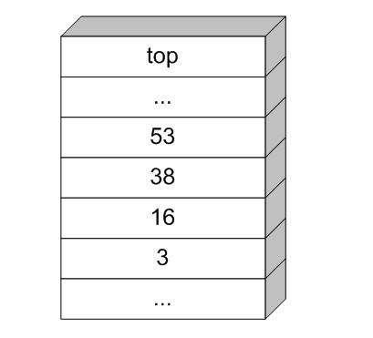
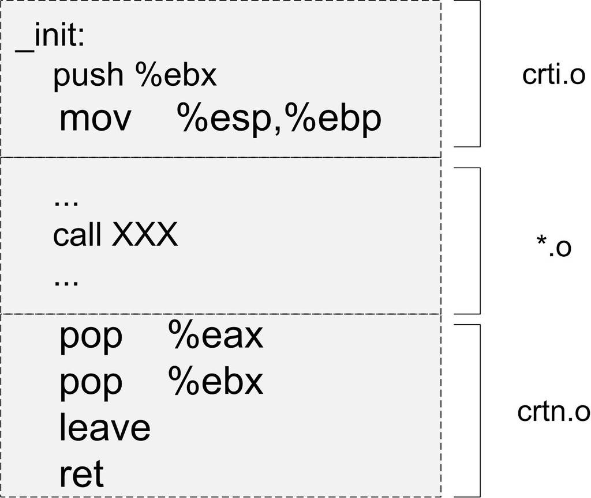
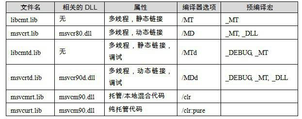
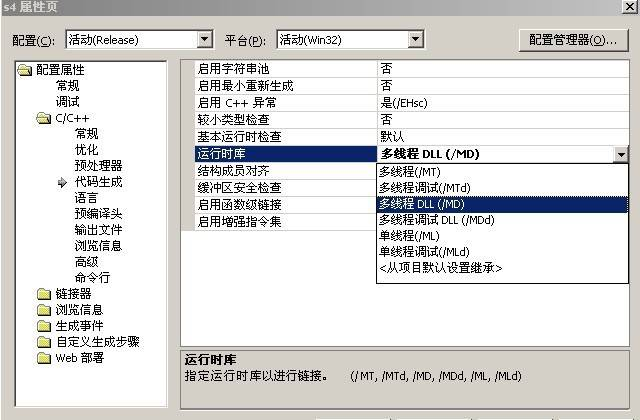
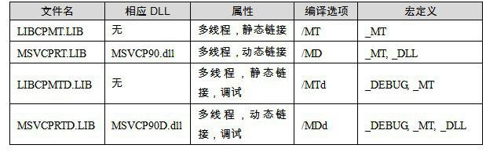

<h2>11.2 C/C++執行庫</h2>

11.2.1 C語言執行庫

任何一個C程式，它的背後都有一套龐大的程式碼來進行支撐，以使得該程式能夠正常執行。這套程式碼至少包括入口函式，及其所依賴的函式所構成的函式集合。當然，它還理應包括各種標準庫函式的實現。

這樣的一個程式碼集合稱之為執行時庫（Runtime Library）。而C語言的執行庫，即被稱為C執行庫（CRT）。

如果讀者擁有Visual Studio，可以在VC/crt/src裡找到一份C語言執行庫的原始碼。然而，由於此原始碼過於龐大，僅僅.c檔案就有近千個，並且和C++的STL程式碼一起毫無組織地堆放在一起，以至於實際上沒有什麼仔細閱讀的可能性。同樣，Linux下的libc原始碼讀起來也如同啃磚頭。所幸的是，在本章的最後，我們會一起來實現一個簡單的執行庫，讓大家更直觀地瞭解它。

一個C語言執行庫大致包含了如下功能：

啟動與退出：包括入口函式及入口函式所依賴的其他函式等。

標準函式：由C語言標準規定的C語言標準庫所擁有的函式實現。

I/O：I/O功能的封裝和實現，參見上一節中I/O初始化部分。

堆：堆的封裝和實現，參見上一節中堆初始化部分。

語言實現：語言中一些特殊功能的實現。

除錯：實現除錯功能的程式碼。

在這些執行庫的組成成分中，C語言標準庫佔據了主要地位並且大有來頭。C語言標準庫是C語言標準化的基礎函式庫，我們平時使用的printf、exit等都是標準庫中的一部分。標準庫定義了C語言中普遍存在的函式集合，我們可以放心地使用標準庫中規定的函式而不用擔心在將程式碼移植到別的平台時對應的平台上不提供這個函式。在下一章節裡，我們會介紹C語言標準庫的函式集合，並對一些特殊的函式集合進行詳細介紹。

標準庫的歷史

在計算機世界的歷史中，C語言在AT&amp;T的貝爾實驗室誕生了。初生的C語言在功能上非常不完善，例如不提供I/O相關的函式。因此在C語言的發展過程中，C語言社群共同意識到建立一個基礎函式庫的必要性。與此同時，在20世紀70年代C語言變得非常流行時，許多大學、公司和組織都自發地編寫自己的C語言變種和基礎函式庫，因此當到了80年代時，C語言已經出現了大量的變種和多種不同的基礎函式庫，這對程式碼遷移等方面造成了巨大的障礙，許多大學、公司和組織在共享程式碼時為了將程式碼在不同的C語言變種之間移植搞得焦頭爛額，怨聲載道。於是對此慘狀忍無可忍的美國國家標準協會（American National Standards Institute, ANSI）在1983年成立了一個委員會，旨在對C語言進行標準化，此委員會所建立的C語言標準被稱為ANSI C。第一個完整的C語言標準建立於1989年，此版本的C語言標準稱為C89。在C89標準中，包含了C語言基礎函式庫，由C89指定的C語言基礎函式庫就稱為ANSI C標準執行庫（簡稱標準庫）。其後在1995年C語言標準委員會對C89標準進行了一次修訂，在此次修訂中，ANSI C標準庫得到了第一次擴充，標頭檔iso646.h、wchar.h和wctype.h加入了標準庫的大家庭。在1999年，C99標準誕生，C語言標準庫得到了進一步的擴充，標頭檔complex.h、fenv.h、inttypes.h、stdbool.h、stdint.h和tgmath.h進入標準庫。自此，C語言標準庫的面貌一直延續至今。

11.2.2 C語言標準庫

在本章節裡，我們將介紹C語言標準庫的基本函式集合，並對其中一些特殊函式進行詳細的介紹。ANSI C的標準庫由24個C標頭檔組成。與許多其他語言（如Java）的標準庫不同，C語言的標準庫非常輕量，它僅僅包含了數學函式、字元/字串處理，I/O等基本方面，例如：

標準輸入輸出（stdio.h）。

檔案操作（stdio.h）。

字元操作（ctype.h）。

字串操作（string.h）。

數學函式（math.h）。

資源管理（stdlib.h）。

格式轉換（stdlib.h）。

時間/日期（time.h）。

斷言（assert.h）。

各種型別上的常數（limits.h &amp; float.h）。

除此之外，C語言標準庫還有一些特殊的庫，用於執行一些特殊的操作，例如：

變長引數（stdarg.h）。

非區域性跳轉（setjmp.h）。

相信常見的C語言函式讀者們都已經非常熟悉，因此這裡就不再一一介紹，接下來讓我們看看兩組特殊函式的細節。

1. 變長引數

變長引數是C語言的特殊引數形式，例如如下函式宣告：

<pre>int printf(const char* format, ...);</pre>

如此的宣告表明，printf函式除了第一個引數型別為<code>const char*</code>之外，其後可以追加任意數量、任意型別的引數。在函式的實現部分，可以使用stdarg.h裡的多個宏來訪問各個額外的引數：假設lastarg是變長引數函式的最後一個具名引數（例如printf裡的format），那麼在函式內部定義型別為<code>va_list</code>的變數：

<pre>va_list ap;</pre>

該變數以後將會依次指向各個可變引數。ap必須用宏<code>va_start</code>初始化一次，其中<code>lastarg</code>必須是函式的最後一個具名的引數。

<pre>va_start(ap, lastarg);</pre>

此後，可以使用<code>va_arg</code>宏來獲得下一個不定引數（假設已知其型別為type）：

<pre>type next = va_arg(ap, type);</pre>

在函式結束前，還必須用宏<code>va_end</code>來清理現場。在這裡我們可以討論這幾個宏的實現細節。在研究這幾個宏之前，我們要先了解變長引數的實現原理。變長引數的實現得益於C語言預設的cdecl呼叫慣例的自右向左壓棧傳遞方式。設想如下的函式：

<pre>int sum(unsigned num, ...);</pre>

其語義如下：

第一個引數傳遞一個整數num，緊接著後面會傳遞num個整數，返回num個整數的和。

當我們呼叫：

<pre>int n = sum(3, 16, 38, 53);</pre>

引數在棧上會形成如圖11-7所示的佈局。

 圖11-7 函式引數在棧上分佈 …

在函式內部，函式可以使用名稱num來訪問數字3，但無法使用任何名稱訪問其他的幾個不定引數。但此時由於棧上其他的幾個引數實際恰好依序排列在引數num的高地址方向，因此可以很簡單地透過num的地址計算出其他引數的地址。sum函式的實現如下：

<pre>int sum(unsigned num, ...)
{
    int* p = &amp;num + 1;
    int ret = 0;
    while (num--)
        ret += *p++;
    return ret;
}
</pre>

在這裡我們可以觀察到兩個事實：

（1）sum函式獲取引數的量僅取決於num引數的值，因此，如果num引數的值不等於實際傳遞的不定引數的數量，那麼sum函式可能取到錯誤的或不足的引數。

（2）cdecl呼叫慣例保證了引數的正確清除。我們知道有些呼叫慣例（如stdcall）是由被呼叫方負責清除堆疊的引數，然而，被呼叫方在這裡其實根本不知道有多少引數被傳遞進來，所以沒有辦法清除堆疊。而cdecl恰好是呼叫方負責清除堆疊，因此沒有這個問題。

printf的不定引數比sum要複雜得多，因為printf的引數不僅數量不定，而且型別也不定。所以printf需要在格式字串中註明引數的型別，例如用<code>%d</code>表明是一個整數。printf裡的格式字串如果將型別描述錯誤，因為不同引數的大小不同，不僅可能導致這個引數的輸出錯誤，還有可能導致其後的一係列引數錯誤。

【小實驗】

printf的狂亂輸出

<pre>#include &lt;stdio.h&gt;

int main()
{
    printf("%lf\t%d\t%c\n", 1, 666, 'a');
}
</pre>

在這個程式裡，printf的第一個輸出引數是一個int（4位元組），而我們告訴printf它是一個double（8位元組以上），因此printf的輸出會錯誤，由於printf在讀取double的時候實際造成了越界，因此後面幾個引數的輸出也會失敗。該程式的實際輸出為（根據實際編譯器和環境可能不同）：

0.000000 97 '

下面讓我們來看va_list等宏應該如何實現。

<code>va_list</code>實際是一個指標，用來指向各個不定引數。由於型別不明，因此這個<code>va_list</code>以<code>void*</code>或<code>char*</code>為最佳選擇。

<code>va_start</code>將<code>va_list</code>定義的指標指向函式的最後一個引數後面的位置，這個位置就是第一個不定引數。

<code>va_arg</code>獲取當前不定引數的值，並根據當前不定引數的大小將指標移向下一個引數。

<code>va_end</code>將指標清0。

按照以上思路，va係列宏的一個最簡單的實現就可以得到了，如下所示：

<pre>#define va_list char*
#define va_start(ap,arg) (ap=(va_list)&amp;arg+sizeof(arg))
#define va_arg(ap,t) (*(t*)((ap+=sizeof(t))-sizeof(t)))
#define va_end(ap) (ap=(va_list)0)
</pre>

【小提示】

變長引數宏

在很多時候我們希望在定義宏的時候也能夠像print一樣可以使用變長引數，即宏的引數可以是任意個，這個功能可以由編譯器的變長引數宏實現。在GCC編譯器下，變長引數宏可以使用“##”宏字串連線操作實現，比如：

<pre>#define printf(args…) fprintf(stdout, ##args)</pre>

而在MSVC下，我們可以使用__VA_ARGS__這個編譯器內建宏，比如：

<pre>#define printf(…) fprintf(stdout,__VA_ARGS__)</pre>

它的效果與前面的GCC下使用##的效果一樣。

2. 非區域性跳轉

非區域性跳轉即使在C語言裡也是一個備受爭議的機制。使用非區域性跳轉，可以實現從一個函式體內向另一個事先登記過的函式體內跳轉，而不用擔心堆疊混亂。下面讓我們來看一個示例：

<pre>#include &lt;setjmp.h&gt;
#include &lt;stdio.h&gt;
jmp_buf b;
void f()
{
    longjmp(b, 1);
}
int main()
{
    if (setjmp(b))
        printf("World!");
    else
    {
        printf("Hello ");
        f();
    }
}
</pre>

這段程式碼按常理不論setjmp返回什麼，也只會列印出“Hello ”和“World！”之一，然而事實上的輸出是：

Hello World!

實際上，當setjmp正常返回的時候，會返回0，因此會列印出“Hello ”的字樣。而longjmp的作用，就是讓程式的執行流回到當初setjmp返回的時刻，並且返回由longjmp指定的返回值（longjmp的引數2），也就是1，自然接著會列印出“World！”並退出。換句話說，longjmp可以讓程式“時光倒流”回setjmp返回的時刻，並改變其行為，以至於改變了未來。

是的，這絕對不是結構化程式設計。

11.2.3 glibc與MSVC CRT

執行庫是平台相關的，因為它與作業系統結合得非常緊密。C語言的執行庫從某種程度上來講是C語言的程式和不同作業系統平台之間的抽象層，它將不同的作業系統API抽象成相同的庫函式。比如我們可以在不同的作業系統平台下使用fread來讀取檔案，而事實上fread在不同的作業系統平台下的實現是不同的，但作為執行庫的使用者我們不需要關心這一點。雖然各個平台下的C語言執行庫提供了很多功能，但很多時候它們畢竟有限，比如使用者的許可權控制、作業系統執行緒建立等都不是屬於標準的C語言執行庫。於是我們不得不透過其他的辦法，諸如繞過C語言執行庫直接呼叫作業系統API或使用其他的庫。Linux和Windows平台下的兩個主要C語言執行庫分別為glibc（GNU C Library）和MSVCRT（Microsoft Visual C Run-time），我們在下面將會分別介紹它們。

值得注意的是，像執行緒操作這樣的功能並不是標準的C語言執行庫的一部分，但是glibc和MSVCRT都包含了執行緒操作的庫函式。比如glibc有一個可選的pthread庫中的<code>pthread_create()</code>函式可以用來建立執行緒；而MSVCRT中可以使用<code>_beginthread()</code>函式來建立執行緒。所以glibc和MSVCRT事實上是標準C語言執行庫的超集，它們各自對C標準庫進行了一些擴充套件。

glibc

glibc即GNU C Library，是GNU旗下的C標準庫。最初由自由軟體基金會FSF（Free Software Foundation）發起開發，目的是為GNU作業系統開發一個C標準庫。GNU作業系統的最初計劃的核心是Hurd，一個微核心的構架系統。Hurd因為種種原因開發進展緩慢，而Linux因為它的實用性而逐漸風靡，最後取代Hurd成了GNU作業系統的核心。於是glibc從最初開始支援Hurd到後來漸漸發展成同時支援Hurd和Linux，而且隨著Linux的越來越流行，glibc也主要關注Linux下的開發，成為了Linux平台的C標準庫。

20世紀90年代初，在glibc成為Linux下的C執行庫之前，Linux的開發者們因為開發的需要，從Linux核心程式碼裡面分離出了一部分程式碼，形成了早期Linux下的C執行庫。這個C執行庫又被稱為Linux libc。這個版本的C執行庫被維護了很多年，從版本2一直開發到版本5。如果你去看早期版本的Linux，會發現/lib目錄下面有libc.so.5這樣的檔案，這個檔案就是第五個版本的Linux libc。1996年FSF發布了glibc 2.0，這個版本的glibc開始支援諸多特性，比如它完全支援POSIX標準、國際化、IPv6、64-位資料訪問、多執行緒及改進了程式碼的可移植性。在此時Linux libc的開發者也認識到單獨地維護一份Linux下專用的C執行庫是沒有必要的，於是Linux開始採用glibc作為預設的C執行庫，並且將2.x版本的glibc看作是Linux libc的後繼版本。於是我們可以看到，glibc在/lib目錄下的.so檔案為libc.so.6，即第六個libc版本，而且在各個Linux發行版中，glibc往往被稱為libc6。glibc在Linux平台下佔據了主導地位之後，它又被移植到了其他作業系統和其他硬體平台，諸如FreeBSD、NetBSD等，而且它支援數十種CPU及嵌入式平台。目前最新的glibc版本號是2.8（2008年4月）。

20世紀90年代初，在glibc成為Linux下的C執行庫之前，Linux的開發者們因為開發的需要，從Linux核心程式碼裡面分離出了一部分程式碼，形成了早期Linux下的C執行庫。這個C執行庫又被稱為Linux libc。這個版本的C執行庫被維護了很多年，從版本2一直開發到版本5。如果你去看早期版本的Linux，會發現/lib目錄下面有libc.so.5這樣的檔案，這個檔案就是第五個版本的Linux libc。1996年FSF發布了glibc 2.0，這個版本的glibc開始支援諸多特性，比如它完全支援POSIX標準、國際化、IPv6、64-位資料訪問、多執行緒及改進了程式碼的可移植性。在此時Linux libc的開發者也認識到單獨地維護一份Linux下專用的C執行庫是沒有必要的，於是Linux開始採用glibc作為預設的C執行庫，並且將2.x版本的glibc看作是Linux libc的後繼版本。於是我們可以看到，glibc在/lib目錄下的.so檔案為libc.so.6，即第六個libc版本，而且在各個Linux發行版中，glibc往往被稱為libc6。glibc在Linux平台下佔據了主導地位之後，它又被移植到了其他作業系統和其他硬體平台，諸如FreeBSD、NetBSD等，而且它支援數十種CPU及嵌入式平台。目前最新的glibc版本號是2.8（2008年4月）。

glibc的發布版本主要由兩部分組成，一部分是標頭檔，比如stdio.h、stdlib.h等，它們往往位於/usr/include；另外一部分則是庫的二進位檔案部分。二進位部分主要的就是C語言標準庫，它有靜態和動態兩個版本。動態的標準庫我們及在本書的前面章節中碰到過了，它位於/lib/libc.so.6；而靜態標準庫位於/usr/lib/libc.a。事實上glibc除了C標準庫之外，還有幾個輔助程式執行的執行庫，這幾個檔案可以稱得上是真正的“執行庫”。它們就是/usr/lib/crt1.o、/usr/lib/crti.o和/usr/lib/crtn.o。是不是對這幾個檔案還有點印象呢？我們在第2章講到靜態函式庫連結的時候已經碰到過它們了，雖然它們都很小，但這幾個檔案都是程式執行的最關鍵的檔案。

glibc啟動檔案

crt1.o裡面包含的就是程式的入口函式<code>_start</code>，由它負責呼叫<code>__libc_start_main</code>初始化libc並且呼叫main函式進入真正的程式主體。實際上最初開始的時候它並不叫做crt1.o，而是叫做crt.o，包含了基本的啟動、退出程式碼。由於當時有些連結器對連結時目的檔和庫的順序有依賴性，crt.o這個檔案必須被放在連結器命令列中的所有輸入檔案中的第一個，為了強調這一點，crt.o被更名為crt0.o，表示它是連結時輸入的第一個檔案。

後來由於C++的出現和ELF檔案的改進，出現了必須在<code>main()</code>函式之前執行的全域性/靜態物件構造和必須在main()函式之後執行的全域性/靜態物件析構。為了滿足類似的需求，執行庫在每個目的檔中引入兩個與初始化相關的段“.init”和“.finit”。執行庫會保證所有位於這兩個段中的程式碼會先於/後於<code>main()</code>函式執行，所以用它們來實現全域性構造和析構就是很自然的事情了。連結器在進行連結時，會把所有輸入目的檔中的“.init”和“.finit”按照順序收集起來，然後將它們合並成輸出檔案中的“.init”和“.finit”。但是這兩個輸出的段中所包含的指令還需要一些輔助的程式碼來幫助它們啟動（比如計算GOT之類的），於是引入了兩個目的檔分別用來幫助實現初始化函式的crti.o和crtn.o。

與此同時，為了支援新的庫和執行檔格式，crt0.o也進行了升級，變成了crt1.o。crt0.o和crt1.o之間的區別是crt0.o為原始的，不支援“.init”和“.finit”的啟動程式碼，而crt1.o是改進過後，支援“.init”和“.finit”的版本。這一點我們從反組譯crt1.o可以看到，它向libc啟動函式<code>__libc_start_main()</code>傳遞了兩個函式指標“__libc_csu_init”和<code>“__libc_csu_fini</code>”，這兩個函式負責呼叫<code>_init()</code>和<code>_finit()，</code>我們在後面“C++全域性構造和析構”的章節中還會詳細分析。

與此同時，為了支援新的庫和執行檔格式，crt0.o也進行了升級，變成了crt1.o。crt0.o和crt1.o之間的區別是crt0.o為原始的，不支援“.init”和“.finit”的啟動程式碼，而crt1.o是改進過後，支援“.init”和“.finit”的版本。這一點我們從反組譯crt1.o可以看到，它向libc啟動函式<code>__libc_start_main()</code>傳遞了兩個函式指標“__libc_csu_init”和<code>“__libc_csu_fini</code>”，這兩個函式負責呼叫<code>_init()</code>和<code>_finit()，</code>我們在後面“C++全域性構造和析構”的章節中還會詳細分析。

為了方便執行庫呼叫，最終輸出檔案中的“.init”和“.finit”兩個段實際上分別包含的是<code>_init()</code>和<code>_finit()</code>這兩個函式，我們在關於執行庫初始化的部分也會看到這兩個函式，並且在C++全域性構造和析構的章節中也會分析它們是如何實現全域性構造和析構的。crti.o和crtn.o這兩個目的檔中包含的程式碼實際上是<code>_init()</code>函式和<code>_finit()</code>函式的開始和結尾部分，當這兩個檔案和其他目的檔安裝順序連結起來以後，剛好形成兩個完整的函式<code>_init()</code>和<code>_finit()。</code>我們用objdump可以檢視這兩個檔案的反組合語言程式碼：

<pre>$ objdump -dr /usr/lib/crti.o

crti.o:     file format elf32-i386

Disassembly of section .init:

00000000 &lt;_init&gt;:
   0:   55                      push   %ebp
   1:   89 e5                   mov    %esp,%ebp
   3:   53                      push   %ebx
   4:   83 ec 04                sub    $0x4,%esp
   7:   e8 00 00 00 00          call   c &lt;_init+0xc&gt;
   c:   5b                      pop    %ebx
   d:   81 c3 03 00 00 00       add    $0x3,%ebx
                        f: R_386_GOTPC  _GLOBAL_OFFSET_TABLE_
  13:   8b 93 00 00 00 00       mov 0x0(%ebx),%edx
                        15: R_386_GOT32 __gmon_start__
  19:   85 d2                   test   %edx,%edx
  1b:   74 05                   je     22 &lt;_init+0x22&gt;
  1d:   e8 fc ff ff ff          call   1e &lt;_init+0x1e&gt;
                        1e: R_386_PLT32 __gmon_start__

Disassembly of section .fini:

00000000 &lt;_fini&gt;:
   0:   55                      push   %ebp
   1:   89 e5                   mov    %esp,%ebp
   3:   53                      push   %ebx
   4:   83 ec 04                sub    $0x4,%esp
   7:   e8 00 00 00 00          call   c &lt;_fini+0xc&gt;
   c:   5b                      pop    %ebx
   d:   81 c3 03 00 00 00       add    $0x3,%ebx
                        f: R_386_GOTPC  _GLOBAL_OFFSET_TABLE_

$ objdump -dr /usr/lib/crtn.o

crtn.o:     file format elf32-i386

Disassembly of section .init:
00000000 &lt;.init&gt;:
   0:   58                      pop    %eax
   1:   5b                      pop    %ebx
   2:   c9                      leave
   3:   c3                      ret
Disassembly of section .fini:

00000000 &lt;.fini&gt;:
   0:   59                      pop    %ecx
   1:   5b                      pop    %ebx
   2:   c9                      leave
   3:   c3                      ret
</pre>

於是在最終連結完成之後，輸出的目的檔中的“.init”段只包含了一個函式<code>_init()，</code>這個函式的開始部分來自於crti.o的“.init”段，結束部分來自於crtn.o的“.init”段。為了保證最終輸出檔案中“.init”和“.finit”的正確性，我們必須保證在連結時，crti.o必須在使用者目的檔和系統庫之前，而crtn.o必須在使用者目的檔和系統庫之後。連結器的輸入檔案順序一般是：

<pre>ld crt1.o crti.o [user_objects] [system_libraries] crtn.o</pre>

由於crt1.o（crt0.o）不包含“.init”段和“.finit”段，所以不會影響最終生成“.init”和“.finit”段時的順序。輸出檔案中的“.init”段看上去應該如圖11-8所示（對於“.finit”來說也一樣）。

 圖11-8 .init段的組成 …

在預設情況下，ld連結器會將libc、crt1.o等這些CRT和啟動檔案與程式的模組連結起來，但是有些時候，我們可能不需要這些檔案，或者希望使用自己的libc和crt1.o等啟動檔案，以替代系統預設的檔案，這種情況在嵌入式系統或作業系統核心編譯的時候很常見。GCC提高了兩個引數“-nostartfile”和“-nostdlib”，分別用來取消預設的啟動檔案和C語言執行庫。

其實C++全域性物件的建構函式和解構函式並不是直接放在.init和.finit段裡面的，而是把一個執行所有構造/析構的函式的呼叫放在裡面，由這個函式進行真正的構造和析構，我們在後面的章節還會再詳細分析ELF/Glib和PE/MSVC對全域性物件構造和析構的過程。

除了全域性物件構造和析構之外，.init和.finit還有其他的作用。由於它們的特殊性（在main之前/後執行），一些使用者監控程式效能、除錯等工具經常利用它們進行一些初始化和反初始化的工作。當然我們也可以使用“__<code>attribute__((section(“.init”)))”</code>將函式放到.init段裡面，但是要注意的是普通函式放在“.init”是會破壞它們的結構的，因為函式的返回指令使得<code>_init()</code>函式會提前返回，必須使用組語指令，不能讓編譯器產生“ret”指令。

GCC平台相關目的檔

就這樣，在第2章中我們在連結時碰到過的諸多輸入檔案中，已經解決了crt1.o、crti.o和crtn.o，剩下的還有幾個crtbeginT.o、libgcc.a、libgcc_eh.a、crtend.o。嚴格來講，這幾個檔案實際上不屬於glibc，它們是GCC的一部分，它們都位於GCC的安裝目錄下：

/usr/lib/gcc/i486-Linux-gnu/4.1.3/crtbeginT.o

/usr/lib/gcc/i486-Linux-gnu/4.1.3/libgcc.a

/usr/lib/gcc/i486-Linux-gnu/4.1.3/libgcc_eh.a

/usr/lib/gcc/i486-Linux-gnu/4.1.3/crtend.o

首先是crtbeginT.o及crtend.o，這兩個檔案是真正用於實現C++全域性構造和析構的目的檔。那麼為什麼已經有了crti.o和crtn.o之後，還需要這兩個檔案呢？我們知道，C++這樣的語言的實現是跟編譯器密切相關的，而glibc只是一個C語言執行庫，它對C++的實現並不瞭解。而GCC是C++的真正實現者，它對C++的全域性構造和析構瞭如指掌。於是它提供了兩個目的檔crtbeginT.o和crtend.o來配合glibc實現C++的全域性構造和析構。事實上是crti.o和crtn.o中的“.init”和“.finit”提供一個在<code>main()</code>之前和之後執行程式碼的機制，而真正全域性構造和析構則由crtbeginT.o和crtend.o來實現。我們在後面的章節還會詳細分析它們的實現機制。

由於GCC支援諸多平台，能夠正確處理不同平台之間的差異性也是GCC的任務之一。比如有些32位平台不支援64位的long long型別的運算，編譯器不能夠直接產生相應的CPU指令，而是需要一些輔助的例程來幫助實現計算。libgcc.a裡面包含的就是這種類似的函式，這些函式主要包括整數運算、浮點數運算（不同的CPU對浮點數的運算方法很不相同）等，而libgcc_eh.a則包含了支援C++的異常處理（Exception Handling）的平台相關函式。另外GCC的安裝目錄下往往還有一個動態連結版本的libgcc.a，為libgcc_s.so。

MSVC CRT

相比於相對自由分散的glibc，一直伴隨著不同版本的Visual C++發布的MSVC CRT（Microsoft Visual C++ C Runtime）倒看過去更加有序一些。從1992年最初的Visual C++ 1.0版開始，一直到現在的Visual C++ 9.0（又叫做Visual C++ 2008），MSVC CRT也從1.0版發展到了9.0版。

同一個版本的MSVC CRT根據不同的屬性提供了多種子版本，以供不同需求的開發者使用。按照靜態/動態連結，可以分為靜態版和動態版；按照單執行緒/多執行緒，可以分為單執行緒版和多執行緒版；按照除錯/發布，可分為除錯版和發布版；按照是否支援C++分為純C執行庫版和支援C++版；按照是否支援託管程式碼分為支援原生代碼/託管程式碼和純託管程式碼版。這些屬性很多時候是相互正交的，也就是說它們之間可以相互組合。比如可以有靜態單執行緒純C純原生代碼除錯版；也可以有動態的多執行緒純C純原生代碼發布版等。但有些組合是沒有的，比如動態連結版本的CRT是沒有單執行緒的，所有的動態連結CRT都是多執行緒安全的。

這樣的不同組合將會出現非常多的子版本，於是微軟提供了一套執行庫的命名方法。這個命名方法是這樣的，靜態版和動態版完全不同。靜態版的CRT位於MSVC安裝目錄下的lib/，比如Visual C++ 2008的靜態函式庫路徑為“Program Files\Microsoft Visual Studio 9.0\VC\lib”，它們的命名規則為：

libc [p] [mt] [d] .lib

p 表示 C Plusplus，即C++標準庫。

mt表示 Multi-Thread，即表示支援多執行緒。

d 表示 Debug，即表示除錯版本。

比如靜態的非C++的多執行緒版CRT的檔名為libcmtd.lib。動態版的CRT的每個版本一般有兩個相對應的檔案，一個用於連結的.lib檔案，一個用於執行時用的.dll動態連結庫。它們的命名方式與靜態版的CRT非常類似，稍微有所不同的是，CRT的動態連結庫DLL檔名中會包含版本號。比如Visual C++ 2005的多執行緒、動態連結版的DLL檔名為msvcr90.dll（Visual C++ 2005的內部版本號為8.0）。表11-1列舉了一些最常見的MSVC CRT版本（以Visual C++ 2005為例）。

 表11-1 …

自從Visual C++ 2005（MSVC 8.0）以後，MSVC不再提供靜態連結單執行緒版的執行庫（LIBC.lib、LIBCD.lib），因為據微軟聲稱，經過改進後的新的多執行緒版的C執行庫在單執行緒的模式下執行速度已經接近單執行緒版的執行庫，於是沒有必要再額外提供一個只支援單執行緒的CRT版本。

預設情況下，如果在編譯連結時不指定連結哪個CRT，編譯器會預設選擇LIBCMT.LIB，即靜態多執行緒CRT，Visual C++ 2005之前的版本會選擇LIBC.LIB，即靜態單執行緒版本。關於CRT的多執行緒和單執行緒的問題，我們在後面的章節還會再深入分析。

除了使用編譯命令列的選項之外，在Visual C++工程屬性中也可以設定相關選項。如圖11-9所示。

 圖11-9 Visual C++ 2003 .NET工程屬性的截圖 …

我們可以從圖11-9中看到，除了多執行緒庫以外，還有單執行緒靜態/ML、單執行緒靜態除錯/MLd的選項。

C++ CRT

表11-1中的所有CRT都是指C語言的標準庫，MSVC還提供了相應的C++標準庫。如果你的程式是使用C++編寫的，那麼就需要額外連結相應的C++標準庫。這裡“額外”的意思是，如表11-2所列的C++標準庫裡面包含的僅僅是C++的內容，比如iostream、string、map等，不包含C的標準庫。

 表11-2 …

當你在程式裡包含了某個C++標準庫的標頭檔時，MSVC編譯器就認為該原始碼檔案是一個C++原始碼程式，它會在編譯時根據編譯選項，在目的檔的“.drectve”段（還記得第2章中的DIRECTIVE吧？）相應的C++標準庫連結資訊。比如我們用C++寫一個“Hello World”程式：

<pre>// hello.cpp
#include &lt;iostream&gt;

int main()
{
    std::cout &lt;&lt; "Hello world" &lt;&lt; std::endl;
    return 0;
}
</pre>

然後將它編譯成目的檔，並檢視它的“.drectve”段的資訊：

<pre>cl /c hello.cpp
dumpbin /DIRECTIVES hello.obj
Microsoft (R) COFF/PE Dumper Version 9.00.21022.08
Copyright (C) Microsoft Corporation.  All rights reserved.

Dump of file msvcprt.obj

File Type: COFF OBJECT

   Linker Directives
   -----------------
   /DEFAULTLIB:"libcpmt"
   /DEFAULTLIB:"LIBCMT"
   /DEFAULTLIB:"OLDNAMES"

cl /c /MDd hello.cpp
dumpbin /DIRECTIVES hello.obj
Microsoft (R) COFF/PE Dumper Version 9.00.21022.08
Copyright (C) Microsoft Corporation.  All rights reserved.

Dump of file msvcprt.obj

File Type: COFF OBJECT

   Linker Directives
   -----------------
   /manifestdependency:"type='win32'
   name='Microsoft.VC90.DebugCRT'
   version='9.0.21022.8'
   processorArchitecture='x86'
   publicKeyToken='1fc8b3b9a1e18e3b'"
   /DEFAULTLIB:"msvcprtd"
   /manifestdependency:"type='win32'
   name='Microsoft.VC90.DebugCRT'
   version='9.0.21022.8'
   processorArchitecture='x86'
   publicKeyToken='1fc8b3b9a1e18e3b'"
   /DEFAULTLIB:"MSVCRTD"
   /DEFAULTLIB:"OLDNAMES"
</pre>

可以看到，hello.obj需要連結libcpmt.lib、LIBCMT.lib和OLDNAMES.lib。當我們使用“/MDd”引數編譯時，hello.obj就需要msvcprtd.lib、MSVCRTD.lib和OLDNAMES.lib，除此之外，編譯器還給連結器傳遞了“/manifestdependency”引數，即manifest資訊。

Q&amp;A

Q：如果一個程式裡面的不同obj檔案或DLL檔案使用了不同的CRT，會不會有問題？

A：這個問題實際上分很多種情況。如果程式沒有用到DLL，完全靜態連結，不同的obj在編譯時用到了不同版本的靜態CRT。由於目前靜態連結CRT只有多執行緒版，並且如果所有的目的檔都統一使用除錯版或發布版，那麼這種情況下一般是不會有問題的。因為我們知道，目的檔對靜態函式庫引用只是在目的檔的符號表中保留一個記號，並不進行實際的連結，也沒有靜態函式庫的版本資訊。

但是，如果程式涉及動態連結CRT，這就比較複雜了。因為不同的目的檔如果依賴於不同版本的msvcrt.lib和msvcrt.dll，甚至有些目的檔是依賴於靜態CRT，而有些目的檔依賴於動態CRT，那麼很有可能出現的問題就是無法透過連結。連結器對這種情況的具體反應依賴於輸入目的檔的順序，有些情況下它會報符號重複定義錯誤：

MSVCRTD.lib(MSVCR80D.dll) : error LNK2005: _printf already defined in LIBCMTD.lib (printf.obj)

但是有些情況下，它會使連結順利透過，只是給出一個警告：

LINK : warning LNK4098: defaultlib 'LIBCMTD' conflicts with use of other libs; use /NODEFAULTLIB:library

如果碰到上面這種靜態/動態CRT混合的情況，我們可以使用連結器的/NODEFAULTLIB來禁止某個或某些版本的CRT，這樣一般就能使連結順利進行。

最麻煩的情況應該屬於一個程式所依賴的DLL分別使用不同的CRT，這會導致程式在執行時同時有多份CRT的副本。在一般情況下，這個程式應該能正常執行，但是值得注意的是，你不能夠在這些DLL之間相互傳遞使用一些資源。比如兩個DLL A和B分別使用不同的CRT，那麼應該注意以下問題：

• 不能在A中申請記憶體然後在B中釋放，因為它們分屬於不同的CRT，即擁有不同的堆，這包括C++裡面所有物件的申請和釋放；

• 在A中開啟的檔案不能在B中使用，比如FILE*之類的，因為它們依賴於CRT的檔案操作部分。

還有類似的問題，比如不能相互共享locale等。如果不違反上述規則，可能會使程式發生莫名其妙的錯誤並且很難發現。

防止出現上述問題的最好方法就是保證一個工程裡面所有的目的檔和DLL都使用同一個版本的CRT。當然有時候事實並不能盡如人意，比如很多時候當我們要用到第三方提供的.lib或DLL檔案而對方又不提供原始碼時，就會比較難辦。

Windows系統的system32目錄下有個叫msvcrt.dll的檔案，它跟msvcr90.dll這樣的DLL有什麼區別？

Q：為什麼我用Visual C++ 2005/2008編譯的程式無法在別人的機器上執行？

A：因為Visual C++ 2005/2008編譯的程式使用了manifest機制，這些程式必須依賴於相對應版本的執行庫。一個解決的方法就是使用靜態連結，這樣就不需要依賴於CRT的DLL。另外一個解決的方法就是將相應版本的執行庫與程式一起發布給終端使用者。

