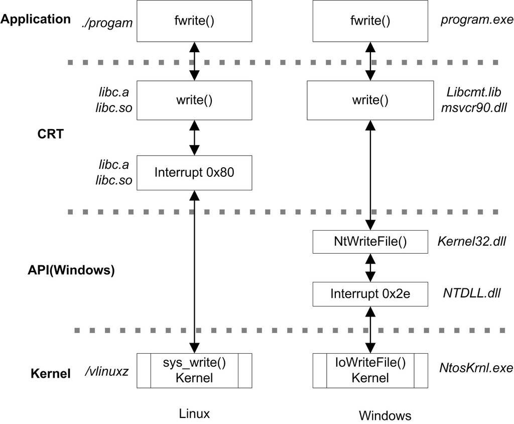
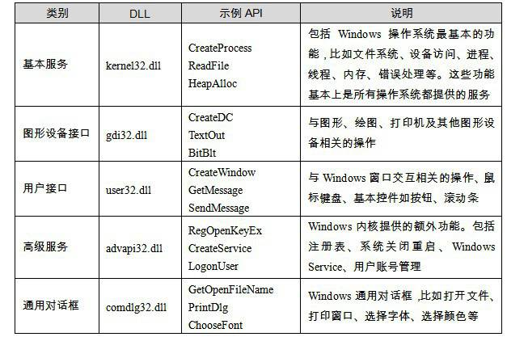
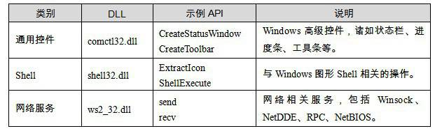
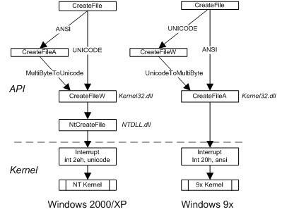

<h2>12.3 Windows API</h2>

API的全稱為Application Programming Interface，即應用程式程式設計介面。因此API不是一個專門的事物，而是一係列事物的總稱。但是我們通常在Windows下提到API時，一般就是指Windows 系統提供給應用程式的介面，即Windows API。

Windows API是指Windows作業系統提供給應用程式開發者的最底層的、最直接與Windows打交道的介面。在Windows作業系統下，CRT是建立在Windows API之上的。另外還有很多對Windows API的各種包裝庫，MFC就是很著名的一種以C++形式封裝的庫。

很多作業系統是以系統呼叫作為應用程式最底層的，而Windows的最底層介面是Windows API。Windows API是Windows程式設計的基礎，盡管Windows的核心提供了數百個系統呼叫（Windows又把系統呼叫稱作系統服務（System Service）），但是出於種種原因，微軟並沒有將這些系統呼叫公開，而在這些系統呼叫之上，建立了這樣一個API層，讓程式設計師只能呼叫API層的函式，而不是如Linux一般直接使用系統呼叫。Windows在加入API層以後，一個普通的<code>fwrite()</code>的呼叫路徑如圖12-9所示。

 圖12-9 Linux和Windows的fwrite路徑 …

12.3.1 Windows API概覽

Windows API是以DLL匯出函式的形式暴露給應用程式開發者的。它被包含在諸多的系統DLL內，規模上非常龐大，所有的匯出函式大約有數千個（以Windows XP為例）。微軟把這些Windows API DLL匯出函式的宣告的標頭檔、匯出庫、相關檔案和工具一起提供給開發者，並讓它們成為Software Development Kit（SDK）。

SDK可以單獨地在微軟的官方網站下載，也可能被整合到Visual Studio這樣的開發工具中。當我們安裝了Visual Studio後，可以在SDK的安裝目錄下找到所有的Windows API函式宣告。其中有一個標頭檔“Windows.h”包含了Windows API的核心部分，只要我們在程式裡面包含了它，就可以使用Windows API的核心部分了。

Windows API 版本

Windows API隨著Windows 版本的升級也經曆了好幾個版本，每次Windows進行大升級的時候，也會引入新版本的API。最早期的Windows API是Win16，即16位Windows（Windows 3.x係列）所提供的API，Win16的核心部分是由3個16位DLL提供的：kernel.exe（或kernel286.exe或kernel386.exe）、user.exe和gdi.exe（雖然副檔名是exe，但實際上它們有匯出函式，再說DLL和EXE其實就是一回事嘛）。

伴隨32位Windows的API是Win32，它主要有3個核心DLL：kernel32.dll、user32.dll和gdi32.dll。Windows 3.x為了支援一部分Win32程式，還提供了一個Win32的子集叫做Win32s（s為Subset，即子集）。

64位的Windows提供了相容Win32的API，被稱為Win64。Win64與Win32沒有增加介面的數量，只是所有的指標型別都改成了64位。

因為Win32是使用最廣泛也是最成熟的Windows API版本，下文中如果我們不額外註明，則預設為Win32。

Windows API現在的數量已經十分龐大，它們按照功能被劃分成了幾大類別，如表12-2所示。

 表12-2 …

我們可以在MSDN裡找到每一個API的文件，很多API還可以找到使用示例，因此MSDN是學習Win32 API極佳的工具。

表12-2中所列的Kernel32.dll和User32.dll等DLL在不同的Windows平台上的實現都不一樣，雖然它們暴露給應用程式的介面是一樣的。在Windows NT係列的平台上，這些DLL在實現上都會依賴於一個更為底層的DLL叫做NTDLL.DLL，然後由NTDLL.DLL進行系統呼叫。NTDLL.DLL把Windows NT核心的系統呼叫包裝了起來，它實際上是Windows系統使用者層面的最底層，所有的DLL都是透過呼叫NTDLL.DLL，由它進行系統呼叫的。NTDLL.DLL的匯出函式對於應用程式開發者是不公開的，原則上應用程式不應該直接使用NTDLL.DLL中的任何匯出函式。我們可以根據dumpbin等工具來察看它的匯出函式，比如Windows XP的NTDLL.dll大約有1 300個匯出函式。它所匯出的函式大多都以“Nt”開頭，並提供給那些API DLL使用以實現系統功能，比如建立程式的函式叫做NtCreateProcess，位於Kernel32.dll的CreateProcess這個API就是透過NtCreateProcess實現的。

由於Windows API所提供的介面還是相對比較原始的，比如它所提供的網路相關的介面僅僅是socket級別的操作，如果使用者要透過API訪問HTTP資源，還需要自己實現HTTP協議，所以直接使用API進行程式開發往往效率較低。Windows系統在API之上建立了很多應用模組，這些應用模組是對Windows API的功能的擴充套件，比如對HTTP/FTP等協議進行包裝的Internet模組（wininet.dll）對WinSocket API進行了擴充套件，這樣程式開發者就可以透過Internet模組直接訪問HTTP/FTP資源，而不需要自己實現一套HTTP/FTP協議。除了wininet.dll之外，Windows還有許多類似的對Windows API的包裝模組，比如OPENGL模組、ODBC（統一的資料庫介面）、WIA（數字影象裝置介面）等。

12.3.2 為什麼要使用Windows API

能省一事則省一事，微軟為什麼放著好好的系統呼叫不用，又要在CRT和系統呼叫之間增加一層Windows API層呢？

微軟不公開系統呼叫而決定使用Windows API作為程式介面的原因也很簡單，其實還是第1章裡的“要解決問題就加層的萬能法則”。Windows作為一個成功的商業作業系統，它對應用程式的向後相容性可以說是非常好，這一點從Windows XP等這種較新的Windows版本還仍然支援20多年前的DOS程式/Windows 3.1/Windows 95的程式可以看出來。雖然它沒有完全做到向後相容，但是我們看得出Windows系統為向後相容所付出的努力及Windows系統為此所背負的歷史包袱。

系統呼叫實際上是非常依賴於硬體結構的一種介面，它受到硬體的嚴格限製，比如暫存器的數量、呼叫時的引數傳遞、中斷號、堆疊切換等，都與硬體密切相關。如果硬體結構稍微發生改變，大量的應用程式可能就會出現問題（特別是那些與CRT靜態連結在一起的）。那麼直接使用系統呼叫作為程式介面的系統，它的應用程式在不同硬體平台間的相容性也是存在較大問題的。

硬體結構發生改變雖然較少見，可能幾年甚至十幾年才會發生一次，比如16位CPU升級至32位，32位升級至64位，或者由Sysenter/Sysexit代替中斷等，但是一旦發生改變，所付出的代價無疑是驚人的。

為了盡量隔離硬體結構的不同而導致的程式相容性問題，Windows系統把系統呼叫包裝了起來，使用DLL匯出函式作為應用程式的唯一可用的介面暴露給使用者。這樣可以讓核心隨版本自由地改變系統呼叫介面，只要讓API層不改變，使用者程式就可以完全無礙地執行在新的系統上。

除了隔離硬體結構不同之外，Windows本身也有可能使用不同版本的核心，比如微軟在Windows 2000之前要同時維護兩條Windows產品線：Windows 9x和Windows NT係列。它們使用的是完全不同的Windows核心，所以系統呼叫的介面自然也是不一樣的。如果應用程式都是直接使用系統呼叫，那麼後來Windows 9x和Windows NT這兩條產品線合並成Windows 2000的時候估計不會像現在這麼順利。

Windows API以DLL匯出函式的形式存在也自然是水到渠成，我們知道DLL作為Windows系統的最基本的模組組織形式，它有著良好的介面定義和靈活的組合方式。DLL基本上是Windows系統上很多高階介面和程式設計方法的基石，包括核心與驅動程式、COM、OLE、ActiveX等都是基於DLL技術的。

銀彈

很多時候人們把這種透過在軟體體係結構中增加層以解決相容性問題的做法又叫做“銀彈”。古老相傳，只有銀彈(silver bullet)才能殺死巫士、巨人、有魔力的動物，譬如狼人。在現代軟體工程的鉅著《人月神話》中，作者把規模越來越大的軟體開發專案比作無法控制的怪物，希望有一樣技術，能夠像銀彈徹底殺死狼人那樣，徹底解決這個問題。因而現在計算機界中的銀彈，指的就是能夠迅速解決各種問題的“萬靈藥”。

當某個軟體某個層面要發生變化，卻要保持與之相關聯的另一方面不變時，加一個中間層即可。Windows API層就是這樣的一個“銀彈”。

Windows API的例項

我們知道Windows NT係列與Windows 9x係列是兩個核心完全不同的作業系統，它們分別屬於兩個不同的Windows產品線，前者的目的主要為商業應用，它的核心以穩定高效著稱；而後者是以家庭和多媒體應用為目標，注重體係應用程式的相容性（支援DOS程式）和多媒體功能。

當Windows 版本升級至2000時，微軟計劃停止Windows 9x係列產品，而將Windows統一建立在較可靠的NT核心之上。這時候兩條產品線將合並成同一個Windows版本，即Windows 2000。Windows 2000就必須承擔起能夠同時相容Windows 9x和之前Window NT的應用程式的任務。由於Windows 2000使用的是NT的核心（核心版本5.0），所以要做到相容之前的Windows NT（NT 4.0及之前）的應用程式應該不是很成問題的。但是要相容Windows 9x則不是一件容易的事，因為它的核心與NT完全不同，它們各自使用的中斷號都不一樣，NT核心使用的是INT 0x2E，而9x核心則使用INT 0x20，所以，如果某個9x的應用程式一旦使用了任何系統呼叫，那麼它就無法在Windows 2000下執行。

除了它們的核心中斷號不同以外，即使同一個介面，有可能引數也不同。

Windows 9x系統的核心是並不原生支援unicode的，因此它的系統呼叫涉及的字串都是ANSI字串，即引數都是使用char*作為型別，比如與CreateFile這個API相對應的系統呼叫要傳入一個檔名，那麼這個字串在最終傳遞給核心時應該是一個ANSI字串。而Windows NT核心是原生支援unicode的，所有的系統呼叫涉及的字串相關的引數都是unicode字串，即引數是wchar_t*型別的（wchar_t是一種雙位元組的字元型別）。那麼同樣的系統呼叫，所需要的字串型別卻不一樣，這也會造成程式相容性的問題。

幸運的是，Windows API層阻止了這樣的事情發生。大家如果留意的話，會注意到Windows 下所有有字串作為引數的API都會有兩個版本，一個是ANSI字串版本，另外一個是unicode字串版本。例如，與Windows API 的CreateFile相對應的兩個版本分別為CreateFileA和CreateFileW，“A”表示ANSI版，“W”表示寬字元（Wide character），即unicode版，kernel32.dll實際上匯出了這兩個函式，而CreateFile僅僅是一個宏定義。下面的程式碼摘自Windows SDK的“winbase.h”：

<pre>WINBASEAPI
HANDLE
WINAPI
CreateFileA(
    IN LPCSTR lpFileName,
    IN DWORD dwDesiredAccess,
    IN DWORD dwShareMode,
    IN LPSECURITY_ATTRIBUTES lpSecurityAttributes,
    IN DWORD dwCreationDisposition,
    IN DWORD dwFlagsAndAttributes,
    IN HANDLE hTemplateFile
    );
WINBASEAPI
HANDLE
WINAPI
CreateFileW(
    IN LPCWSTR lpFileName,
    IN DWORD dwDesiredAccess,
    IN DWORD dwShareMode,
    IN LPSECURITY_ATTRIBUTES lpSecurityAttributes,
    IN DWORD dwCreationDisposition,
    IN DWORD dwFlagsAndAttributes,
    IN HANDLE hTemplateFile
    );
#ifdef UNICODE
#define CreateFile  CreateFileW
#else
#define CreateFile  CreateFileA
#endif
</pre>

可見根據編譯的時候是否定義UNICODE這個宏，CreateFile會被展開為CreateFileW或CreateFileA，而這兩個函式唯一的區別就是第一個引數lpFileName的型別不同，分別為LPCWSTR和LPCSTR，即const wchar_t*和const char*。CreateFileA/CreateFileW這個API才是真正的Windows API匯出函式，它們在不同的作業系統版本上實現會有所不同。

例如在Windows 2000下，由於NT核心只支援unicode版的系統呼叫，所以CreateFileW的實現是最直接的，它只要直接呼叫核心即可。而CreateFileA則在實現上需要把第一個引數從ANSI字串轉換成unicode字串（Windows提供了MultiByteToWideChar這樣的API用於轉換不同編碼的字串），然後再呼叫CreateFileW。Windows 2000的kernel32.dll中的CreateFileA的實現大概如下面的程式碼所示：

<pre>HANDLE STDCALL CreateFileA (
    LPCSTR lpFileName,
    DWORD dwDesiredAccess,
    DWORD dwShareMode,
    LPSECURITY_ATTRIBUTES lpSecurityAttributes,
    DWORD dwCreationDisposition,
    DWORD dwFlagsAndAttributes,
    HANDLE hTemplateFile)
{
    PWCHAR FileNameW;
    HANDLE FileHandle;

    // ANSI to UNICODE
    FileNameW = MultiByteToWideChar( lpFileName );

    FileHandle = CreateFileW (FileNameW,
                          dwDesiredAccess,
                          dwShareMode,
                          lpSecurityAttributes,
                          dwCreationDisposition,
                          dwFlagsAndAttributes,
                          hTemplateFile);

    return FileHandle;
}
</pre>

對上面的程式碼我們進行了簡化，但是它表達的思想與實際的實現是一致的。可以想象，在Windows 9x的kernel32.dll所進行的恰恰是相反的步驟，CreateFileW函式中的寬字串透過WideCharToMultiByte()被轉換成了ANSI字串，然後呼叫CreateFileA。API層在這一過程中所扮演的角色可以如圖12-10所示。

 圖12-10 Windows NT和Windows 9x的API層次結構對比 …

所以不管核心如何改變介面，只要維持API層面的介面不變，理論上所有的應用程式都不用重新編譯就可以正常執行，這也是Windows API存在的主要原因。

12.3.3 API與子系統

作為一個商業作業系統，應用程式相容性是評價作業系統是否有競爭力最重要的指標之一。一方面從使用者的角度看，如果一個商業作業系統只能執行數量很少的應用程式，是不會有人使用的；從應用程式的開發者角度看，他們投入了巨大的精力在應用程式上，如果作業系統不支援這些應用程式，無疑會使開發者的努力白費。微軟最初在開發Windows NT的時候除了考慮向後相容性之外（相容其他版本Windows），它還考慮到了相容Windows之外的作業系統。

為了作業系統的相容性，微軟試圖讓Windows NT能夠支援其他作業系統上的應用程式。在設計Windows NT的時候，與它同一時期的作業系統有各種UNIX（posix標準）、IBM的OS/2、微軟自家的DOS和Windows 3.x等。於是Windows NT提出子系統（Subsystem）的概念，希望提供各種作業系統的執行環境，以相容它們的應用程式。

子系統又稱為Windows環境子系統（Evironment Subsystem），簡稱子系統（Subsystem）。我們知道，原生的Windows程式是透過CreateProcess這個API來建立程式的，而UNIX的程式則是透過<code>fork()</code>來建立的，子系統就是這樣一個中間層，它使用Windows的API來模擬<code>fork()</code>這樣的系統呼叫，使得應用程式看起來與UNIX沒有區別。

子系統實際上又是Windows架設在API和應用程式之間的另一個中間層。前面講到API這個中間層是為了防止核心系統呼叫層發生變化導致使用者程式也必須隨之變化而增加的，而子系統則是用來為各種不同平台的應用程式建立與它們相容的執行環境。

當然，子系統要實現二進位級別的相容性是十分困難的，於是它的目標就是原始碼級別的相容。也就是說每個子系統必須實現目標作業系統的所有介面，比如Windows NT要建立一個能夠執行UNIX應用程式的子系統，它必須實現UNIX的所有系統呼叫在C語言原始碼層面的介面。

在Windows裡，最開始支援3種子系統：Win32子系統、POSIX子系統和OS/2子系統，而OS/2子系統在Windows 2000裡已經被去除。DOS程式和16位Windows程式也是透過類似於子系統的模式實現在32位Windows下執行的。16位的Windows程式執行在32位Windows下被稱為WoW（Windows On Windows），這使我們聯想到現在32位Windows程式執行於64位的Windows作業系統，也是透過WoW技術實現的。

和核心直接打交道的只有Win32子系統，其他的子系統如Posix子系統和OS/2子系統都是直接將請求傳送給Win32子系統處理。Win32子系統在系統執行的時候始終是執行的，而其他的子系統則是在需要的時候才啟動。

後來隨著Windows的市場地位逐漸鞏固，它對於相容其他作業系統和早期的DOS/Windows 3.1及Windows 9x的應用程式的需求已經極大地減弱，現在執行於Windows系統上的應用軟體基本上都是使用Win32子系統的程式，所以子系統的概念已經逐漸地被弱化，除了Win32子系統之外，其他的子系統基本上形同虛設。我們在本書中提及子系統這一概念，也僅僅是為了幫助讀者瞭解一些背景，以便於在Windows系統下碰到相關內容時不至於困惑，但並不打算深入介紹它，因為Windows子系統在實際上已經被拋棄了。

