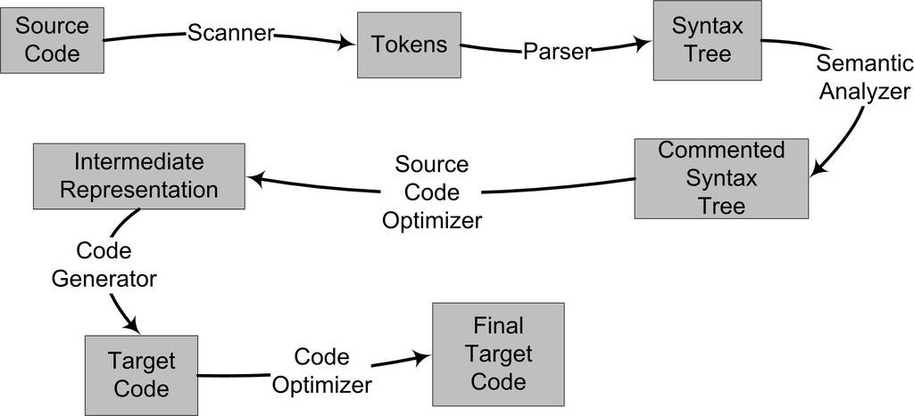
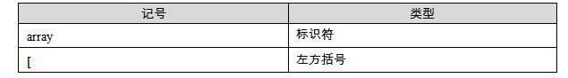
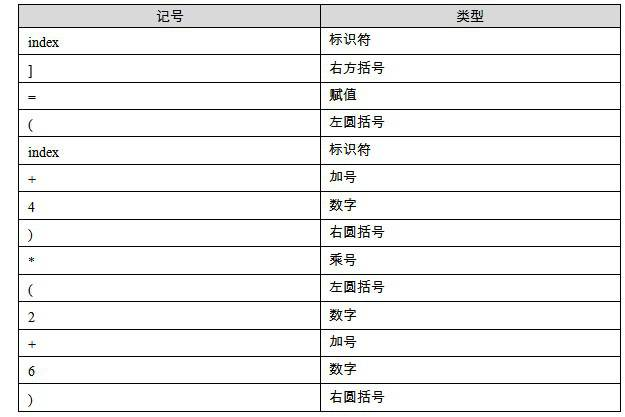
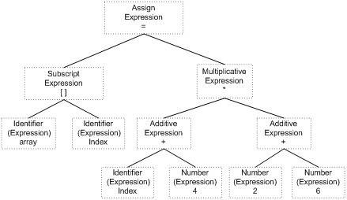
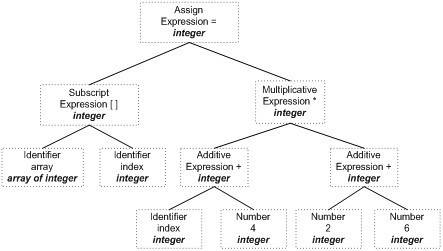
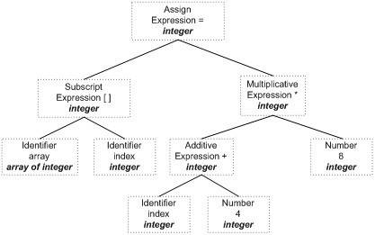

<h2>2.2 編譯器做了什麼</h2>

從最直觀的角度來講，編譯器就是將高階語言翻譯成機器語言的一個工具。比如我們用C/C++語言寫的一個程式可以使用編譯器將其翻譯成機器可以執行的指令及資料。我們前面也提到了，使用機器指令或組合語言編寫程式是十分費事及乏味的事情，它們使得程式開發的效率十分低下。並且使用機器語言或組合語言編寫的程式依賴於特定的機器，一個為某種CPU編寫的程式在另外一種CPU下完全無法執行，需要重新編寫，這幾乎是令人無法接受的。所以人們期望能夠採用類似於自然語言的語言來描述一個程式，但是自然語言的形式不夠精確，所以類似於數學定義的程式語言很快就誕生了。20世紀的六七十年代誕生了很多高階語言，有些至今仍然非常流行，如FORTRAN、C語言等（準確地講，FORTRAN誕生於20世紀50年代的IBM）。高階語言使得程式設計師們能夠更加關注程式邏輯的本身，而盡量少考慮計算機本身的限製，如字長、記憶體大小、通訊方式、儲存方式等。高階程式語言的出現使得程式開發的效率大大提高，高階語言的可移植性也使得它在多種計算機平台下能夠遊刃有餘。據研究，高階語言的開發效率是組合語言和機器語言的5倍以上。

讓我們繼續回到編譯器本身的職責上來，編譯過程一般可以分為6步：掃描、語法分析、語義分析、原始碼最佳化、程式碼生成和目的碼最佳化。整個過程如圖2-2所示。

 圖2-2 編譯過程 …

我們將結合圖2-2來簡單描述從原始碼（Source Code）到最終目的碼（Final Target Code）的過程。以一段很簡單的C語言的程式碼為例子來講述這個過程。比如我們有一行C語言的原始碼如下：

<pre>array[index] = (index + 4) * (2 + 6)
CompilerExpression.c
</pre>

2.2.1 詞法分析

首先原始碼程式被輸入到掃描器（Scanner），掃描器的任務很簡單，它只是簡單地進行詞法分析，運用一種類似於有限狀態機（Finite State Machine）的演算法可以很輕鬆地將原始碼的字元序列分割成一係列的記號（Token）。比如上面的那行程式，總共包含了28個非空字元，經過掃描以後，產生了16個記號，如表2-1所示。

 表2-1 …

詞法分析產生的記號一般可以分為如下幾類：關鍵字、識別符號、字面量（包含數字、字串等）和特殊符號（如加號、等號）。在識別記號的同時，掃描器也完成了其他工作。比如將識別符號存放到符號表，將數字、字串常量存放到文字表等，以備後面的步驟使用。

有一個叫做lex的程式可以實現詞法掃描，它會按照使用者之前描述好的詞法規則將輸入的字串分割成一個個記號。因為這樣一個程式的存在，編譯器的開發者就無須為每個編譯器開發一個獨立的詞法掃描器，而是根據需要改變詞法規則就可以了。

另外對於一些有預處理的語言，比如C語言，它的宏替換和檔案包含等工作一般不歸入編譯器的範圍而交給一個獨立的前處理器。

2.2.2 語法分析

接下來語法分析器（Grammar Parser）將對由掃描器產生的記號進行語法分析，從而產生語法樹（Syntax Tree）。整個分析過程採用了上下文無關語法（Context-free Grammar）的分析手段，如果你對上下文無關語法及下推自動機很熟悉，那麼應該很好理解。否則，可以參考一些計算理論的資料，一般都會有很詳細的介紹。此處不再贅述。簡單地講，由語法分析器生成的語法樹就是以表示式（Expression）為節點的樹。我們知道，C語言的一個語句是一個表示式，而複雜的語句是很多表示式的組合。上面例子中的語句就是一個由賦值表示式、加法表示式、乘法表示式、陣列表示式、括號表示式組成的複雜語句。它在經過語法分析器以後形成如圖2-3所示的語法樹。

 圖2-3 語法樹 …

從圖2-3中我們可以看到，整個語句被看作是一個賦值表示式；賦值表示式的左邊是一個陣列表示式，它的右邊是一個乘法表示式；陣列表示式又由兩個符號表示式組成，等等。符號和數字是最小的表示式，它們不是由其他的表示式來組成的，所以它們通常作為整個語法樹的葉節點。在語法分析的同時，很多運算子號的優先順序和含義也被確定下來了。比如乘法表示式的優先順序比加法高，而圓括號表示式的優先順序比乘法高，等等。另外有些符號具有多重含義，比如星號*在C語言中可以表示乘法表示式，也可以表示對指標取內容的表示式，所以語法分析階段必須對這些內容進行區分。如果出現了表示式不合法，比如各種括號不匹配、表示式中缺少運算子等，編譯器就會報告語法分析階段的錯誤。

正如前面詞法分析有lex一樣，語法分析也有一個現成的工具叫做yacc（Yet Another Compiler Compiler）。它也像lex一樣，可以根據使用者給定的語法規則對輸入的記號序列進行解析，從而構建出一棵語法樹。對於不同的程式語言，編譯器的開發者只需要改變語法規則，而無須為每個編譯器編寫一個語法分析器，所以它又被稱為“編譯器編譯器（Compiler Compiler）”。

2.2.3 語義分析

接下來進行的是語義分析，由語義分析器（Semantic Analyzer）來完成。語法分析僅僅是完成了對表示式的語法層面的分析，但是它並不瞭解這個語句是否真正有意義。比如C語言裡面兩個指標做乘法運算是沒有意義的，但是這個語句在語法上是合法的；比如同樣一個指標和一個浮點數做乘法運算是否合法等。編譯器所能分析的語義是靜態語義（Static Semantic），所謂靜態語義是指在編譯期可以確定的語義，與之對應的動態語義（Dynamic Semantic）就是只有在執行期才能確定的語義。

靜態語義通常包括宣告和型別的匹配，型別的轉換。比如當一個浮點型的表示式賦值給一個整型的表示式時，其中隱含了一個浮點型到整型轉換的過程，語義分析過程中需要完成這個步驟。比如將一個浮點型賦值給一個指標的時候，語義分析程式會發現這個型別不匹配，編譯器將會報錯。動態語義一般指在執行期出現的語義相關的問題，比如將0作為除數是一個執行期語義錯誤。

經過語義分析階段以後，整個語法樹的表示式都被標識了型別，如果有些型別需要做隱式轉換，語義分析程式會在語法樹中插入相應的轉換節點。上面描述的語法樹在經過語義分析階段以後成為如圖2-4所示的形式。

 圖2-4 標識語義後的語法樹 …

可以看到，每個表示式（包括符號和數字）都被標識了型別。我們的例子中幾乎所有的表示式都是整型的，所以無須做轉換，整個分析過程很順利。語義分析器還對符號表裡的符號型別也做了更新。

2.2.4 中間語言生成

現代的編譯器有著很多層次的最佳化，往往在原始碼級別會有一個最佳化過程。我們這裡所描述的原始碼級最佳化器（Source Code Optimizer）在不同編譯器中可能會有不同的定義或有一些其他的差異。原始碼級最佳化器會在原始碼級別進行最佳化，在上例中，細心的讀者可能已經發現，（2 + 6）這個表示式可以被最佳化掉，因為它的值在編譯期就可以被確定。類似的還有很多其他複雜的最佳化過程，我們在這裡就不詳細描述了。經過最佳化的語法樹如圖2-5所示。

 圖2-5 最佳化後的語法樹 …

我們看到（2 + 6）這個表示式被最佳化成8。其實直接在語法樹上作最佳化比較困難，所以原始碼最佳化器往往將整個語法樹轉換成中間程式碼（Intermediate Code），它是語法樹的順序表示，其實它已經非常接近目的碼了。但是它一般跟目標機器和執行時環境是無關的，比如它不包含資料的尺寸、變數地址和暫存器的名字等。中間程式碼有很多種型別，在不同的編譯器中有著不同的形式，比較常見的有：三地址碼（Three-address Code）和P-程式碼（P-Code）。我們就拿最常見的三地址碼來作為例子，最基本的三地址碼是這樣的：

x = y op z

這個三地址碼表示將變數y和z進行op操作以後，賦值給x。這裡op操作可以是算數運算，比如加減乘除等，也可以是其他任何可以應用到y和z的操作。三地址碼也得名於此，因為一個三地址碼語句裡面有三個變數地址。我們上面的例子中的語法樹可以被翻譯成三地址碼後是這樣的：

<pre>t1 = 2 + 6
t2 = index + 4
t3 = t2 * t1
array[index] = t3
</pre>

我們可以看到，為了使所有的操作都符合三地址碼形式，這裡利用了幾個臨時變數：t1、t2和t3。在三地址碼的基礎上進行最佳化時，最佳化程式會將2+6的結果計算出來，得到t1 = 8。然後將後面程式碼中的t1替換成數字8。還可以省去一個臨時變數t3，因為t2可以重複利用。經過最佳化以後的程式碼如下：

<pre>t2 = index + 4
t2 = t2 * 8
array[index] = t2
</pre>

中間程式碼使得編譯器可以被分為前端和後端。編譯器前端負責產生機器無關的中間程式碼，編譯器後端將中間程式碼轉換成目標機器程式碼。這樣對於一些可以跨平台的編譯器而言，它們可以針對不同的平台使用同一個前端和針對不同機器平台的數個後端。

2.2.5 目的碼生成與最佳化

原始碼級最佳化器產生中間程式碼標誌著下面的過程都屬於編輯器後端。編譯器後端主要包括程式碼生成器（Code Generator）和目的碼最佳化器（Target Code Optimizer）。讓我們先來看看程式碼生成器。程式碼生成器將中間程式碼轉換成目標機器程式碼，這個過程十分依賴於目標機器，因為不同的機器有著不同的字長、暫存器、整數資料型別和浮點數資料型別等。對於上面例子中的中間程式碼，程式碼生成器可能會生成下面的程式碼序列（我們用x86的組合語言來表示，並且假設index的型別為int型，array的型別為int型陣列）：

<pre>movl index, %ecx        ; value of index to ecx
addl $4, %ecx           ; ecx = ecx + 4
mull $8, %ecx             ; ecx = ecx * 8
movl index, %eax        ; value of index to eax
movl %ecx, array(,eax,4)  ; array[index] = ecx
</pre>

最後目的碼最佳化器對上述的目的碼進行最佳化，比如選擇合適的定址方式、使用位移來代替乘法運算、刪除多餘的指令等。上面的例子中，乘法由一條相對複雜的基址比例變址定址（Base Index Scale Addressing）的lea指令完成，隨後由一條mov指令完成最後的賦值操作，這條mov指令的定址方式與lea是一樣的。

<pre>movl  index, %edx
leal  32(,%edx,8), %eax
movl  %eax, array(,%edx,4)
</pre>

現代的編譯器有著異常複雜的結構，這是因為現代高階程式語言本身非常地複雜，比如C++語言的定義就極為複雜，至今沒有一個編譯器能夠完整支援C++語言標準所規定的所有語言特性。另外現代的計算機CPU相當地複雜，CPU本身採用了諸如流水線、多發射、超標量等諸多複雜的特性，為了支援這些特性，編譯器的機器指令最佳化過程也變得十分複雜。使得編譯過程更為複雜的是有些編譯器支援多種硬體平台，即允許編譯器編譯出多種目標CPU的程式碼。比如著名的GCC編譯器就幾乎支援所有CPU平台，這也導致了編譯器的指令生成過程更為複雜。

經過這些掃描、語法分析、語義分析、原始碼最佳化、程式碼生成和目的碼最佳化，編譯器忙活了這麼多個步驟以後，原始碼終於被編譯成了目的碼。但是這個目的碼中有一個問題是：index和array的地址還沒有確定。如果我們要把目的碼使用組譯器編譯成真正能夠在機器上執行的指令，那麼index和array的地址應該從哪兒得到呢？如果index和array定義在跟上面的原始碼同一個編譯單元裡面，那麼編譯器可以為index和array分配空間，確定它們的地址；那如果是定義在其他的程式模組呢？

這個看似簡單的問題引出了我們一個很大的話題：目的碼中有變數定義在其他模組，該怎麼辦？事實上，定義其他模組的全域性變數和函式在最終執行時的絕對地址都要在最終連結的時候才能確定。所以現代的編譯器可以將一個原始碼檔案編譯成一個未連結的目的檔，然後由連結器最終將這些目的檔連結起來形成執行檔。讓我們帶著這個問題，走進連結的世界。

