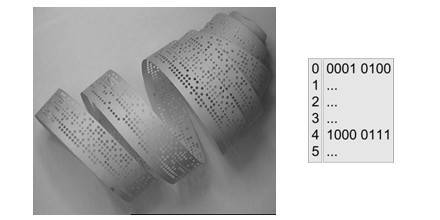
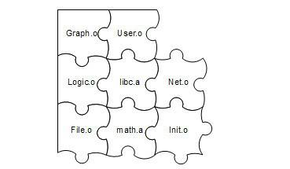

<h2>2.3 連結器年齡比編譯器長</h2>

很久很久以前，在一個非常遙遠的銀河係……人們編寫程式時，將所有原始碼都寫在同一個檔案中，發展到後來一個程式原始碼的檔案長達數百萬行，以至於這個地方的人類已經沒有能力維護這個程式了。人們開始尋找新的辦法，一場新的軟體開發革命即將爆發……

為了更好地理解計算機程式的編譯和連結的過程，我們簡單地回顧計算機程式開發的歷史一定會非常有益。計算機的程式開發並非從一開始就有著這麼複雜的自動化編譯、連結過程。原始的連結概念遠在高階程式語言發明之前就已經存在了，在最開始的時候，程式設計師（當時程式設計師的概念應該跟現在相差很大了）先把一個程式在紙上寫好，當然當時沒有很高階的語言，用的都是機器語言，甚至連組合語言都沒有。當程式需要被執行時，程式設計師人工將他寫的程式寫入到儲存裝置上，最原始的儲存裝置之一就是紙帶，即在紙帶上打相應的孔。

這個過程我們可以透過圖2-6來看到，假設有一種計算機，它的每條指令是1個位元組，也就是8位。我們假設有一種跳轉指令，它的高4位是0001，表示這是一條跳轉指令；低4

 圖2-6 紙帶與機器指令 …

位存放的是跳轉目的地的絕對地址。我們可以從圖2-6中看到，這個程式的第一條指令就是一條跳轉指令，它的目的地址是第5條指令（注意，第5條指令的絕對地址是4）。至於0和1怎麼對映到紙帶上，這個應該很容易理解，比如我們可以規定紙帶上每行有8個孔位，每個孔位代表一位，穿孔表示0，未穿孔表示1。

現在問題來了，程式並不是一寫好就永遠不變化的，它可能會經常被修改。比如我們在第1條指令之後、第5條指令之前插入了一條或多條指令，那麼第5條指令及後面的指令的位置將會相應地往後移動，原先第一條指令的低4位的數字將需要相應地調整。在這個過程中，程式設計師需要人工重新計算每個子程式或跳轉的目標地址。當程式修改的時候，這些位置都要重新計算，十分繁瑣又耗時，並且很容易出錯。這種重新計算各個目標的地址過程被叫做重定位（Relocation）。

如果我們有多條紙帶的程式，這些程式之間可能會有類似的跨紙帶之間的跳轉，這種程式經常修改導致跳轉目標地址變化在程式擁有多個模組的時候更為嚴重。人工繫結進行指令的修正以確保所有的跳轉目標地址都正確，在程式規模越來越大以後變得越來越複雜和繁瑣。

沒辦法，這種黑暗的程式設計師生活是沒有辦法容忍的。先驅者發明瞭組合語言，這相比機器語言來說是個很大的進步。組合語言使用接近人類的各種符號和標記來幫助記憶，比如指令採用兩個或三個字母的縮寫，記住“jmp”比記住0001XXXX是跳轉（jump）指令容易得多了；組合語言還可以使用符號來標記位置，比如一個符號“divide”表示一個除法子程式的起始地址，比記住從某個位置開始的第幾條指令是除法子程式方便得多。最重要的是，這種符號的方法使得人們從具體的指令地址中逐步解放出來。比如前面紙帶程式中，我們把剛開始第5條指令開始的子程式命名為“foo”，那麼第一條指令的組譯就是：

<pre>jmp foo</pre>

當然人們可以使用這種符號命名子程式或跳轉目標以後，不管這個“foo”之前插入或減少了多少條指令導致“foo”目標地址發生了什麼變化，組譯器在每次組譯程式的時候會重新計算“foo”這個符號的地址，然後把所有引用到“foo”的指令修正到這個正確的地址。整個過程不需要人工參與，對於一個有成百上千個類似的符號的程式，程式設計師終於擺脫了這種低階的繁瑣的調整地址的工作，用一句政治口號來說叫做“極大地解放了生產力”。符號（Symbol）這個概念隨著組合語言的普及迅速被使用，它用來表示一個地址，這個地址可能是一段子程式（後來發展成函式）的起始地址，也可以是一個變數的起始地址。

有了組合語言以後，生產力大大提高了，隨之而來的是軟體的規模也開始日漸龐大，這時程式的程式碼量也已經開始快速地膨脹，導致人們要開始考慮將不同功能的程式碼以一定的方式組織起來，使得更加容易閱讀和理解，以便於日後修改和重複使用。自然而然，人們開始將程式碼按照功能或性質劃分，分別形成不同的功能模組，不同的模組之間按照層次結構或其他結構來組織。這個在現代的軟體原始碼組織中很常見，比如在C語言中，最小的單位是變數和函式，若幹個變數和函式組成一個模組，存放在一個“.c”的原始碼檔案裡，然後這些原始碼檔案按照目錄結構來組織。在比較高階的語言中，如Java中，每個類是一個基本的模組，若幹個類模組組成一個包（Package），若幹個包組合成一個程式。

在現代軟體開發過程中，軟體的規模往往都很大，動輒數百萬行程式碼，如果都放在一個模組肯定無法想象。所以現代的大型軟體往往擁有成千上萬個模組，這些模組之間相互依賴又相對獨立。這種按照層次化及模組化儲存和組織原始碼有很多好處，比如程式碼更容易閱讀、理解、重用，每個模組可以單獨開發、編譯、測試，改變部分程式碼不需要編譯整個程式等。

在一個程式被分割成多個模組以後，這些模組之間最後如何組合形成一個單一的程式是須解決的問題。模組之間如何組合的問題可以歸結為模組之間如何通訊的問題，最常見的屬於靜態語言的C/C++模組之間通訊有兩種方式，一種是模組間的函式呼叫，另外一種是模組間的變數訪問。函式訪問須知道目標函式的地址，變數訪問也須知道目標變數的地址，所以這兩種方式都可以歸結為一種方式，那就是模組間符號的引用。模組間依靠符號來通訊類似於拚圖版，定義符號的模組多出一塊區域，引用該符號的模組剛好少了那一塊區域，兩者一拚接剛好完美組合（見圖2-7）。這個模組的拚接過程就是本書的一個主題：連結（Linking）。

 圖2-7 模組間拚合 …

這種基於符號的模組化的一個直接結果是連結過程在整個程式開發中變得十分重要和突出。我們在本書的後面將可以看到連結器如何將這些編譯後的模組連結到一起，最終產生一個可以執行的程式。

