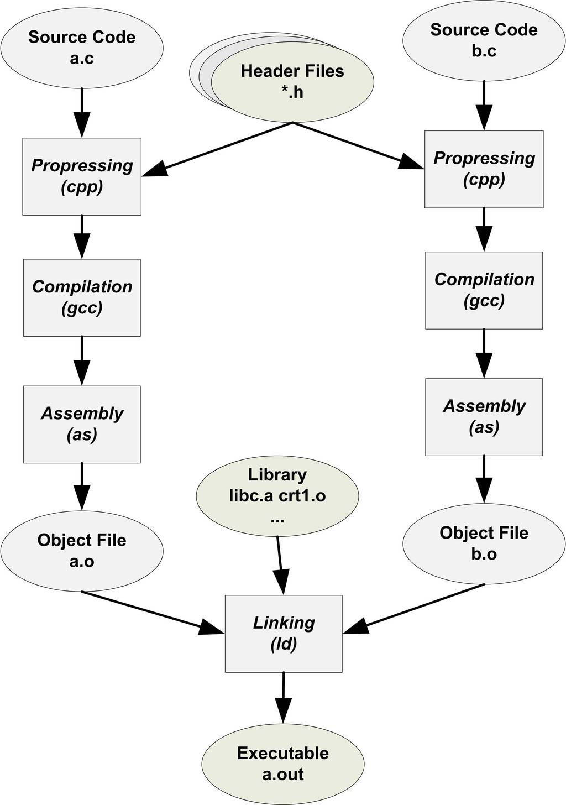
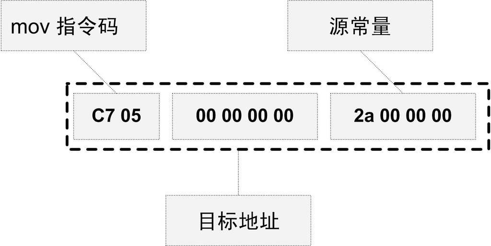

<h2>2.4 模組拚裝——靜態連結</h2>

程式設計的模組化是人們一直在追求的目標，因為當一個系統十分複雜的時候，我們不得不將一個複雜的系統逐步分割成小的系統以達到各個突破的目的。一個複雜的軟體也如此，人們把每個原始碼模組獨立地編譯，然後按照需要將它們“組裝”起來，這個組裝模組的過程就是連結（Linking）。連結的主要內容就是把各個模組之間相互引用的部分都處理好，使得各個模組之間能夠正確地銜接。連結器所要做的工作其實跟前面所描述的“程式設計師人工調整地址”本質上沒什麼兩樣，只不過現代的高階語言的諸多特性和功能，使得編譯器、連結器更為複雜，功能更為強大，但從原理上來講，它的工作無非就是把一些指令對其他符號地址的引用加以修正。連結過程主要包括了地址和空間分配（Address and Storage Allocation）、符號決議（Symbol Resolution）和重定位（Relocation）等這些步驟。

符號決議有時候也被叫做符號繫結（Symbol Binding）、名稱繫結（Name Binding）、名稱決議（Name Resolution），甚至還有叫做地址繫結（Address Binding）、指令繫結（Instruction Binding）的，大體上它們的意思都一樣，但從細節角度來區分，它們之間還是存在一定區別的，比如“決議”更傾向於靜態連結，而“繫結”更傾向於動態連結，即它們所使用的範圍不一樣。在靜態連結，我們將統一稱為符號決議。

最基本的靜態連結過程如圖2-8所示。每個模組的原始碼檔案（如.c）檔案經過編譯器編譯成目的檔（Object File，一般副檔名為.o或.obj），目的檔和庫（Library）一起連結

 圖2-8 連結過程 …

形成最終執行檔。而最常見的庫就是執行時庫（Runtime Library），它是支援程式執行的基本函式的集合。庫其實是一組目的檔的包，就是一些最常用的程式碼編譯成目的檔後打包存放。關於庫本書的後面還會再詳細分析。

我們認為對於Object檔案沒有一個很合適的中文名稱，把它叫做中間目的檔比較合適，簡稱為目的檔，所以本書後面的內容都將稱Object檔案為目的檔，很多時候我們也把目的檔稱為模組。

現代的編譯和連結過程也並非想象中的那麼複雜，它還是一個比較容易理解的概念。比如我們在程式模組main.c中使用另外一個模組func.c中的函式foo()。我們在main.c模組中每一處呼叫foo的時候都必須確切知道foo這個函式的地址，但是由於每個模組都是單獨編譯的，在編譯器編譯main.c的時候它並不知道foo函式的地址，所以它暫時把這些呼叫foo的指令的目標地址擱置，等待最後連結的時候由連結器去將這些指令的目標地址修正。如果沒有連結器，需要我們手工把每個呼叫foo的指令進行修正，則填入正確的foo函式地址。當func.c模組被重新編譯，foo函式的地址有可能改變時，那麼我們在main.c中所有使用到foo的地址的指令將要全部重新調整。這些繁瑣的工作將成為程式設計師的噩夢。使用連結器，你可以直接引用其他模組的函式和全域性變數而無須知道它們的地址，因為連結器在連結的時候，會根據你所引用的符號 foo，自動去相應的func.c模組查詢foo的地址，然後將main.c模組中所有引用到foo的指令重新修正，讓它們的目標地址為真正的foo函式的地址。這就是靜態連結的最基本的過程和作用。

在連結過程中，對其他定義在目的檔中的函式呼叫的指令需要被重新調整，對使用其他定義在其他目的檔的變數來說，也存在同樣的問題。讓我們結合具體的CPU指令來瞭解這個過程。假設我們有個全域性變數叫做var，它在目的檔A裡面。我們在目的檔B裡面要訪問這個全域性變數，比如我們在目的檔B裡面有這麼一條指令：

<pre>movl    $0x2a, var</pre>

這條指令就是給這個var變數賦值0x2a，相當於C語言裡面的語句var = 42。然後我們編譯目的檔B，得到這條指令機器碼，如圖2-9所示。

 圖2-9 傳送指令 …

由於在編譯目的檔B的時候，編譯器並不知道變數var的目標地址，所以編譯器在沒法確定地址的情況下，將這條mov指令的目標地址置為0，等待連結器在將目的檔A和B連結起來的時候再將其修正。我們假設A和B連結後，變數var的地址確定下來為0x1000，那麼連結器將會把這個指令的目標地址部分修改成0x10000。這個地址修正的過程也被叫做重定位（Relocation），每個要被修正的地方叫一個重定位入口（Relocation Entry）。重定位所做的就是給程式中每個這樣的絕對地址引用的位置“打補丁”，使它們指向正確的地址。

