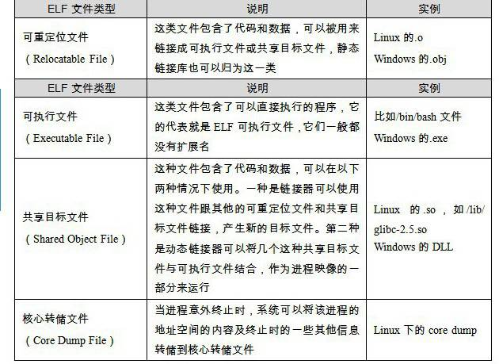

<h2>3.1 目的檔的格式</h2>

現在PC平台流行的執行檔格式（Executable）主要是Windows下的PE（Portable Executable）和Linux的ELF（Executable Linkable Format），它們都是COFF（Common file format）格式的變種。目的檔就是原始碼編譯後但未進行連結的那些中間檔案（Windows的.obj和Linux下的.o），它跟執行檔的內容與結構很相似，所以一般跟執行檔格式一起採用一種格式儲存。從廣義上看，目的檔與執行檔的格式其實幾乎是一樣的，所以我們可以廣義地將目的檔與執行檔看成是一種型別的檔案，在Windows下，我們可以統稱它們為PE-COFF檔案格式。在Linux下，我們可以將它們統稱為ELF檔案。其他不太常見的執行檔格式還有Intel/Microsoft的OMF（Object Module Format）、Unix a.out格式和MS-DOS .COM格式等。

不光是執行檔（Windows的.exe和Linux下的ELF執行檔）按照執行檔格式儲存。動態連結庫（DLL，Dynamic Linking Library）（Windows的.dll和Linux的.so）及靜態連結庫（Static Linking Library）（Windows的.lib和Linux的.a）檔案都按照執行檔格式儲存。它們在Windows下都按照PE-COFF格式儲存，Linux下按照ELF格式儲存。靜態連結庫稍有不同，它是把很多目的檔捆綁在一起形成一個檔案，再加上一些索引，你可以簡單地把它理解為一個包含有很多目的檔的檔案包。ELF檔案標準裡面把系統中採用ELF格式的檔案歸為如表3-1所列舉的4類。

 表3-1 …

我們可以在Linux下使用file命令來檢視相應的檔案格式，上面幾種檔案在file命令下會顯示出相應的型別：

<pre>$ file foobar.o
foobar.o: ELF 32-bit LSB relocatable, Intel 80386, version 1 (SYSV), not stripped

$ file /bin/bash
/bin/bash: ELF 32-bit LSB executable, Intel 80386, version 1 (SYSV), for GNU/Linux 2.6.8, dynamically linked (uses shared libs), stripped

$ file /lib/ld-2.6.1.so
/lib/libc-2.6.1.so: ELF 32-bit LSB shared object, Intel 80386, version 1 (SYSV), for GNU/Linux 2.6.8, stripped
</pre>

目的檔與執行檔格式的小歷史

目的檔與執行檔格式跟作業系統和編譯器密切相關，所以不同的系統平台下會有不同的格式，但這些格式又大同小異，目的檔格式與執行檔格式的歷史幾乎是作業系統的發展史。

COFF是由Unix System V Release 3首先提出並且使用的格式規範，後來微軟公司基於COFF格式，製定了PE格式標準，並將其用於當時的Windows NT系統。System V Release 4在COFF的基礎上引入了ELF格式，目前流行的Linux系統也以ELF作為基本執行檔格式。這也就是為什麼目前PE和ELF如此相似的主要原因，因為它們都是源於同一種執行檔格式COFF。

Unix最早的執行檔格式為a.out格式，它的設計非常地簡單，以至於後來共用函式庫這個概念出現的時候，a.out格式就變得捉襟見肘了。於是人們設計了COFF格式來解決這些問題，這個設計非常通用，以至於COFF的繼承者到目前還在被廣泛地使用。

COFF的主要貢獻是在目的檔裡面引入了“段”的機制，不同的目的檔可以擁有不同數量及不同型別的“段”。另外，它還定義了除錯資料格式。

下文的剖析我們以ELF結構為主。然後會專門分析PE-COFF檔案結構，並對比其與ELF的異同。

