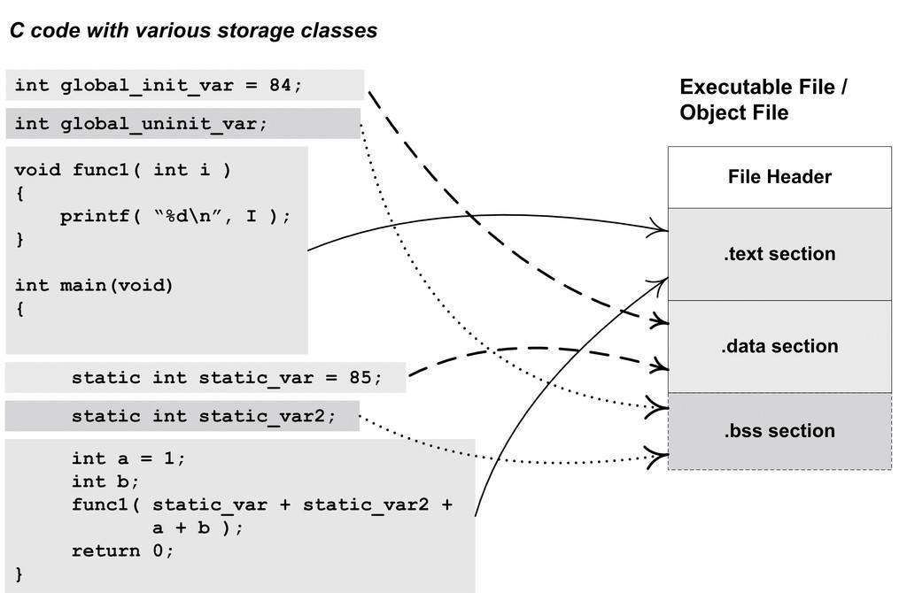
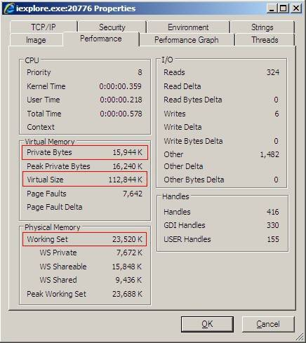

<h2>3.2 目的檔是什麼樣的</h2>

我們大概能猜到，目的檔中的內容至少有編譯後的機器指令程式碼、資料。沒錯，除了這些內容以外，目的檔中還包括了連結時所需要的一些資訊，比如符號表、除錯資訊、字串等。一般目的檔將這些資訊按不同的屬性，以“節”（Section）的形式儲存，有時候也叫“段”（Segment），在一般情況下，它們都表示一個一定長度的區域，基本上不加以區別，唯一的區別是在ELF的連結檢視和載入檢視的時候，後面會專門提到。在本書中，預設情況下統一將它們稱為“段”。

程式原始碼編譯後的機器指令經常被放在程式碼段（Code Section）裡，程式碼段常見的名字有“.code”或“.text”；全域性變數和區域性靜態變數資料經常放在資料段（Data Section），資料段的一般名字都叫“.data”。讓我們來看一個簡單的程式被編譯成目的檔後的結構，如圖3-1所示。

 圖3-1 程式與目的檔 …

假設圖3-1的執行檔（目的檔）的格式是ELF，從圖中可以看到，ELF檔案的開頭是一個“檔案頭”，它描述了整個檔案的檔案屬性，包括檔案是否可執行、是靜態連結還是動態連結及入口地址（如果是執行檔）、目標硬體、目標作業系統等資訊，檔案頭還包括一個段表（Section Table），段表其實是一個描述檔案中各個段的陣列。段表描述了檔案中各個段在檔案中的偏移位置及段的屬性等，從段表裡面可以得到每個段的所有資訊。檔案頭後面就是各個段的內容，比如程式碼段儲存的就是程式的指令，資料段儲存的就是程式的靜態變數等。

對照圖3-1來看，一般C語言的編譯後執行語句都編譯成機器程式碼，儲存在.text段；已初始化的全域性變數和區域性靜態變數都儲存在. data段；未初始化的全域性變數和區域性靜態變數一般放在一個叫.“bss”的段裡。我們知道未初始化的全域性變數和區域性靜態變數預設值都為0，本來它們也可以被放在.data段的，但是因為它們都是0，所以為它們在.data段分配空間並且存放資料0是沒有必要的。程式執行的時候它們的確是要佔記憶體空間的，並且執行檔必須記錄所有未初始化的全域性變數和區域性靜態變數的大小總和，記為.bss段。所以.bss段只是為未初始化的全域性變數和區域性靜態變數預留位置而已，它並沒有內容，所以它在檔案中也不佔據空間。

BSS歷史

BSS（Block Started by Symbol）這個詞最初是UA-SAP組譯器（United Aircraft Symbolic Assembly Program）中的一個偽指令，用於為符號預留一塊記憶體空間。該組譯器由美國聯合航空公司於20世紀50年代中期為IBM 704大型機所開發。

後來BSS這個詞被作為關鍵字引入到了IBM 709和7090/94機型上的標準組譯器FAP（Fortran Assembly Program），用於定義符號並且為該符號預留給定數量的未初始化空間。

Unix FAQ section 1.3（http://www.faqs.org/faqs/unix-faq/faq/part1/section-3.html）裡面有Unix和C語言之父Dennis Rithcie對BSS這個詞由來的解釋。

總體來說，程式原始碼被編譯以後主要分成兩種段：程式指令和程式資料。程式碼段屬於程式指令，而資料段和.bss段屬於程式資料。

很多人可能會有疑問：為什麼要那麼麻煩，把程式的指令和資料的存放分開？混雜地放在一個段裡面不是更加簡單？其實資料和指令分段的好處有很多。主要有如下幾個方面。

• 一方面是當程式被載入後，資料和指令分別被對映到兩個虛擬記憶體區域。由於資料區域對於程式來說是可讀寫的，而指令區域對於程式來說是只讀的，所以這兩個虛擬記憶體區域的許可權可以被分別設定成可讀寫和只讀。這樣可以防止程式的指令被有意或無意地改寫。

• 另外一方面是對於現代的CPU來說，它們有著極為強大的快取（Cache）體係。由於快取在現代的計算機中地位非常重要，所以程式必須盡量提高快取的命中率。指令區和資料區的分離有利於提高程式的區域性性。現代CPU的快取一般都被設計成資料快取和指令快取分離，所以程式的指令和資料被分開存放對CPU的快取命中率提高有好處。

• 第三個原因，其實也是最重要的原因，就是當系統中執行著多個該程式的副本時，它們的指令都是一樣的，所以記憶體中只需要要儲存一份該程式的指令部分。對於指令這種只讀的區域來說是這樣，對於其他的只讀資料也一樣，比如很多程式裡面帶有的圖示、圖片、文字等資源也是屬於可以共享的。當然每個副本程式的資料區域是不一樣的，它們是程式私有的。不要小看這個共享指令的概念，它在現代的作業系統裡面佔據了極為重要的地位，特別是在有動態連結的系統中，可以節省大量的記憶體。比如我們常用的Windows Internet Explorer 7.0執行起來以後，它的總虛擬記憶體空間為112 844 KB，它的私有部分資料為15 944 KB，即有96 900 KB的空間是共享部分（資料來源見圖3-2）。如果系統中執行了數百個程式，可以想象共享的方法來節省大量空間。關於記憶體共享的更為深入的內容我們將在載入這一章探討。

 圖3-2 Process Explorer 下檢視程式IExplorer.exe的程式資訊 …

