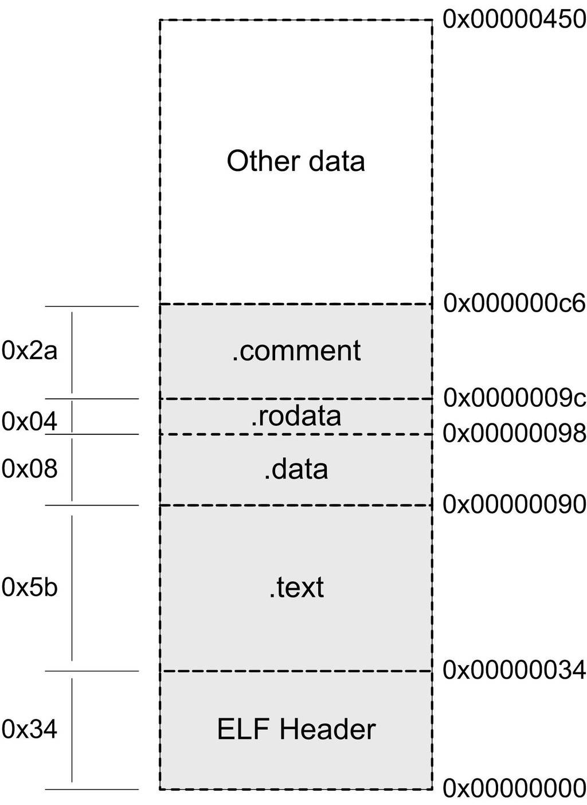
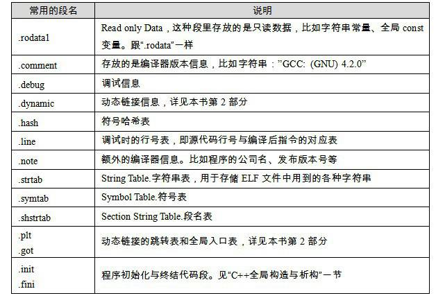

<h2>3.3 挖掘SimpleSection.o</h2>

前面對於目的檔只是作了概念上的闡述，如果不徹底深入目的檔的具體細節，相信這樣的分析也只是泛泛而談，沒有真正深入理解的效果。就像知道TCP/IP協議是基於包的結構，但是從來卻沒有看到過包的結構是怎樣的，包的頭部有哪些內容？目標地址和源地址是怎麼存放的？如果不瞭解這些，那麼對於TCP/IP的瞭解是粗略的，不夠細致的。很多問題其實在表面上看似很簡單，其實深入內部會發現很多鮮為人知的秘密，或者發現以前自己認為理所當然的東西居然是錯誤的，或者是有偏差的。對於系統軟體也是如此，不瞭解ELF檔案的結構細節就像學習了TCP/IP網路沒有了解IP包頭的結構一樣。本節後面的內容就是以ELF目的檔格式作為例子，徹底深入剖析目的檔，爭取不放過任何一個位元組。

真正了不起的程式設計師對自己的程式的每一個位元組都瞭如指掌。

——佚名

我們就以前面提到過的SimpleSection.c編譯出來的目的檔作為分析物件，這個程式是經過精心挑選的，具有一定的代表性而又不至於過於繁瑣和複雜。在接下來所進行的一係列編譯、連結和相關的實驗過程中，我們將會用到第1章所提到過的工具套件，比如GCC編譯器、binutils等工具，如果你忘了這些工具怎麼使用，那麼在閱讀過程中可以再回去參考本書第1部分的內容。圖3-1中的程式程式碼如清單3-1所示。

清單3-1

<pre>/* 
 * SimpleSection.c
 * 
 * Linux:
 *   gcc -c SimpleSection.c
 *
 * Windows:
 *   cl SimpleSection.c /c /Za
 */

int printf( const char* format, ... );

int global_init_var = 84;
int global_uninit_var;

void func1( int i ) 
{
  printf( "%d\n",  i );
}

int main(void)
{
    static int static_var = 85;
 static int static_var2;

    int a = 1;
    int b; 

    func1( static_var + static_var2 + a + b );

    return a; 
}
</pre>

如不加說明，則以下所分析的都是32位Intel x86平台下的ELF檔案格式。

我們使用GCC來編譯這個檔案（引數 -c 表示只編譯不連結）：

<pre>$ gcc –c SimpleSection.c</pre>

我們得到了一個1 104位元組（該檔案大小可能會因為編譯器版本以及機器平台不同而變化）的SimpleSection.o目的檔。我們可以使用binutils的工具objdump來檢視object內部的結構，這個工具在第1部分已經介紹過了，它可以用來檢視各種目的檔的結構和內容。執行以下命令：

<pre>$ objdump -h SimpleSection.o

SimpleSection.o:     file format elf32-i386

Sections:
Idx Name        Size      VMA         LMA       File off  Algn
  0 .text       0000005b  00000000  00000000  00000034  2**2
                CONTENTS, ALLOC, LOAD, RELOC, READONLY, CODE
  1 .data       00000008  00000000  00000000  00000090  2**2
                CONTENTS, ALLOC, LOAD, DATA
  2 .bss        00000004  00000000  00000000  00000098  2**2
                ALLOC
  3 .rodata     00000004  00000000  00000000  00000098  2**0
                CONTENTS, ALLOC, LOAD, READONLY, DATA
  4 .comment    0000002a  00000000  00000000  0000009c  2**0
                CONTENTS, READONLY
  5 .note.GNU-stack 00000000  00000000  00000000  000000c6  2**0
                CONTENTS, READONLY
</pre>

GCC和binutils可被移植到各種平台上，所以它們支援多種目的檔格式。比如Windows下的GCC和binutils支援PE檔案格式、Linux版本支援ELF格式。Linux還有一個很不錯的工具叫readelf，它是專門針對ELF檔案格式的解析器，很多時候它對ELF檔案的分析可以跟objdump相互對照，所以我們下面會經常用到這個工具。

引數“-h”就是把ELF檔案的各個段的基本資訊列印出來。我們也可以使用“objdump –x”把更多的資訊列印出來，但是“-x”輸出的這些資訊又多又複雜，對於不熟悉ELF和objdump的讀者來說可能會很陌生。我們還是先把ELF段的結構分析清楚。從上面的結果來看，SimpleSection.o的段的數量比我們想象中的要多，除了最基本的程式碼段、資料段和BSS段以外，還有3個段分別是只讀資料段（.rodata）、注釋資訊段（.comment）和堆疊提示段（.note.GNU-stack），這3個額外的段的意義我們暫且不去細究。先來看看幾個重要的段的屬性，其中最容易理解的是段的長度（Size）和段所在的位置（File Offset），每個段的第2行中的“CONTENTS”、“ALLOC”等表示段的各種屬性，“CONTENTS”表示該段在檔案中存在。我們可以看到BSS段沒有“CONTENTS”，表示它實際上在ELF檔案中不存在內容。“.note.GNU-stack”段雖然有“CONTENTS”，但它的長度為0，這是個很古怪的段，我們暫且忽略它，認為它在ELF檔案中也不存在。那麼ELF檔案中實際存在的也就是“.text”、“.data”、“.rodata”和“.comment”這4個段了，它們的長度和在檔案中的偏移位置我們已經用粗體表示出來了。它們在ELF中的結構如圖3-3所示。

瞭解了這幾個段在SimpleSection.o的基本分佈，接著將逐個來看這幾個段，看看它們包含了什麼內容。

有一個專門的命令叫做“size”，它可以用來檢視ELF檔案的程式碼段、資料段和BSS段的長度（dec表示3個段長度的和的十進製，hex表示長度和的十六進位）：

<pre>$ size SimpleSection.o
  text  data  bss  dec  hex  filename
    95     8    4  107   6b  SimpleSection.o
</pre>

3.3.1 程式碼段

挖掘各個段的內容，我們還是離不開objdump這個利器。objdump的<code>“-s</code>”引數可以將所有段的內容以十六進位的方式列印出來<code>，“-d</code>”引數可以將所有包含指令的段反組譯。我們將objdump輸出中關於程式碼段的內容提取出來，分析一下關於程式碼段的內容（省略號表示略去無關內容）：

<pre>$ objdump -s -d SimpleSection.o
……
Contents of section .text:
 0000 5589e583 ec088b45 08894424 04c70424  U......E..D$...$
 0010 00000000 e8fcffff ffc9c38d 4c240483  ............L$..
 0020 e4f0ff71 fc5589e5 5183ec14 c745f401  ...q.U..Q....E..
 0030 0000008b 15040000 00a10000 00008d04  ................
 0040 020345f4 0345f889 0424e8fc ffffff8b  ..E..E...$......
 0050 45f483c4 14595d8d 61fcc3             E....Y].a..  
……
00000000 &lt;func1&gt;:
   0:   55                    push   %ebp
   1:   89 e5                 mov    %esp,%ebp
   3:   83 ec 08                  sub    $0x8,%esp
   6:   8b 45 08                  mov    0x8(%ebp),%eax
   9:   89 44 24 04             mov    %eax,0x4(%esp)
   d:   c7 04 24 00 00 00 00  movl   $0x0,(%esp)
  14:   e8 fc ff ff ff        call   15 &lt;func1+0x15&gt;
  19:   c9                        leave
  1a:   c3                        ret

0000001b &lt;main&gt;:
  1b:   8d 4c 24 04             lea  0x4(%esp),%ecx
  1f:   83 e4 f0                and    $0xfffffff0,%esp
  22:   ff 71 fc                pushl  -0x4(%ecx)
  25:   55                        push   %ebp
  26:   89 e5                   mov    %esp,%ebp
  28:   51                        push   %ecx
  29:   83 ec 14                sub    $0x14,%esp
  2c:   c7 45 f4 01 00 00 00  movl   $0x1,-0xc(%ebp)
  33:   8b 15 04 00 00 00     mov  0x4,%edx
  39:   a1 00 00 00 00          mov  0x0,%eax
  3e:   8d 04 02                lea    (%edx,%eax,1),%eax
  41:   03 45 f4                add    -0xc(%ebp),%eax
  44:   03 45 f8                add    -0x8(%ebp),%eax
  47:   89 04 24                mov    %eax,(%esp)
  4a:   e8 fc ff ff ff          call   4b &lt;main+0x30&gt;
  4f:   8b 45 f4                mov    -0xc(%ebp),%eax
  52:   83 c4 14                add    $0x14,%esp
  55:   59                        pop    %ecx
  56:   5d                        pop    %ebp
  57:   8d 61 fc                lea    -0x4(%ecx),%esp
  5a:   c3                        ret
</pre>

“Contents of section .text”就是.text的資料以十六進位方式列印出來的內容，總共0x5b位元組，跟前面我們瞭解到的“.text”段長度相符合，最左面一列是偏移量，中間4列是十六進位內容，最右面一列是.text段的ASCII碼形式。對照下面的反組譯結果，可以很明顯地看到，.text段裡所包含的正是SimpleSection.c裡兩個函式<code>func1()</code>和<code>main()</code>的指令。.text段的第一個位元組“<code>0x55</code>”就是“<code>func1()”</code>函式的第一條“<code>push %ebp</code>”指令，而最後一個位元組<code>0xc3</code>正是<code>main()</code>函式的最後一條指令“<code>ret</code>”。

3.3.2 資料段和只讀資料段

.data段儲存的是那些已經初始化了的全域性靜態變數和區域性靜態變數。前面的SimpleSection.c程式碼裡面一共有兩個這樣的變數，分別是<code>global_init_varabal</code>與<code>static_var</code>。這兩個變數每個4個位元組，一共剛好8個位元組，所以“.data”這個段的大小為8個位元組。

SimpleSection.c裡面我們在呼叫“printf”的時候，用到了一個字串常量“%d\n”，它是一種只讀資料，所以它被放到了“.rodata”段，我們可以從輸出結果看到“.rodata”這個段的4個位元組剛好是這個字串常量的ASCII位元組序，最後以\0結尾。

“.rodata”段存放的是只讀資料，一般是程式裡面的只讀變數（如const修飾的變數）和字串常量。單獨設立“.rodata”段有很多好處，不光是在語義上支援了C++的const關鍵字，而且作業系統在載入的時候可以將“.rodata”段的屬性對映成只讀，這樣對於這個段的任何修改操作都會作為非法操作處理，保證了程式的安全性。另外在某些嵌入式平台下，有些儲存區域是採用只讀儲存器的，如ROM，這樣將“.rodata”段放在該儲存區域中就可以保證程式訪問儲存器的正確性。

另外值得一提的是，有時候編譯器會把字串常量放到“.data”段，而不會單獨放在“.rodata”段。有興趣的讀者可以試著把SimpleSection.c的檔名改成SimpleSection.cpp，然後用各種MSVC編譯器編譯一下看看字串常量的存放情況。

<pre>$ objdump -x -s -d SimpleSection.o
……
Sections:
  Idx Name          Size      VMA       LMA       File off  Algn
       1 .data      00000008  00000000  00000000  00000090  2**2
                    CONTENTS, ALLOC,    LOAD,     DATA
       3 .rodata    00000004  00000000  00000000  00000098  2**0
                  CONTENTS, ALLOC,    LOAD,     READONLY, DATA
……
Contents of section .data:
 0000 54000000 55000000                    T...U... 
Contents of section .rodata:
 0000 25640a00                              %d..            
……
</pre>

我們看到“.data”段裡的前4個位元組，從低到高分別為0x54、0x00、0x00、0x00。這個值剛好是<code>global_init_varabal</code>，即十進製的84。<code>global_init_varabal</code>是個4位元組長度的int型別，為什麼存放的次序為0x54、0x00、0x00、0x00而不是0x00、0x00、0x00、0x54？這涉及CPU的位元組序（Byte Order）的問題，也就是所謂的大端（Big-endian）和小端（Little-endian）的問題。關於位元組序的問題本書的附錄有詳細的介紹。而最後4個位元組剛好是<code>static_init_var</code>的值，即85。

3.3.3 BSS段

.bss段存放的是未初始化的全域性變數和區域性靜態變數，如上述程式碼中<code>global_uninit_var</code>和<code>static_var2</code>就是被存放在.bss段，其實更準確的說法是.bss段為它們預留了空間。但是我們可以看到該段的大小只有4個位元組，這與<code>global_uninit_var</code>和<code>static_var2</code>的大小的8個位元組不符。

其實我們可以透過符號表（Symbol Table）（後面章節介紹符號表）看到，只有<code>static_var2</code>被存放在了.bss段，而<code>global_uninit_var</code>卻沒有被存放在任何段，只是一個未定義的“COMMON符號”。這其實是跟不同的語言與不同的編譯器實現有關，有些編譯器會將全域性的未初始化變數存放在目的檔.bss段，有些則不存放，只是預留一個未定義的全域性變數符號，等到最終連結成執行檔的時候再在.bss段分配空間。我們將在“弱符號與強符號”和“COMMON塊”這兩個章節深入分析這個問題。原則上講，我們可以簡單地把它當作全域性未初始化變數存放在.bss段。值得一提的是編譯單元內部可見的靜態變數（比如給<code>global_uninit_var</code>加上static修飾）的確是存放在.bss段的，這一點很容易理解。

<pre>$ objdump -x -s -d SimpleSection.o
……
Sections:
   Idx Name         Size      VMA       LMA       File off  Algn
        2 .bss      00000004  00000000  00000000  00000098  2**2
                    ALLOC
……
</pre>

Quiz 變數存放位置

現在讓我們來做一個小的測試，請看以下程式碼：

<pre>static int x1 = 0;
static int x2 = 1;
</pre>

x1和x2會被放在什麼段中呢？

x1會被放在.bss中，x2會被放在.data中。為什麼一個在.bss段, 一個在.data段？ 因為x1為0，可以認為是未初始化的，因為未初始化的都是0，所以被最佳化掉了可以放在.bss，這樣可以節省磁碟空間，因為.bss不佔磁碟空間。另外一個變數x2初始化值為1，是初始化的，所以放在.data段中。

這種類似的編譯器的最佳化會對我們分析系統軟體背後的機制帶來很多障礙，使得很多問題不能一目瞭然，本書將盡量避開這些最佳化過程，還原機制和原理本身。

3.3.4 其他段

除了.text、.data、.bss這3個最常用的段之外，ELF檔案也有可能包含其他的段，用來儲存與程式相關的其他資訊。表3-2中列舉了ELF的一些常見的段。

 表3-2 …

這些段的名字都是由“.”作為字首，表示這些表的名字是系統保留的，應用程式也可以使用一些非系統保留的名字作為段名。比如我們可以在ELF檔案中插入一個“music”的段，裡面存放了一首MP3音樂，當ELF檔案執行起來以後可以讀取這個段播放這首MP3。但是應用程式自定義的段名不能使用“.”作為字首，否則容易跟系統保留段名衝突。一個ELF檔案也可以擁有幾個相同段名的段，比如一個ELF檔案中可能有兩個或兩個以上叫做“.text”的段。還有一些保留的段名是因為ELF檔案歷史遺留問題造成的，以前用過的一些名字如.sdata、.tdesc、.sbss、.lit4、.lit8、.reginfo、.gptab、.liblist、.conflict。可以不用理會這些段，它們已經被遺棄了。

Q&amp;A

Q：如果我們要將一個二進位檔案，比如圖片、MP3音樂、詞典一類的東西作為目的檔中的一個段，該怎麼做？

A：可以使用objcopy工具，比如我們有一個圖片檔案“image.jpg”，大小為0x82100位元組：

<pre>$ objcopy -I binary -O elf32-i386 -B i386 image.jpg image.o 
$ objdump -ht image.o

image.o:     file format elf32-i386

Sections:
Idx Name          Size      VMA       LMA       File off  Algn
  0 .data         00081200  00000000  00000000  00000034  2**0
                  CONTENTS, ALLOC, LOAD, DATA
SYMBOL TABLE:
00000000 l    d  .data  00000000 .data
00000000 g       .data  00000000 _binary_image_jpg_start
00081200 g       .data  00000000 _binary_image_jpg_end
00081200 g       *ABS*  00000000 _binary_image_jpg_size
</pre>

符號<code>“_binary_image_jpg_start</code><code>”、“_binary_image_jpg_end</code>”和“_<code>binary_image_jpg_size</code>”分別表示該圖片檔案在記憶體中的起始地址、結束地址和大小，我們可以在程式裡面直接宣告並使用它們。

自定義段

正常情況下，GCC編譯出來的目的檔中，程式碼會被放到“.text”段，全域性變數和靜態變數會被放到“.data”和“.bss”段，正如我們前面所分析的。但是有時候你可能希望變數或某些部分程式碼能夠放到你所指定的段中去，以實現某些特定的功能。比如為了滿足某些硬體的記憶體和I/O的地址佈局，或者是像Linux作業系統核心中用來完成一些初始化和使用者空間複製時出現頁錯誤異常等。GCC提供了一個擴充套件機制，使得程式設計師可以指定變數所處的段：

<pre>__attribute__((section("FOO"))) int global = 42;

__attribute__((section("BAR"))) void foo()
{
}
</pre>

我們在全域性變數或函式之前加上“__<code>attribute__((section(“name”)))</code>”屬性就可以把相應的變數或函式放到以“<code>name</code>”作為段名的段中。

