<h2>3.4 ELF檔案結構描述</h2>

我們已經透過SimpleSection.o的結構大致瞭解了ELF檔案的輪廓，接著就來看看ELF檔案的結構格式。圖3-4描述的是ELF目的檔的總體結構，我們省去了ELF一些繁瑣的結構，把最重要的結構提取出來，形成了如圖3-4所示的ELF檔案基本結構圖，隨著我們討論的展開，ELF檔案結構會在這個基本結構之上慢慢變得複雜起來。

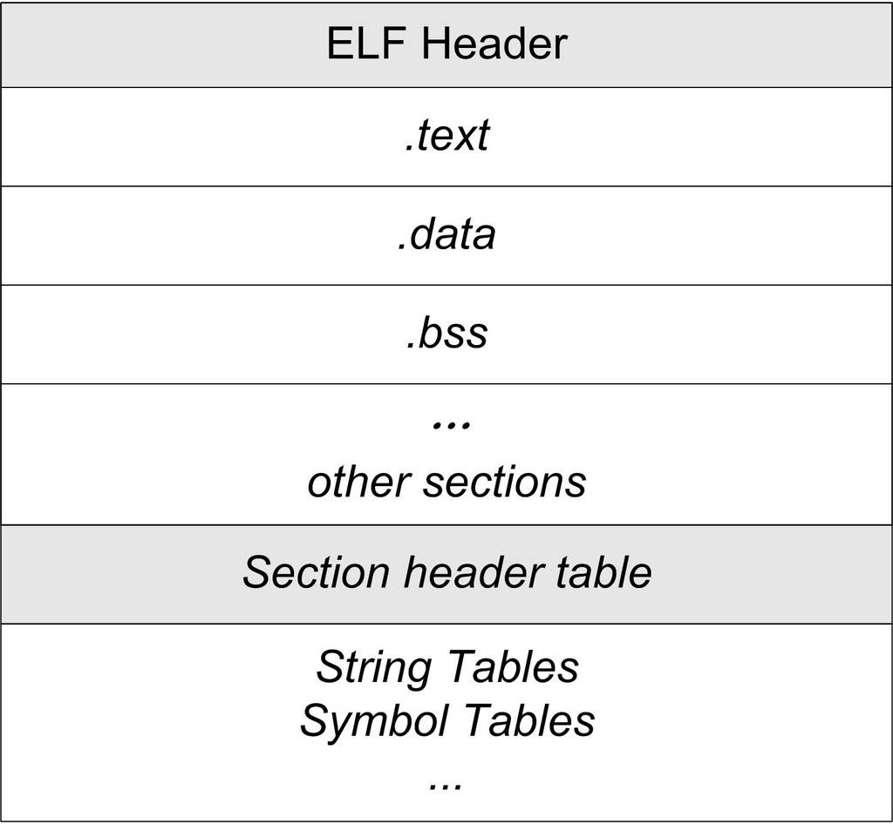 圖3-4 ELF 結構 …

ELF目的檔格式的最前部是ELF檔案頭（ELF Header），它包含了描述整個檔案的基本屬性，比如ELF檔案版本、目標機器型號、程式入口地址等。緊接著是ELF檔案各個段。其中ELF檔案中與段有關的重要結構就是段表（Section Header Table），該表描述了ELF檔案包含的所有段的資訊，比如每個段的段名、段的長度、在檔案中的偏移、讀寫許可權及段的其他屬性。接著將詳細分析ELF檔案頭、段表等ELF關鍵的結構。另外還會介紹一些ELF中輔助的結構，比如字串表、符號表等，這些結構我們在本節只是簡單介紹一下，到相關章節中再詳細展開。

3.4.1 檔案頭

我們可以用readelf命令來詳細檢視ELF檔案，程式碼如清單3-2所示。

清單3-2 檢視ELF檔案頭

<pre>$readelf –h SimpleSection.o
ELF Header:
  Magic:   7f 45 4c 46 01 01 01 00 00 00 00 00 00 00 00 00
  Class:                              ELF32
  Data:                             2's complement, little endian
  Version:                          1 (current)
  OS/ABI:                             UNIX - System V
  ABI Version:                    0
  Type:                               REL (Relocatable file)
  Machine:                            Intel 80386
  Version:                        0x1
  Entry point address:            0x0
  Start of program headers:       0 (bytes into file)
  Start of section headers:       280 (bytes into file)
  Flags:                          0x0
  Size of this header:          52 (bytes)
  Size of program headers:        0 (bytes)
  Number of program headers:      0
  Size of section headers:        40 (bytes)
  Number of section headers:      11
  Section header string table index:  8
</pre>

從上面輸出的結果可以看到，ELF的檔案頭中定義了ELF魔數、檔案機器位元組長度、資料儲存方式、版本、執行平台、ABI版本、ELF重定位型別、硬體平台、硬體平台版本、入口地址、程式頭入口和長度、段表的位置和長度及段的數量等。這些數值中有關描述ELF目標平台的部分，與我們常見的32位Intel的硬體平台基本上一樣。

ELF檔案頭結構及相關常數被定義在“/usr/include/elf.h”裡，因為ELF檔案在各種平台下都通用，ELF檔案有32位版本和64位版本。它的檔案頭結構也有這兩種版本，分別叫做“Elf32_Ehdr”和“Elf64_Ehdr”。32位版本與64位版本的ELF檔案的檔案頭內容是一樣的，只不過有些成員的大小不一樣。為了對每個成員的大小做出明確的規定以便於在不同的編譯環境下都擁有相同的欄位長度，“elf.h”使用typedef定義了一套自己的變數體係，如表3-3所示。

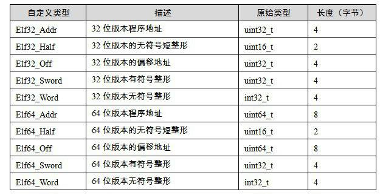 表3-3 …

我們這裡以32位版本的檔案頭結構“<code>Elf32_Ehdr</code>”作為例子來描述，它的定義如下：

<pre>typedef struct {
    unsigned char e_ident[16];
    Elf32_Half e_type;
    Elf32_Half e_machine;
    Elf32_Word e_version;
    Elf32_Addr e_entry;
    Elf32_Off  e_phoff;
    Elf32_Off  e_shoff;
    Elf32_Word e_flags;
    Elf32_Half e_ehsize;
    Elf32_Half e_phentsize;
    Elf32_Half e_phnum;
    Elf32_Half e_shentsize;
    Elf32_Half e_shnum;
    Elf32_Half e_shstrndx;
} Elf32_Ehdr;
</pre>

讓我們拿ELF檔案頭結構跟前面readelf輸出的ELF檔案頭資訊相比照，可以看到輸出的資訊與ELF檔案頭中的結構很多都一一對應。有點例外的是“Elf32_Ehdr”中的e_ident這個成員對應了readelf輸出結果中的“Class”、“Data”、“Version”、“OS/ABI”和“ABI Version”這5個引數。剩下的引數與“Elf32_Ehdr”中的成員都一一對應。我們在表3-4中簡單地列舉一下，讓大家有個初步的印象，詳細的定義可以在ELF標準文件裡面找到。表3-4是ELF檔案頭中各個成員的含義與readelf輸出結果的對照表。

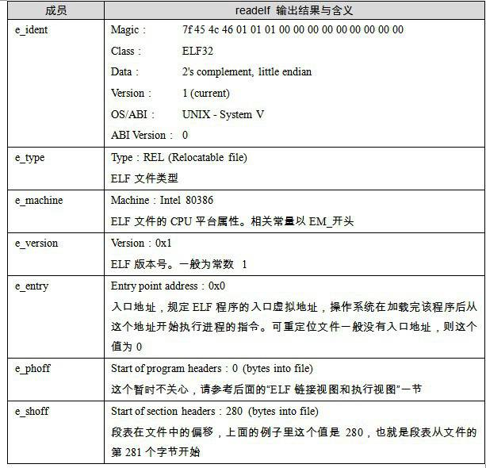 表3-4 ELF檔案頭結構成員含義 …

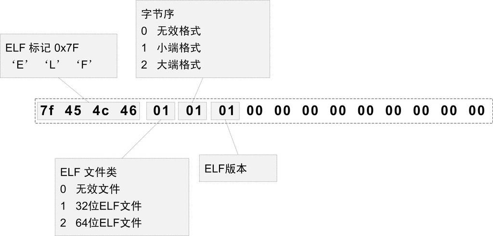 圖3-5 ELF 魔數 …

最開始的4個位元組是所有ELF檔案都必須相同的標識碼，分別為0x7F、0x45、0x4c、0x46，第一個位元組對應ASCII字元裡面的DEL控制符，後面3個位元組剛好是ELF這3個字母的ASCII碼。這4個位元組又被稱為ELF檔案的魔數，幾乎所有的執行檔格式的最開始的幾個位元組都是魔數。比如a.out格式最開始兩個位元組為 0x01、0x07；PE/COFF檔案最開始兩個個位元組為0x4d、0x5a，即ASCII字元MZ。這種魔數用來確認檔案的型別，作業系統在載入執行檔的時候會確認魔數是否正確，如果不正確會拒絕載入。

接下來的一個位元組是用來標識ELF的檔案類的，0x01表示是32位的，0x02表示是64位的；第6個字是位元組序，規定該ELF檔案是大端的還是小端的（見附錄：位元組序）。第7個位元組規定ELF檔案的主版本號，一般是1，因為ELF標準自1.2版以後就再也沒有更新了。後面的9個位元組ELF標準沒有定義，一般填0，有些平台會使用這9個位元組作為擴充套件標誌。

各種魔數的由來

a.out格式的魔數為0x01、0x07，為什麼會規定這個魔數呢？

UNIX早年是在PDP小型機上誕生的，當時的系統在載入一個執行檔後直接從檔案的第一個位元組開始執行，人們一般在檔案的最開始放置一條跳轉（jump）指令，這條指令負責跳過接下來的7個機器字的檔案頭到執行檔的真正入口。而0x01 0x07這兩個位元組剛好是當時PDP-11的機器的跳轉7個機器字的指令。為了跟以前的系統保持相容性，這條跳轉指令被當作魔數一直被保留到了幾十年後的今天。

計算機系統中有很多怪異的設計背後有著很有趣的歷史和傳統，瞭解它們的由來可以讓我們瞭解到很多很有意思的事情。這讓我想起了經濟學裡面所謂的“路徑依賴”，其中一個很有意思的叫“馬屁股決定太空梭”的故事在網上流傳很廣泛，有興趣的話你可以在google以“馬屁股”和“太空梭”作為關鍵字搜尋一下。

ELF檔案標準歷史

20世紀90年代，一些廠商聯合成立了一個委員會，起草並發布了一個ELF檔案格式標準供公開使用，並且希望所有人能夠遵循這項標準並且從中獲益。1993年，委員會發布了ELF檔案標準。當時參與該委員會的有來自於編譯器的廠商，如Watcom和Borland；來自CPU的廠商如IBM和Intel；來自作業系統的廠商如IBM和Microsoft。1995年，委員會發布了ELF 1.2標準，自此委員會完成了自己的使命，不久就解散了。所以ELF檔案格式標準的最新版本為1.2。

檔案型別 <code>e_type</code>成員表示ELF檔案型別，即前面提到過的3種ELF檔案型別，每個檔案型別對應一個常量。系統透過這個常量來判斷ELF的真正檔案型別，而不是透過檔案的副檔名。相關常量以“<code>ET_”</code>

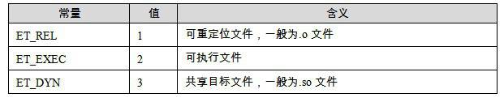 表3-5 …

機器型別 ELF檔案格式被設計成可以在多個平台下使用。這並不表示同一個ELF檔案可以在不同的平台下使用（就像java的位元組碼檔案那樣），而是表示不同平台下的ELF檔案都遵循同一套ELF標準。<code>e_machine</code>成員就表示該ELF檔案的平台屬性，比如3表示該ELF檔案只能在Intel x86機器下使用，這也是我們最常見的情況。相關的常量以“<code>EM_”</code>開頭，如表3-6所示。

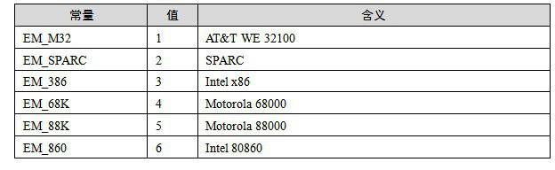 表3-6 …

3.4.2 段表

我們知道ELF檔案中有很多各種各樣的段，這個段表（Section Header Table）就是儲存這些段的基本屬性的結構。段表是ELF檔案中除了檔案頭以外最重要的結構，它描述了ELF的各個段的資訊，比如每個段的段名、段的長度、在檔案中的偏移、讀寫許可權及段的其他屬性。也就是說，ELF檔案的段結構就是由段表決定的，編譯器、連結器和載入器都是依靠段表來定位和訪問各個段的屬性的。段表在ELF檔案中的位置由ELF檔案頭的“<code>e_shoff</code>”成員決定，比如SimpleSection.o中，段表位於偏移0x118。

前文中我們使用了“objudmp -h”來檢視ELF檔案中包含的段，結果是SimpleSection裡面看到了總共有6個段，分別是<code>“.code</code><code>”、“.data</code><code>”、“.bss</code>”、“.<code>rodata</code>”、“.<code>comment</code>”和“.<code>note.GNU-stack</code>”。實際上的情況卻有所不同，“objdump -h”命令只是把ELF檔案中關鍵的段顯示了出來，而省略了其他的輔助性的段，比如：符號表、字串表、段名字串表、重定位表等。我們可以使用readelf工具來檢視ELF檔案的段，它顯示出來的結果才是真正的段表結構：

<pre>$ readelf -S SimpleSection.o
There are 11 section headers, starting at offset 0x118:

Section Headers:
 [Nr] Name          Type      Addr     Off    Size   ES Flg Lk Inf Al
 [ 0]               NULL      00000000 000000 000000 00 0   0  0
 [ 1] .text         PROGBITS  00000000 000034 00005b 00 AX  0  0   4
 [ 2] .rel.text     REL       00000000 000428 000028 08     9  1   4
 [ 3] .data         PROGBITS  00000000 000090 000008 00 WA  0  0   4
 [ 4] .bss          NOBITS    00000000 000098 000004 00 WA  0  0   4
 [ 5] .rodata       PROGBITS  00000000 000098 000004 00 A   0  0   1
 [ 6] .comment        PROGBITS  00000000 00009c 00002a 00 0   0  1
 [ 7] .note.GNU-stack PROGBITS  00000000 0000c6 000000 00 0   0  1
 [ 8] .shstrtab   STRTAB    00000000 0000c6 000051 00 0   0  1
 [ 9] .symtab       SYMTAB    00000000 0002d0 0000f0 10     10 10   4
 [10] .strtab       STRTAB    00000000 0003c0 000066 00 0   0  1
Key to Flags:
  W (write), A (alloc), X (execute), M (merge), S (strings)
  I (info), L (link order), G (group), x (unknown)
  O (extra OS processing required) o (OS specific), p (processor specific)
</pre>

readelf輸出的結果就是ELF檔案段表的內容，那麼就讓我們對照這個輸出來看看段表的結構。段表的結構比較簡單，它是一個以“<code>Elf32_Shdr</code>”結構體為元素的陣列。陣列元素的個數等於段的個數，每個“<code>Elf32_Shdr</code>”結構體對應一個段。“<code>Elf32_Shdr</code>”又被稱為段描述符（Section Descriptor）。對於SimpleSection.o來說，段表就是有11個元素的陣列。ELF段表的這個陣列的第一個元素是無效的段描述符，它的型別為“NULL”，除此之外每個段描述符都對應一個段。也就是說SimpleSection.o共有10個有效的段。

陣列的存放方式

ELF檔案裡面很多地方採用了這種與段表類似的陣列方式儲存。一般定義一個固定長度的結構，然後依次存放。這樣我們就可以使用下標來引用某個結構。

<code>Elf32_Shdr</code>被定義在“/usr/include/elf.h”，程式碼如清單3-3所示。

清單3-3 Elf32_Shdr段描述符結構

<pre>typedef struct
{
  Elf32_Word    sh_name;
  Elf32_Word    sh_type;
  Elf32_Word    sh_flags;
  Elf32_Addr    sh_addr;
  Elf32_Off     sh_offset;
  Elf32_Word    sh_size;
  Elf32_Word    sh_link;
  Elf32_Word    sh_info;
  Elf32_Word    sh_addralign;
  Elf32_Word    sh_entsize;
} Elf32_Shdr;
</pre>

<code>Elf32_Shdr</code>的各個成員的含義如表3-7所示。

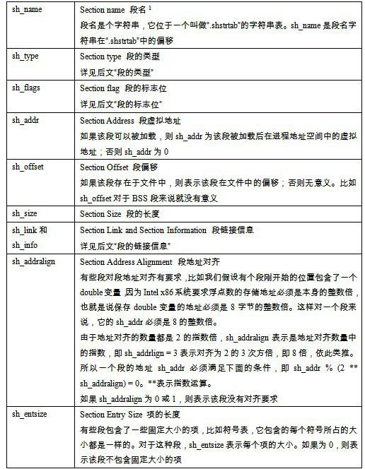 表3-7 …

注 1：事實上段的名字對於編譯器、連結器來說是有意義的，但是對於作業系統來說並沒有實質的意義，對於作業系統來說，一個段該如何處理取決於它的屬性和許可權，即由段的型別和段的標誌位這兩個成員決定。

注 2：關於這些欄位，涉及一些映像檔案的載入的概念，我們將在本書的第2部分詳細介紹其相關內容，讀者也可以先閱讀第2部分的最前面一章“執行檔的載入於程式”，瞭解一下載入的概念，然後再來閱讀關於段的虛擬大小和虛擬地址的內容。當然，如果讀者對映像檔案載入過程比較熟悉，應該很容易理解這些內容。

讓我們對照<code>Elf32_Shdr</code>和“<code>readelf -S</code>”的輸出結果，可以很明顯看到，結構體的每一個成員對應於輸出結果中從第二列“Name”開始的每一列。於是SimpleSection的段表的位置如圖3-6所示。

到了這一步，我們才徹徹底底把SimpleSection的所有段的位置和長度給分析清楚了。在圖3-6中，SectionTable長度為0x1b8，也就是440個位元組，它包含了11個段描述符，每個段描述符為40個位元組，這個長度剛好等於sizeof(Elf32_Shdr)，符合段描述符的結構體長度；整個檔案最後一個段“.rel.text”結束後，長度為0x450，即1104位元組，即剛好是SimpleSection.o的檔案長度。中間Section Table和“.rel.text”都因為對齊的原因，與前面的段之間分別有一個位元組和兩個位元組的間隔。

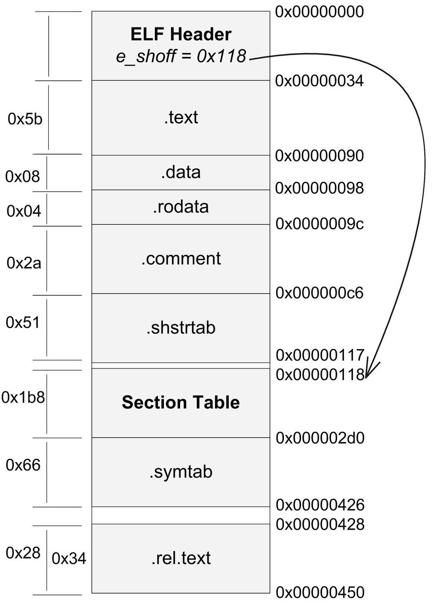 圖3-6 SimpleSection.o 的Section Table及所有段的位置和長度 …

段的型別（<code>sh_type</code>） 正如前面所說的，段的名字只是在連結和編譯過程中有意義，但它不能真正地表示段的型別。我們也可以將一個資料段命名為“.text”，對於編譯器和連結器來說，主要決定段的屬性的是段的型別（<code>sh_type</code>）和段的標誌位（<code>sh_flags</code>）。段的型別相關常量以SHT_開頭，列舉如表3-8所示。

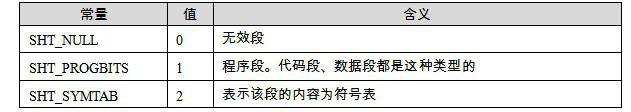 表3-8 …

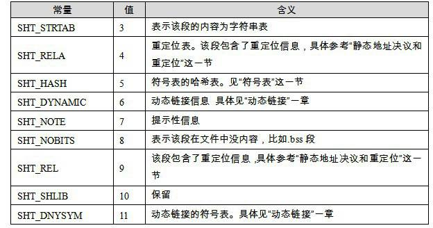

段的標誌位（<code>sh_flag</code>） 段的標誌位表示該段在程式虛擬地址空間中的屬性，比如是否可寫，是否可執行等。相關常量以SHF_開頭，如表3-9所示。

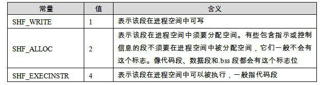 表3-9 …

對於系統保留段，表3-10列舉了它們的屬性。

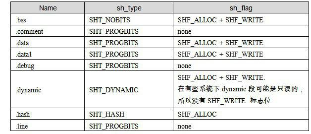

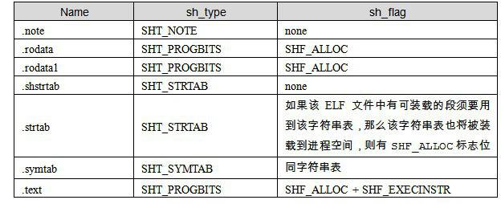

段的連結資訊（<code>sh_link</code>、<code>sh_info</code>） 如果段的型別是與連結相關的（不論是動態連結或靜態連結），比如重定位表、符號表等，那麼<code>sh_link</code>和<code>sh_info</code>這兩個成員所包含的意義如表3-11所示。對於其他型別的段，這兩個成員沒有意義。

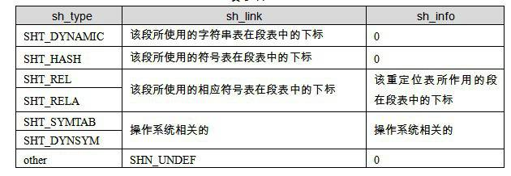 表3-11 …

3.4.3 重定位表

我們注意到，SimpleSection.o中有一個叫做“.rel.text”的段，它的型別（<code>sh_type</code>）為“<code>SHT_REL</code>”，也就是說它是一個重定位表（Relocation Table）。正如我們最開始所說的，連結器在處理目的檔時，需要對目的檔中某些部位進行重定位，即程式碼段和資料段中那些對絕對地址的引用的位置。這些重定位的資訊都記錄在ELF檔案的重定位表裡面，對於每個需要重定位的程式碼段或資料段，都會有一個相應的重定位表。比如SimpleSection.o中的“.rel.text”就是針對“.text”段的重定位表，因為“.text”段中至少有一個絕對地址的引用，那就是對“printf”函式的呼叫；而“.data”段則沒有對絕對地址的引用，它只包含了幾個常量，所以SimpleSection.o中沒有針對“.data”段的重定位表“.rel.data”。

一個重定位表同時也是ELF的一個段，那麼這個段的型別（<code>sh_type</code>）就是“<code>SHT_REL</code>”型別的，它的“<code>sh_link</code>”表示符號表的下標，它的“<code>sh_info</code>”表示它作用於哪個段。比如“.rel.text”作用於“.text”段，而“.text”段的下標為“1”，那麼“.rel.text”的“<code>sh_info</code>”為“1”。

關於重定位表的內部結構我們在這裡先不展開了，在下一章分析靜態連結過程的時候，我們還會詳細地分析重定位表的結構。

3.4.4 字串表

ELF檔案中用到了很多字串，比如段名、變數名等。因為字串的長度往往是不定的，所以用固定的結構來表示它比較困難。一種很常見的做法是把字串集中起來存放到一個表，然後使用字串在表中的偏移來引用字串。比如表3-12這個字串表。

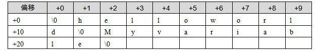 表3-12 …

那麼偏移與它們對應的字串如表3-13所示。

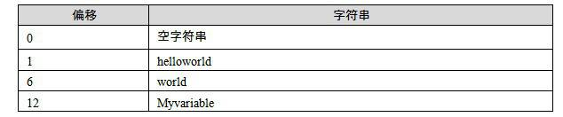 表3-13 …

透過這種方法，在ELF檔案中引用字串只需要給出一個數字下標即可，不用考慮字串長度的問題。一般字串表在ELF檔案中也以段的形式儲存，常見的段名為“.strtab”或“.shstrtab”。這兩個字串表分別為字串表（String Table）和段表字串表（Section Header String Table）。顧名思義，字串表用來儲存普通的字串，比如符號的名字；段表字串表用來儲存段表中用到的字串，最常見的就是段名（<code>sh_name</code>）。

接著我們再回頭看這個ELF檔案頭中的“<code>e_shstrndx</code>”的含義，我們在前面提到過，“<code>e_shstrndx</code>”是<code>Elf32_Ehdr</code>的最後一個成員，它是“Section header string table index”的縮寫。我們知道段表字串表本身也是ELF檔案中的一個普通的段，知道它的名字往往叫做“.shstrtab”。那麼這個“<code>e_shstrndx</code>”就表示“.shstrtab”在段表中的下標，即段表字串表在段表中的下標。前面的SimpleSection.o中，“<code>e_shstrndx</code>”的值為8，我們再對照“<code>readelf -S</code>”的輸出結果，可以看到“.shstrtab”這個段剛好位於段表中的下標為8的位置上。由此，我們可以得出結論，只有分析ELF檔案頭，就可以得到段表和段表字串表的位置，從而解析整個ELF檔案。

