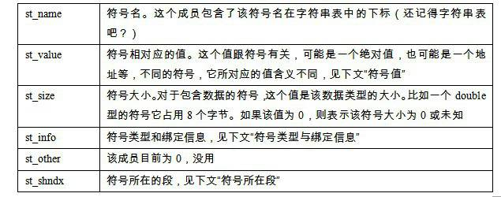
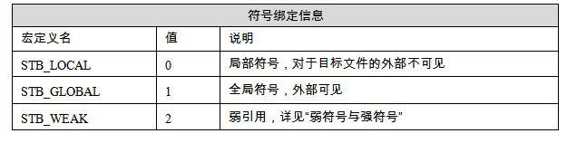
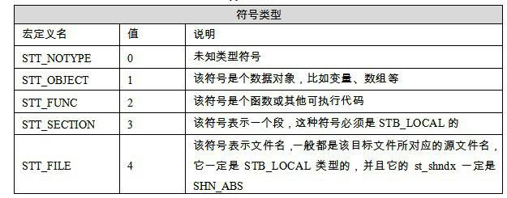
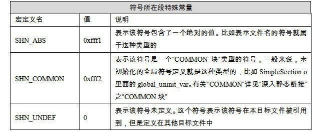
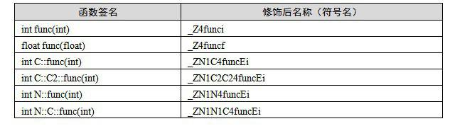
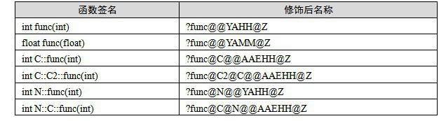

<h2>3.5 連結的介面——符號</h2>

連結過程的本質就是要把多個不同的目的檔之間相互“粘”到一起，或者說像玩具積木一樣，可以拚裝形成一個整體。為了使不同目的檔之間能夠相互粘合，這些目的檔之間必須有固定的規則才行，就像積木模組必須有凹凸部分才能夠拚合。在連結中，目的檔之間相互拚合實際上是目的檔之間對地址的引用，即對函式和變數的地址的引用。比如目的檔B要用到了目的檔A中的函式“foo”，那麼我們就稱目的檔A定義（Define）了函式“foo”，稱目的檔B引用（Reference）了目的檔A中的函式“foo”。這兩個概念也同樣適用於變數。每個函式或變數都有自己獨特的名字，才能避免連結過程中不同變數和函式之間的混淆。在連結中，我們將函式和變數統稱為符號（Symbol），函式名或變數名就是符號名（Symbol Name）。

我們可以將符號看作是連結中的粘合劑，整個連結過程正是基於符號才能夠正確完成。連結過程中很關鍵的一部分就是符號的管理，每一個目的檔都會有一個相應的符號表（Symbol Table），這個表裡面記錄了目的檔中所用到的所有符號。每個定義的符號有一個對應的值，叫做符號值（Symbol Value），對於變數和函式來說，符號值就是它們的地址。除了函式和變數之外，還存在其他幾種不常用到的符號。我們將符號表中所有的符號進行分類，它們有可能是下面這些型別中的一種：

定義在本目的檔的全域性符號，可以被其他目的檔引用。比如SimpleSection.o裡面的“<code>func1</code>”、“<code>main</code>”和“<code>global_init_var</code>”。

在本目的檔中引用的全域性符號，卻沒有定義在本目的檔，這一般叫做外部符號（External Symbol），也就是我們前面所講的符號引用。比如SimpleSection.o裡面的“printf”。

段名，這種符號往往由編譯器產生，它的值就是該段的起始地址。比如SimpleSection.o裡面的“.text”、“.data”等。

區域性符號，這類符號只在編譯單元內部可見。比如SimpleSection.o裡面的“<code>static_var</code>”和“<code>static_var2</code>”。偵錯程式可以使用這些符號來分析程式或崩潰時的核心轉儲檔案。這些區域性符號對於連結過程沒有作用，連結器往往也忽略它們。

行號資訊，即目的檔指令與原始碼中程式碼行的對應關係，它也是可選的。

對於我們來說，最值得關注的就是全域性符號，即上面分類中的第一類和第二類。因為連結過程只關心全域性符號的相互“粘合”，區域性符號、段名、行號等都是次要的，它們對於其他目的檔來說是“不可見”的，在連結過程中也是無關緊要的。我們可以使用很多工具來檢視ELF檔案的符號表，比如readelf、objdump、nm等，比如使用“nm”來檢視“SimpleSection.o”的符號結果如下：

<pre>$ nm SimpleSection.o
00000000 T func1
00000000 D global_init_var
00000004 C global_uninit_var
0000001b T main
         U printf
00000004 d static_var.1286
00000000 b static_var2.1287
</pre>

3.5.1 ELF符號表結構

ELF檔案中的符號表往往是檔案中的一個段，段名一般叫“.symtab”。符號表的結構很簡單，它是一個Elf32_Sym結構（32位ELF檔案）的陣列，每個Elf32_Sym結構對應一個符號。這個陣列的第一個元素，也就是下標0的元素為無效的“未定義”符號。Elf32_Sym的結構定義如下：

<pre>typedef struct {
    Elf32_Word st_name;
    Elf32_Addr st_value;
    Elf32_Word st_size;
    unsigned char st_info;
    unsigned char st_other;
    Elf32_Half st_shndx;
} Elf32_Sym;
</pre>

這幾個成員的定義如表3-14所示。

 表3-14 …

符號型別和繫結資訊（<code>st_info</code>） 該成員低4位表示符號的型別（<code>Symbol Type</code>），高28位表示符號繫結資訊（<code>Symbol Binding</code>），如表3-15、表3-16所示。

 表3-15 …

 表3-16 …

符號所在段（<code>st_shndx</code>）如果符號定義在本目的檔中，那麼這個成員表示符號所在的段在段表中的下標；但是如果符號不是定義在本目的檔中，或者對於有些特殊符號，<code>sh_shndx</code>的值有些特殊，如表3-17所示。

 表3-17 …

符號值（<code>st_value</code>） 我們前面已經介紹過，每個符號都有一個對應的值，如果這個符號是一個函式或變數的定義，那麼符號的值就是這個函式或變數的地址，更準確地講應該按下面這幾種情況區別對待。

在目的檔中，如果是符號的定義並且該符號不是“COMMON塊”型別的（即st_shndx不為SHN_COMMON，具體請參照“深入靜態連結”一章中的“COMMON塊”），則st_value表示該符號在段中的偏移。即符號所對應的函式或變數位於由st_shndx指定的段，偏移st_value的位置。這也是目的檔中定義全域性變數的符號的最常見情況，比如SimpleSection.o中的“<code>func1</code>”、“<code>main</code>”和“<code>global_init_var</code>”。

在目的檔中，如果符號是“COMMON塊”型別的（即<code>st_shndx</code>為SHN_COMMON），則st_value表示該符號的對齊屬性。比如SimpleSection.o中的“<code>global_uninit_var</code>”。

在執行檔中，st_value表示符號的虛擬地址。這個虛擬地址對於動態連結器來說十分有用。我們將在第3部分講述動態連結器。

根據上面的介紹，我們對ELF檔案的符號表有了大致的瞭解，接著將以SimpleSection.o裡面的符號為例子，分析各個符號在符號表中的狀態。這裡使用readelf工具來檢視ELF檔案的符號，雖然objdump工具也可以達到同樣的目的，但是總體來看readelf的輸出格式更為清晰：

<pre>$ readelf –s SimpleSection.o

Symbol table '.symtab' contains 15 entries:
   Num:    Value  Size  Type    Bind   Vis      Ndx Name
     0: 00000000  0   NOTYPE  LOCAL  DEFAULT  UND 
     1: 00000000  0   FILE    LOCAL  DEFAULT  ABS SimpleSection.c
     2: 00000000  0   SECTION LOCAL  DEFAULT    1 
     3: 00000000  0   SECTION LOCAL  DEFAULT    3 
     4: 00000000  0   SECTION LOCAL  DEFAULT    4 
     5: 00000000  0   SECTION LOCAL  DEFAULT    5 
     6: 00000000    4   OBJECT  LOCAL  DEFAULT    4 static_var2.1534
     7: 00000004    4   OBJECT  LOCAL  DEFAULT    3 static_var.1533
     8: 00000000  0   SECTION LOCAL  DEFAULT    7 
     9: 00000000  0   SECTION LOCAL  DEFAULT    6 
    10: 00000000    4   OBJECT  GLOBAL DEFAULT    3 global_init_var
    11: 00000000  27  FUNC    GLOBAL DEFAULT    1 func1
    12: 00000000  0   NOTYPE  GLOBAL DEFAULT  UND printf
    13: 0000001b  64  FUNC    GLOBAL DEFAULT    1 main
    14: 00000004    4   OBJECT  GLOBAL DEFAULT  COM global_uninit_var
</pre>

readelf的輸出格式與上面描述的<code>Elf32_Sym</code>的各個成員幾乎一一對應，第一列Num表示符號表陣列的下標，從0開始，共15個符號；第二列Value就是符號值，即<code>st_value</code>；第三列Size為符號大小，即<code>st_size</code>；第四列和第五列分別為符號型別和繫結資訊，即對應<code>st_info</code>的低4位和高28位；第六列Vis目前在C/C++語言中未使用，我們可以暫時忽略它；第七列Ndx即<code>st_shndx</code>，表示該符號所屬的段；當然最後一列也最明顯，即符號名稱。從上面的輸出可以看到，第一個符號，即下標為0的符號，永遠是一個未定義的符號。對於另外幾個符號解釋如下。

<code>func1</code>和<code>main</code>函式都是定義在SimpleSection.c裡面的，它們所在的位置都為程式碼段，所以Ndx為1，即SimpleSection.o裡面，.text段的下標為1。這一點可以透過readelf –a或objdump –x得到驗證。它們是函式，所以型別是<code>STT_FUNC</code>；它們是全域性可見的，所以是<code>STB_GLOBAL</code>；Size表示函式指令所佔的位元組數；Value表示函式相對於程式碼段起始位置的偏移量。

再來看printf這個符號，該符號在SimpleSection.c裡面被引用，但是沒有被定義。所以它的Ndx是SHN_UNDEF。

<code>global_init_var</code>是已初始化的全域性變數，它被定義在.bss段，即下標為3。

<code>global_uninit_var</code>是未初始化的全域性變數，它是一個<code>SHN_COMMON</code>型別的符號，它本身並沒有存在於BSS段；關於未初始化的全域性變數具體請參見“COMMON塊”。

static_var.1533和static_var2.1534是兩個靜態變數，它們的繫結屬性是STB_LOCAL，即只是編譯單元內部可見。至於為什麼它們的變數名從“static_var”和“static_var2”變成了現在這兩個“static_var.1533”和“static_var2.1534”，我們在下面一節“符號修飾”中將會詳細介紹。

對於那些STT_SECTION型別的符號，它們表示下標為Ndx的段的段名。它們的符號名沒有顯示，其實它們的符號名即它們的段名。比如2號符號的Ndx為1，那麼它即表示.text段的段名，該符號的符號名應該就是“.text”。如果我們使用“objdump –t”就可以清楚地看到這些段名符號。

“SimpleSection.c”這個符號表示編譯單元的原始檔名。

3.5.2 特殊符號

當我們使用ld作為連結器來連結生產執行檔時，它會為我們定義很多特殊的符號，這些符號並沒有在你的程式中定義，但是你可以直接宣告並且引用它，我們稱之為特殊符號。其實這些符號是被定義在ld連結器的連結指令碼中的，我們在後面的“連結過程控制”這一節中會再來回顧這個問題。目前你只需要認為這些符號是特殊的，你無須定義它們，但可以宣告它們並且使用。連結器會在將程式最終連結成執行檔的時候將其解析成正確的值，注意，只有使用ld連結生產最終執行檔的時候這些符號才會存在。幾個很具有代表性的特殊符號如下。

<code>__executable_start</code>，該符號為程式起始地址，注意，不是入口地址，是程式的最開始的地址。

<code>__etext</code>或<code>_etext</code>或<code>etext</code>，該符號為程式碼段結束地址，即程式碼段最末尾的地址。

<code>_edata</code>或<code>edata</code>，該符號為資料段結束地址，即資料段最末尾的地址。

<code>_end</code>或<code>end</code>，該符號為程式結束地址。

以上地址都為程式被載入時的虛擬地址，我們在載入這一章時再來回顧關於程式被載入後的虛擬地址。

我們可以在程式中直接使用這些符號：

<pre>/*
 * SpecialSymbol.c
 */
#include &lt;stdio.h&gt;

extern char __executable_start[];
extern char etext[], _etext[], __etext[];
extern char edata[], _edata[];
extern char end[], _end[];

int main()
{
    printf("Executable Start %X\n", __executable_start);
    printf("Text End %X %X %X\n", etext, _etext, __etext);
    printf("Data End %X %X\n", edata, _edata);
    printf("Executable End %X %X\n", end, _end);

    return 0;
}

$ gcc SpecialSymbol.c –o SpecialSymbol
$ ./SpecialSymbol
Executable Start 8048000
Text End 80484D4 80484D4 80484D4
Data End 804963C 804963C
Executable End 8049640 8049640
</pre>

另外還有不少其他的特殊符號，在此不一一列舉了，它們跟ld的連結指令碼有關。具體請參閱本書第7章的“連結過程控制”。

3.5.3 符號修飾與函式簽名

約在20世紀70年代以前，編譯器編譯原始碼產生目的檔時，符號名與相應的變數和函式的名字是一樣的。比如一個組譯原始碼裡面包含了一個函式foo，那麼組譯器將它編譯成目的檔以後，foo在目的檔中的相對應的符號名也是foo。當後來UNIX平台和C語言發明時，已經存在了相當多的使用組譯編寫的庫和目的檔。這樣就產生了一個問題，那就是如果一個C程式要使用這些庫的話，C語言中不可以使用這些庫中定義的函式和變數的名字作為符號名，否則將會跟現有的目的檔衝突。比如有個用組譯編寫的庫中定義了一個函式叫做main，那麼我們在C語言裡面就不可以再定義一個main函式或變數了。同樣的道理，如果一個C語言的目的檔要用到一個使用Fortran語言編寫的目的檔，我們也必須防止它們的名稱衝突。

為了防止類似的符號名衝突，UNIX下的C語言就規定，C語言原始碼檔案中的所有全域性的變數和函式經過編譯以後，相對應的符號名前加上下劃線“_”。而Fortran語言的原始碼經過編譯以後，所有的符號名前加上“_”，後面也加上“_”。比如一個C語言函式“<code>foo</code>”，那麼它編譯後的符號名就是<code>“_foo</code>”；如果是Fortran語言，就是<code>“_foo</code>_”。

這種簡單而原始的方法的確能夠暫時減少多種語言目的檔之間的符號衝突的機率，但還是沒有從根本上解決符號衝突的問題。比如同一種語言編寫的目的檔還有可能會產生符號衝突，當程式很大時，不同的模組由多個部門（個人）開發，它們之間的命名規範如果不嚴格，則有可能導致衝突。於是像C++這樣的後來設計的語言開始考慮到了這個問題，增加了名稱空間（Namespace）的方法來解決多模組的符號衝突問題。

但是隨著時間的推移，很多作業系統和編譯器被完全重寫了好幾遍，比如UNIX也分化成了很多種，整個環境發生了很大的變化，上面所提到的跟Fortran和古老的組譯庫的符號衝突問題已經不是那麼明顯了。在現在的Linux下的GCC編譯器中，預設情況下已經去掉了在C語言符號前加“_”的這種方式；但是Windows平台下的編譯器還保持的這樣的傳統，比如Visual C++編譯器就會在C語言符號前加“_”，GCC在Windows平台下的版本（cygwin、mingw）也會加“_”。GCC編譯器也可以透過引數選項“<code>-fleading-underscore</code>”或<code>“-fno-leading-underscore</code>”來開啟和關閉是否在C語言符號前加上下劃線。

C++符號修飾

眾所週知，強大而又複雜的C++擁有類、繼承、虛機制、過載、名稱空間等這些特性，它們使得符號管理更為複雜。最簡單的例子，兩個相同名字的函式func(int)和func(double)，盡管函式名相同，但是引數列表不同，這是C++裡面函式過載的最簡單的一種情況，那麼編譯器和連結器在連結過程中如何區分這兩個函式呢？為了支援C++這些複雜的特性，人們發明瞭符號修飾（Name Decoration）或符號改編（Name Mangling）的機制，下面我們來看看C++的符號修飾機制。

首先出現的一個問題是C++允許多個不同引數型別的函式擁有一樣的名字，就是所謂的函式過載；另外C++還在語言級別支援名稱空間，即允許在不同的名稱空間有多個同樣名字的符號。比如清單3-4這段程式碼。

清單3-4 C++ 函式的名稱修飾

<pre>int func(int);
float func(float);

class C {
    int func(int);
    class C2 {
        int func(int);
    };
};

namespace N {
    int func(int);
    class C {
        int func(int);
    };
}
</pre>

這段程式碼中有6個同名函式叫func，只不過它們的返回型別和引數及所在的名稱空間不同。我們引入一個術語叫做函式簽名（Function Signature），函式簽名包含了一個函式的資訊，包括函式名、它的引數型別、它所在的類和名稱空間及其他資訊。函式簽名用於識別不同的函式，就像簽名用於識別不同的人一樣，函式的名字只是函式簽名的一部分。由於上面6個同名函式的引數型別及所處的類和名稱空間不同，我們可以認為它們的函式簽名不同。在編譯器及連結器處理符號時，它們使用某種名稱修飾的方法，使得每個函式簽名對應一個修飾後名稱（Decorated Name）。編譯器在將C++原始碼編譯成目的檔時，會將函式和變數的名字進行修飾，形成符號名，也就是說，C++的原始碼編譯後的目的檔中所使用的符號名是相應的函式和變數的修飾後名稱。C++編譯器和連結器都使用符號來識別和處理函式和變數，所以對於不同函式簽名的函式，即使函式名相同，編譯器和連結器都認為它們是不同的函式。上面的6個函式簽名在GCC編譯器下，相對應的修飾後名稱如表3-18所示。

 表3-18 …

GCC的基本C++名稱修飾方法如下：所有的符號都以“_Z”開頭，對於巢狀的名字（在名稱空間或在類裡面的），後面緊跟“N”，然後是各個名稱空間和類的名字，每個名字前是名字字串長度，再以“E”結尾。比如<code>N::C::func</code>經過名稱修飾以後就是<code>_ZN1N1C4funcE</code>。對於一個函式來說，它的引數列表緊跟在“E”後面，對於int型別來說，就是字母“i”。所以整個<code>N::C::func(int)</code>函式簽名經過修飾為<code>_ZN1N1C4funcEi</code>。更為具體的修飾方法我們在這裡不詳細介紹，有興趣的讀者可以參考GCC的名稱修飾標準。幸好這種名稱修飾方法我們平時程式開發中也很少手工分析名稱修飾問題，所以無須很詳細地瞭解這個過程。binutils裡面提供了一個叫“<code>c++filt</code>”的工具可以用來解析被修飾過的名稱，比如：

GCC的基本C++名稱修飾方法如下：所有的符號都以“_Z”開頭，對於巢狀的名字（在名稱空間或在類裡面的），後面緊跟“N”，然後是各個名稱空間和類的名字，每個名字前是名字字串長度，再以“E”結尾。比如<code>N::C::func</code>經過名稱修飾以後就是<code>_ZN1N1C4funcE</code>。對於一個函式來說，它的引數列表緊跟在“E”後面，對於int型別來說，就是字母“i”。所以整個<code>N::C::func(int)</code>函式簽名經過修飾為<code>_ZN1N1C4funcEi</code>。更為具體的修飾方法我們在這裡不詳細介紹，有興趣的讀者可以參考GCC的名稱修飾標準。幸好這種名稱修飾方法我們平時程式開發中也很少手工分析名稱修飾問題，所以無須很詳細地瞭解這個過程。binutils裡面提供了一個叫“<code>c++filt</code>”的工具可以用來解析被修飾過的名稱，比如：

<pre>$ c++filt _ZN1N1C4funcEi
N::C::func(int)
</pre>

簽名和名稱修飾機制不光被使用到函式上，C++中的全域性變數和靜態變數也有同樣的機制。對於全域性變數來說，它跟函式一樣都是一個全域性可見的名稱，它也遵循上面的名稱修飾機制，比如一個名稱空間<code>foo</code>中的全域性變數bar，它修飾後的名字為<code>：_ZN3foo3barE</code>。值得注意的是，變數的型別並沒有被加入到修飾後名稱中，所以不論這個變數是整形還是浮點型甚至是一個全域性物件，它的名稱都是一樣的。

名稱修飾機制也被用來防止靜態變數的名字衝突。比如<code>main()</code>函式裡面有一個靜態變數叫<code>foo</code>，而<code>func()</code>函式裡面也有一個靜態變數叫<code>foo</code>。為了區分這兩個變數，GCC會將它們的符號名分別修飾成兩個不同的名字<code>_ZZ4mainE3foo</code>和<code>_ZZ4funcvE3foo</code>，這樣就區分了這兩個變數。

不同的編譯器廠商的名稱修飾方法可能不同，所以不同的編譯器對於同一個函式簽名可能對應不同的修飾後名稱。比如上面的函式簽名中在Visual C++編譯器下，它們的修飾後名稱如表3-19所示。

 表3-19 …

我們以<code>int N::C::func(int)</code>這個函式簽名來猜測Visual C++的名稱修飾規則（當然，你只需要大概瞭解這個修飾規則就可以了）。修飾後名字由“?”開頭，接著是函式名由“@”符號結尾的函式名；後面跟著由“@”結尾的類名“C”和名稱空間“N”，再一個“@”表示函式的名稱空間結束；第一個“A”表示函式呼叫型別為<code>“__cdecl</code>”（函式呼叫型別我們將在第4章詳細介紹），接著是函式的引數型別及返回值，由“@”結束，最後由“Z”結尾。可以看到函式名、引數的型別和名稱空間都被加入了修飾後名稱，這樣編譯器和連結器就可以區別同名但不同引數型別或名字空間的函式，而不會導致link的時候函式多重定義。

Visual C++的名稱修飾規則並沒有對外公開，當然，一般情況下我們也無須瞭解這套規則，但是有時候可能需要將一個修飾後名字轉換成函式簽名，比如在連結、除錯程式的時候可能會用到。Microsoft提供了一個<code>UnDecorateSymbolName()</code>的API，可以將修飾後名稱轉換成函式簽名。下面這段程式碼使用<code>UnDecorateSymbolName()</code>將修飾後名稱轉換成函式簽名：

<pre>/* 2-4.c
 * Compile: cl 2-4.c /link Dbghelp.lib
 * Usage: 2-4.exe DecroatedName
 */
#include &lt;Windows.h&gt;
#include &lt;Dbghelp.h&gt;

int main( int argc, char* argv[] )
{
    char buffer[256];

    if(argc == 2) 
    {
        UnDecorateSymbolName( argv[1], buffer, 256, 0 );
        printf( buffer );
    } 
    else 
    {
        printf( "Usage: 2-4.exe DecroatedName\n" );
    }

    return 0;
}
</pre>

由於不同的編譯器採用不同的名字修飾方法，必然會導致由不同編譯器編譯產生的目的檔無法正常相互連結，這是導致不同編譯器之間不能互操作的主要原因之一。我們後面的關於C++ ABI和COM的這一節將會詳細討論這個問題。

3.5.4 extern “C”

C++為了與C相容，在符號的管理上，C++有一個用來宣告或定義一個C的符號的“extern “C””關鍵字用法：

<pre>extern ”C” {
    int func(int);
    int var;
}
</pre>

C++編譯器會將在extern “C” 的大括號內部的程式碼當作C語言程式碼處理。所以很明顯，上面的程式碼中，C++的名稱修飾機制將不會起作用。它宣告瞭一個C的函式func，定義了一個整形全域性變數var。從上文我們得知，在Visual C++平台下會將C語言的符號進行修飾，所以上述程式碼中的func和var的修飾後符號分別是<code>_func</code>和<code>_var</code>；但是在Linux版本的GCC編譯器下卻沒有這種修飾，extern “C”裡面的符號都為修飾後符號，即前面不用加下劃線。如果單獨宣告某個函式或變數為C語言的符號，那麼也可以使用如下格式：

<pre>extern "C" int func(int);
extern "C" int var;
</pre>

上面的程式碼宣告瞭一個C語言的函式func和變數var。我們可以使用上述的機制來做一個小實驗：

<pre>// ManualNameMangling.cpp
// g++ ManualNameMangling.cpp -o ManualNameMangling

#include &lt;stdio.h&gt;

namespace myname {
    int var = 42;
}

extern "C" int _ZN6myname3varEi;

int main()
{
    printf( "%d\n", _ZN6myname3varEi );
    return 0;
}
</pre>

上面的程式碼中，我們在myname的名稱空間中定義了一個全域性變數var。根據我們所掌握的GCC名稱修飾規則，這個變數修飾後的名稱為“_<code>ZN6myname3varEi</code>”，然後我們手工使用extern “C”的方法宣告一個外部符號<code>_ZN6myname3varEi</code>，並將其列印出來。我們使用GCC來編譯這個程式並且執行它，我們就可以得到程式輸出為42：

<pre>$ g++ ManaulNameMangling.cpp –o ManualNameMangling
$ ./ManualNameMangling
42
</pre>

很多時候我們會碰到有些標頭檔宣告瞭一些C語言的函式和全域性變數，但是這個標頭檔可能會被C語言程式碼或C++程式碼包含。比如很常見的，我們的C語言庫函式中的string.h中宣告瞭memset這個函式，它的原型如下：

<pre>void *memset (void *, int, size_t);</pre>

如果不加任何處理，當我們的C語言程式包含string.h的時候，並且用到了memset這個函式，編譯器會將memset符號引用正確處理；但是在C++語言中，編譯器會認為這個memset函式是一個C++函式，將memset的符號修飾成<code>_Z6memsetPvii</code>，這樣連結器就無法與C語言庫中的memset符號進行連結。所以對於C++來說，必須使用extern “C”來宣告memset這個函式。但是C語言又不支援extern “C”語法，如果為了相容C語言和C++語言定義兩套標頭檔，未免過於麻煩。幸好我們有一種很好的方法可以解決上述問題，就是使用C++的宏<code>“__cplusplus</code>”，C++編譯器會在編譯C++的程式時預設定義這個宏，我們可以使用條件宏來判斷當前編譯單元是不是C++程式碼。具體程式碼如下：

<pre>#ifdef __cplusplus
extern "C" {
#endif
 
void *memset (void *, int, size_t);

#ifdef __cplusplus
}
#endif
</pre>

如果當前編譯單元是C++程式碼，那麼memset會在extern “C”裡面被宣告；如果是C程式碼，就直接宣告。上面這段程式碼中的技巧幾乎在所有的系統標頭檔裡面都被用到。

3.5.5 弱符號與強符號

我們經常在程式設計中碰到一種情況叫符號重複定義。多個目的檔中含有相同名字全域性符號的定義，那麼這些目的檔連結的時候將會出現符號重複定義的錯誤。比如我們在目的檔A和目的檔B都定義了一個全域性整形變數global，並將它們都初始化，那麼連結器將A和B進行連結時會報錯：

<pre>b.o:(.data+0x0): multiple definition of `global'
a.o:(.data+0x0): first defined here
</pre>

這種符號的定義可以被稱為強符號（Strong Symbol）。有些符號的定義可以被稱為弱符號（Weak Symbol）。對於C/C++語言來說，編譯器預設函式和初始化了的全域性變數為強符號，未初始化的全域性變數為弱符號。我們也可以透過GCC的<code>“__attribute__((weak))”</code>來定義任何一個強符號為弱符號。注意，強符號和弱符號都是針對定義來說的，不是針對符號的引用。比如我們有下面這段程式：

<pre>extern int ext;

int weak;
int strong = 1;
__attribute__((weak)) weak2 = 2;

int main()
{
    return 0;
}
</pre>

上面這段程式中，“<code>weak</code>”和“<code>weak2</code>”是弱符號，“<code>strong</code>”和“<code>main</code>”是強符號，而“<code>ext</code>”既非強符號也非弱符號，因為它是一個外部變數的引用。針對強弱符號的概念，連結器就會按如下規則處理與選擇被多次定義的全域性符號：

規則1：不允許強符號被多次定義（即不同的目的檔中不能有同名的強符號）；如果有多個強符號定義，則連結器報符號重複定義錯誤。

規則2：如果一個符號在某個目的檔中是強符號，在其他檔案中都是弱符號，那麼選擇強符號。

規則3：如果一個符號在所有目的檔中都是弱符號，那麼選擇其中佔用空間最大的一個。比如目的檔A定義全域性變數global為int型，佔4個位元組；目的檔B定義global為double型，佔8個位元組，那麼目的檔A和B連結後，符號global佔8個位元組（盡量不要使用多個不同型別的弱符號，否則容易導致很難發現的程式錯誤）。

弱引用和強引用 目前我們所看到的對外部目的檔的符號引用在目的檔被最終連結成執行檔時，它們需要被正確決議，如果沒有找到該符號的定義，連結器就會報符號未定義錯誤，這種被稱為強引用（Strong Reference）。與之相對應還有一種弱引用（Weak Reference），在處理弱引用時，如果該符號有定義，則連結器將該符號的引用決議；如果該符號未被定義，則連結器對於該引用不報錯。連結器處理強引用和弱引用的過程幾乎一樣，只是對於未定義的弱引用，連結器不認為它是一個錯誤。一般對於未定義的弱引用，連結器預設其為0，或者是一個特殊的值，以便於程式程式碼能夠識別。弱引用和弱符號主要用於庫的連結過程，我們將在“庫”這一章再來詳細講述。弱符號跟連結器的COMMON塊概念聯繫很緊密，我們在後面“深入靜態連結”這一章中的“COMMON塊”一節還會回顧弱符號的概念。

在GCC中，我們可以透過使用<code>“__attribute__((weakref))”</code>這個擴充套件關鍵字來宣告對一個外部函式的引用為弱引用，比如下面這段程式碼：

<pre>__attribute__ ((weakref)) void foo();

int main()
{
    foo();
}
</pre>

我們可以將它編譯成一個執行檔，GCC並不會報連結錯誤。但是當我們執行這個執行檔時，會發生執行錯誤。因為當main函式試圖呼叫foo函式時，foo函式的地址為0，於是發生了非法地址訪問的錯誤。一個改進的例子是：

<pre>__attribute__ ((weakref)) void foo();

int main()
{
    if(foo) foo();
}
</pre>

這種弱符號和弱引用對於庫來說十分有用，比如庫中定義的弱符號可以被使用者定義的強符號所覆蓋，從而使得程式可以使用自定義版本的庫函式；或者程式可以對某些擴充套件功能模組的引用定義為弱引用，當我們將擴充套件模組與程式連結在一起時，功能模組就可以正常使用；如果我們去掉了某些功能模組，那麼程式也可以正常連結，只是缺少了相應的功能，這使得程式的功能更加容易裁剪和組合。

在Linux程式的設計中，如果一個程式被設計成可以支援單執行緒或多執行緒的模式，就可以透過弱引用的方法來判斷當前的程式是連結到了單執行緒的Glibc庫還是多執行緒的Glibc庫（是否在編譯時有-lpthread選項），從而執行單執行緒版本的程式或多執行緒版本的程式。我們可以在程式中定義一個pthread_create函式的弱引用，然後程式在執行時動態判斷是否連結到pthread庫從而決定執行多執行緒版本還是單執行緒版本：

<pre>#include &lt;stdio.h&gt;
#include &lt;pthread.h&gt;

int pthread_create(
pthread_t*, 
    const pthread_attr_t*, 
    void* (*)(void*), 
    void*) __attribute__ ((weak));

int main()
{
    if(pthread_create) {
        printf("This is multi-thread version!\n");
        // run the multi-thread version
        // main_multi_thread()
    } else {
        printf("This is single-thread version!\n");    
        // run the single-thread version
        // main_single_thread()
    }
}
</pre>

編譯執行結果如下：

<pre>$ gcc pthread.c -o pt
$ ./pt
This is single-thread version!
$ gcc pthread.c -lpthread -o pt
$ ./pt
This is multi-thread version!
</pre>
