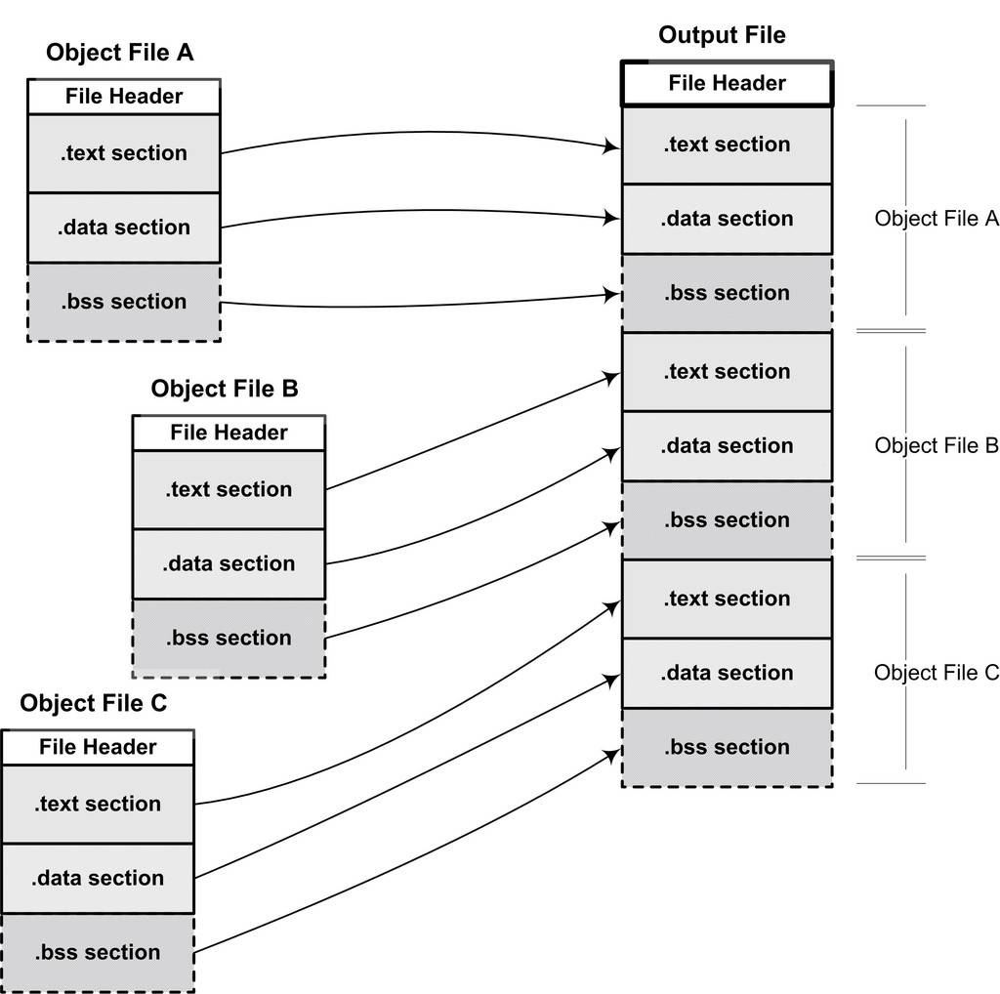
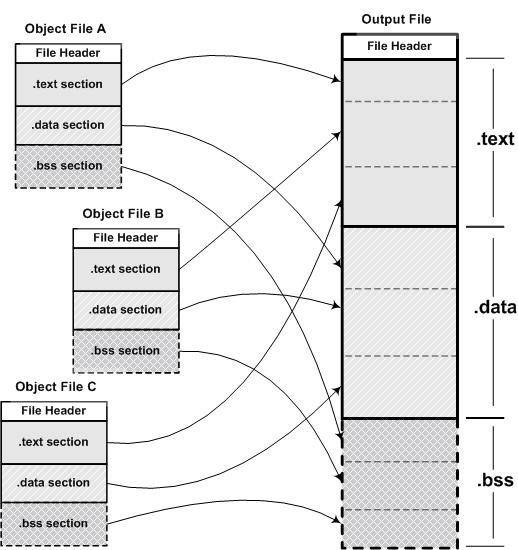
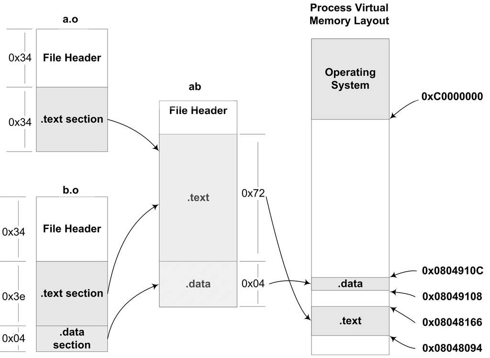
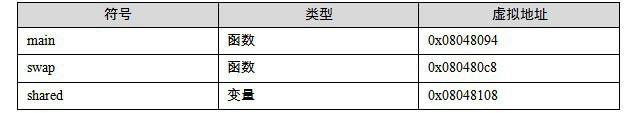

<h2>4.1 空間與地址分配</h2>

對於連結器來說，整個連結過程中，它就是將幾個輸入目的檔加工後合並成一個輸出檔案。那麼在這個例子裡，我們的輸入就是目的檔“a.o”和“b.o”，輸出就是執行檔“ab”。我們在前面詳細分析了ELF檔案的格式，我們知道，執行檔中的程式碼段和資料段都是由輸入的目的檔中合並而來的。那麼我們連結過程就很明顯產生了第一個問題：對於多個輸入目的檔，連結器如何將它們的各個段合並到輸出檔案？或者說，輸出檔案中的空間如何分配給輸入檔案？

4.1.1 按序疊加

一個最簡單的方案就是將輸入的目的檔按照次序疊加起來，如圖4-1所示。

圖4-1中的做法的確很簡單，就是直接將各個目的檔依次合並。但是這樣做會造成一

 圖4-1 簡單的空間分配策略 …

個問題，在有很多輸入檔案的情況下，輸出檔案將會有很多零散的段。比如一個規模稍大的應用程式可能會有數百個目的檔，如果每個目的檔都分別有.text段、.data段和.bss段，那最後的輸出檔案將會有成百上千個零散的段。這種做法非常浪費空間，因為每個段都需要有一定的地址和空間對齊要求，比如對於x86的硬體來說，段的載入地址和空間的對齊單位是頁，也就是4 096位元組（關於地址和空間對齊，我們在後面還會有專門的章節詳細介紹）。那麼就是說如果一個段的長度只有1個位元組，它也要在記憶體中佔用4 096位元組。這樣會造成記憶體空間大量的內部碎片，所以這並不是一個很好的方案。

4.1.2 相似段合並

一個更實際的方法是將相同性質的段合並到一起，比如將所有輸入檔案的“.text”合並到輸出檔案的“.text”段，接著是“.data”段、“.bss”段等，如圖4-2所示。

 圖4-2 實際的空間分配策略 …

正如我們前文所提到的，“.bss”段在目的檔和執行檔中並不佔用檔案的空間，但是它在載入時佔用地址空間。所以連結器在合並各個段的同時，也將“.bss”合並，並且分配虛擬空間。從“.bss”段的空間分配上我們可以思考一個問題，那就是這裡的所謂的“空間分配”到底是什麼空間？

“連結器為目的檔分配地址和空間”這句話中的“地址和空間”其實有兩個含義：第一個是在輸出的執行檔中的空間；第二個是在載入後的虛擬地址中的虛擬地址空間。對於有實際資料的段，比如“.text”和“.data”來說，它們在檔案中和虛擬地址中都要分配空間，因為它們在這兩者中都存在；而對於“.bss”這樣的段來說，分配空間的意義只侷限於虛擬地址空間，因為它在檔案中並沒有內容。事實上，我們在這裡談到的空間分配只關注於虛擬地址空間的分配，因為這個關係到連結器後面的關於地址計算的步驟，而執行檔本身的空間分配與連結過程關係並不是很大。

關於執行檔和虛擬地址空間之間的關係請參考第10章“執行檔的載入與程式”。

現在的連結器空間分配的策略基本上都採用上述方法中的第二種，使用這種方法的連結器一般都採用一種叫兩步連結（Two-pass Linking）的方法。也就是說整個連結過程分兩步。

第一步 空間與地址分配 掃描所有的輸入目的檔，並且獲得它們的各個段的長度、屬性和位置，並且將輸入目的檔中的符號表中所有的符號定義和符號引用收集起來，統一放到一個全域性符號表。這一步中，連結器將能夠獲得所有輸入目的檔的段長度，並且將它們合並，計算出輸出檔案中各個段合並後的長度與位置，並建立對映關係。

第二步 符號解析與重定位 使用上面第一步中收集到的所有資訊，讀取輸入檔案中段的資料、重定位資訊，並且進行符號解析與重定位、調整程式碼中的地址等。事實上第二步是連結過程的核心，特別是重定位過程。

我們使用ld連結器將“a.o”和“b.o”連結起來：

<pre>$ld a.o b.o -e main -o ab</pre>

<code>-e main</code> 表示將main函式作為程式入口，ld連結器預設的程式入口為<code>_start</code>。

<code>-o ab</code> 表示連結輸出檔名為ab，預設為a.out。

讓我們使用objdump來檢視連結前後地址的分配情況，程式碼如清單4-1所示。

清單4-1 連結前後各個段的屬性

<pre>$ objdump -h a.o
...
Sections:
Idx Name          Size    VMA       LMA       File off  Algn
  0 .text       00000034  00000000  00000000  00000034  2**2
                CONTENTS, ALLOC, LOAD, RELOC, READONLY, CODE
  1 .data       00000000  00000000  00000000  00000068  2**2
                CONTENTS, ALLOC, LOAD, DATA
  2 .bss        00000000  00000000  00000000  00000068  2**2
                ALLOC
...
$ objdump -h b.o
...
Sections:
Idx Name        Size      VMA       LMA       File off  Algn
  0 .text       0000003e  00000000  00000000  00000034  2**2
                CONTENTS, ALLOC, LOAD, READONLY, CODE
  1 .data       00000004  00000000  00000000  00000074  2**2
                CONTENTS, ALLOC, LOAD, DATA
  2 .bss        00000000  00000000  00000000  00000078  2**2
                ALLOC
...
$objdump –h ab
...
Sections:
Idx Name          Size      VMA       LMA       File off  Algn
  0 .text       00000072  08048094  08048094  00000094  2**2
                  CONTENTS, ALLOC, LOAD, READONLY, CODE
  1 .data       00000004  08049108  08049108  00000108  2**2
                  CONTENTS, ALLOC, LOAD, DATA
</pre>

VMA表示Virtual Memory Address，即虛擬地址，LMA表示Load Memory Address，即載入地址，正常情況下這兩個值應該是一樣的，但是在有些嵌入式系統中，特別是在那些程式放在ROM的系統中時，LMA和VMA是不相同的。這裡我們只要關注VMA即可。

連結前後的程式中所使用的地址已經是程式在程式中的虛擬地址，即我們關心上面各個段中的VMA（Virtual Memory Address）和Size，而忽略檔案偏移（File off）。我們可以看到，在連結之前，目的檔中的所有段的VMA都是0，因為虛擬空間還沒有被分配，所以它們預設都為0。等到連結之後，執行檔“ab”中的各個段都被分配到了相應的虛擬地址。這裡的輸出程式“ab”中，“.text”段被分配到了地址0x08048094，大小為0x72位元組；“.data”段從地址0x08049108開始，大小為4位元組。整個連結過程前後，目的檔各段的分配、程式虛擬地址如圖4-3所示。

 圖4-3 目的檔、執行檔與程式空間 …

我們在圖4-3中忽略了像.comment這種無關緊要的段，只關心程式碼段和資料段。由於在本例中沒有“.bss”段，所以我們也將其簡化了。從圖4-3中可以看到，“a.o”和“b.o”的程式碼段被先後疊加起來，合並成“ab”的一個.text段，加起來的長度為0x72。所以“ab”的程式碼段裡面肯定包含了<code>main</code>函式和<code>swap</code>函式的指令程式碼。

我們在圖4-3中忽略了像.comment這種無關緊要的段，只關心程式碼段和資料段。由於在本例中沒有“.bss”段，所以我們也將其簡化了。從圖4-3中可以看到，“a.o”和“b.o”的程式碼段被先後疊加起來，合並成“ab”的一個.text段，加起來的長度為0x72。所以“ab”的程式碼段裡面肯定包含了<code>main</code>函式和<code>swap</code>函式的指令程式碼。

那麼，為什麼連結器要將執行檔“ab”的“.text”分配到0x08048094、將“.data”分配0x08049108？而不是從虛擬空間的0地址開始分配呢？這涉及作業系統的程式虛擬地址空間的分配規則，在Linux下，ELF執行檔預設從地址0x08048000開始分配。關於程式的虛擬地址分配等相關內容我們將在第6章“執行檔的載入與程式”這一章進行詳細的分析。

4.1.3 符號地址的確定

我們還是以“a.o”和“b.o”作為例子，來分析這兩個步驟中連結器的工作過程。在第一步的掃描和空間分配階段，連結器按照前面介紹的空間分配方法進行分配，這時候輸入檔案中的各個段在連結後的虛擬地址就已經確定了，比如“.text”段起始地址為0x08048094，“.data”段的起始地址為0x08049108。

當前面一步完成之後，連結器開始計算各個符號的虛擬地址。因為各個符號在段內的相對位置是固定的，所以這時候其實“main”、“shared”和“swap”的地址也已經是確定的了，只不過連結器需要給每個符號加上一個偏移量，使它們能夠調整到正確的虛擬地址。比如我們假設“a.o”中的“main”函式相對於“a.o”的“.text”段的偏移是X，但是經過連結合並以後，“a.o”的“.text”段位於虛擬地址0x08048094，那麼“main”的地址應該是0x08048094 + X。從前面“objdump”的輸出看到，“main”位於“a.o”的“.text”段的最開始，也就是偏移為0，所以“main”這個符號在最終的輸出檔案中的地址應該是0x08048094 + 0，即0x08048094。我們也可以透過完全一樣的計算方法得知所有符號的地址，在這個例子裡面，只有三個全域性符號，所以連結器在更新全域性符號表的符號地址以後，各個符號的最終地址如表4-1所示。

 表4-1 …

