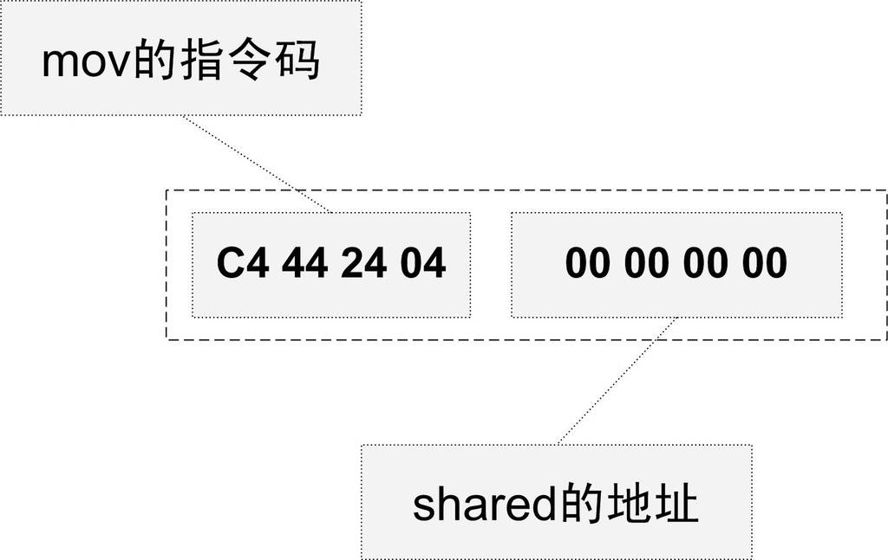
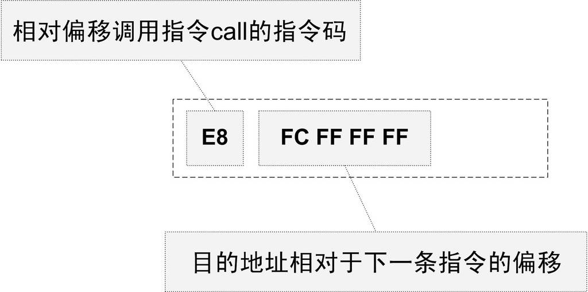
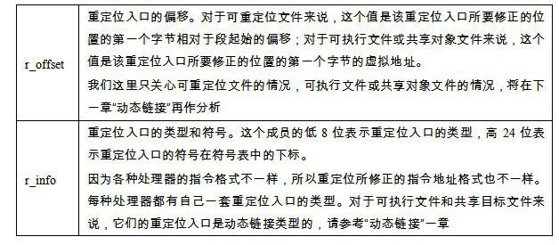
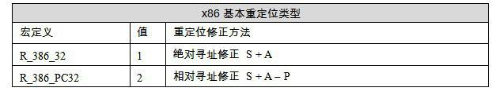

<h2>4.2 符號解析與重定位</h2>

4.2.1 重定位

在完成空間和地址的分配步驟以後，連結器就進入了符號解析與重定位的步驟，這也是靜態連結的核心內容。在分析符號解析和重定位之前，首先讓我們來看看“a.o”裡面是怎麼使用這兩個外部符號的，也就是說我們在“a.c”的源程式裡面使用了“shared”變數和“swap”函式，那麼編譯器在將“a.c”編譯成指令時，它如何訪問“shared”變數？如何呼叫“swap”函式？

使用objdump的<code>“-d</code>”引數可以看到“a.o”的程式碼段反組譯結果：

<pre>$objdump -d a.o

a.o:     file format elf32-i386

Disassembly of section .text:

00000000 &lt;main&gt;:
   0: 8d 4c 24 04           lea 0x4(%esp),%ecx
   4: 83 e4 f0              and    $0xfffffff0,%esp
   7: ff 71 fc              pushl  0xfffffffc(%ecx)
   a: 55                    push   %ebp
   b: 89 e5                 mov    %esp,%ebp
   d: 51                    push   %ecx
   e: 83 ec 24              sub    $0x24,%esp
  11: c7 45 f8 64 00 00 00  movl   $0x64,0xfffffff8(%ebp)
  18: c7 44 24 04 00 00 00  movl   $0x0,0x4(%esp)
  1f: 00 
  20: 8d 45 f8              lea 0xfffffff8(%ebp),%eax
  23: 89 04 24              mov    %eax,(%esp)
  26: e8 fc ff ff ff        call   27 &lt;main+0x27&gt;
  2b: 83 c4 24              add    $0x24,%esp
  2e: 59                    pop    %ecx
  2f: 5d                    pop    %ebp
  30: 8d 61 fc              lea 0xfffffffc(%ecx),%esp
  33: c3                    ret   
</pre>

我們知道在程式的程式碼裡面使用的都是虛擬地址，在這裡也可以看到“main”的起始地址為0x00000000，這是因為在未進行前面提到過的空間分配之前，目的檔程式碼段中的起始地址以0x00000000開始，等到空間分配完成以後，各個函式才會確定自己在虛擬地址空間中的位置。

我們可以很清楚地看到“a.o”的反組譯結果中，“a.o”共定義了一個函式main。這個函式佔用0x33個位元組，共17條指令；最左邊那列是每條指令的偏移量，每一行代表一條指令（有些指令的長度很長，如第偏移為0x18的mov指令，它的二進位顯示佔據了兩行）。我們已經用粗體標出了兩個引用“shared”和“swap”的位置，對於“shared”的引用是一條“mov”指令，這條指令總共8個位元組，它的作用是將“shared”的地址賦值到ESP暫存器+4的偏移地址中去，前面4個位元組是指令碼，後面4個位元組是“shared”的地址，我們只關心後面的4個位元組部分，如圖4-4所示。

我們可以很清楚地看到“a.o”的反組譯結果中，“a.o”共定義了一個函式main。這個函式佔用0x33個位元組，共17條指令；最左邊那列是每條指令的偏移量，每一行代表一條指令（有些指令的長度很長，如第偏移為0x18的mov指令，它的二進位顯示佔據了兩行）。我們已經用粗體標出了兩個引用“shared”和“swap”的位置，對於“shared”的引用是一條“mov”指令，這條指令總共8個位元組，它的作用是將“shared”的地址賦值到ESP暫存器+4的偏移地址中去，前面4個位元組是指令碼，後面4個位元組是“shared”的地址，我們只關心後面的4個位元組部分，如圖4-4所示。

當原始碼“a.c”在被編譯成目的檔時，編譯器並不知道“shared”和“swap”的地址，因為它們定義在其他目的檔中。所以編譯器就暫時把地址0看作是“shared”的地址，我們可以看到這條“mov”指令中，關於“shared”的地址部分為“0x00000000”。

另外一個是偏移為0x26的指令的一條呼叫指令，它其實就表示對swap函式的呼叫，如圖4-5所示。

 圖4-5 相對地址指令 …

這條指令共5個位元組，前面的0xE8是操作碼（Operation Code），從Intel的IA-32體係軟體開發者手冊（IA-32 Intel Architecture Software Developer’s Manual，參考文獻裡有詳細介紹）可以查閱到，這條指令是一條近址相對位移呼叫指令（Call near, relative, displacement relative to next instruction），後面4個位元組就是被呼叫函式的相對於呼叫指令的下一條指令的偏移量。在沒有重定位之前，相對偏移被置為0xFFFFFFFC（小端），它是常量“?-4”的補碼形式。

讓我們來仔細看這條指令的含義。緊跟在這條call指令後面的那條指令為add指令，add指令的地址為0x2b，而相對於add指令偏移為“?4”的地址即 0x2b – 4 = 0x27。所以這條call指令的實際呼叫地址為0x27。我們可以看到0x27存放著並不是swap函式的地址，跟前面“shared”一樣，“0xFFFFFFFC”只是一個臨時的假地址，因為在編譯的時候，編譯器並不知道“swap”的真正地址。

編譯器把這兩條指令的地址部分暫時用地址“0x00000000”和“0xFFFFFFFC”代替著，把真正的地址計算工作留給了連結器。我們透過前面的空間與地址分配可以得知，連結器在完成地址和空間分配之後就已經可以確定所有符號的虛擬地址了，那麼連結器就可以根據符號的地址對每個需要重定位的指令進行地位修正。我們用objdump來反組譯輸出程式“ab”的程式碼段，可以看到main函式的兩個重定位入口都已經被修正到正確的位置：

<pre>$objdump –d ab
ab:     file format elf32-i386

Disassembly of section .text:

08048094 &lt;main&gt;:
 8048094: 8d 4c 24 04           lea 0x4(%esp),%ecx
 8048098: 83 e4 f0              and    $0xfffffff0,%esp
 804809b: ff 71 fc              pushl  0xfffffffc(%ecx)
 804809e: 55                    push   %ebp
 804809f: 89 e5                 mov    %esp,%ebp
 80480a1: 51                    push   %ecx
 80480a2: 83 ec 24              sub    $0x24,%esp
 80480a5: c7 45 f8 64 00 00 00  movl   $0x64,0xfffffff8(%ebp)
 80480ac: c7 44 24 04 08 91 04  movl   $0x8049108,0x4(%esp)
 80480b3: 08 
 80480b4: 8d 45 f8              lea 0xfffffff8(%ebp),%eax
 80480b7: 89 04 24              mov    %eax,(%esp)
 80480ba: e8 09 00 00 00        call   80480c8 &lt;swap&gt;
 80480bf: 83 c4 24              add    $0x24,%esp
 80480c2: 59                    pop    %ecx
 80480c3: 5d                    pop    %ebp
 80480c4: 8d 61 fc              lea 0xfffffffc(%ecx),%esp
 80480c7: c3                    ret    

080480c8 &lt;swap&gt;:
 80480c8: 55                    push   %ebp
...
</pre>

經過修正以後，“shared”和“swap”的地址分別為0x08049108和0x00000009（小端位元組序）。關於“shared”很好理解，因為“shared”變數的地址的確是0x08049108。對於“swap”來說稍顯晦澀。我們前面介紹過，這個“call”指令是一條近址相對位移呼叫指令，它後面跟的是呼叫指令的下一條指令的偏移量，“call”指令的下一條指令是“add”，它的地址是0x080480bf，所以“相對於add指令偏移量為0x00000009”的地址為0x080480bf + 9 = 0x080480c8，即剛好是“swap ”函式的地址。有興趣的讀者可以閱讀後面的“指令修正方式”一節，那裡我們將更加詳細介紹指令修正時的地址計算方式。

4.2.2 重定位表

那麼連結器是怎麼知道哪些指令是要被調整的呢？這些指令的哪些部分要被調整？怎麼調整？比如上面例子中“mov”指令和“call”指令的調整方式就有所不同。事實上在ELF檔案中，有一個叫重定位表（Relocation Table）的結構專門用來儲存這些與重定位相關的資訊，我們在前面介紹ELF檔案結構時已經提到過了重定位表，它在ELF檔案中往往是一個或多個段。

對於可重定位的ELF檔案來說，它必須包含有重定位表，用來描述如何修改相應的段裡的內容。對於每個要被重定位的ELF段都有一個對應的重定位表，而一個重定位表往往就是ELF檔案中的一個段，所以其實重定位表也可以叫重定位段，我們在這裡統一稱作重定位表。比如程式碼段“.text”如有要被重定位的地方，那麼會有一個相對應叫“.rel.text”的段儲存了程式碼段的重定位表；如果程式碼段“.data”有要被重定位的地方，就會有一個相對應叫“.rel.data”的段儲存了資料段的重定位表。我們可以使用objdump來檢視目的檔的重定位表：

<pre>$ objdump -r a.o

a.o:     file format elf32-i386

RELOCATION RECORDS FOR [.text]:
OFFSET   TYPE              VALUE 
0000001c R_386_32          shared
00000027 R_386_PC32        swap
</pre>

這個命令可以用來檢視“a.o”裡面要重定位的地方，即“a.o”所有引用到外部符號的地址。每個要被重定位的地方叫一個重定位入口（Relocation Entry），我們可以看到“a.o”裡面有兩個重定位入口。重定位入口的偏移（Offset）表示該入口在要被重定位的段中的位置，“RELOCATION RECORDS FOR [.text]”表示這個重定位表是程式碼段的重定位表，所以偏移表示程式碼段中需要被調整的位置。對照前面的反組譯結果可以知道，這裡的0x1c和0x27分別就是程式碼段中“mov”指令和“call”指令的地址部分。

對於32位的Intel x86係列處理器來說，重定位表的結構也很簡單，它是一個Elf32_Rel結構的陣列，每個陣列元素對應一個重定位入口。Elf32_Rel的定義如下：

<pre>typedef struct {
    Elf32_Addr r_offset;
    Elf32_Word r_info;
} Elf32_Rel;
</pre>

4.2.3 符號解析

在我們通常的觀念裡，之所以要連結是因為我們目的檔中用到的符號被定義在其他目的檔，所以要將它們連結起來。比如我們直接使用ld來連結“a.o”，而不將“b.o”作為輸入。連結器就會發現shared和swap兩個符號沒有被定義，沒有辦法完成連結工作：

<pre>$ ld a.o
a.o: In function `main':
a.c:(.text+0x1c): undefined reference to `shared'
a.c:(.text+0x27): undefined reference to `swap'
</pre>

這也是我們平時在編寫程式的時候最常碰到的問題之一，就是連結時符號未定義。導致這個問題的原因很多，最常見的一般都是連結時缺少了某個庫，或者輸入目的檔路徑不正確或符號的宣告與定義不一樣。所以從普通程式設計師的角度看，符號的解析佔據了連結過程的主要內容。

透過前面指令重定位的介紹，我們可以更加深層次地理解為什麼缺少符號的定義會導致連結錯誤。其實重定位過程也伴隨著符號的解析過程，每個目的檔都可能定義一些符號，也可能引用到定義在其他目的檔的符號。重定位的過程中，每個重定位的入口都是對一個符號的引用，那麼當連結器需要對某個符號的引用進行重定位時，它就要確定這個符號的目標地址。這時候連結器就會去查詢由所有輸入目的檔的符號表組成的全域性符號表，找到相應的符號後進行重定位。

比如我們檢視“a.o”的符號表：

<pre>$ readelf -s a.o

Symbol table '.symtab' contains 10 entries:
   Num:    Value  Size Type    Bind   Vis      Ndx Name
     0: 00000000  0 NOTYPE  LOCAL  DEFAULT  UND
     1: 00000000  0 FILE    LOCAL  DEFAULT  ABS a.c
     2: 00000000  0 SECTION LOCAL  DEFAULT    1
     3: 00000000  0 SECTION LOCAL  DEFAULT    3
     4: 00000000  0 SECTION LOCAL  DEFAULT    4
     5: 00000000  0 SECTION LOCAL  DEFAULT    6
     6: 00000000  0 SECTION LOCAL  DEFAULT    5
     7: 00000000     52 FUNC    GLOBAL DEFAULT    1 main
     8: 00000000  0 NOTYPE  GLOBAL DEFAULT  UND shared
     9: 00000000  0 NOTYPE  GLOBAL DEFAULT  UND swap
</pre>

“GLOBAL”型別的符號，除了“main”函式是定義在程式碼段之外，其他兩個“shared”和“swap”都是“UND”，即“undefined”未定義型別，這種未定義的符號都是因為該目的檔中有關於它們的重定位項。所以在連結器掃描完所有的輸入目的檔之後，所有這些未定義的符號都應該能夠在全域性符號表中找到，否則連結器就報符號未定義錯誤。

4.2.4 指令修正方式

不同的處理器指令對於地址的格式和方式都不一樣。比如對於32位Intel x86處理器來說，轉移跳轉指令（jmp 指令）、子程式呼叫指令（call 指令）和資料傳送指令（mov 指令）定址方式千差萬別。直至2006年為止，Intel x86係列CPU的jmp指令有11種定址模式；call指令有10種；mov指令則有多達34種定址模式！這些定址方式有如下幾方面的區別：

• 近址定址或遠址定址。

• 絕對定址或相對定址。

• 定址長度為8位、16位、32位或64位。

但是對於32位x86平台下的ELF檔案的重定位入口所修正的指令定址方式只有兩種：

• 絕對近址32位定址。

• 相對近址32位定址。

這兩種重定位方式指令修正方式每個被修正的位置的長度都為32位，即4個位元組。而且都是近址定址，不用考慮Intel的段間遠址定址。唯一的區別就是絕對定址和相對定址。前面我們提到過，重定位入口的r_info成員低8位表示重定位入口型別，如表4-2所示。

 表4-2 …

A = 儲存在被修正位置的值

P = 被修正的位置（相對於段開始的偏移量或者虛擬地址），注意，該值可透過r_offset計算得到

S = 符號的實際地址，即由r_info的高24位指定的符號的實際地址

對照前面a.o的重定位資訊，我們可以看到第一個重定位入口是對swap符號的引用，型別為R_386_PC32，查閱Intel指令手冊，它的確是一條相對位移呼叫指令；而shared是R_386_32型別的，它修正的是一條傳輸指令的源，該傳輸指令的源是一個立即數，即shared的絕對地址。所以這兩個重定位入口很具有代表性，分別代表了兩種不同的重定位地址修正方式。

現在讓我們假設在將a.o和b.o連結成最終執行檔後，main函式的虛擬地址為0x1000，swap函式的虛擬地址為0x2000；shared變數的虛擬地址為0x3000。那麼我們的連結器將如何修正a.o裡面這兩個重定位入口呢？

絕對定址修正 讓我們先看a.o的第一個重定位入口，即偏移為0x18的這條mov指令的修正，它的修正方式是R_386_32，即絕對地址修正。對於這個重定位入口，它修正後的結果應該是S + A。

• S是符號shared的實際地址，即0x3000。

• A是被修正位置的值，即0x00000000。

所以最後這個重定位入口修正後地址為：0x3000 + 0x00000000 = 0x3000。即指令修正後應該是：

<pre>...
1011: c7 45 f8 64 00 00 00  movl   $0x64,0xfffffff8(%ebp)
1018: c7 44 24 04 00 30 00  movl   $0x3000,0x4(%esp)
101f: 00 
1020: 8d 45 f8              lea 0xfffffff8(%ebp),%eax
...
</pre>

相對定址修正* 讓我們再來看看a.o的第二個重定位入口，即偏移為0x26的這條call指令的修正，它的指令修正方式是R_386_PC32，即相對定址修正。對於這個重定位入口，它修正後的結果應該是S + A – P。

• S是符號swap的實際地址，即0x2000；

• A是被修正位置的值，即0xFFFFFFFC（-4）；

• P為被修正的位置，當連結成執行檔時，這個值應該是被修正位置的虛擬地址，即0x1000 + 0x27。

所以最後這個重定位入口修正後地址為：0x2000 + (-4) – ( 0x1000 + 0x27) = 0xFD5。即指令修正後應該是：

<pre>...
1023:  8d 45 f8               lea 0xfffffff8(%ebp),%eax
1026:  e8 d5 0f 00 00         call   0xfd5
102b:  89 04 24               mov    %eax,(%esp)
...

2000&lt;swap&gt;:
...
</pre>

這條相對位移呼叫指令呼叫的地址是該指令下一條指令的起始地址加上偏移量，即：0x102b + 0xfd5 = 0x2000，剛好是swap函式的地址。

從這兩個例子可以看出來，絕對定址修正和相對定址修正的區別就是絕對定址修正後的地址為該符號的實際地址；相對定址修正後的地址為符號距離被修正位置的地址差。

