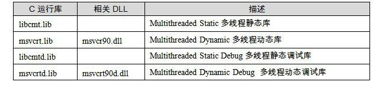
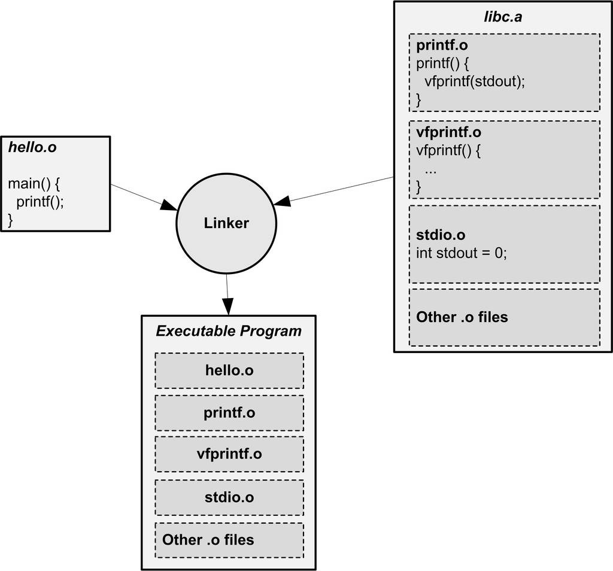

<h2>4.5 靜態函式庫連結</h2>

程式之所以有用，因為它會有輸入輸出，這些輸入輸出的物件可以是資料，可以是人，也可以是另外一個程式，還可以是另外一台計算機，一個沒有輸入輸出的程式沒有任何意義。但是一個程式如何做到輸入輸出呢？最簡單的辦法是使用作業系統提供的應用程式程式設計介面（API, Application Programming Interface）。當然，作業系統也只是一個程式，它怎麼實現跟人機互動裝置、跟其他計算機以及其他程式互動呢？這一點我們在第1章介紹作業系統和I/O時已經簡單介紹過了。

讓我們還是先回到一個比較初步的問題，就是程式如何使用作業系統提供的API。在一般的情況下，一種語言的開發環境往往會附帶有語言庫（Language Library）。這些庫就是對作業系統的API的包裝，比如我們經典的C語言版“Hello World”程式，它使用C語言標準庫的“printf”函式來輸出一個字串，“printf”函式對字串進行一些必要的處理以後，最後會呼叫作業系統提供的API。各個作業系統下，往終端輸出字串的API都不一樣，在Linux下，它是一個“write”的系統呼叫，而在Windows下它是“WriteConsole”系統API。

庫裡面還帶有那些很常用的函式，比如C語言標準庫裡面有很常用一個函式取得一個字串的長度叫<code>strlen()，</code>該函式即遍曆整個字串後返回字串長度，這個函式並沒有呼叫任何作業系統的API，也沒有做任何輸入輸出。但是很大一部分庫函式都是要呼叫作業系統的API的，比如最常用的往終端輸出格式化字串的printf就是會呼叫作業系統，往終端裡面列印一些字串。我們將在第4部分更加詳細地介紹庫的概念。這裡我們只是簡單地介紹靜態函式庫的連結過程。

其實一個靜態函式庫可以簡單地看成一組目的檔的集合，即很多目的檔經過壓縮打包後形成的一個檔案。比如我們在Linux中最常用的C語言靜態函式庫libc位於/usr/lib/libc.a，它屬於glibc專案的一部分；像Windows這樣的平台上，最常使用的C語言庫是由整合開發環境所附帶的執行庫，這些庫一般由編譯器廠商提供，比如Visual C++附帶了多個版本的C/C++執行庫。表4-3列出了VC2008（內部版本號VC9）所附帶的一部分C執行庫（庫檔案存放在VC安裝目錄下的lib\目錄）。

 表4-3 …

表4-3中只是簡單列舉了幾種C語言執行庫，我們在這裡將介紹一個程式的目的檔如何與C語言執行庫連結形成一個執行檔。關於庫的更詳細內容，將在第4部分展開討論。

我們知道在一個C語言的執行庫中，包含了很多跟系統功能相關的程式碼，比如輸入輸出、檔案操作、時間日期、記憶體管理等。glibc本身是用C語言開發的，它由成百上千個C語言原始碼檔案組成，也就是說，編譯完成以後有相同數量的目的檔，比如輸入輸出有printf.o，scanf.o；檔案操作有fread.o，fwrite.o；時間日期有date.o，time.o；記憶體管理有malloc.o等。把這些零散的目的檔直接提供給庫的使用者，很大程度上會造成檔案傳輸、管理和組織方面的不便，於是通常人們使用“ar”壓縮程式將這些目的檔壓縮到一起，並且對其進行編號和索引，以便於查詢和檢索，就形成了libc.a這個靜態函式庫檔案。在我的機器上，該檔案有2.8 MB大小，我們也可以使用“ar”工具來檢視這個檔案包含了哪些目的檔：

<pre>$ar -t libc.a
init-first.o
libc-start.o
sysdep.o
version.o
check_fds.o
libc-tls.o
elf-init.o
dso_handle.o
errno.o
errno-loc.o
iconv_open.o
iconv.o
iconv_close.o
gconv_open.o
gconv.o
gconv_close.o
gconv_db.o
gconv_conf.o
...
</pre>

Visual C++也提供了與Linux下的ar類似的工具，叫lib.exe，這個程式可以用來建立、提取、列舉.lib檔案中的內容。使用“lib /LIST libcmt.lib”就可以列舉出libcmt.lib中所有的目的檔。Visual C++ libcmt.lib中包含949個目的檔。具體引數請參照MSDN。

libc.a裡面總共包含了1 400個目的檔，那麼，我們如何在這麼多目的檔中找到“printf”函式所在的目的檔呢？答案是使用“objdump”或“readelf”加上文字查詢工具如“grep”，使用“objdump”檢視libc.a的符號可以發現如下結果：

<pre>$objdump -t libc.a
...
printf.o:     file format elf32-i386

SYMBOL TABLE:
00000000 l  d .text  00000000 .text
00000000 l  d .data  00000000 .data
00000000 l  d   .bss   00000000 .bss
00000000 l  d .comment   00000000 .comment
00000000 l    d .note.GNU-stack    00000000 .note.GNU-stack
00000000 g  F .text  00000026 __printf
00000000        *UND*  00000000 stdout
00000000        *UND*  00000000 vfprintf
00000000 g  F .text  00000026 printf
00000000 g  F .text  00000026 _IO_printf
...
</pre>

可以看到“printf”函式被定義在了“printf.o”這個目的檔中。這裡我們似乎找到了最終的機制，那就是“Hello World”程式編譯出來的目的檔只要和libc.a裡面的“printf.o”連結在一起，最後就可以形成一個可用的執行檔了。這個解釋似乎很完美，實際上已經很接近最後的答案了。那麼我們就按照這個方案去嚐試一下，假設“Hello World”程式的原始碼為“hello.c”，使用如下方法編譯：

<pre>$gcc –c –fno-builtin hello.c</pre>

我們得到了目的檔為“hello.o”，為什麼這裡要使用“-<code>fno-builtin</code>”引數是因為預設情況下，GCC會自作聰明地將“Hello World”程式中只使用了一個字串引數的“printf”替換成“puts”函式，以提高執行速度，我們要使用“-<code>fno-builtin</code>”關閉這個內建函式最佳化選項。現在我們還缺“printf.o”，透過“ar”工具解壓出“printf.o”：

<pre>$ar –x libc.a</pre>

這個命令會將libc.a中的所有目的檔“解壓”至當前目錄。我們也可以找到“printf.o”，然後將其與“hello.o”連結在一起：

<pre>$ld hello.o printf.o
ld: warning: cannot find entry symbol _start; defaulting to 0000000008048080
printf.o: In function `_IO_printf':
(.text+0x18): undefined reference to `stdout'
printf.o: In function `_IO_printf':
(.text+0x20): undefined reference to `vfprintf'
</pre>

連結卻失敗了，原因是缺少兩個外部符號的定義。其實眼尖的讀者可能已經在最開始列印“printf.o”的符號表時就看出一點問題來了，那就是“printf.o”裡面有兩個“UND”的符號“stdout”和“vfprintf”，也就是有兩個未定義的符號。正是這兩個未定義的符號打破了看似完美的解釋，很明顯：“printf.o”依賴於其他的目的檔。

用同樣的方法，我們可以找到“stdout”這個符號所在的目的檔，它位於“stdio.o”；而“vfprintf”位於“vfprintf.o”。很不幸的是這兩個檔案還依賴於其他的目的檔，因為它們也有未定義的符號。這些變數和函式都分佈在glibc的各個目的檔之中，如果我們能夠一一將它們收集齊，那麼理論上就可以將它們連結在一起，最後跟“hello.o”連結成一個執行檔。但是，如果靠人工這樣做的代價實在是太大了，我們在這裡不打算演示這樣一個繁瑣的過程。幸好ld連結器會處理這一切繁瑣的事務，自動尋找所有需要的符號及它們所在的目的檔，將這些目的檔從“libc.a”中“解壓”出來，最終將它們連結在一起成為一個執行檔。那麼我們可不可以就這麼認為：將“hello.o”和“libc.a”連結起來就可以得到執行檔呢？理論上這樣就可以了，如圖4-6所示。

實際情況恐怕還是令人失望的，現在Linux系統上的庫比我們想象的要複雜。當我們編譯和連結一個普通C程式的時候，不僅要用到C語言庫libc.a，而且還有其他一些輔助性質的目的檔和庫。我們可以使用下面的GCC命令編譯“hello.c”，“-verbose”表示將整個編譯連結過程的中間步驟列印出來：

 圖4-6 靜態函式庫連結 …

<pre>$gcc -static --verbose -fno-builtin hello.c
Using built-in specs.
Target: i486-linux-gnu
Configured with: ../src/configure -v --enable-languages=c,c++,fortran,objc,obj-c++,treelang --prefix=/usr --enable-shared --with-system-zlib --libexecdir=/usr/lib --without-included-gettext --enable-threads=posix --enable-nls --with-gxx-include-dir=/usr/include/c++/4.1.3 --program-suffix=-4.1 --enable-__cxa_atexit --enable-clocale=gnu --enable-libstdcxx-debug --enable-mpfr --enable-checking=release i486-linux-gnu
Thread model: posix
gcc version 4.1.3 20070929 (prerelease) (Ubuntu 4.1.2-16ubuntu2)
 /usr/lib/gcc/i486-linux-gnu/4.1.3/cc1 -quiet -v hello.c -quiet -dumpbase hello.c -mtune=generic -auxbase hello -version -fno-builtin -fstack-protector -fstack-protector -o /tmp/ccUhtGSB.s
ignoring nonexistent directory "/usr/local/include/i486-linux-gnu"
ignoring nonexistent directory "/usr/lib/gcc/i486-linux-gnu/4.1.3/../../../../i486-linux-gnu/include"
ignoring nonexistent directory "/usr/include/i486-linux-gnu"
#include "..." search starts here:
#include &lt;...&gt; search starts here:
 /usr/local/include
 /usr/lib/gcc/i486-linux-gnu/4.1.3/include
 /usr/include
End of search list.
GNU C version 4.1.3 20070929 (prerelease) (Ubuntu 4.1.2-16ubuntu2) (i486-linux-gnu)
        compiled by GNU C version 4.1.3 20070929 (prerelease) (Ubuntu 4.1.2-16ubuntu2).
GGC heuristics: --param ggc-min-expand=64 --param ggc-min-heapsize=64493
Compiler executable checksum: caf034d6752b947185f431aa3e927159
 as --traditional-format -V -Qy -o /tmp/ccQZRPL5.o /tmp/ccUhtGSB.s
GNU assembler version 2.18 (i486-linux-gnu) using BFD version (GNU Binutils for Ubuntu) 2.18
 /usr/lib/gcc/i486-linux-gnu/4.1.3/collect2 -m elf_i386 --hash-style=both -static /usr/lib/gcc/i486-linux-gnu/4.1.3/../../../../lib/crt1.o /usr/lib/gcc/i486-linux-gnu/4.1.3/../../../../lib/crti.o /usr/lib/gcc/i486-linux-gnu/4.1.3/crtbeginT.o -L/usr/lib/gcc/i486-linux-gnu/4.1.3 -L/usr/lib/gcc/i486-linux-gnu/4.1.3 -L/usr/lib/gcc/i486-linux-gnu/4.1.3/../../../../lib -L/lib/../lib -L/usr/lib/../lib /tmp/ccQZRPL5.o --start-group -lgcc -lgcc_eh -lc --end-group /usr/lib/gcc/i486-linux-gnu/4.1.3/crtend.o /usr/lib/gcc/i486-linux-gnu/4.1.3/../../../../lib/crtn.o
</pre>

關鍵的三個步驟上面已經用粗體表示出來了，第一步是呼叫cc1程式，這個程式實際上就是GCC的C語言編譯器，它將“hello.c”編譯成一個臨時的組譯檔案“/tmp/ccUhtGSB.s”；然後呼叫as程式，as程式是GNU的組譯器，它將“/tmp/ccUhtGSB.s”組譯成臨時目的檔“/tmp/ccQZRPL5.o”，這個“/tmp/ccQZRPL5.o”實際上就是前面的“hello.o”；接著最關鍵的步驟是最後一步，GCC呼叫collect2程式來完成最後的連結。但是按照我們之前的理解，連結過程應該由ld連結器來完成，這裡怎麼忽然殺出個collect2？這是個什麼程式？

實際上collect2可以看作是ld連結器的一個包裝，它會呼叫ld連結器來完成對目的檔的連結，然後再對連結結果進行一些處理，主要是收集所有與程式初始化相關的資訊並且構造初始化的結構。在第4部分我們會介紹程式的初始化結構的相關內容，還會再介紹collect2程式。在這裡，可以簡單地把collect2看作是ld連結器。可以看到最後一步中，至少有下列幾個庫和目的檔被連結入了最終執行檔：

crt1.o

crti.o

這些庫和目的檔現在看來可能很不熟悉，我們將在第4部分專門介紹這些庫及它們背後的原理。

Q&amp;A

Q：為什麼靜態執行庫裡面一個目的檔只包含一個函式？比如libc.a裡面printf.o只有printf()函式、strlen.o只有strlen()函式，為什麼要這樣組織？

A：我們知道，連結器在連結靜態函式庫的時候是以目的檔為單位的。比如我們引用了靜態函式庫中的printf()函式，那麼連結器就會把庫中包含printf()函式的那個目的檔連結進來，如果很多函式都放在一個目的檔中，很可能很多沒用的函式都被一起連結進了輸出結果中。由於執行庫有成百上千個函式，數量非常龐大，每個函式獨立地放在一個目的檔中可以盡量減少空間的浪費，那些沒有被用到的目的檔（函式）就不要連結到最終的輸出檔案中。

