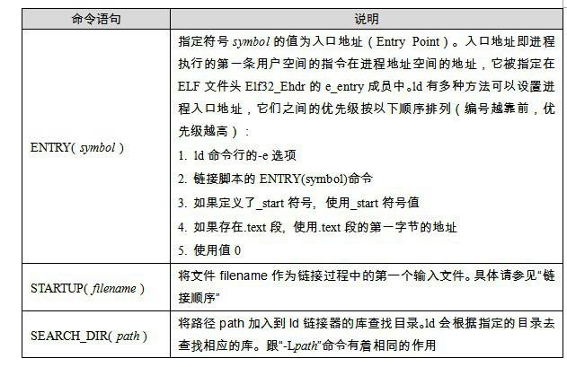
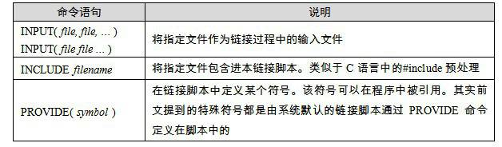

4.6 連結過程控制

絕大部分情況下，我們使用連結器提供的預設連結規則對目的檔進行連結。這在一般情況下是沒有問題的，但對於一些特殊要求的程式，比如作業系統核心、BIOS（Basic Input Output System）或一些在沒有作業系統的情況下執行的程式（如載入程式Boot Loader或者嵌入式系統的程式，或者有一些脫離作業系統的硬碟分割槽軟體PQMagic等），以及另外的一些需要特殊的連結過程的程式，如一些核心驅動程式等，它們往往受限於一些特殊的條件，如需要指定輸出檔案的各個段虛擬地址、段的名稱、段存放的順序等，因為這些特殊的環境，特別是某些硬體條件的限製，往往對程式的各個段的地址有著特殊的要求。

由於整個連結過程有很多內容需要確定：使用哪些目的檔？使用哪些庫檔案？是否在最終執行檔中保留除錯資訊、輸出檔案格式（執行檔還是動態連結庫）？還要考慮是否要匯出某些符號以供偵錯程式或程式本身或其他程式使用等。

作業系統核心。從本質上來講，它本身也是一個程式。比如Windows的核心ntoskrnl.exe就是一個我們平常看到的PE檔案，它的位置位於\WINDOWS\system32\ntoskrnl.exe。很多人誤以為Window作業系統的核心很龐大，由很多檔案組成。這是一個誤解，其實真正的Windows核心就是這個檔案。

4.6.1 連結控制指令碼

連結器一般都提供多種控制整個連結過程的方法，以用來產生使用者所需要的檔案。一般連結器有如下三種方法。

• 使用命令列來給連結器指定引數，我們前面所使用的ld的-o、-e引數就屬於這類。這種方法我們已經在前面使用很多次了。

• 將連結指令存放在目的檔裡面，編譯器經常會透過這種方法向連結器傳遞指令。方法也比較常見，只是我們平時很少關注，比如VISUAL C++編譯器會把連結引數放在PE目的檔的.drectve段以用來傳遞引數。具體可以參考PE/COFF一節中的.drectve段介紹。

• 使用連結控制指令碼，使用連結控制指令碼方法就是本節要介紹的，也是最為靈活、最為強大的連結控制方法。

A：我們知道，連結器在連結靜態函式庫的時候是以目的檔為單位的。比如我們引用了靜態函式庫中的printf()函式，那麼連結器就會把庫中包含printf()函式的那個目的檔連結進來，如果很多函式都放在一個目的檔中，很可能很多沒用的函式都被一起連結進了輸出結果中。由於執行庫有成百上千個函式，數量非常龐大，每個函式獨立地放在一個目的檔中可以盡量減少空間的浪費，那些沒有被用到的目的檔（函式）就不要連結到最終的輸出檔案中。

4.6 連結過程控制

絕大部分情況下，我們使用連結器提供的預設連結規則對目的檔進行連結。這在一般情況下是沒有問題的，但對於一些特殊要求的程式，比如作業系統核心、BIOS（Basic Input Output System）或一些在沒有作業系統的情況下執行的程式（如載入程式Boot Loader或者嵌入式系統的程式，或者有一些脫離作業系統的硬碟分割槽軟體PQMagic等），以及另外的一些需要特殊的連結過程的程式，如一些核心驅動程式等，它們往往受限於一些特殊的條件，如需要指定輸出檔案的各個段虛擬地址、段的名稱、段存放的順序等，因為這些特殊的環境，特別是某些硬體條件的限製，往往對程式的各個段的地址有著特殊的要求。

由於整個連結過程有很多內容需要確定：使用哪些目的檔？使用哪些庫檔案？是否在最終執行檔中保留除錯資訊、輸出檔案格式（執行檔還是動態連結庫）？還要考慮是否要匯出某些符號以供偵錯程式或程式本身或其他程式使用等。

VM1698:1

由於各個連結器平台的連結控制過程各不相同，我們只能側重一個平台來介紹。ld連結器的連結指令碼功能非常強大，我們接下來以ld作為主要介紹物件。VISUAL C++也允許使用指令碼來控制整個連結過程，VISUAL C++把這種控制指令碼叫做模組定義檔案（Module-Definition File），它們的副檔名一般為.def。

前面我們在使用ld連結器的時候，沒有指定連結指令碼，其實ld 在使用者沒有指定連結指令碼的時候會使用預設連結指令碼。我們可以使用下面的命令列來檢視ld預設的連結指令碼：

<pre>$ ld -verbose</pre>

預設的ld連結指令碼存放在/usr/lib/ldscripts/下，不同的機器平台、輸出檔案格式都有相應的連結指令碼。比如Intel IA32下的普通可執行ELF檔案連結指令碼檔案為elf_i386.x；IA32下共用函式庫的連結指令碼檔案為elf_i386.xs等。具體可以看每個檔案的注釋。ld會根據命令列要求使用相應的連結指令碼檔案來控制連結過程，當我們使用ld來連結生成一個執行檔的時候，它就會使用elf_i386.x作為連結控制指令碼；當我們使用ld來生成一個共享目的檔的時候，它就會使用elf_i386.xs作為連結控制指令碼。

當然，為了更加精確地控制連結過程，我們可以自己寫一個指令碼，然後指定該指令碼為連結控制指令碼。比如可以使用-T引數：

<pre>$ ld –T link.script</pre>

4.6.2 最“小”的程式

為了演示連結的控制過程，我們接著要做一個最小的程式：這個程式的功能是在終端上輸出“Hello world!”。可能很多人的第一反應就是我們學C語言時候的那個經典的使用printf的helloworld，然後對著螢幕盲打一遍該程式原始碼後編譯連結一氣呵成，連滑鼠都沒有移動一下，非常好，你的C語言基礎很紮實。但是我們這裡要演示的程式稍微有所不同。

• 首先，經典的helloworld使用了printf函式，該函式是系統C語言庫的一部分。為了使用該函式，我們必須在連結時將C語言庫與程式的目的檔連結產生最終執行檔。我們希望“小程式”能夠脫離C語言執行庫，使得它成為一個獨立於任何庫的純正的“程式”。

• 其次，經典的helloworld由於使用了庫，所以必須有main函式。我們知道一般程式的入口在庫的<code>_start</code>，由庫負責初始化後呼叫main函式來執行程式的主體部分。為了不使用main這個我們已經感到厭煩的函式名，“小程式”使用nomain作為整個程式的入口。

• 接著，經典的helloworld會產生多個段：main程式的指令部分會產生.text段、字串常量“Hello world!\n”會被放在資料段或只讀資料段，還有C庫所包含的各種段。為了演示ld連結指令碼的控制過程，我們將“小程式”的所有段都合並到一個叫“tinytext”的段，注意：這個段是我們任意命名的，是由連結指令碼控制連結過程生成的。

TinyHelloWorld.c原始碼如下：

<pre>char* str = "Hello world!\n";

void print()
{
    asm( "movl $13,%%edx \n\t"
         "movl %0,%%ecx  \n\t"
         "movl $0,%%ebx  \n\t"
         "movl $4,%%eax  \n\t"
         "int $0x80      \n\t"
         ::"r"(str):"edx","ecx","ebx");
}

void exit()
{
    asm( "movl $42,%ebx  \n\t"
         "movl $1,%eax  \n\t"
         "int $0x80     \n\t" );
}

void nomain()
{
    print();
    exit();
}
</pre>

從原始碼我們可以看到，程式入口為<code>nomain()</code>函式，然後該函式呼叫<code>print()</code>函式，列印“Hello World”，接著呼叫<code>exit()</code>函式，結束程式。這裡的print函式使用了Linux的WRITE系統呼叫，<code>exit()</code>函式使用了EXIT系統呼叫。這裡我們使用了GCC內嵌組譯，對這種內嵌組譯格式不熟悉的話，請參照GCC手冊關於內嵌組譯的部分。這裡簡單介紹系統呼叫：系統呼叫透過0x80中斷實現，其中eax為呼叫號，ebx、ecx、edx等通用暫存器用來傳遞引數，比如WRITE呼叫是往一個檔案控制代碼寫入資料，如果用C語言來描述它的原型就是：

<pre>int write(int filedesc, char* buffer, int size);</pre>

WRITE呼叫的呼叫號為4，則eax = 0。

filedesc表示被寫入的檔案控制代碼，使用ebx暫存器傳遞，我們這裡是要往預設終端（stdout）輸出，它的檔案控制代碼為0，即ebx = 0。

buffer表示要寫入的緩衝區地址，使用ecx暫存器傳遞，我們這裡要輸出字串str，所以ecx = str。

size 表示要寫入的位元組數，使用edx暫存器傳遞，字串“Hello world!\n”長度為13位元組，所以edx = 13。

同理，EXIT系統呼叫中，ebx表示程式退出碼（Exit Code），比如我們平時的main程式中的return的數值會返回給系統庫，由系統庫將該數值傳遞給EXIT系統呼叫。這樣父程式就可以接收到子程式的退出碼。EXIT系統呼叫的呼叫號為1，即eax = 1。你可以透過下面的方法得到上一條bash命令執行的程式的退出碼）：

<pre>$ ./TinyHelloWorld
$ echo $?
42
</pre>

這裡要呼叫EXIT結束程式是因為如果是普通程式，main()函式結束後控制權返回給系統庫，由系統庫負責呼叫EXIT，退出程式。我們這裡的nomain()結束後系統控制權不會返回，可能會執行到nomain()後面不正常的指令，最後導致程式異常退出。

關於系統庫已經系統呼叫的細節我們在這裡不詳細展開，將在第12章進行更為詳細的介紹。

我們先不急於使用連結指令碼，而先使用普通命令列的方式來編譯和連結TinyHelloWorld.c：

<pre>$ gcc -c -fno-builtin TinyHelloWorld.c
$ ld -static -e nomain -o TinyHelloWorld TinyHelloWorld.o
</pre>

第一步是使用GCC將TinyHelloWorld.c編譯成TinyHelloWorld.o，接著使用ld將TinyHelloWorld.o連結成執行檔TinyHelloWorld。這裡GCC和ld的引數的意義如下。

-fno-builtin GCC編譯器提供了很多內建函式（Built-in Function），它會把一些常用的C庫函式替換成編譯器的內建函式，以達到最佳化的功能。比如GCC會將只有字串引數的printf函式替換成puts，以節省格式解析的時間。exit()函式也是GCC的內建引數之一，所以我們要使用-fno-builtin引數來關閉GCC內建函式功能。

<code>-static</code> 這個參數列示ld將使用靜態連結的方式來連結程式，而不是使用預設的動態連結的方式。

<code>-e nomain</code> 表示該程式的入口函式為nomain，還記得ELF檔案頭Elf32_Ehdr的e_entry成員嗎？這個引數就是將ELF檔案頭的e_entry成員賦值成nomain函式的地址。

<code>-o TinyHelloWorld</code> 表示指定輸出可執行檔名為TinyHelloWorld。

我們得到了一個924位元組（依賴於系統環境）的ELF執行檔，執行它以後能夠正確列印“Hello world!”並且正常退出。但是當我們用objdump或readelf檢視TinyHelloWorld這個檔案時，會發現它有4個段：.text、.rodata、.data和.comment。透過前面的介紹我們可以猜到：

.text肯定儲存的是程式的指令，它是只讀的。

.rodata儲存的是字串“Hello World!\n”，它也是只讀的。

.data儲存的是str全域性變數，看上去它是可讀寫的，但我們並沒有在程式中改寫該變數，所以實際上它也是只讀的。

.comment儲存的是編譯器和系統版本資訊，這些資訊也是只讀的。由於.comment裡面儲存的資料並不關鍵，對於程式的執行沒有作用，所以可以將其丟棄。

鑒於這些段的屬性如此相似，原則上講，我們可以把它們合並到一個段裡面，該段的屬性是可執行、可讀的，包含程式的資料和指令。為了達到這個目的，我們必須使用ld連結指令碼來控制連結過程。

4.6.3 使用ld連結指令碼

如果把整個連結過程比作一台計算機，那麼ld連結器就是計算機的CPU，所有的目的檔、庫檔案就是輸入，連結結果輸出的執行檔就是輸出，而連結控制指令碼正是這台計算機的“程式”，它控制CPU的執行，以“程式”要求的方式將輸入加工成所需要的輸出結果。連結控制指令碼“程式”使用一種特殊的語言寫成，即ld的連結指令碼語言，這種語言並不複雜，只有為數不多的幾種操作。

無論是輸出檔案還是輸入檔案，它們的主要的資料就是檔案中的各種段，我們把輸入檔案中的段稱為輸入段（Input Sections），輸出檔案中的段稱為輸出段（Output Sections）。簡單來講，控制連結過程無非是控制輸入段如何變成輸出段，比如哪些輸入段要合並一個輸出段，哪些輸入段要丟棄；指定輸出段的名字、載入地址、屬性，等等。我們先來看看TinyHelloWorld的連結指令碼TinyHelloWorld.lds（一般連結指令碼名都以lds作為副檔名ld script），有個感性的認識：

<pre>ENTRY(nomain)

SECTIONS
{
    . = 0x08048000 + SIZEOF_HEADERS;
    
    tinytext  : { *(.text) *(.data) *(.rodata) }

    /DISCARD/ : { *(.comment) }
}
</pre>

這是一個非常簡單的連結指令碼，第一行的ENTRY(nomain)指定了程式的入口為nomain()函式；後面的SECTIONS命令一般是連結指令碼的主體，這個命令指定了各種輸入段到輸出段的變換，SECTIONS後面緊跟著的一對大括號裡面包含了SECTIONS變換規則，其中有三條語句，每條語句一行。第一條是賦值語句，後面兩條是段轉換規則，它們的含義分別如下：

<code>. = 0x08048000 + SIZEOF_HEADERS</code> 第一條賦值語句的意思是將當前虛擬地址設定成 <code>0x08048000 + SIZEOF_HEADERS</code>，<code>SIZEOF_HEADERS</code>為輸出檔案的檔案頭大小。“.”表示當前虛擬地址，因為這條語句後面緊跟著輸出段“tinytext”，所以“tinytext”段的起始虛擬地址即為0x08048000 + SIZEOF_HEADERS。它將當前虛擬地址設定成一個比較巧妙的值，以便於載入時頁對映更為方便。具體請參考本書第2部分關於載入的章節。

<code>tinytext : { *(.text) *(.data) *(.rodata) }</code> 第二條是個段轉換規則，它的意思即為所有輸入檔案中的名字為“.text”、“.data”或“.rodata”的段依次合並到輸出檔案的“tinytext”。

/DISCARD/ : { *(.comment) } 第三條規則為：將所有輸入檔案中的名字為“.comment”的段丟棄，不儲存到輸出檔案中。

透過上述兩條轉換規則，我們就達到了TinyHelloWorld程式的第三個要求：最終輸出的執行檔只有一個叫“tinytext”的段。我們透過下面的命令列來編譯TinyHelloWorld，並且啟用該連結控制指令碼：

<pre>$ gcc –c –fno-builtin TinyHelloWorld.c
$ ld –static –T TinyHelloWorld.lds –o TinyHelloWorld TinyHelloWorld.o
</pre>

我們得到了一個588位元組的ELF執行檔：TinyHelloWorld，並且執行這個程式能夠在終端上正確顯示“Hello World!”。如果你使用objdump檢視TinyHelloWorld的段，你會很高興地發現，我們達到了目的：整個程式只有一個段“tinytext”。但是興奮之餘你可能又想用readelf工具檢視一下，發現程式除了tinytext之外居然還有其他3個段：.shstrtab、.symtab和.strtab。這3個段我們在前面已經介紹過了，它們分別是段名字串表、符號表和字串表。在預設情況下，ld連結器在產生執行檔時會產生這3個段。對於執行檔來說，符號表和字串表是可選的，但是段名字串表使用者儲存段名，所以它是必不可少的。

你可以透過ld的-s引數禁止連結器產生符號表，或者使用strip命令來去除程式中的符號表，去掉符號表後的TinyHelloWorld只有340個位元組，但它仍然是一個有效的ELF執行檔，能夠正確執行並輸出結果。

有人專門研究瞭如何得到一個最小的ELF執行檔，最後成果是最小的ELF執行檔為45個位元組。這個程式的功能是以42為程式退出碼正常退出程式，沒有任何輸入和輸出。上面的TinyHelloWorld也是以這個特殊的值42作為退出碼。

追溯“42”這個奇怪的數字來源，可能因為《銀河係漫遊指南》裡面的終極電腦給出的關於生命、宇宙及萬物的終極答案是42。

4.6.4 ld連結指令碼語法簡介

ld連結器的連結指令碼語法繼承與AT&amp;T連結器命令語言的語法，風格有點像C語言，它本身並不複雜。連結指令碼由一係列語句組成，語句分兩種，一種是命令語句，另外一種是賦值語句。我們前面的連結指令碼裡面的ENTRY(nomain)就是命令語句；而<code>. = 0x08480000 + SIZEOF_HEADERS</code>則是一個經典的賦值語句。之所以說連結指令碼語法像C語言，主要有如下幾點相似之處。

語句之間使用分號“;”作為分割符 原則上講語句之間都要以“；“作為分割符，但是對於命令語句來說也可以使用換行來結束該語句，對於賦值語句來說必須以“；”結束。

表示式與運算子 指令碼語言的語句中可以使用C語言類似的表示式和運算運算子，比如+、?、*、/、+=、?=、*=等，甚至包括&amp;、|、&gt;&gt;、&lt;&lt;等這些位運算子。

注釋和字元引用 使用/* */作為注釋。指令碼檔案中使用到的檔名、格式名或段名等凡是包含“;”或其他的分隔符的，都要使用雙引號將該名字全稱引用起來，如果檔名包含引號，則很不幸，無法處理。

賦值語句比較簡單，我們在這裡就不詳細介紹了。命令語句一般的格式是由一個關鍵字和緊跟其後的引數所組成。比如前面的TinyHelloWorld.lds就是由兩個命令語句組成：一個ENTRY命令語句和一個SECTIONS語句，“ENTRY”和“SECTIONS”為這兩個語句的關鍵字。其中SECTIONS語句比較複雜，它又包含了一個賦值語句及一些SECTIONS語句所特有的對映規則。其實除了SECTIONS命令語句之外，其他命令語句都比較簡單，畢竟SECTIONS負責指定連結過程的段轉換過程，這也是連結的最核心和最複雜的部分。我們先來看看一些常用的命令語句，如表4-4所示。

 表4-4 …

這裡只是大概提及以下幾個常用的命令語句格式，更多的命令語句的意義及它們的格式請參照ld的使用手冊。除了這些簡單的命令語句之外，剩下最重要、也是最複雜的就是SECTIONS命令了。SECTIONS命令語句最基本格式為：

<pre>SECTIONS
{
    ...
    secname : { contents }
    ...
}
</pre>

secname表示輸出段的段名，secname後面必須有一個空格符，這樣使得輸出段名不會有歧義，後面緊跟著冒號和一對大括號。大括號裡面的contents描述了一套規則和條件，它表示符合這種條件的輸入段將合並到這個輸出段中。輸出段名的命名方法必須符合輸出檔案格式的要求，比如，如果使用ld生產一個a.out格式的檔案，那麼輸出段名就不可以使用除“.text”、“.data”和“.bss”之外的任何名字，因為a.out格式規定段名只允許這三個名字。

有一個特殊的段名叫“/DISCARD/”，如果使用這個名字作為輸出段名，那麼所有符合後面contents所規定的條件的段都將被丟棄，不輸出到輸出檔案中。

接著，我們最應該關心的是contents這個規則。contents中可以包含若幹個條件，每個條件之間以空格隔開，如果輸入段符合這些條件中的任意一個即表示這個輸入段符合contents規則。條件的寫法如下：

filename(sections)

filename表示輸入檔名，sections表示輸入段名。讓我們舉幾個條件的例子來看看：

file1.o(.data) 表示輸入檔案中名為file1.o的檔案中名叫.data的段符合條件。

file1.o(.data .rodata) 或 file1.o(.data, .rodata) 表示輸入檔案中名為file1.o的檔案中的名叫.data或.rodata的段符合條件。

*(.data) 所有輸入檔案中的名字為.data的檔案符合條件。 * 是萬用字元，類似於正規表示式中的 *，我們還可以使用正規表示式中的 ?、[]等規則。

[a-z]*(.text*[A-Z]) 這個條件比較複雜，它表示所有輸入檔案中以小寫字母a到z開頭的檔案中所有段名以.text開頭，並且以大寫字母A到Z結尾的段。從這個規則中你也許可以看到一些連結指令碼功能的強大。

很明顯，當我們回頭再看TinyHelloWorld.lds連結指令碼，發現它的SECTIONS命令中除了有一條賦值語句之外，還有兩條段規則，相信你能夠很快地根據上面給出的條件做出定義分析。

