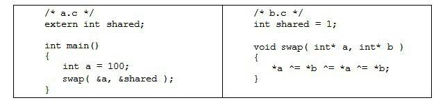

<h1>第4章 靜態連結</h1>

4.1 空間與地址分配

4.2 符號解析與重定位

4.3 COMMON塊

4.4 C++相關問題

4.5 靜態函式庫連結

4.6 連結過程控制

4.7 BFD庫

4.8 本章小結

透過前面對ELF檔案格式的介紹，使我們對ELF目的檔從整體輪廓到某些區域性的細節都有了一定的瞭解。接下來的問題是：當我們有兩個目的檔時，如何將它們連結起來形成一個執行檔？這個過程中發生了什麼？這基本上就是連結的核心內容：靜態連結。在這一節裡，我們將使用下面這兩個原始碼檔案“a.c”和“b.c”作為例子展開分析：

假設我們的程式只有這兩個模組“a.c”和“b.c”。首先我們使用gcc將“a.c”和“b.c”分別編譯成目的檔“a.o”和“b.o”：

經過編譯以後我們就得到了“a.o”和“b.o”這兩個目的檔。從程式碼中可以看到，“b.c”總共定義了兩個全域性符號，一個是變數“shared”，另外一個是函式“swap”；“a.c”裡面定義了一個全域性符號就是“main”。模組“a.c”裡面引用到了“b.c”裡面的“swap”和“shared”。我們接下來要做的就是把“a.o”和“b.o”這兩個目的檔連結在一起並最終形成一個執行檔“ab”。

