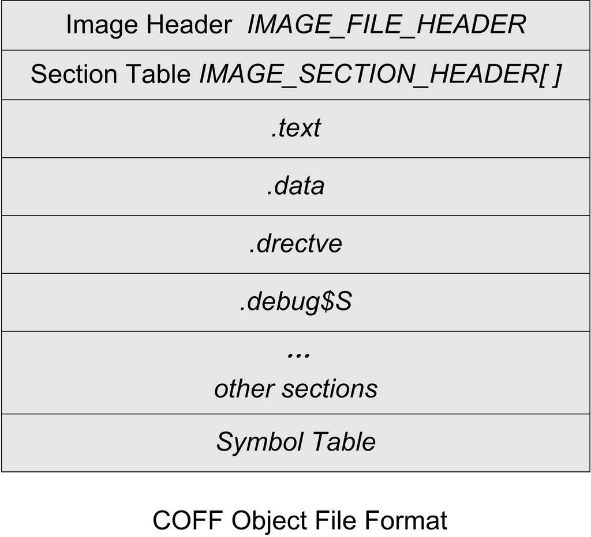
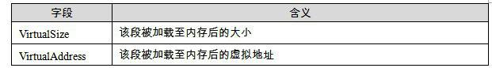
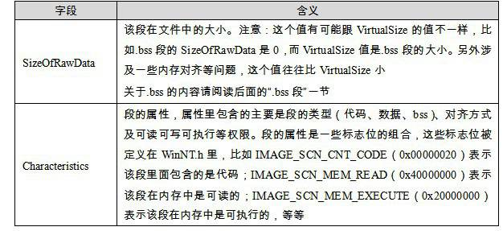

<h2>5.2 PE的前身——COFF</h2>

還記得剛開始分析ELF檔案格式時的那個SimpleSection.c嗎？我們接下來還是以它為例子，看看在Windows下，它被編譯成COFF目的檔時，所有的變數和函式是怎麼儲存的。在這個過程中，我們將用到“Microsoft Visual C++”的編譯環境。包括編譯器“cl”，連結器“link”，執行檔檢視器“dumpbin”等，你可以透過Microsoft的官方網站下載免費的Visual C++ Express 2005版，這已經足夠用了。

要使用這些工具，我們要在Windows命令列下面執行它們，Visual C++在安裝完成後就會有一個批處理檔案用來建立執行這些工具所需要的環境。它位於開始/程式/Microsoft Visual Studio 2005/Visual Studio Tools/ Visual Studio 2005 Command Prompt，這樣我們就可以透過命令列使用VC++的編譯器了。然後使用“cd”命令進入到原始碼所在目錄後執行：

<pre>cl /c /Za SimpleSection.c</pre>

“cl”是VISUAL C++的編譯器，即“Compiler”的縮寫。/c參數列示只編譯，不連結，即將.c檔案編譯成.obj檔案，而不呼叫連結器生成.exe檔案。如果不加這個引數，cl會在編譯“SimpleSection.c”檔案以後，再呼叫link連結器將該產生的SimpleSection.obj檔案與預設的C執行庫連結，產生執行檔SimpleSection.exe。

VISUAL C++有一些C和C++語言的專有擴充套件，這些擴充套件並沒有定義ANSI C標準或ANSI C++標準，具體可以參閱MSDN的Microsoft Extensions to C and C++這一節。“/Za”引數禁用這些擴充套件，使得我們的程式跟標準的C/C++相容，這樣可以盡量地看到問題的本質。另外值得一提的是，使用/Za引數時，編譯器自動定義了__STDC__這個宏，我們可以在程式裡透過判斷這個宏是否被定義而確定編譯器是否禁用了Microsoft C/C++語法擴充套件。

編譯完成以後我們得到了一個971位元組的SimpleSection.obj目的檔，當然檔案大小可能會因為編譯器版本、選項及機器平台不同而不同。跟GNU的工具鏈中的“objdump”一樣，Visual C++也提供了一個用於檢視目的檔和執行檔的工具，就是“dumpbin”。下面這個命令可以檢視SimpleSection.obj的結構：

dumpbin /ALL SimpleSection.obj &gt; SimpleSection.txt

<code>“/ALL</code>”引數是將列印輸出目的檔的所有相關資訊，包括檔案頭、每個段的屬性和段的原始資料及符號表。由於輸出資訊較多，如果直接列印到終端上，可能不太便於檢視，所以我們將其導向到一個輸出檔案“SimpleSection.txt”中。因為在接下來的分析過程中，我們將會經常用到這個“dumpbin”的輸出結果，所以將它儲存在“SimpleSection.txt”檔案中，以便後面分析時逐一對照。我們也可以用“/SUMMARY”選項來檢視整個檔案的基本資訊，它只輸出所有段的段名和長度：

<pre>dumpbin SimpleSection.obj /SUMMARY
Microsoft (R) COFF/PE Dumper Version 8.00.50727.762
Copyright (C) Microsoft Corporation.  All rights reserved.

Dump of file SimpleSection.obj

File Type: COFF OBJECT

  Summary

           4 .bss
           C .data
          86 .debug$S
          18 .drectve
          4E .text
</pre>

COFF檔案結構

幾乎跟ELF檔案一樣，COFF也是由檔案頭及後面的若幹個段組成，再加上檔案末尾的符號表、除錯資訊的內容，就構成了COFF檔案的基本結構，我們在COFF檔案中幾乎都可以找到與ELF檔案結構相對應的地方。COFF檔案的檔案頭部包括了兩部分，一個是描述檔案總體結構和屬性的映像頭（Image Header），另外一個是描述該檔案中包含的段屬性的段表（Section Table）。檔案頭後面緊跟著的就是檔案的段，包括程式碼段、資料段等，最後還有符號表等。整體結構如圖5-1所示。

映像（Image）：因為PE檔案在載入時被直接對映到程式的虛擬空間中執行，它是程式的虛擬空間的映像。所以PE執行檔很多時候被叫做映像檔案（Image File）。

 圖5-1 COFF目的檔格式 …

檔案頭裡描述COFF檔案總體屬性的映像頭是一個“IMAGE_FILE_HEADER”的結構，很明顯，它跟ELF中的“Elf32_Ehdr”結構的作用相同。這個結構及相關常數被定義在“VC\PlatformSDK\include\WinNT.h”裡面：

<pre>typedef struct _IMAGE_FILE_HEADER {
    WORD    Machine;
    WORD    NumberOfSections;
    DWORD   TimeDateStamp;
    DWORD   PointerToSymbolTable;
    DWORD   NumberOfSymbols;
    WORD    SizeOfOptionalHeader;
    WORD    Characteristics;
} IMAGE_FILE_HEADER, *PIMAGE_FILE_HEADER;
</pre>

再回頭對照前面“SimpleSection.txt”中的輸出資訊，我們可以看到輸出的資訊裡面最開始一段“FILE HEADER VALUES”中的內容跟COFF映像頭中的成員是一一對應的：

<pre>File Type: COFF OBJECT

FILE HEADER VALUES
             14C machine (x86)
               5 number of sections
        45C975E6 time date stamp Wed Feb 07 14:47:02 2007
             1E0 file pointer to symbol table
              14 number of symbols
            0 size of optional header
            0 characteristics
</pre>

可以看到這個目的檔的檔案型別是“COFF OBJECT”，也就是COFF目的檔格式。檔案頭裡面還包含了目標機器型別，例子裡的型別是0x14C，微軟定義該型別為x86相容CPU。按照微軟的預想，PE/COFF結構的執行檔應該可以在不同型別的硬體平台上使用，所以預留了該欄位。如果你安裝了VC或Windows SDK（也叫Platform SDK），就可以在WinNT.h裡面找到相應的以“<code>IMAGE_FILE_MACHINE_”</code>開頭的目標機器型別的定義。VISUAL C++裡面附帶的Platform SDK定義了28種CPU型別，從x86到MIPS R係列、ALPHA、ARM、PowerPC等。但是由於目前Windows只能應用在為數不多的平台上（目前只有x86平台），所以我們看到的這個型別值幾乎都是0x14C。檔案頭裡面的“Number of Sections”是指該PE所包含的“段”的數量。“Time date stamp”是指PE檔案的建立時間。“File pointer to symbol table”是符號表在PE中的位置。“Size of optional header”是指Optional Header的大小，這個結構只存在於PE執行檔，COFF目的檔中該結構不存在，所以為0，我們在後面介紹PE檔案結構時還會提到這個成員。

映像頭後面緊跟著的就是COFF檔案的段表，它是一個型別為“<code>IMAGE_SECTION_ HEADER</code>”結構的陣列，陣列裡面每個元素代表一個段，這個結構跟ELF檔案中的“Elf32_Shdr”很相似。很明顯，這個陣列元素的個數剛好是該COFF檔案所包含的段的數量，也就是映像頭裡面的“NumberOfSections”。這個結構是用來描述每個段的屬性的，它也被定義在WinNT.h裡面：

<pre>typedef struct _IMAGE_SECTION_HEADER {
    BYTE    Name[8];
    union {
            DWORD   PhysicalAddress;
            DWORD   VirtualSize;
    } Misc;
    DWORD   VirtualAddress;
    DWORD   SizeOfRawData;
    DWORD   PointerToRawData;
    DWORD   PointerToRelocations;
    DWORD   PointerToLinenumbers;
    WORD    NumberOfRelocations;
    WORD    NumberOfLinenumbers;
    DWORD   Characteristics;
} IMAGE_SECTION_HEADER, *PIMAGE_SECTION_HEADER;
</pre>

可以看到每個段所擁有的屬性包括段名（Section Name）、實體地址（Physical address）、虛擬地址（Virtual address）、原始資料大小（Size of raw data）、段在檔案中的位置（File pointer to raw data）、該段的重定位表在檔案中的位置（File pointer to relocation table）、該段的行號表在檔案中的位置（File pointer to line numbers）、標誌位（Characteristics）等。我們挑幾個重要的欄位來進行分析，主要有VirtualSize、VirtualAddress、SizeOfRawData和Characteristics這幾個欄位，如表5-1所示。

 表5-1 …

段表以後就是一個個的段的實際內容了，我們在分析ELF檔案的過程中已經分析過程式碼段、資料段和BSS段的內容及它們的儲存方式，COFF中這幾個段的內容與ELF中幾乎一樣，我們在這裡也不詳細介紹了。在這裡我們準備介紹兩個ELF檔案中不存在的段，這兩個段就是“.drectve”段和“.debug$S”段。

