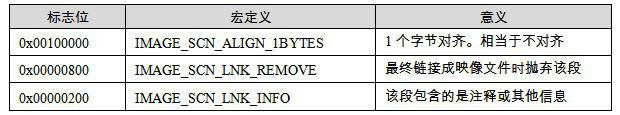

<h2>5.3 連結指示資訊</h2>

我們將“SimpleSection.txt”中關於“.drectve”段相關的內容摘錄如下：

<pre>SECTION HEADER #1
.drectve name
    0 physical address
    0 virtual address
    18 size of raw data
    DC file pointer to raw data (000000DC to 000000F3)
    0 file pointer to relocation table
    0 file pointer to line numbers
    0 number of relocations
    0 number of line numbers
  100A00 flags
         Info
         Remove
         1 byte align

RAW DATA #1
  00000000: 20 20 20 2F 44 45 46 41 55 4C 54 4C 49 42 3A 22     /DEFAULTLIB:"
  00000010: 4C 49 42 43 4D 54 22 20                          LIBCMT" 

   Linker Directives
   -----------------
   /DEFAULTLIB:"LIBCMT"
</pre>

“.drectve段”實際上是“Directive”的縮寫，它的內容是編譯器傳遞給連結器的指令（Directive），即編譯器希望告訴連結器應該怎樣連結這個目的檔。段名後面就是段的屬性，包括地址、長度、位置等我們這些在分析ELF時已經很熟知的屬性，最後一個屬性是標誌位“flags”，即IMAGE_SECTION_HEADERS裡面的Characteristics成員。“.drectve”段的標誌位為“0x100A00”，它是表5-2中的標誌位的組合。

 表5-2 …

“dumpbin”已經為我們列印出了標誌位的三個組合屬性：Info、Remove、1 byte align。即該段是資訊段，並非程式資料；該段可以在最後連結成執行檔的時候被拋棄；該段在檔案中的對齊方式是1個位元組對齊。

輸出資訊中緊隨其後的是該段在檔案中的原始資料（RAW DATA #1，用十六進位顯示的原始資料及相應的ASCII字元）。“dumpbin”知道該段是個“.drectve”段，並且對段的內容進行了解析，解析結果為一個“/DEFAULTLIB:‘LIBCMT’”的連結指令（Linker Directives），實際上它就是“cl”編譯器希望傳給“link”連結器的引數。這個參數列示編譯器希望告訴連結器，該目的檔需要LIBCMT這個預設庫。LIBCMT的全稱是（Library C Multithreaded），它表示VC的靜態連結的多執行緒C庫，對應的檔案在VC安裝目錄下的lib/libcmt.lib，我們在前面介紹靜態函式庫連結時已經簡單介紹過了。所以當我們使用“link”命令連結“SimpleSection.obj”時，連結器看到輸入檔案中有這個段，就會將“/DEFAULT:‘LIBCMT’”引數新增到連結引數中，即將libcmt.lib加入連結輸入檔案中。

我們可以在cl編譯器引數裡面加入/Zl來關閉預設C庫的連結指令。

