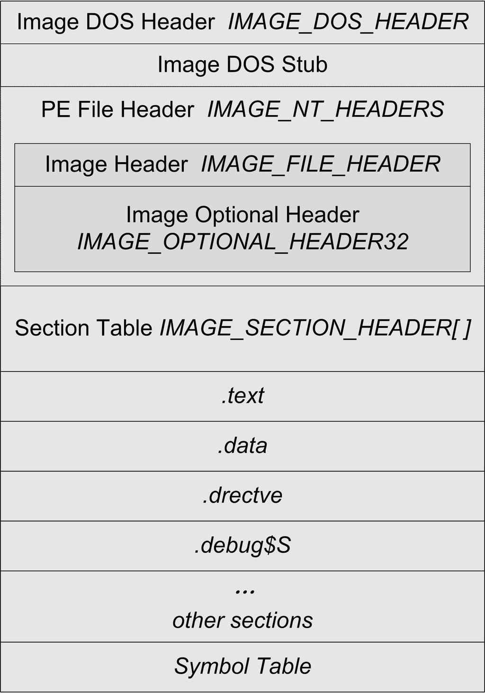

<h2>5.6 Windows下的ELF——PE</h2>

PE檔案是基於COFF的擴充套件，它比COFF檔案多了幾個結構。最主要的變化有兩個：第一個是檔案最開始的部分不是COFF檔案頭，而是DOS MZ執行檔格式的檔案頭和樁程式碼（DOS MZ File Header and Stub）；第二個變化是原來的COFF檔案頭中的“IMAGE_FILE_HEADER”部分擴充套件成了PE檔案檔案頭結構“IMAGE_NT_HEADERS”，這個結構包括了原來的“Image Header”及新增的PE擴充套件頭部結構（PE Optional Header）。PE檔案的結構如圖5-2所示。

DOS下的執行檔的副檔名與Windows下的可執行副檔名一樣，都是“.exe”，但是DOS下的執行檔格式是“MZ”格式（因為這個格式比較古老，我們在這裡並不打

 圖5-2 PE檔案格式 …

算展開介紹這種格式），與Windows下的PE格式完全不同，雖然它們使用相同的副檔名。在Windows發展的早期，那時候DOS系統還如日中天，而且早期的Windows版本還不能脫離DOS環境獨立執行，所以為了照顧DOS系統，那些為Windows編寫的程式必須盡量相容原有的DOS系統，所以PE檔案在設計之初就背負著歷史的累贅。PE檔案中“<code>Image DOS Header</code>”和“<code>DOS Stub</code>”這兩個結構就是為了相容DOS系統而設計的，其中“<code>IMAGE_DOS_HEADER</code>”結構其實跟DOS的“<code>MZ</code>”可執行結構的頭部完全一樣，所以從某個角度看，PE檔案其實也是一個“MZ”檔案。“<code>IMAGE_DOS_HEADER</code>”的結構中有的前兩個位元組是“<code>e_magic</code>”結構，它是裡面包含了“MZ”這兩個字母的ASCII碼；“<code>e_cs</code>”和“<code>e_ip</code>”兩個成員指向程式的入口地址。

當PE可執行映像在DOS下被載入的時候，DOS系統檢測該檔案，發現最開始兩個位元組是“MZ”，於是認為它是一個“MZ”執行檔。然後DOS系統就將PE檔案當作正常的“MZ”檔案開始執行。DOS系統會讀取“e_cs”和“e_ip”這兩個成員的值，以跳轉到程式的入口地址。然而PE檔案中，“e_cs”和“e_ip”這兩個成員並不指向程式真正的入口地址，而是指向檔案中的“DOS Stub”。“DOS Stub”是一段可以在DOS下執行的一小段程式碼，這段程式碼的唯一作用是向終端輸出一行字：“This program cannot be run in DOS”，然後退出程式，表示該程式不能在DOS下執行。所以我們如果在DOS系統下執行Windows的程式就可以看到上面這句話，這是因為PE檔案結構相容DOS“MZ”執行檔結構的緣故。

“IMAGE_DOS_HEADER”結構也被定義在WinNT.h裡面，該結構的大多數成員我們都不關心，唯一值得關心的是“<code>e_lfanew</code>”成員，這個成員表明了PE檔案頭（IMAGE_NT_HEADERS）在PE檔案中的偏移，我們需要使用這個值來定位PE檔案頭。這個成員在DOS的“MZ”檔案格式中它的值永遠為0，所以當Windows開始執行一個字尾名為“.exe”的檔案時，它會判斷“<code>e_lfanew</code>”成員是否為0。如果為0，則該“.exe”檔案是一個DOS“MZ”執行檔，Windows會啟動DOS子系統來執行它；如果不為0，那麼它就是一個Windows的PE執行檔，“<code>e_lfanew</code>”的值表示“IMAGE_NT_HEADERS”在檔案中的偏移。

“IMAGE_NT_HEADERS”是PE真正的檔案頭，它包含了一個標記（Signature）和兩個結構體。標記是一個常量，對於一個合法的PE檔案來說，它的值為0x00004550，按照小端位元組序，它對應的是’P’、‘E’、‘\0’、‘\0’這4個字元的ASCII碼。檔案頭包含的兩個結構分別是映像頭（Image Header）、PE擴充套件頭部結構（Image Optional Header）。這個結構定義如下：

<pre>typedef struct _IMAGE_NT_HEADERS {
    DWORD Signature;
    IMAGE_FILE_HEADER FileHeader;
    IMAGE_OPTIONAL_HEADER OptionalHeader;
} IMAGE_NT_HEADERS, *PIMAGE_NT_HEADERS;
</pre>

“Image Header”我們在介紹COFF目的檔結構時已經和“SectionTable”一起介紹過了。這裡新出現的是PE擴充套件頭部結構，這個結構的字面意思是“可選”（Optional），也就是說不是必須的，但實際上對於PE執行檔（包括DLL）來說，它是必需的。這裡的可選可能是相對於COFF目的檔來說的。該結構裡面包含了很多重要的資訊，同樣，我們可以在“WinNT.h”裡面找到該結構的定義：

<pre>typedef struct _IMAGE_OPTIONAL_HEADER {
    //
    // Standard fields.
    //
    WORD    Magic;
    BYTE    MajorLinkerVersion;
    BYTE    MinorLinkerVersion;
    DWORD   SizeOfCode;
    DWORD   SizeOfInitializedData;
    DWORD   SizeOfUninitializedData;
    DWORD   AddressOfEntryPoint;
    DWORD   BaseOfCode;
    DWORD   BaseOfData;

    //
    // NT additional fields.
    //
    DWORD   ImageBase;
    DWORD   SectionAlignment;
    DWORD   FileAlignment;
    WORD    MajorOperatingSystemVersion;
    WORD    MinorOperatingSystemVersion;
    WORD    MajorImageVersion;
    WORD    MinorImageVersion;
    WORD    MajorSubsystemVersion;
    WORD    MinorSubsystemVersion;
    DWORD   Win32VersionValue;
    DWORD   SizeOfImage;
    DWORD   SizeOfHeaders;
    DWORD   CheckSum;
    WORD    Subsystem;
    WORD    DllCharacteristics;
    DWORD   SizeOfStackReserve;
    DWORD   SizeOfStackCommit;
    DWORD   SizeOfHeapReserve;
    DWORD   SizeOfHeapCommit;
    DWORD   LoaderFlags;
    DWORD   NumberOfRvaAndSizes;
    IMAGE_DATA_DIRECTORY DataDirectory[IMAGE_NUMBEROF_DIRECTORY_ENTRIES];
} IMAGE_OPTIONAL_HEADER32, *PIMAGE_OPTIONAL_HEADER32;
</pre>

我們這裡所討論的“Optional Image Header”是32位版本的“IMAGE_OPTIONAL_ HEADER32”。因為64位的Windows也採用PE結構，所以也就有了64位的PE執行檔格式。為了區別這兩種格式，Windows中把32位的PE檔案格式叫做PE32，把64位的PE檔案格式叫做PE32+。這兩種格式就像ELF32和ELF64一樣，都大同小異，只不過關於地址和長度的一些成員從32位擴充套件成了64位，還增加了若幹個額外的成員之外，沒有其他區別。“WinNT.h”裡面定義了64位版本的“Optional Image Header”，叫做“IMAGE_ OPTIONAL_HEADER64”。

我們平時可以使用“IMAGE_OPTIONAL_HEADER”作為“Optional Image Header”的定義。它是一個宏，在64位的Windows下，Visual C++在編譯時會定義“_WIN64”這個宏，那麼“IMAGE_OPTIONAL_HEADER”就被定義成“IMAGE_OPTIONAL_HEADER64”；32位Windows下沒有定義“_WIN64”這個宏，那麼它就是IMAGE_OPTIONAL_HEADER32。跟ELF檔案中一樣，我們這裡只介紹32位版本的格式，64位的格式與32位區別不大。

“Optional Header”裡面有很多成員，有些部分跟PE檔案的載入與執行相關。我們不打算先在這裡一一列舉所有成員的具體含義，只是挑選一部分跟靜態連結有關的加以介紹，其他的成員在本書的其他部分會再次回顧。這些成員很多都是跟Windows系統相關聯的，很多關於Windows系統的程式設計書籍上也都會有介紹，也可以在Microsoft的MSDN上找到關於它們的資訊。

5.6.1 PE 資料目錄

在Windows系統載入PE執行檔時，往往需要很快地找到一些載入所需要的資料結構，比如匯入表、匯出表、資源、重定位表等。這些常用的資料的位置和長度都被儲存在了一個叫資料目錄（Data Directory）的結構裡面，其實它就是前面“IMAGE_OPTIONAL_ HEADER”結構裡面的“DataDirectory”成員。這個成員是一個“IMAGE_DATA_DIRECTORY”的結構陣列，相關的定義如下：

<pre>typedef struct _IMAGE_DATA_DIRECTORY {
    DWORD   VirtualAddress;
    DWORD   Size;
} IMAGE_DATA_DIRECTORY, *PIMAGE_DATA_DIRECTORY;

#define IMAGE_NUMBEROF_DIRECTORY_ENTRIES    16
</pre>

可以看到這個陣列的大小為16，IMAGE_DATA_DIRECTORY結構有兩個成員，分別是虛擬地址以及長度。DataDirectory陣列裡面每一個元素都對應一個包含一定含義的表。“WinNT.h”裡面定義了一些以“IMAGE_DIRECTORY_ENTRY_”開頭的宏，數值從0到15，它們實際上就是相關的表的宏定義在陣列中的下標。比如“IMAGE_DIRECTORY_ENTRY_EXPORT”被定義為0，所以這個陣列的第一個元素所包含的地址和長度就是匯出表（Export Table）所在的地址和長度。

這個陣列中還包含其他的表，比如匯入表、資源表、異常表、重定位表、除錯資訊表、執行緒私有儲存（TLS）等的地址和長度。這些表多數跟載入和DLL動態連結有關，與靜態連結沒什麼關係，所以我們在此不展開分析。在本書的第3部分我們會經常碰到這些表，在這裡我們只要透過解析DataDirectory結構瞭解這些表的位置和長度就可以了。

