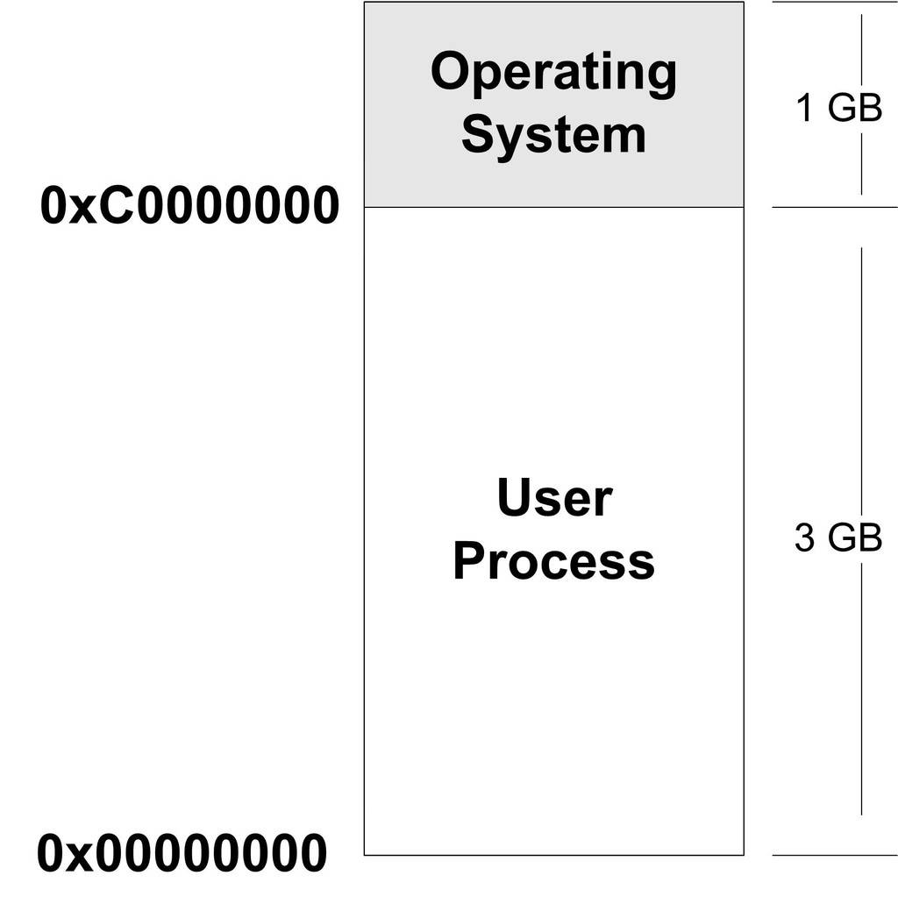

<h2>6.1 程式虛擬地址空間</h2>

我們在第1章已經回顧了關於虛擬地址空間和地址對映的一些基本概念。基於這些現代的計算機硬體體係結構和作業系統的概念，我們將逐步結合現實的系統，來分析這些概念是如何在實際中被應用的，並且影響到我們構建程式的方方面面。

程式和程式有什麼區別

程式（或者狹義上講執行檔）是一個靜態的概念，它就是一些預先編譯好的指令和資料集合的一個檔案；程式則是一個動態的概念，它是程式執行時的一個過程，很多時候把動態函式庫叫做執行時（Runtime）也有一定的含義。有人做過一個很有意思的比喻，說把程式和程式的概念跟做菜相比較的話，那麼程式就是菜譜，計算機的CPU就是人，相關的廚具則是計算機的其他硬體，整個炒菜的過程就是一個程式。計算機按照程式的指示把輸入資料加工成輸出資料，就好像菜譜指導著人把原料做成美味可口的菜餚。從這個比喻中我們還可以擴大到更大範圍，比如一個程式能在兩個CPU上執行等。

我們知道每個程式被執行起來以後，它將擁有自己獨立的虛擬地址空間（Virtual Address Space），這個虛擬地址空間的大小由計算機的硬體平台決定，具體地說是由CPU的位數決定的。硬體決定了地址空間的最大理論上限，即硬體的定址空間大小，比如32位的硬體平台決定了虛擬地址空間的地址為 0 到 2^32-1，即0x00000000～0xFFFFFFFF，也就是我們常說的4 GB虛擬空間大小；而64位的硬體平台具有64位定址能力，它的虛擬地址空間達到了264位元組，即0x0000000000000000～0xFFFFFFFFFFFFFFFF，總共17 179 869 184 GB，這個定址能力從現在來看，幾乎是無限的，但是歷史總是會嘲弄人，或許有一天我們會覺得64位的地址空間很小，就像我們現在覺得32位地址不夠用一樣。當人們第一次推出32位處理器的時候，很多人都在疑惑4 GB這麼大的地址空間有什麼用。

其實從程式的角度看，我們可以透過判斷C語言程式中的指標所佔的空間來計算虛擬地址空間的大小。一般來說，C語言指標大小的位數與虛擬空間的位數相同，如32位平台下的指標為32位，即4位元組；64位平台下的指標為64位，即8位元組。當然有些特殊情況下，這種規則不成立，比如早期的MSC的C語言分長指標、短指標和近指標，這是為了適應當時畸形處理器而設立的，現在基本可以不予考慮。

我們在下文中以32位的地址空間為主，64位的與32位類似。

那麼32位平台下的4 GB虛擬空間，我們的程式是否可以任意使用呢？很遺憾，不行。因為程式在執行的時候處於作業系統的監管下，作業系統為了達到監控程式執行等一係列目的，程式的虛擬空間都在作業系統的掌握之中。程式只能使用那些作業系統分配給程式的地址，如果訪問未經允許的空間，那麼作業系統就會捕獲到這些訪問，將程式的這種訪問當作非法操作，強製結束程式。我們經常在Windows下碰到令人討厭的“程式因非法操作需要關閉”或Linux下的“Segmentation fault”很多時候是因為程式訪問了未經允許的地址。

那麼到底這4 GB的程式虛擬地址空間是怎樣的分配狀態呢？首先以Linux作業系統作為例子，預設情況下，Linux作業系統將程式的虛擬地址空間做了如圖6-1所示的分配。

 圖6-1 Linux程式虛擬空間分佈 …

整個4 GB被劃分成兩部分，其中作業系統本身用去了一部分：從地址0xC00000000到0xFFFFFFFF，共1 GB。剩下的從0x00000000地址開始到0xBFFFFFFF共3 GB的空間都是留給程式使用的。那麼從原則上講，我們的程式最多可以使用3 GB的虛擬空間，也就是說整個程式在執行的時候，所有的程式碼、資料包括透過C語言malloc()等方法申請的虛擬空間之和不可以超過3 GB。在現代的程式中，3 GB的虛擬空間有時候是不夠用的，比如一些大型的資料庫系統、數值計算、圖形影象處理、虛擬現實、遊戲等程式需要佔用的記憶體空間較大，這使得32位硬體平台的虛擬地址空間顯得捉襟見肘。當然一本萬利的方法就是使用64位處理器，把虛擬地址空間擴充套件到17 179 869 184 GB。當然不是人人都能順利地更換64位處理器，更何況有很多現有的程式只能執行在32位處理器下。那麼32位CPU的平台能不能使用超過4 GB的空間呢？這個問題我們將在後面的“PAE”一節中進行介紹。

不知讀者是否注意到，上文提到這3 GB的空間“原則上”是可以給程式使用的，但令人遺憾的是，程式並不能完全使用這3 GB的虛擬空間，其中有一部分是預留給其他用途的，我們在後面還會提到。

對於Windows作業系統來說，它的程式虛擬地址空間劃分是作業系統佔用2 GB，那麼程式只剩下2 GB空間。2 GB空間對一些程式來說太小了，所以Windows有個啟動引數可以將作業系統佔用的虛擬地址空間減少到1 GB，即跟Linux分佈一樣。方法如下：修改Windows系統盤根目錄下的Boot.ini，加上“/3G”引數。

<pre>[boot loader]
timeout=30
default=multi(0)disk(0)rdisk(0)partition(1)\WINDOWS
[operating systems]
multi(0)disk(0)rdisk(0)partition(1)\WINDOWS="Microsoft Windows XP Professional" /3G /fastdetect /NoExecute=OptIn
</pre>

PAE

32位的CPU下，程式使用的空間能不能超過4 GB呢？這個問題其實應該從兩個角度來看，首先，問題裡面的“空間”如果是指虛擬地址空間，那麼答案是“否”。因為32位的CPU只能使用32位的指標，它最大的定址範圍是0 到4 GB；如果問題裡面的“空間”指計算機的記憶體空間，那麼答案為“是”。Intel自從1995年的Pentium Pro CPU開始採用了36位的實體地址，也就是可以訪問高達64 GB的實體記憶體。

從硬體層面上來講，原先的32位地址線只能訪問最多4 GB的實體記憶體。但是自從擴充套件至36位地址線之後，Intel修改了頁對映的方式，使得新的對映方式可以訪問到更多的實體記憶體。Intel 把這個地址擴充套件方式叫做PAE（Physical Address Extension）。

當然擴充套件的實體地址空間，對於普通應用程式來說正常情況下感覺不到它的存在，因為這主要是作業系統的事，在應用程式裡，只有32位的虛擬地址空間。那麼應用程式該如何使用這些大於常規的記憶體空間呢？一個很常見的方法就是作業系統提供一個視窗對映的方法，把這些額外的記憶體對映到程式地址空間中來。應用程式可以根據需要來選擇申請和對映，比如一個應用程式中0x10000000～0x20000000這一段256 MB的虛擬地址空間用來做視窗，程式可以從高於4 GB的物理空間中申請多個大小為256 MB的物理空間，編號成A、B、C等，然後根據需要將這個視窗對映到不同的物理空間塊，用到A時將0x10000000～0x20000000對映到A，用到B、C時再對映過去，如此重複操作即可。在Windows下，這種訪問記憶體的操作方式叫做AWE（Address Windowing Extensions）；而像Linux等UNIX類作業系統則採用mmap()系統呼叫來實現。

當然這只是一種補救32位地址空間不夠大時的非常規手段，真正的解決方法還是應該使用64位的處理器和作業系統。這不僅使人想起了DOS時代16位地址不夠用時，也採用了類似的16位CPU字長，20位地址線長度，系統有著640 KB、1 MB等諸多訪問限製。由於很多應用程式須訪問超過1 MB的記憶體，所以當時也有很多類似PAE和AWE的方法，比如當時很著名的XMS（eXtended Memory Specification）。

Windows下的PAE和AWE可以使用與/3G相似的啟動選項/PAE和/AWE開啟。

