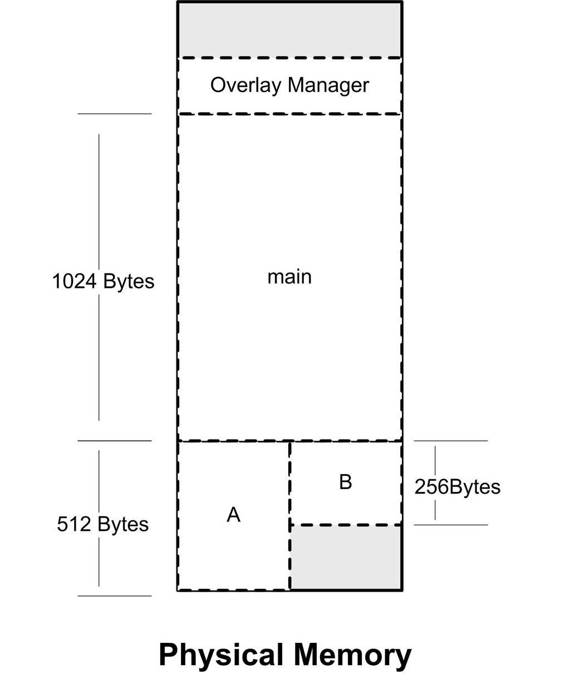
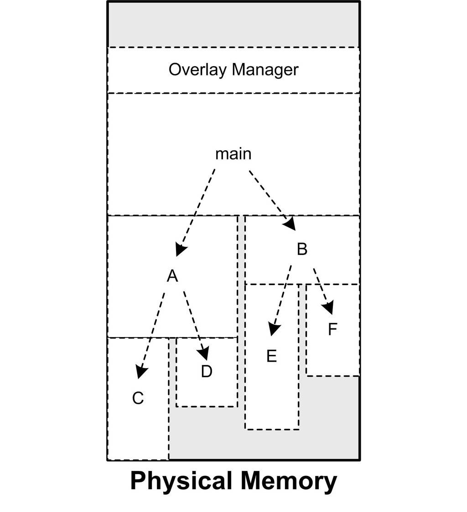
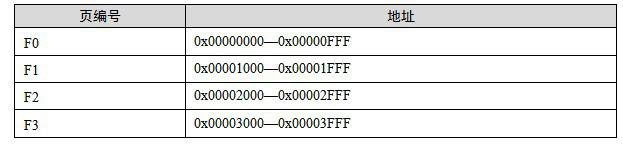
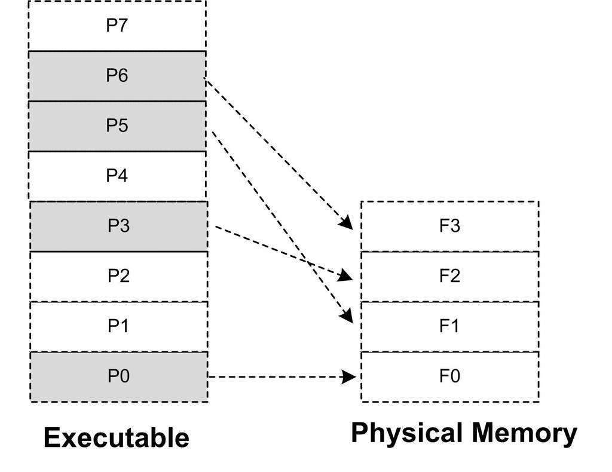

<h2>6.2 載入的方式</h2>

程式執行時所需要的指令和資料必須在記憶體中才能夠正常執行，最簡單的辦法就是將程式執行所需要的指令和資料全都裝入記憶體中，這樣程式就可以順利執行，這就是最簡單的靜態裝入的辦法。但是很多情況下程式所需要的記憶體數量大於實體記憶體的數量，當記憶體的數量不夠時，根本的解決辦法就是新增記憶體。相對於磁碟來說，記憶體是昂貴且稀有的，這種情況自計算機磁碟誕生以來一直如此。所以人們想盡各種辦法，希望能夠在不新增記憶體的情況下讓更多的程式執行起來，盡可能有效地利用記憶體。後來研究發現，程式執行時是有區域性性原理的，所以我們可以將程式最常用的部分駐留在記憶體中，而將一些不太常用的資料存放在磁碟裡面，這就是動態裝入的基本原理。

覆蓋裝入（Overlay）和頁對映（Paging）是兩種很典型的動態載入方法，它們所採用的思想都差不多，原則上都是利用了程式的區域性性原理。動態裝入的思想是程式用到哪個模組，就將哪個模組裝入記憶體，如果不用就暫時不裝入，存放在磁碟中。

按照2009年2月的資料，以一個普通的希捷7200RPM的桌面PC硬碟為例，它擁有8 MB快取，500 GB的容量，價格是459元。按照每GB的價格來算，DDR2 667記憶體每GB約150元，而硬碟每GB的價格不到1元，價格大約是記憶體的1/200。

6.2.1 覆蓋裝入

覆蓋裝入在沒有發明虛擬儲存之前使用比較廣泛，現在已經幾乎被淘汰了。雖然這種方法很蹩腳，在被虛擬儲存慣壞了的現代PC機程式設計師眼裡可能不屑一顧，但是它在計算機發展的初期的確為程式能夠在記憶體受限的機器下正常執行提供了一種解決方案。它所體現的一些思想還是很有意義的。值得一提的是，在一些現代嵌入式的記憶體受限環境下，特別是諸如DSP等，這種方法或許還有用武之地。

覆蓋裝入的方法把挖掘記憶體潛力的任務交給了程式設計師，程式設計師在編寫程式的時候必須手工將程式分割成若幹塊，然後編寫一個小的輔助程式碼來管理這些模組何時應該駐留記憶體而何時應該被替換掉。這個小的輔助程式碼就是所謂的覆蓋管理器（Overlay Manager）。最簡單的情況下，一個程式有主模組“main”，main分別會呼叫到模組A和模組B，但是A和B之間不會相互呼叫；這三個模組的大小分別是1 024位元組、512位元組和256位元組。假設不考慮記憶體對齊、載入地址限製的情況，理論上執行這個程式需要有1 792個位元組的記憶體。如果我們採用覆蓋裝入的辦法，那麼在記憶體中可以這樣安排，如圖6-2所示。

 圖6-2 簡單覆蓋載入 …

由於模組A和模組B之間相互呼叫依賴關係，我們可以把模組A和模組B在記憶體中“相互覆蓋”，即兩個模組共享塊記憶體區域。當main模組呼叫模組A時，覆蓋管理器保證將模組A從檔案中讀入記憶體；當模組main呼叫模組B時，則覆蓋管理器將模組B從檔案中讀入記憶體，由於這時模組A不會被使用，那麼模組B可以裝入到原來模組A所佔用的記憶體空間。很明顯，除了覆蓋管理器，整個程式執行只需要1 536個位元組，比原來的方案節省了256位元組的空間。覆蓋管理器本身往往很小，從數十位元組到數百位元組不等，一般都常駐記憶體。

上面的例子是最簡單的覆蓋情況，但是事實上程式往往不止兩個模組，而模組之間的呼叫關係也比上面的例子要複雜。在多個模組的情況下，程式設計師需要手工將模組按照它們之間的呼叫依賴關係組織成樹狀結構。

按照圖6-3的組織關係，模組main依賴於模組A和B，模組A依賴於C和D；模組B依賴於E和F，則它們在記憶體中的覆蓋方式如圖中所示。很明顯，這個程式的執行方式與前面的例子大同小異，值得注意的是，覆蓋管理器需要保證兩點。

 圖6-3 複雜的覆蓋載入 …

這個樹狀結構中從任何一個模組到樹的根（也就是main）模組都叫呼叫路徑。當該模組被呼叫時，整個呼叫路徑上的模組必須都在記憶體中。比如程式正在模組E中執行程式碼，那麼模組B和模組main必須都在記憶體中，以確保模組E執行完畢以後能夠正確返回至模組B和模組main。

禁止跨樹間呼叫。任意一個模組不允許跨過樹狀結構進行呼叫。比如上面例子中，模組A不可以呼叫模組B、E、F；模組C不可以呼叫模組D、B、E、F等。因為覆蓋管理器不能夠保證跨樹間的模組能夠存在於記憶體中。不過很多時候可能兩個子模組都需要依賴於某個模組，比如模組E和模組C都需要另外一個模組G，那麼最方便的做法是將模組G並入到main模組中，這樣G就在E和C的呼叫路徑上了。

當然，由於跨模組間的呼叫都需要經過覆蓋管理器，以確保所有被呼叫到的模組都能夠正確地駐留在記憶體，而且一旦模組沒有在記憶體中，還需要從磁碟或其他儲存器讀取相應的模組，所以覆蓋裝入的速度肯定比較慢，不過這也是一種摺中的方案，是典型的利用時間換取空間的方法。

6.2.2 頁對映

頁對映是虛擬儲存機制的一部分，它隨著虛擬儲存的發明而誕生。前面我們已經介紹了頁對映的基本原理，這裡我們再結合執行檔的載入來闡述一下頁對映是如何被應用到動態載入中去的。與覆蓋裝入的原理相似，頁對映也不是一下子就把程式的所有資料和指令都裝入記憶體，而是將記憶體和所有磁碟中的資料和指令按照“頁（Page）”為單位劃分成若幹個頁，以後所有的載入和操作的單位就是頁。以目前的情況，硬體規定的頁的大小有4 096位元組、8 192位元組、2 MB、4 MB等，最常見的Intel IA32處理器一般都使用4 096位元組的頁，那麼512 MB的實體記憶體就擁有512 * 1024 * 1024 / 4 096 = 131 072個頁。

為了演示頁對映的基本機制，假設我們的32位機器有16 KB的記憶體，每個頁大小為4 096位元組，則共有4個頁，如表6-1所示。

 表6-1 …

假設程式所有的指令和資料總和為32 KB，那麼程式總共被分為8個頁。我們將它們編號為P0～P7。很明顯，16 KB的記憶體無法同時將32 KB的程式裝入，那麼我們將按照動態裝入的原理來進行整個裝入過程。如果程式剛開始執行時的入口地址在P0，這時載入管理器（我們假設載入過程由一個叫載入管理器的家夥來控制，就像覆蓋管理器一樣）發現程式的P0不在記憶體中，於是將記憶體F0分配給P0，並且將P0的內容裝入F0；執行一段時間以後，程式需要用到P5，於是載入管理器將P5裝入F1；就這樣，當程式用到P3和P6的時候，它們分別被裝入到了F2和F3，它們的對映關係如圖6-4所示。

 圖6-4 頁對映與頁載入 …

很明顯，如果這時候程式只需要P0、P3、P5和P6這4個頁，那麼程式就能一直執行下去。但是問題很明顯，如果這時候程式需要訪問P4，那麼載入管理器必須做出抉擇，它必須放棄目前正在使用的4個記憶體頁中的其中一個來載入P4。至於選擇哪個頁，我們有很多種演算法可以選擇，比如可以選擇F0，因為它是第一個被分配掉的記憶體頁（這個演算法我們可以稱之為FIFO，先進先出演算法）；假設載入管理器發現F2很少被訪問到，那麼我們可以選擇F2（這種演算法可以稱之為LUR，最少使用演算法）。假設我們放棄P0，那麼這時候F0就裝入了P4。程式接著按照這樣的方式執行。

可能很多讀者已經發現了，這個所謂的載入管理器就是現代的作業系統，更加準確地講就是作業系統的儲存管理器。目前幾乎所有的主流作業系統都是按照這種方式載入執行檔的，我們熟悉的Windows對PE檔案的載入及Linux對ELF檔案的載入都是這樣完成的，接著我們將從作業系統的角度來看執行檔的載入。

