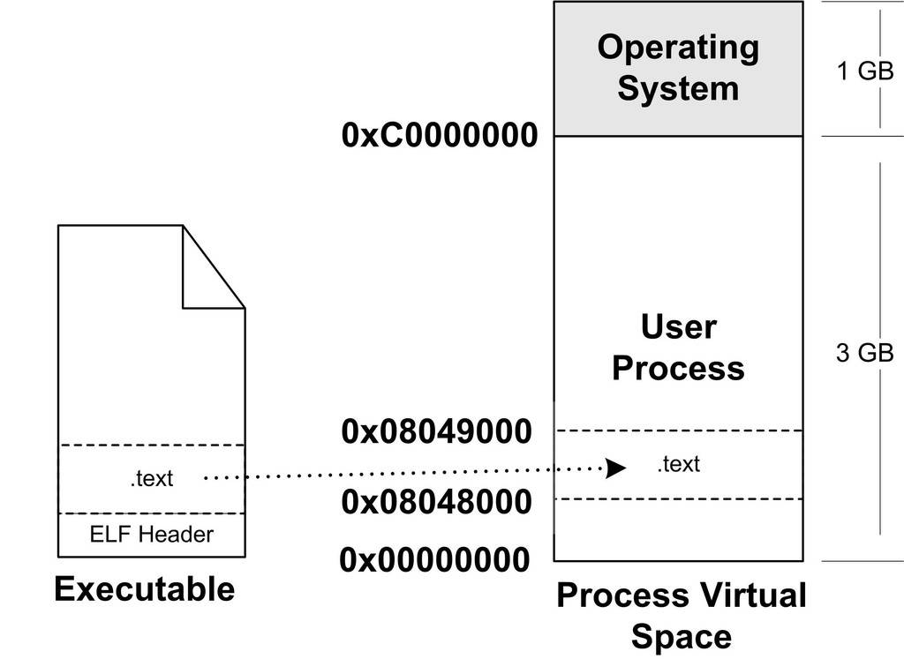
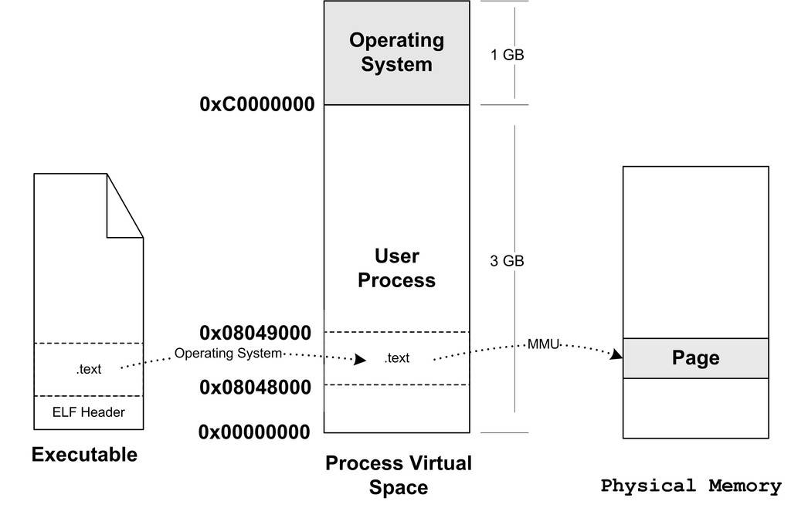

<h2>6.3 從作業系統角度看執行檔的載入</h2>

從上面頁對映的動態裝入的方式可以看到，執行檔中的頁可能被裝入記憶體中的任意頁。比如程式需要P4的時候，它可能會被裝入F0～F3這4個頁中的任意一個。很明顯，如果程式使用實體地址直接進行操作，那麼每次頁被裝入時都需要進行重定位。正如我們在第1章中所提到的，在虛擬儲存中，現代的硬體MMU都提供地址轉換的功能。有了硬體的地址轉換和頁對映機制，作業系統動態載入執行檔的方式跟靜態載入有了很大的區別。

我們經常看到各種執行檔的載入過程的描述，雖然大致能夠明白這個過程，但是總覺得似乎還有那麼一層迷霧阻隔著，一旦涉及細節總是有一些模糊。本節我們將站在作業系統的角度來闡述一個執行檔如何被載入，並且同時在程式中執行。

6.3.1 程式的建立

事實上，從作業系統的角度來看，一個程式最關鍵的特徵是它擁有獨立的虛擬地址空間，這使得它有別於其他程式。很多時候一個程式被執行同時都伴隨著一個新的程式的建立，那麼我們就來看看這種最通常的情形：建立一個程式，然後載入相應的執行檔並且執行。在有虛擬儲存的情況下，上述過程最開始只需要做三件事情：

建立一個獨立的虛擬地址空間。

讀取執行檔頭，並且建立虛擬空間與執行檔的對映關係。

將CPU的指令暫存器設定成執行檔的入口地址，啟動執行。

首先是建立虛擬地址空間。回憶第1章的頁對映機制，我們知道一個虛擬空間由一組頁對映函式將虛擬空間的各個頁對映至相應的物理空間，那麼建立一個虛擬空間實際上並不是建立空間而是建立對映函式所需要的相應的資料結構，在i386 的Linux下，建立虛擬地址空間實際上只是分配一個頁目錄（Page Directory）就可以了，甚至不設定頁對映關係，這些對映關係等到後面程式發生頁錯誤的時候再進行設定。

讀取執行檔頭，並且建立虛擬空間與執行檔的對映關係。上面那一步的頁對映關係函式是虛擬空間到實體記憶體的對映關係，這一步所做的是虛擬空間與執行檔的對映關係。我們知道，當程式執行發生頁錯誤時，作業系統將從實體記憶體中分配一個物理頁，然後將該“缺頁”從磁碟中讀取到記憶體中，再設定缺頁的虛擬頁和物理頁的對映關係，這樣程式才得以正常執行。但是很明顯的一點是，當作業系統捕獲到缺頁錯誤時，它應知道程式當前所需要的頁在執行檔中的哪一個位置。這就是虛擬空間與執行檔之間的對映關係。從某種角度來看，這一步是整個載入過程中最重要的一步，也是傳統意義上“載入”的過程。

由於執行檔在載入時實際上是被對映的虛擬空間，所以執行檔很多時候又被叫做映像檔案（Image）。

讓我們考慮最簡單的情況，假設我們的ELF執行檔只有一個程式碼段“.text“，它的虛擬地址為0x08048000，它在檔案中的大小為0x000e1，對齊為0x1000。由於虛擬儲存的頁對映都是以頁為單位的，在32位的Intel IA32下一般為4 096位元組，所以32位ELF的對齊粒度為0x1000。由於該.text段大小不到一個頁，考慮到對齊該段佔用一個段。所以一旦該執行檔被載入，執行檔與執行該執行檔程式的虛擬空間的對映關係如圖6-5所示。

 圖6-5 執行檔與程式虛擬空間 …

很明顯，這種對映關係只是儲存在作業系統內部的一個資料結構。Linux中將程式虛擬空間中的一個段叫做虛擬記憶體區域（VMA, Virtual Memory Area）；在Windows中將這個叫做虛擬段（Virtual Section），其實它們都是同一個概念。比如上例中，作業系統建立程式後，會在程式相應的資料結構中設定有一個.text 段的VMA：它在虛擬空間中的地址為0x08048000～0x08049000，它對應ELF檔案中偏移為0的.text，它的屬性為只讀（一般程式碼段都是只讀的），還有一些其他的屬性。

VMA是一個很重要的概念，它對於我們理解程式的載入執行和作業系統如何管理程式的虛擬空間有非常重要的幫助。

上面的例子中，我們描述的是最簡單的只有一個段的執行檔對映的情況。作業系統在內部儲存這種結構，很明顯是因為當程式執行發生段錯誤時，它可以透過查詢這樣的一個資料結構來定位錯誤頁在執行檔中的位置，此內容後面會詳細介紹。

將CPU指令暫存器設定成執行檔入口，啟動執行。第三步其實也是最簡單的一步，作業系統透過設定CPU的指令暫存器將控制權轉交給程式，由此程式開始執行。這一步看似簡單，實際上在作業系統層面上比較複雜，它涉及核心堆疊和使用者堆疊的切換、CPU執行許可權的切換。不過從程式的角度看這一步可以簡單地認為作業系統執行了一條跳轉指令，直接跳轉到執行檔的入口地址。還記得ELF檔案頭中儲存有入口地址嗎？沒錯，就是這個地址。

6.3.2 頁錯誤

上面的步驟執行完以後，其實執行檔的真正指令和資料都沒有被裝入到記憶體中。作業系統只是透過執行檔頭部的資訊建立起執行檔和程式虛擬記憶體之間的對映關係而已。假設在上面的例子中，程式的入口地址為0x08048000，即剛好是.text段的起始地址。當CPU開始打算執行這個地址的指令時，發現頁面0x08048000～0x08049000是個空頁面，於是它就認為這是一個頁錯誤（Page Fault）。CPU將控制權交給作業系統，作業系統有專門的頁錯誤處理例程來處理這種情況。這時候我們前面提到的載入過程的第二步建立的資料結構起到了很關鍵的作用，作業系統將查詢這個資料結構，然後找到空頁面所在的VMA，計算出相應的頁面在執行檔中的偏移，然後在實體記憶體中分配一個物理頁面，將程式中該虛擬頁與分配的物理頁之間建立對映關係，然後把控制權再還回給程式，程式從剛才頁錯誤的位置重新開始執行。

隨著程式的執行，頁錯誤也會不斷地產生，作業系統也會為程式分配相應的物理頁面來滿足程式執行的需求，如圖6-6所示。當然有可能程式所需要的記憶體會超過可用的記憶體數量，特別是在有多個程式同時執行的時候，這時候作業系統就需要精心組織和分配實體記憶體，甚至有時候應將分配給程式的實體記憶體暫時收回等，這就涉及了作業系統的虛擬儲存管理。這裡不再展開，有興趣的讀者可以參考相應的作業系統方面的資料。

 圖6-6 頁錯誤 …

