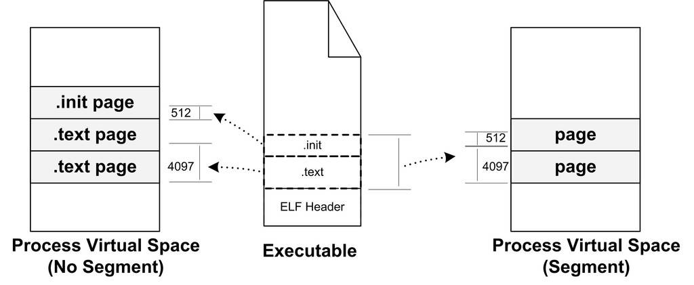
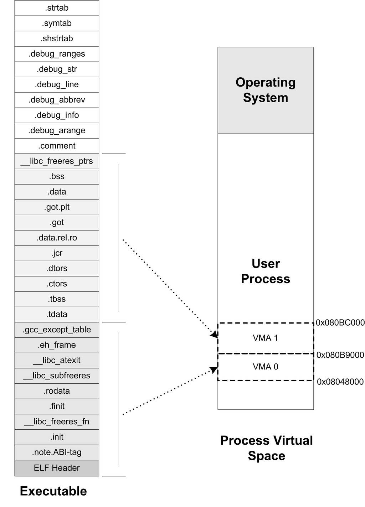
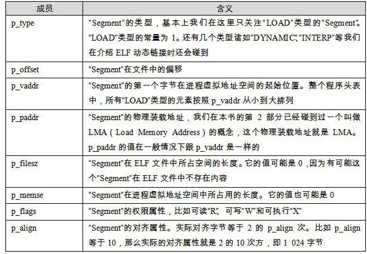
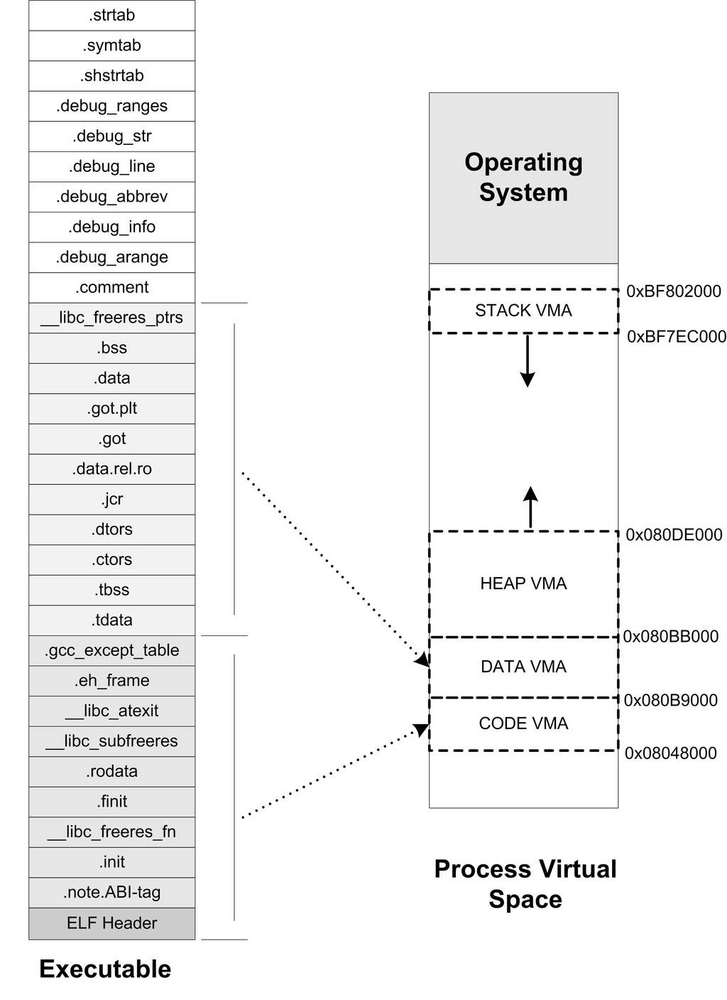
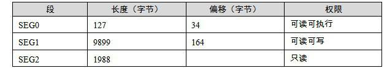
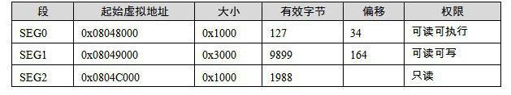
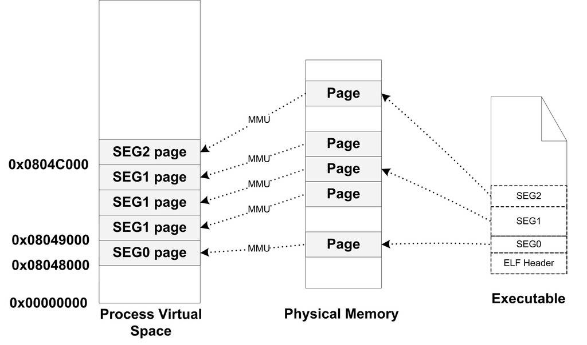
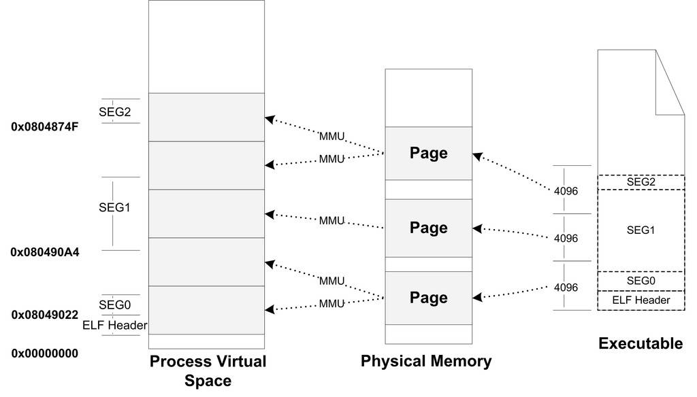
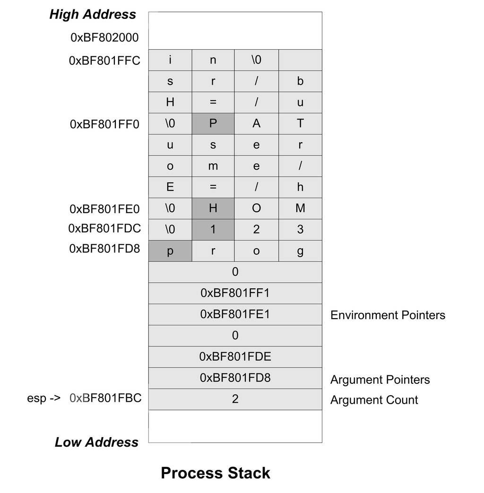

<h2>6.4 程式虛擬記憶體空間分佈</h2>

6.4.1 ELF檔案連結檢視和執行檢視

前面例子的執行檔中只有一個程式碼段，所以它被作業系統載入至程式地址空間之後，相對應的只有一個VMA。不過實際情況會比這複雜得多，在一個正常的程式中，執行檔中包含的往往不止程式碼段，還有資料段、BSS等，所以對映到程式虛擬空間的往往不止一個段。

當段的數量增多時，就會產生空間浪費的問題。因為我們知道，ELF檔案被對映時，是以系統的頁長度作為單位的，那麼每個段在對映時的長度應該都是系統頁長度的整數倍；如果不是，那麼多餘部分也將佔用一個頁。一個ELF檔案中往往有十幾個段，那麼記憶體空間的浪費是可想而知的。有沒有辦法盡量減少這種記憶體浪費呢？

當我們站在作業系統載入執行檔的角度看問題時，可以發現它實際上並不關心執行檔各個段所包含的實際內容，作業系統只關心一些跟載入相關的問題，最主要的是段的許可權（可讀、可寫、可執行）。ELF檔案中，段的許可權往往只有為數不多的幾種組合，基本上是三種：

以程式碼段為代表的許可權為可讀可執行的段。

以資料段和BSS段為代表的許可權為可讀可寫的段。

以只讀資料段為代表的許可權為只讀的段。

那麼我們可以找到一個很簡單的方案就是：對於相同許可權的段，把它們合並到一起當作一個段進行對映。比如有兩個段分別叫“.text”和“.init”，它們包含的分別是程式的可執行程式碼和初始化程式碼，並且它們的許可權相同，都是可讀並且可執行的。假設.text為4 097位元組，.init為512位元組，這兩個段分別對映的話就要佔用三個頁面，但是，如果將它們合並成一起對映的話只需要佔用兩個頁面，如圖6-7所示。

 圖6-7 ELF Segment …

ELF執行檔引入了一個概念叫做“Segment”，一個“Segment”包含一個或多個屬性類似的“Section”。正如我們上面的例子中看到的，如果將“.text”段和“.init”段合並在一起看作是一個“Segment”，那麼載入的時候就可以將它們看作一個整體一起對映，也就是說對映以後在程式虛擬記憶體空間中只有一個相對應的VMA，而不是兩個，這樣做的好處是可以很明顯地減少頁面內部碎片，從而節省了記憶體空間。

我們很難將“Segment”和“Section”這兩個詞從中文的翻譯上加以區分，因為很多時候Section也被翻譯成“段”，回顧第2章，我們也沒有很嚴格區分這兩個英文詞彙和兩個中文詞彙“段”和“節”之間的相互翻譯。很明顯，從連結的角度看，ELF檔案是按“Section”儲存的，事實也的確如此；從載入的角度看，ELF檔案又可以按照“Segment”劃分。我們在這裡就對“Segment”不作翻譯，一律按照原詞。

“Segment”的概念實際上是從載入的角度重新劃分了ELF的各個段。在將目的檔連結成執行檔的時候，連結器會盡量把相同許可權屬性的段分配在同一空間。比如可讀可執行的段都放在一起，這種段的典型是程式碼段；可讀可寫的段都放在一起，這種段的典型是資料段。在ELF中把這些屬性相似的、又連在一起的段叫做一個“Segment”，而系統正是按照“Segment”而不是“Section”來對映執行檔的。

下面的例子是一個很小的程式，程式本身是不停地迴圈執行“sleep”操作，除非使用者發訊號給它，否則就一直執行。它的原始碼如下：

<pre>#include &lt;stdlib.h&gt;

int main()
{
    while(1) {
        sleep(1000);
    }
    return 0;
}
</pre>

我們使用靜態連線的方式將其編譯連線成執行檔，然後得到的執行檔“SectionMapping.elf”是一個Linux下很典型的執行檔：

$gcc -static SectionMapping.c -o SectionMapping.elf

使用readelf可以看到，這個執行檔中總共有33個段（Section）：

<pre>$readelf -S SectionMapping.elf
There are 33 section headers, starting at offset 0x74594:

Section Headers:
  [Nr] Name              Type     Addr     Off    Size   ES Flg Lk Inf Al
  [ 0]                   NULL     00000000 000000 000000 00      0   0  0
  [ 1] .note.ABI-tag     NOTE     080480d4 0000d4 000020 00   A  0   0  4
  [ 2] .init             PROGBITS 080480f4 0000f4 000017 00  AX  0   0  4
  [ 3] .text             PROGBITS 08048110 000110 055948 00  AX  0   0 16
  [ 4] __libc_freeres_fn PROGBITS 0809da60 055a60 000a8b 00  AX  0   0 16
  [ 5] .fini             PROGBITS 0809e4ec 0564ec 00001c 00  AX  0   0  4
  [ 6] .rodata           PROGBITS 0809e520 056520 0169e8 00   A  0   0 32
  [ 7] __libc_subfreeres PROGBITS 080b4f08 06cf08 00002c 00   A  0   0  4
  [ 8] __libc_atexit     PROGBITS 080b4f34 06cf34 000004 00   A  0   0  4
  [ 9] .eh_frame         PROGBITS 080b4f38 06cf38 003a0c 00   A  0   0  4
  [10] .gcc_except_table PROGBITS 080b8944 070944 0000a1 00   A  0   0  1
  [11] .tdata            PROGBITS 080b99e8 0709e8 000010 00 WAT  0   0  4
  [12] .tbss             NOBITS   080b99f8 0709f8 000018 00 WAT  0   0  4
  [13] .ctors            PROGBITS 080b99f8 0709f8 000008 00  WA  0   0  4
  [14] .dtors            PROGBITS 080b9a00 070a00 00000c 00  WA  0   0  4
  [15] .jcr              PROGBITS 080b9a0c 070a0c 000004 00  WA  0   0  4
  [16] .data.rel.ro      PROGBITS 080b9a10 070a10 00002c 00  WA  0   0  4
  [17] .got              PROGBITS 080b9a3c 070a3c 000008 04  WA  0   0  4
  [18] .got.plt          PROGBITS 080b9a44 070a44 00000c 04  WA  0   0  4
  [19] .data             PROGBITS 080b9a60 070a60 000720 00  WA  0   0 32
  [20] .bss              NOBITS   080ba180 071180 001ad4 00  WA  0   0 32
  [21] __libc_freeres_pt NOBITS   080bbc54 071180 000014 00  WA  0   0  4
  [22] .comment          PROGBITS 00000000 071180 002df0 00      0   0  1
  [23] .debug_aranges    PROGBITS 00000000 073f70 000058 00      0   0  8
  [24] .debug_pubnames   PROGBITS 00000000 073fc8 000025 00      0   0  1
  [25] .debug_info       PROGBITS 00000000 073fed 0001ad 00      0   0  1
  [26] .debug_abbrev     PROGBITS 00000000 07419a 000066 00      0   0  1
  [27] .debug_line       PROGBITS 00000000 074200 00013d 00      0   0  1
  [28] .debug_str        PROGBITS 00000000 07433d 0000bb 01  MS  0   0  1
  [29] .debug_ranges     PROGBITS 00000000 0743f8 000048 00      0   0  8
  [30] .shstrtab         STRTAB   00000000 074440 000152 00      0   0  1
  [31] .symtab           SYMTAB   00000000 074abc 007ab0 10      32 898  4
  [32] .strtab           STRTAB   00000000 07c56c 006e68 00      0   0  1
Key to Flags:
  W (write), A (alloc), X (execute), M (merge), S (strings)
  I (info), L (link order), G (group), x (unknown)
  O (extra OS processing required) o (OS specific), p (processor specific)
</pre>

我們可以使用readelf命令來檢視ELF的“Segment”。正如描述“Section”屬性的結構叫做段表，描述“Segment”的結構叫程式頭（Program Header），它描述了ELF檔案該如何被作業系統對映到程式的虛擬空間：

<pre>$ readelf -l SectionMapping.elf

Elf file type is EXEC (Executable file)
Entry point 0x8048110
There are 5 program headers, starting at offset 52

Program Headers:
  Type           Offset   VirtAddr   PhysAddr   FileSiz MemSiz  Flg Align
  LOAD        0x000000 0x08048000 0x08048000 0x709e5 0x709e5 R E 0x1000
  LOAD        0x0709e8 0x080b99e8 0x080b99e8 0x00798 0x02280 RW  0x1000
  NOTE        0x0000d4 0x080480d4 0x080480d4 0x00020 0x00020 R   0x4
  TLS         0x0709e8 0x080b99e8 0x080b99e8 0x00010 0x00028 R   0x4
  GNU_STACK   0x000000 0x00000000 0x00000000 0x00000 0x00000 RW  0x4

 Section to Segment mapping:
  Segment Sections...
   00     .note.ABI-tag .init .text __libc_freeres_fn .fini .rodata __libc_subfreeres __libc_atexit .eh_frame .gcc_except_table
   01     .tdata .ctors .dtors .jcr .data.rel.ro .got .got.plt .data .bss __libc_freeres_ptrs
   02     .note.ABI-tag
   03     .tdata .tbss
   04
</pre>

我們可以看到，這個執行檔中共有5個Segment。從載入的角度看，我們目前只關心兩個“LOAD”型別的Segment，因為只有它是需要被對映的，其他的諸如“NOTE”、“TLS”、“GNU_STACK”都是在載入時起輔助作用的，我們在這裡不詳細展開。可以用圖6-8來表示“SectionMapping.elf”執行檔的段與程式虛擬空間的對映關係。

由圖6-8可以發現，“SectionMapping.elf”被重新劃分成了三個部分，有一些段被歸入可讀可執行的，它們被統一對映到一個VMA0；另外一部分段是可讀可寫的，它們被對映到了VMA1；還有一部分段在程式載入時沒有被對映的，它們是一些包含除錯資訊和字串表等段，這些段在程式執行時沒有用，所以不需要被對映。很明顯，所有相同屬性的“Section”被歸類到一個“Segment”，並且對映到同一個VMA。

所以總的來說，“Segment”和“Section”是從不同的角度來劃分同一個ELF檔案。這個在ELF中被稱為不同的檢視（View），從“Section”的角度來看ELF檔案就是連結檢視（Linking View），從“Segment”的角度來看就是執行檢視（Execution View）。當我們在談到ELF載入時，“段”專門指“Segment”；而在其他的情況下，“段”指的是“Section”。

 圖6-8 ELF執行檔與程式虛擬空間對映關係 …

ELF執行檔中有一個專門的資料結構叫做程式頭表（Program Header Table）用來儲存“Segment”的資訊。因為ELF目的檔不需要被載入，所以它沒有程式頭表，而ELF的執行檔和共用函式庫檔案都有。跟段表結構一樣，程式頭表也是一個結構體陣列，它的結構體如下：

<pre>typedef struct {
    Elf32_Word p_type;
    Elf32_Off p_offset;
    Elf32_Addr p_vaddr;
    Elf32_Addr p_paddr;
    Elf32_Word p_filesz;
    Elf32_Word p_memsz;
    Elf32_Word p_flags;
    Elf32_Word p_align;
} Elf32_Phdr;

</pre>

Elf32_Phdr結構體的幾個成員與前面我們使用“readelf –l”列印檔案頭表顯示的結果一一對應。我們來看Elf32_Phdr結構的各個成員的基本含義，如表6-2所示。

 表6-2 …

對於“LOAD”型別的“Segment”來說，<code>p_memsz</code>的值不可以小於<code>p_filesz</code>，否則就是不符合常理的。但是，如果<code>p_memsz</code>的值大於<code>p_filesz</code>又是什麼意思呢？如果<code>p_memsz</code>大於<code>p_filesz</code>，就表示該“Segment”在記憶體中所分配的空間大小超過檔案中實際的大小，這部分“多餘”的部分則全部填充為“0”。這樣做的好處是，我們在構造ELF執行檔時不需要再額外設立BSS的“Segment”了，可以把資料“Segment”的<code>p_memsz</code>擴大，那些額外的部分就是BSS。因為資料段和BSS的唯一區別就是：資料段從檔案中初始化內容，而BSS段的內容全都初始化為0。這也就是我們在前面的例子中只看到了兩個“LOAD”型別的段，而不是三個，BSS已經被合並到了資料型別的段裡面。

6.4.2 堆和棧

在作業系統裡面，VMA除了被用來對映執行檔中的各個“Segment”以外，它還可以有其他的作用，作業系統透過使用VMA來對程式的地址空間進行管理。我們知道程式在執行的時候它還需要用到棧（Stack）、堆（Heap）等空間，事實上它們在程式的虛擬空間中的表現也是以VMA的形式存在的，很多情況下，一個程式中的棧和堆分別都有一個對應的VMA。在Linux下，我們可以透過檢視“/proc”來檢視程式的虛擬空間分佈：

<pre>$ ./SectionMapping.elf &amp;
[1] 21963
$ cat /proc/21963/maps
08048000-080b9000 r-xp 00000000 08:01 2801887    ./SectionMapping.elf
080b9000-080bb000 rwxp 00070000 08:01 2801887    ./SectionMapping.elf
080bb000-080de000 rwxp 080bb000 00:00 0          [heap]
bf7ec000-bf802000 rw-p bf7ec000 00:00 0          [stack]
ffffe000-fffff000 r-xp 00000000 00:00 0          [vdso]
</pre>

上面的輸出結果中：第一列是VMA的地址範圍；第二列是VMA的許可權，“r”表示可讀，“w”表示可寫，“x”表示可執行，“p”表示私有（COW, Copy on Write），“s”表示共享。第三列是偏移，表示VMA對應的Segment在映像檔案中的偏移；第四列表示映像檔案所在裝置的主裝置號和次裝置號；第五列表示映像檔案的節點號。最後一列是映像檔案的路徑。

我們可以看到程式中有5個VMA，只有前兩個是對映到執行檔中的兩個Segment。另外三個段的檔案所在裝置主裝置號和次裝置號及檔案節點號都是0，則表示它們沒有對映到檔案中，這種VMA叫做匿名虛擬記憶體區域（Anonymous Virtual Memory Area）。我們可以看到有兩個區域分別是堆（Heap）和棧（Stack），它們的大小分別為140 KB和88 KB。這兩個VMA幾乎在所有的程式中存在，我們在C語言程式裡面最常用的malloc()記憶體分配函式就是從堆裡面分配的，堆由系統庫管理，我們在第10章會詳細介紹關於堆的內容。棧一般也叫做堆疊，我們知道每個執行緒都有屬於自己的堆疊，對於單執行緒的程式來講，這個VMA堆疊就全都歸它使用。另外有一個很特殊的VMA叫做“vdso”，它的地址已經位於核心空間了（即大於0xC0000000的地址），事實上它是一個核心的模組，程式可以透過訪問這個VMA來跟核心進行一些通訊，這裡我們就不具體展開了，有興趣的讀者可以去參考一些關於Linux核心模組的資料。

透過上面的例子，讓我們小結關於程式虛擬地址空間的概念：作業系統透過給程式空間劃分出一個個VMA來管理程式的虛擬空間；基本原則是將相同許可權屬性的、有相同映像檔案的對映成一個VMA；一個程式基本上可以分為如下幾種VMA區域：

程式碼VMA，許可權只讀、可執行；有映像檔案。

資料VMA，許可權可讀寫、可執行；有映像檔案。

堆VMA，許可權可讀寫、可執行；無映像檔案，匿名，可向上擴充套件。

棧VMA，許可權可讀寫、不可執行；無映像檔案，匿名，可向下擴充套件。

當我們在討論程式虛擬空間的“Segment”的時候，基本上就是指上面的幾種VMA。現在再讓我們來看一個常見程式的虛擬空間是怎麼樣的，如圖6-9所示。

 圖6-9 ELF與Linux程式虛擬空間對映關係 …

細心的讀者可能已經發現，我們在Linux的“/proc”目錄裡面看到的VMA2的結束地址跟原先預測的不一樣，按照計算應該是0x080bc000，但實際上顯示出來的是0x080bb000。這是怎麼回事呢？這是因為Linux在載入ELF檔案時實現了一種“Hack”的做法，因為Linux的程式虛擬空間管理的VMA的概念並非與“Segment”完全對應，Linux規定一個VMA可以對映到某個檔案的一個區域，或者是沒有對映到任何檔案；而我們這裡的第二個“Segment”要求是，前面部分對映到檔案中，而後面一部分不對映到任何檔案，直接為0，也就是說前面的從“.tdata”段到“.data”段部分要建立從虛擬空間到檔案的對映，而“.bss”和<code>“__libcfreeres_ptrs</code>”部分不要對映到檔案。這樣這兩個概念就不完全相同了，所以Linux實際上採用了一種取巧的辦法，它在對映完第二個“Segment”之後，把最後一個頁面的剩餘部分清0，然後呼叫核心中的<code>do_brk()，</code>把“.bss”和<code>“__libcfreeres_ptrs</code>”的剩餘部分放到堆段中。不過這種具體實現問題中的細節不是很關鍵，有興趣的讀者可以閱讀位於Linux核心原始碼“fs/Binfmt_elf.c”中的“<code>load_elf_interp()”</code>和“<code>elf_map()”</code>兩個函式。

6.4.3 堆的最大申請數量

Linux下虛擬地址空間分給程式本身的是3GB（Windows預設是2GB），那麼程式真正可以用到的有多少呢？我們知道，一般程式中使用malloc()函式進行地址空間的申請，那麼<code>malloc()</code>到底最大可以申請多少記憶體呢？用下面這個小程式可以測試malloc最大記憶體申請數量：

<pre>#include &lt;stdio.h&gt;
#include &lt;stdlib.h&gt;

unsigned maximum = 0;

int main(int argc, char *argv[]) 
{
    unsigned blocksize[] = { 1024 * 1024, 1024, 1 };
    int i, count;
    for(i = 0; i &lt; 3; i++) {
        for(count = 1;; count++) {
            void *block = malloc( maximum + blocksize[i] * count); 
            if (block) {
                maximum = maximum + blocksize[i] * count;
                free(block);
            } else {
                break;
            }
        }
    }

    printf("maximum malloc size = %u bytes\n", maximum);
}
</pre>

在我的Linux機器上，執行上面這個程式的結果大概是2.9 GB左右的空間；在Windows下執行這個程式的結果大概是1.5 GB。那麼malloc的最大申請數量會受到哪些因素的影響呢？實際上，具體的數值會受到作業系統版本、程式本身大小、用到的動態/共用函式庫數量、大小、程式棧數量、大小等，甚至有可能每次執行的結果都會不同，因為有些作業系統使用了一種叫做隨機地址空間分佈的技術（主要是出於安全考慮，防止程式受惡意攻擊），使得程式的堆空間變小。關於程式的堆的相關內容，在本書的第4部分還會詳細介紹。

6.4.4 段地址對齊

執行檔最終是要被作業系統載入執行的，這個載入的過程一般是透過虛擬記憶體的頁對映機制完成的。在對映過程中，頁是對映的最小單位。對於Intel 80x86係列處理器來說，預設的頁大小為4 096位元組，也就是說，我們要對映將一段實體記憶體和程式虛擬地址空間之間建立對映關係，這段記憶體空間的長度必須是4 096的整數倍，並且這段空間在實體記憶體和程式虛擬地址空間中的起始地址必須是4 096的整數倍。由於有著長度和起始地址的限製，對於執行檔來說，它應該盡量地最佳化自己的空間和地址的安排，以節省空間。我們就拿下面這個例子來看看，執行檔在頁對映機制中如何節省空間。假設我們有一個ELF執行檔，它有三個段（Segment）需要載入，我們將它們命名為SEG0、SEG1和SEG2。每個段的長度、在檔案中的偏移如表6-3所示。

 表6-3 …

這是很常見的一種情況，就是每個段的長度都不是頁長度的整數倍，一種最簡單的對映辦法就是每個段分開對映，對於長度不足一個頁的部分則佔一個頁。通常ELF執行檔的起始虛擬地址為0x08048000，那麼按照這樣的對映方式，該ELF檔案中的各個段的虛擬地址和長度如表6-4所示。

 表6-4 …

可以看到這種對齊方式在檔案段的內部會有很多內部碎片，浪費磁碟空間。整個執行檔的三個段的總長度只有12 014位元組，卻佔據了5個頁，即20 480位元組，空間使用率只有58.6%。

為瞭解決這種問題，有些UNIX系統採用了一個很取巧的辦法，就是讓那些各個段接壤部分共享一個物理頁面，然後將該物理頁面分別對映兩次（見圖6-10）。比如對於SEG0和

 圖6-10 執行檔段未合並情況 …

SEG1的接壤部分的那個物理頁，系統將它們對映兩份到虛擬地址空間，一份為SEG0，另外一份為SEG1，其他的頁都按照正常的頁粒度進行對映。而且UNIX系統將ELF的檔案頭也看作是系統的一個段，將其對映到程式的地址空間，這樣做的好處是程式中的某一段區域就是整個ELF檔案的映像，對於一些須訪問ELF檔案頭的操作（比如動態連結器就須讀取ELF檔案頭）可以直接透過讀寫記憶體地址空間進行。從某種角度看，好像是整個ELF檔案從檔案最開始到某個點結束，被邏輯上分成了以4 096位元組為單位的若幹個塊，每個塊都被載入到實體記憶體中，對於那些位於兩個段中間的塊，它們將會被對映兩次。現在讓我們來看看在這種方法下，上面例子中ELF檔案的對映方式如表6-5所示。

 表6-5 …

在這種情況下，記憶體空間得到了充分的利用，我們可以看到，本來要用到5個物理頁面，也就是20 480位元組的記憶體，現在只有3個頁面，即12 288位元組。這種對映方式下，對於一個物理頁面來說，它可能同時包含了兩個段的資料，甚至可能是多於兩個段，比如檔案頭、程式碼段、資料段和BSS段的長度加起來都沒超過4 096位元組，那麼一個物理頁面可能包含檔案頭、程式碼段、資料段和BSS段（見圖6-11）。

因為段地址對齊的關係，各個段的虛擬地址就往往不是系統頁面長度的整數倍了，有興趣的讀者也可以結合前面的例子思考一下，這些虛擬地址是怎麼計算出來的。比如我們拿前面的程式“SectionMapping.elf”做例子，看看各個段的虛擬地址是怎麼計算出來的。為什麼VMA1的起始地址是0x080B99E8？而不是0x080B89E8或幹脆是0x080B9000？

 圖6-11 ELF檔案段合並情況 …

VMA0的起始地址是0x08048000，長度是0x709E5，所以它的結束地址是0x080B89E5。而VMA1因為跟VMA0的最後一個虛擬頁面共享一個物理頁面，並且對映兩遍，所以它的虛擬地址應該是0x080B99E5，又因為段必須是4位元組的倍數，則向上取整至0x080B99E8。

根據上面的段對齊方案，由此我們可以推算出一個規律那就是，在ELF檔案中，對於任何一個可載入的“Segment”，它的p_vaddr除以對齊屬性的餘數等於p_offset除以對齊屬性的餘數。比如前面例子中，第二個“Segment”的p_vaddr為0x080b99e8，對齊屬性為0x1000位元組，所以0x080b99e8 % 0x1000 = 0x9e8；而p_offset為0x0709e8，所以0x0709e8 % 0x1000 = 0x9e8。如何能推匯出這條規律？請有興趣的讀者對照前面的對齊規則計算一下應該很快能得出結論。

6.4.5 程式棧初始化

我們知道程式剛開始啟動的時候，須知道一些程式執行的環境，最基本的就是系統環境變數和程式的執行引數。很常見的一種做法是作業系統在程式啟動前將這些資訊提前儲存到程式的虛擬空間的棧中（也就是VMA中的Stack VMA）。讓我們來看看Linux的程式初始化後棧的結構，我們假設系統中有兩個環境變數：

HOME=/home/user

PATH=/usr/bin

比如我們執行該程式的命令列是：

<pre>$ prog 123</pre>

並且我們假設堆疊段底部地址為0xBF802000，那麼程式初始化後的堆疊就如圖6-12所示。

 圖6-12 Linux程式初始堆疊 …

棧頂暫存器esp指向的位置是初始化以後堆疊的頂部，最前面的4個位元組表示命令列引數的數量，我們的例子裡面是兩個，即“prog”和“123”，緊接的就是分佈指向這兩個引數字串的指標；後面跟了一個0；接著是兩個指向環境變數字串的指標，它們分別指向字串“<code>HOME=/home/user</code>”和“<code>PATH=/usr/bin</code>”；後面緊跟一個0表示結束。

程式在啟動以後，程式的庫部分會把堆疊裡的初始化資訊中的引數資訊傳遞給<code>main()</code>函式，也就是我們熟知的<code>main()</code>函式的兩個argc和argv兩個引數，這兩個引數分別對應這裡的命令列引數數量和命令列引數字串指標陣列。

