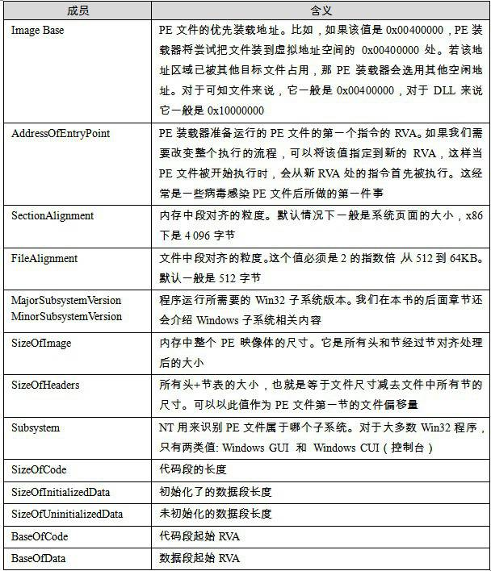

<h2>6.6 Windows PE的載入</h2>

PE檔案的載入跟ELF有所不同，由於PE檔案中，所有段的起始地址都是頁的倍數，段的長度如果不是頁的整數倍，那麼在對映時向上補齊到頁的整數倍，我們也可以簡單地認為在32位的PE檔案中，段的起始地址和長度都是4 096位元組的整數倍。由於這個特點，PE檔案的對映過程會比ELF簡單得多，因為它無須考慮如ELF裡面諸多段地址對齊之類的問題，雖然這樣會浪費一些磁碟和記憶體空間。PE執行檔的段的數量一般很少，不像ELF中經常有十多個“Section”，最後不得不使用“Segment”的概念把它們合並到一起載入，PE檔案中，連結器在生產執行檔時，往往將所有的段盡可能地合並，所以一般只有程式碼段、資料段、只讀資料段和BSS等為數不多的幾個段。

PE檔案的載入跟ELF有所不同，由於PE檔案中，所有段的起始地址都是頁的倍數，段的長度如果不是頁的整數倍，那麼在對映時向上補齊到頁的整數倍，我們也可以簡單地認為在32位的PE檔案中，段的起始地址和長度都是4 096位元組的整數倍。由於這個特點，PE檔案的對映過程會比ELF簡單得多，因為它無須考慮如ELF裡面諸多段地址對齊之類的問題，雖然這樣會浪費一些磁碟和記憶體空間。PE執行檔的段的數量一般很少，不像ELF中經常有十多個“Section”，最後不得不使用“Segment”的概念把它們合並到一起載入，PE檔案中，連結器在生產執行檔時，往往將所有的段盡可能地合並，所以一般只有程式碼段、資料段、只讀資料段和BSS等為數不多的幾個段。

在討論結構的具體載入過程之前，我們要先引入一個PE裡面很常見的術語叫做RVA（Relative Virtual Address），它表示一個相對虛擬地址。這個術語看起來比較晦澀難懂，其實它的概念很簡單，就是相當於檔案中的偏移量的東西。它是相對於PE檔案的載入基地址的一個偏移地址。比如，一個PE檔案被載入到虛擬地址（VA）0x00400000，那麼一個RVA為0x1000的地址就是0x00401000。每個PE檔案在載入時都會有一個載入目標地址（Target Address），這個地址就是所謂的基地址（Base Address）。由於PE檔案被設計成可以載入到任何地址，所以這個基地址並不是固定的，每次載入時都可能會變化。如果PE檔案中的地址都使用絕對地址，它們都要隨著基地址的變化而變化。但是，如果使用RVA這樣一種基於基地址的相對地址，那麼無論基地址怎麼變化，PE檔案中的各個RVA都保持一致。這裡涉及PE執行檔載入的一些內容，我們只是簡單介紹一下，更加詳細的內容將留到本書後面有關PE檔案的Rebasing機制時再進行分析。

載入一個PE執行檔並且載入它，是個比ELF檔案相對簡單的過程：

先讀取檔案的第一個頁，在這個頁中，包含了DOS頭、PE檔案頭和段表。

檢查程式地址空間中，目標地址是否可用，如果不可用，則另外選一個載入地址。這個問題對於執行檔來說基本不存在，因為它往往是程式第一個裝入的模組，所以目標地址不太可能被佔用。主要是針對DLL檔案的載入而言的，我們在後面的“Rebasing”這一節還會具體介紹這個問題。

使用段表中提供的資訊，將PE檔案中所有的段一一對映到地址空間中相應的位置。

如果載入地址不是目標地址，則進行Rebasing。

載入所有PE檔案所需要的DLL檔案。

對PE檔案中的所有匯入符號進行解析。

根據PE頭中指定的引數，建立初始化棧和堆。

建立主執行緒並且啟動程式。

PE檔案中，與載入相關的主要資訊都包含在PE擴充套件頭（PE Optional Header）和段表，我們在第2部分已經介紹過了PE擴充套件頭部分結構，這裡我們將選擇幾個跟載入相關的成員來分析它們的含義（見表6-6），當然還有一部分成員是跟程式初始化和執行庫有關的，我們把它們留到本書的第4部分介紹。

 表6-6 …

