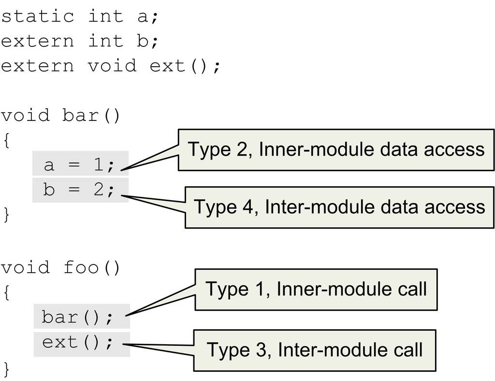
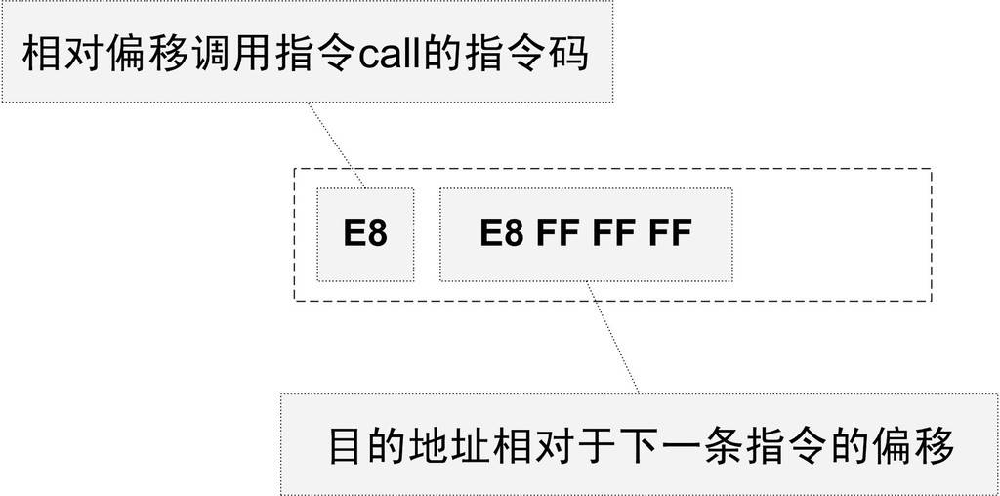
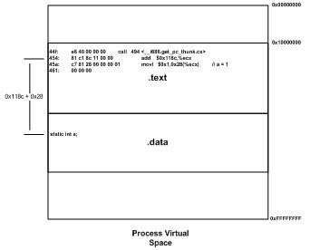
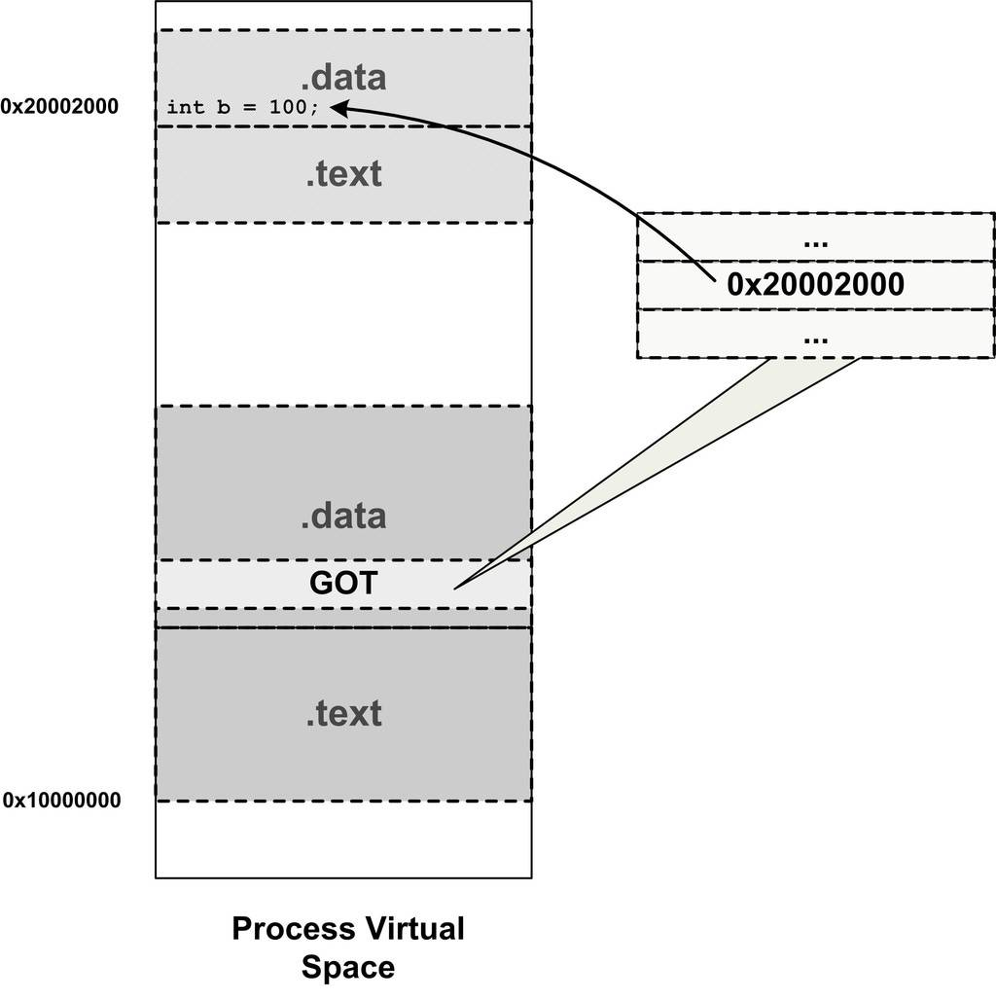
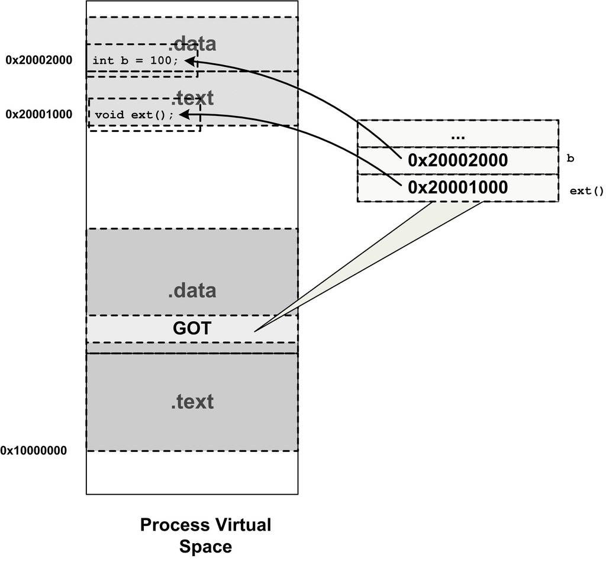

<h2>7.3 地址無關程式碼</h2>

7.3.1 固定載入地址的困擾

透過上一節的介紹我們已經基本瞭解了動態連結的概念，同時，我們也得到了一個問題，那就是：共享物件在被載入時，如何確定它在程式虛擬地址空間中的位置？

為了實現動態連結，我們首先會遇到的問題就是共享物件地址的衝突問題。讓我們先來回顧一下第2章提到的，程式模組的指令和資料中可能會包含一些絕對地址的引用，我們在連結產生輸出檔案的時候，就要假設模組被載入的目標地址。

很明顯，在動態連結的情況下，如果不同的模組目標載入地址都一樣是不行的。而對於單個程式來講，我們可以手工指定各個模組的地址，比如把0x1000到0x2000分配給模組A，把地址0x2000到0x3000分配給模組B。但是，如果某個模組被多個程式使用，甚至多個模組被多個程式使用，那麼管理這些模組的地址將是一件無比繁瑣的事情。比如一個很簡單的情況，一個人製作了一個程式，該程式需要用到模組B，但是不需要用到模組A，所以他以為地址0x1000到0x2000是空閑的，於是分配給了另外一個模組C。這樣C和原先的模組A的目標地址就衝突了，任何人以後將不能在同一個程式裡面使用模組A和C。想象一個有著成千上萬個並且由不同公司和個人開發的共享物件的系統中，採用這種手工分配的方式幾乎是不可行的。

不幸的是，早期的確有些系統採用了這樣的做法，這種做法叫做靜態共用函式庫（Static Shared Library），請注意，它跟靜態函式庫（Static Library）有很明顯的區別。靜態共用函式庫的做法就是將程式的各種模組統一交給作業系統來管理，作業系統在某個特定的地址劃分出一些地址塊，為那些已知的模組預留足夠的空間。

靜態共用函式庫的目標地址導致了很多問題，除了上面提到的地址衝突的問題，靜態共用函式庫的升級也很成問題，因為升級後的共用函式庫必須保持共用函式庫中全域性函式和變數地址的不變，如果應用程式在連結時已經繫結了這些地址，一旦更改，就必須重新連結應用程式，否則會引起應用程式的崩潰。即使升級靜態共用函式庫後保持原來的函式和變數地址不變，只是增加了一些全域性函式或變數，也會受到限製，因為靜態共用函式庫被分配到的虛擬地址空間有限，不能增長太多，否則可能會超出被分配的空間。種種限製和弊端導致了靜態共用函式庫的方式在現在的支援動態連結的系統中已經很少見，而徹底被動態連結取代。我們只有在一些不支援動態連結的舊系統中還能看到靜態共用函式庫的蹤影。目前知道的使用靜態共用函式庫的舊系統有：

UNIX System V Release 3.2（COFF format）。

舊的Linux systems（a.out format）。

BSD/OS derivative of 4.4BSD（a.out and ELF formats.）。

為瞭解決這個模組載入地址固定的問題，我們設想是否可以讓共享物件在任意地址載入？這個問題另一種表述方法就是：共享物件在編譯時不能假設自己在程式虛擬地址空間中的位置。與此不同的是，執行檔基本可以確定自己在程式虛擬空間中的起始位置，因為執行檔往往是第一個被載入的檔案，它可以選擇一個固定空閑的地址，比如Linux下一般都是0x08040000，Windows下一般都是0x0040000。

7.3.2 載入時重定位

為了能夠使共享物件在任意地址載入，我們首先能想到的方法就是靜態連結中的重定位。這個想法的基本思路就是，在連結時，對所有絕對地址的引用不作重定位，而把這一步推遲到載入時再完成。一旦模組載入地址確定，即目標地址確定，那麼系統就對程式中所有的絕對地址引用進行重定位。假設函式foobar相對於程式碼段的起始地址是0x100，當模組被載入到0x10000000時，我們假設程式碼段位於模組的最開始，即程式碼段的載入地址也是0x10000000，那麼我們就可以確定foobar的地址為0x10000100。這時候，系統遍曆模組中的重定位表，把所有對foobar的地址引用都重定位至0x10000100。

事實上，類似的方法在很早以前就存在。早在沒有虛擬儲存概念的情況下，程式是直接被載入進實體記憶體的。當同時有多個程式執行的時候，作業系統根據當時記憶體空閑情況，動態分配一塊大小合適的實體記憶體給程式，所以程式被載入的地址是不確定的。系統在載入程式的時候需要對程式的指令和資料中對絕對地址的引用進行重定位。但這種重定位比前面提到過的靜態連結中的重定位要簡單得多，因為整個程式是按照一個整體被載入的，程式中指令和資料的相對位置是不會改變的。比如一個程式在編譯時假設被載入的目標地址為0x1000，但是在載入時作業系統發現0x1000這個地址已經被別的程式使用了，從0x4000開始有一塊足夠大的空間可以容納該程式，那麼該程式就可以被載入至0x4000，程式指令或資料中的所有絕對引用只要都加上0x3000的偏移量就可以了。

我們前面在靜態連結時提到過重定位，那時的重定位叫做連結時重定位（Link Time Relocation），而現在這種情況經常被稱為載入時重定位（Load Time Relocation），在Windows中，這種載入時重定位又被叫做基址重置（Rebasing），我們在後面將會有專門章節分析基址重置。

這種情況與我們碰到的問題很相似，都是程式模組在編譯時目標地址不確定而需要在載入時將模組重定位。但是載入時重定位的方法並不適合用來解決上面的共享物件中所存在的問題。可以想象，動態連結模組被載入對映至虛擬空間後，指令部分是在多個程式之間共享的，由於載入時重定位的方法需要修改指令，所以沒有辦法做到同一份指令被多個程式共享，因為指令被重定位後對於每個程式來講是不同的。當然，動態連線庫中的可修改資料部分對於不同的程式來說有多個副本，所以它們可以採用載入時重定位的方法來解決。

Linux和GCC支援這種載入時重定位的方法，我們前面在產生共享物件時，使用了兩個GCC引數“-shared”和“-fPIC”，如果只使用“-shared”，那麼輸出的共享物件就是使用載入時重定位的方法。

7.3.3 地址無關程式碼

那麼什麼是“-fPIC”呢？使用這個引數會有什麼效果呢？

載入時重定位是解決動態模組中有絕對地址引用的辦法之一，但是它有一個很大的缺點是指令部分無法在多個程式之間共享，這樣就失去了動態連結節省記憶體的一大優勢。我們還需要有一種更好的方法解決共享物件指令中對絕對地址的重定位問題。其實我們的目的很簡單，希望程式模組中共享的指令部分在載入時不需要因為載入地址的改變而改變，所以實現的基本想法就是把指令中那些需要被修改的部分分離出來，跟資料部分放在一起，這樣指令部分就可以保持不變，而資料部分可以在每個程式中擁有一個副本。這種方案就是目前被稱為地址無關程式碼（PIC, Position-independent Code）的技術。

對於現代的機器來說，產生地址無關的程式碼並不麻煩。我們先來分析模組中各種型別的地址引用方式。這裡我們把共享物件模組中的地址引用按照是否為跨模組分成兩類：模組內部引用和模組外部引用；按照不同的引用方式又可以分為指令引用和資料訪問，這樣我們就得到了如圖7-4中的4種情況。

第一種是模組內部的函式呼叫、跳轉等。

第二種是模組內部的資料訪問，比如模組中定義的全域性變數、靜態變數。

第三種是模組外部的函式呼叫、跳轉等。

第四種是模組外部的資料訪問，比如其他模組中定義的全域性變數。

 圖7-4 4種定址模式 …

關於模組內部和模組外部

當編譯器在編譯pic.c時，它實際上並不能確定變數b和函式<code>ext()</code>是模組外部的還是模組內部的，因為它們有可能被定義在同一個共享物件的其他目的檔中。由於沒法確定，編譯器只能把它們都當作模組外部的函式和變數來處理。MSVC編譯器提供了__declspec(dllimport)編譯器擴充套件來表示一個符號是模組內部的還是模組外部的。

型別一 模組內部呼叫或跳轉

這4種情況中，第一種型別應該是最簡單的，那就是模組內部呼叫。因為被呼叫的函式與呼叫者都處於同一個模組，它們之間的相對位置是固定的，所以這種情況比較簡單。對於現代的系統來講，模組內部的跳轉、函式呼叫都可以是相對地址呼叫，或者是基於暫存器的相對呼叫，所以對於這種指令是不需要重定位的。比如上面例子中foo對bar的呼叫可能產生如下程式碼：

<pre> 8048344 &lt;bar&gt;:
 8048344:       55                      push   %ebp
 8048345:       89 e5                   mov    %esp,%ebp
 8048347:       5d                      pop    %ebp
 8048348:       c3                      ret

 8048349 &lt;foo&gt;:
 ...
 8048357:       e8 e8 ff ff ff          call   8048344 &lt;bar&gt;
 804835c:       b8 00 00 00 00          mov    $0x0,%eax
 ...
</pre>

foo中對bar的呼叫的那條指令實際上是一條相對地址呼叫指令，我們在第2部分已經介紹過相對位移呼叫指令的指令格式，相對偏移呼叫指令如圖7-5所示。

 圖7-5 相對偏移呼叫指令 …

這條指令中的後4個位元組是目的地址相對於當前指令的下一條指令的偏移，即0xFFFFFFE8（Little-endian）。0xFFFFFFE8是-24的補碼形式，即bar的地址為0x804835c + (-24) = 0x8048344。那麼只要bar和foo的相對位置不變，這條指令是地址無關的。即無論模組被載入到哪個位置，這條指令都是有效的。這種相對地址的方式對於jmp指令也有效。

這樣看起來第一個模組內部呼叫或跳轉很容易解決，但實際上這種方式還有一定的問題，這裡存在一個叫做共享物件全域性符號介入（Global Symbol Interposition）問題，這個問題在後面關於“動態連結的實現”中還會詳細介紹。但在這裡，可以簡單地把它當作相對地址呼叫/跳轉。

型別二 模組內部資料訪問

接著來看看第二種型別，模組內部的資料訪問。很明顯，指令中不能直接包含資料的絕對地址，那麼唯一的辦法就是相對定址。我們知道，一個模組前面一般是若幹個頁的程式碼，後面緊跟著若幹個頁的資料，這些頁之間的相對位置是固定的，也就是說，任何一條指令與它需要訪問的模組內部資料之間的相對位置是固定的，那麼只需要相對於當前指令加上固定的偏移量就可以訪問模組內部資料了。現代的體係結構中，資料的相對定址往往沒有相對與當前指令地址（PC）的定址方式，所以ELF用了一個很巧妙的辦法來得到當前的PC值，然後再加上一個偏移量就可以達到訪問相應變數的目的了。得到PC值的方法很多，我們來看看最常用的一種，也是現在ELF的共享物件裡面用的一種方法：

<pre>0000044c &lt;bar&gt;:
 44c: 55                    push   %ebp
 44d: 89 e5                 mov    %esp,%ebp
 44f: e8 40 00 00 00        call   494 &lt;__i686.get_pc_thunk.cx&gt;
 454: 81 c1 8c 11 00 00     add    $0x118c,%ecx
 45a: c7 81 28 00 00 00 01  movl   $0x1,0x28(%ecx)         // a = 1
 461: 00 00 00 
 464: 8b 81 f8 ff ff ff     mov 0xfffffff8(%ecx),%eax
 46a: c7 00 02 00 00 00     movl   $0x2,(%eax)             // b = 2
 470: 5d                    pop    %ebp
 471: c3                    ret    

00000494 &lt;__i686.get_pc_thunk.cx&gt;:
 494: 8b 0c 24              mov    (%esp),%ecx
 497: c3                    ret 
</pre>

這是對上面的例子中的程式碼先編譯成共享物件然後反組譯的結果。用粗體表示的是bar()函式中訪問模組內部變數a的相應程式碼。從上面的指令中可以看到，它先呼叫了一個叫“__i686.get_pc_thunk.cx”的函式，這個函式的作用就是把返回地址的值放到ecx暫存器，即把call的下一條指令的地址放到ecx暫存器。

我們知道當處理器執行call指令以後，下一條指令的地址會被壓到棧頂，而esp暫存器就是始終指向棧頂的，那麼當“__i686.get_pc_thunk.cx”執行“<code>mov (%esp),%ecx</code>”的時候，返回地址就被賦值到ecx暫存器了。

接著執行一條<code>add</code>指令和一條<code>mov</code>指令，可以看到變數a的地址是add指令地址（儲存在ecx暫存器）加上兩個偏移量0x118c和0x28，即如果模組被載入到0x10000000這個地址的話，那麼變數a的實際地址將是0x10000000 + 0x454 + 0x118c + 0x28 = 0x10001608，這個計算過程我們可以從圖7-6中看到。

 圖7-6 模組內部資料訪問示意 …

型別三 模組間資料訪問

模組間的資料訪問比模組內部稍微麻煩一點，因為模組間的資料訪問目標地址要等到載入時才決定，比如上面例子中的變數b，它被定義在其他模組中，並且該地址在載入時才能確定。我們前面提到要使得程式碼地址無關，基本的思想就是把跟地址相關的部分放到資料段裡面，很明顯，這些其他模組的全域性變數的地址是跟模組載入地址有關的。ELF的做法是在資料段裡面建立一個指向這些變數的指標陣列，也被稱為全域性偏移表（Global Offset Table，GOT），當程式碼需要引用該全域性變數時，可以透過GOT中相對應的項間接引用，它的基本機制如圖7-7所示。

 圖7-7 模組間資料訪問 …

當指令中需要訪問變數b時，程式會先找到GOT，然後根據GOT中變數所對應的項找到變數的目標地址。每個變數都對應一個4個位元組的地址，連結器在載入模組的時候會查詢每個變數所在的地址，然後填充GOT中的各個項，以確保每個指標所指向的地址正確。由於GOT本身是放在資料段的，所以它可以在模組載入時被修改，並且每個程式都可以有獨立的副本，相互不受影響。

我們來看看GOT如何做到指令的地址無關性。從第二中型別的資料訪問我們瞭解到，模組在編譯時可以確定模組內部變數相對與當前指令的偏移，那麼我們也可以在編譯時確定GOT相對於當前指令的偏移。確定GOT的位置跟上面的訪問變數a的方法基本一樣，透過得到PC值然後加上一個偏移量，就可以得到GOT的位置。然後我們根據變數地址在GOT中的偏移就可以得到變數的地址，當然GOT中每個地址對應於哪個變數是由編譯器決定的，比如第一個地址對應變數b，第二個對應變數c等。

讓我們再回顧剛才函式bar()的反組合語言程式碼。為訪問變數b，我們的程式首先計算出變數b的地址在GOT中的位置，即0x10000000 + 0x454 + 0x118c + (-8) = 0x100015d8（0xfffffff8為-8的補碼表示），然後使用暫存器間接定址方式給變數b賦值2。

我們也可以使用objdump來檢視GOT的位置：

<pre>$ objdump -h pic.so
...
17 .got       00000010  000015d0  000015d0  000005d0  2**2
                  CONTENTS, ALLOC, LOAD, DATA
...
</pre>

可以看到GOT在檔案中的偏移是0x15d0，我們再來看看pic.so的需要在動態連結時重定位項：

<pre>$ objdump -R pic.so
...
DYNAMIC RELOCATION RECORDS
OFFSET   TYPE              VALUE
...
000015d8 R_386_GLOB_DAT    b
...
</pre>

可以看到變數b的地址需要重定位，它位於0x15d8，也就是GOT中偏移8，相當於是GOT中的第三項（每四個位元組一項）。從上面重定位項中看到，變數b的地址的偏移為0x15d8，正好對應了我們前面透過指令計算出來的偏移值，即0x100015d8 – 0x10000000 = 0x15d8。

型別四 模組間呼叫、跳轉

對於模組間呼叫和跳轉，我們也可以採用上面型別四的方法來解決。與上面的型別有所不同的是，GOT中相應的項儲存的是目標函式的地址，當模組需要呼叫目標函式時，可以透過GOT中的項進行間接跳轉，基本的原理如圖7-8所示。

呼叫<code>ext()</code>函式的方法與上面訪問變數b的方法基本類似，先得到當前指令地址PC，然後加上一個偏移得到函式地址在GOT中的偏移，然後一個間接呼叫：

<pre>call   494 &lt;__i686.get_pc_thunk.cx&gt;
add    $0x118c,%ecx
mov 0xfffffffc(%ecx),%eax
call   *(%eax)
</pre>

 圖7-8 模組間呼叫、跳轉 …

這種方法很簡單，但是存在一些效能問題，實際上ELF採用了一種更加複雜和精巧的方法，我們將在後面關於動態連結最佳化的章節中進行更為具體的介紹。

地址無關程式碼小結

曆經磨難，終於功德圓滿。4種地址引用方式在理論上都實現了地址無關性，我們將它們總結一下，如表7-1所示。

 表7-1 …

-fpic和-fPIC

使用GCC產生地址無關程式碼很簡單，我們只需要使用“-fPIC”引數即可。實際上GCC還提供了另外一個類似的引數叫做“-fpic”，即“PIC”3個字母小寫，這兩個引數從功能上來講完全一樣，都是指示GCC產生地址無關程式碼。唯一的區別是，“-fPIC”產生的程式碼要大，而“-fpic”產生的程式碼相對較小，而且較快。那麼我們為什麼不使用“-fpic”而要使用“-fPIC”呢？原因是，由於地址無關程式碼都是跟硬體平台相關的，不同的平台有著不同的實現，“-fpic”在某些平台上會有一些限製，比如全域性符號的數量或者程式碼的長度等，而“-fPIC”則沒有這樣的限製。所以為了方便起見，絕大部分情況下我們都使用“-fPIC”引數來產生地址無關程式碼。

如何區分一個DSO是否為PIC

readelf –d foo.so | grep TEXTREL

如果上面的命令有任何輸出，那麼foo.so就不是PIC的，否則就是PIC的。PIC的DSO是不會包含任何程式碼段重定位表的，TEXTREL表示程式碼段重定位表地址。

PIC與PIE

地址無關程式碼技術除了可以用在共享物件上面，它也可以用於執行檔，一個以地址無關方式編譯的執行檔被稱作地址無關執行檔（PIE, Position-Independent Executable）。與GCC的“-fPIC”和“-fpic”引數類似，產生PIE的引數為“-fPIE”或“-fpie”。

7.3.4 共享模組的全域性變數問題

地址無關性問題就這麼解決了嗎？看起來好像是的。如果你還沒看出來一個小問題的話，最好回頭再仔細看看前面的4種地址引用方式的分類。發現了嗎？我們上面的情況中沒有包含定義在模組內部的全域性變數的情況。可能你的第一反應就是，這不是很簡單嗎？跟模組內部的靜態變數一樣處理不就可以了嗎？的確，粗略一看模組內部的全域性變數和靜態變數的地址都可以透過上面所列出的型別兩種方法來解決。但是有一種情況很特殊，我們來看看會產生什麼問題。

有一種很特殊的情況是，當一個模組引用了一個定義在共享物件的全域性變數的時候，比如一個共享物件定義了一個全域性變數global，而模組module.c中是這麼引用的：

<pre>extern int global;
int foo()
{
   global = 1;
}
</pre>

當編譯器編譯module.c時，它無法根據這個上下文判斷global是定義在同一個模組的的其他目的檔還是定義在另外一個共享物件之中，即無法判斷是否為跨模組間的呼叫。

假設module.c是程式執行檔的一部分，那麼在這種情況下，由於程式主模組的程式碼並不是地址無關程式碼，也就是說程式碼不會使用這種類似於PIC的機制，它引用這個全域性變數的方式跟普通資料訪問方式一樣，編譯器會產生這樣的程式碼：

<pre>movl   $0x1,XXXXXXXX</pre>

XXXXXXXX就是global的地址。由於執行檔在執行時並不進行程式碼重定位，所以變數的地址必須在連結過程中確定下來。為了能夠使得連結過程正常進行，連結器會在建立執行檔時，在它的“.bss”段建立一個global變數的副本。那麼問題就很明顯了，現在global變數定義在原先的共享物件中，而在執行檔的“.bss”段還有一個副本。如果同一個變數同時存在於多個位置中，這在程式實際執行過程中肯定是不可行的。

於是解決的辦法只有一個，那就是所有的使用這個變數的指令都指向位於執行檔中的那個副本。ELF共用函式庫在編譯時，預設都把定義在模組內部的全域性變數當作定義在其他模組的全域性變數，也就是說當作前面的型別四，透過GOT來實現變數的訪問。當共享模組被載入時，如果某個全域性變數在執行檔中擁有副本，那麼動態連結器就會把GOT中的相應地址指向該副本，這樣該變數在執行時實際上最終就只有一個例項。如果變數在共享模組中被初始化，那麼動態連結器還需要將該初始化值複製到程式主模組中的變數副本；如果該全域性變數在程式主模組中沒有副本，那麼GOT中的相應地址就指向模組內部的該變數副本。

假設module.c是一個共享物件的一部分，那麼GCC編譯器在-fPIC的情況下，就會把對global的呼叫按照跨模組模式產生程式碼。原因也很簡單：編譯器無法確定對global的引用是跨模組的還是模組內部的。即使是模組內部的，即模組內部的全域性變數的引用，按照上面的結論，還是會產生跨模組程式碼，因為global可能被執行檔引用，從而使得共享模組中對global的引用要執行執行檔中的global副本。

Q&amp;A

Q: 如果一個共享物件lib.so中定義了一個全域性變數G，而程式A和程式B都使用了lib.so，那麼當程式A改變這個全域性變數G的值時，程式B中的G會受到影響嗎？

A: 不會。因為當lib.so被兩個程式載入時，它的資料段部分在每個程式中都有獨立的副本，從這個角度看，共享物件中的全域性變數實際上和定義在程式內部的全域性變數沒什麼區別。任何一個程式訪問的只是自己的那個副本，而不會影響其他程式。那麼，如果我們把這個問題的條件改成同一個程式中的執行緒A和執行緒B，它們是否看得到對方對lib.so中的全域性變數G的修改呢？對於同一個程式的兩個執行緒來說，它們訪問的是同一個程式地址空間，也就是同一個lib.so的副本，所以它們對G的修改，對方都是看得到的。

那麼我們可不可以做到跟前面答案相反的情況呢？比如要求兩個程式共享一個共享物件的副本或要求兩個執行緒訪問全域性變數的不同副本，這兩種需求都是存在的，比如多個程式可以共享同一個全域性變數就可以用來實現程式間通訊；而多個執行緒訪問全域性變數的不同副本可以防止不同執行緒之間對全域性變數的幹擾，比如C語言執行庫的erron全域性變數。實際上這兩種需求都是有相應的解決方法的，多程式共享全域性變數又被叫做“共享資料段”，在介紹Windows DLL的時候會碰到它。而多個執行緒訪問不同的全域性變數副本又被叫做“執行緒私有儲存”（Thread Local Storage），我們在後面還會詳細介紹。

7.3.5 資料段地址無關性

透過上面的方法，我們能夠保證共享物件中的程式碼部分地址無關，但是資料部分是不是也有絕對地址引用的問題呢？讓我們來看看這樣一段程式碼：

<pre>static int a;
static int* p = &amp;a;
</pre>

如果某個共享物件裡面有這樣一段程式碼的話，那麼指標p的地址就是一個絕對地址，它指向變數a，而變數a的地址會隨著共享物件的載入地址改變而改變。那麼有什麼辦法解決這個問題呢？

對於資料段來說，它在每個程式都有一份獨立的副本，所以並不擔心被程式改變。從這點來看，我們可以選擇載入時重定位的方法來解決資料段中絕對地址引用問題。對於共享物件來說，如果資料段中有絕對地址引用，那麼編譯器和連結器就會產生一個重定位表，這個重定位表裡面包含了“R_386_RELATIVE”型別的重定位入口，用於解決上述問題。當動態連結器載入共享物件時，如果發現該共享物件有這樣的重定位入口，那麼動態連結器就會對該共享物件進行重定位。

實際上，我們甚至可以讓程式碼段也使用這種載入時重定位的方法，而不使用地址無關程式碼。從前面的例子中我們看到，我們在編譯共享物件時使用了“-fPIC”引數，這個參數列示產生地址無關的程式碼段。如果我們不使用這個引數來產生共享物件又會怎麼樣呢？

<pre>$gcc –shared pic.c –o pic.so</pre>

上面這個命令就會產生一個不使用地址無關程式碼而使用載入時重定位的共享物件。但正如我們前面分析過的一樣，如果程式碼不是地址無關的，它就不能被多個程式之間共享，於是也就失去了節省記憶體的優點。但是載入時重定位的共享物件的執行速度要比使用地址無關程式碼的共享物件快，因為它省去了地址無關程式碼中每次訪問全域性資料和函式時需要做一次計算當前地址以及間接地址定址的過程。

對於執行檔來說，預設情況下，如果執行檔是動態連結的，那麼GCC會使用PIC的方法來產生執行檔的程式碼段部分，以便於不同的程式能夠共享程式碼段，節省記憶體。所以我們可以看到，動態連結的執行檔中存在“.got”這樣的段。

