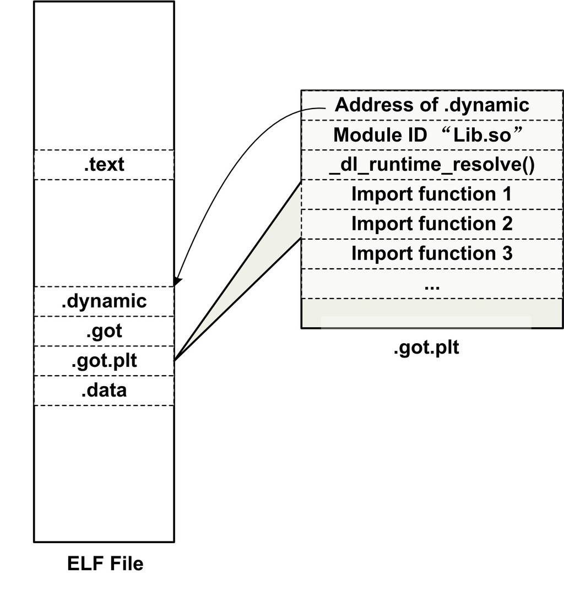

<h2>7.4 延遲繫結（PLT）</h2>

動態連結的確有很多優勢，比靜態連結要靈活得多，但它是以犧牲一部分效能為代價的。據統計ELF程式在靜態連結下要比動態函式庫稍微快點，大約為1%～5%，當然這取決於程式本身的特性及執行環境等。我們知道動態連結比靜態連結慢的主要原因是動態連結下對於全域性和靜態的資料訪問都要進行複雜的GOT定位，然後間接定址；對於模組間的呼叫也要先定位GOT，然後再進行間接跳轉，如此一來，程式的執行速度必定會減慢。另外一個減慢執行速度的原因是動態連結的連結工作在執行時完成，即程式開始執行時，動態連結器都要進行一次連結工作，正如我們上面提到的，動態連結器會尋找並載入所需要的共享物件，然後進行符號查詢地址重定位等工作，這些工作勢必減慢程式的啟動速度。這是影響動態連結效能的兩個主要問題，我們將在這一節介紹最佳化動態連結效能的一些方法。

延遲繫結實現

在動態連結下，程式模組之間包含了大量的函式引用（全域性變數往往比較少，因為大量的全域性變數會導致模組之間耦合度變大），所以在程式開始執行前，動態連結會耗費不少時間用於解決模組之間的函式引用的符號查詢以及重定位，這也是我們上面提到的減慢動態連結效能的第二個原因。不過可以想象，在一個程式執行過程中，可能很多函式在程式執行完時都不會被用到，比如一些錯誤處理函式或者是一些使用者很少用到的功能模組等，如果一開始就把所有函式都連結好實際上是一種浪費。所以ELF採用了一種叫做延遲繫結（Lazy Binding）的做法，基本的思想就是當函式第一次被用到時才進行繫結（符號查詢、重定位等），如果沒有用到則不進行繫結。所以程式開始執行時，模組間的函式呼叫都沒有進行繫結，而是需要用到時才由動態連結器來負責繫結。這樣的做法可以大大加快程式的啟動速度，特別有利於一些有大量函式引用和大量模組的程式。

ELF使用PLT（Procedure Linkage Table）的方法來實現，這種方法使用了一些很精巧的指令序列來完成。在開始詳細介紹PLT之前，我們先從動態連結器的角度設想一下：假設liba.so需要呼叫libc.so中的<code>bar()</code>函式，那麼當liba.so中第一次呼叫<code>bar()</code>時，這時候就需要呼叫動態連結器中的某個函式來完成地址繫結工作，我們假設這個函式叫做<code>lookup()，</code>那麼<code>lookup()</code>需要知道哪些必要的資訊才能完成這個函式地址繫結工作呢？我想答案很明顯，<code>lookup()</code>至少需要知道這個地址繫結發生在哪個模組，哪個函式？那麼我們可以假設lookup的原型為lookup（module, function），這兩個引數的值在我們這個例子中分別為liba.so和<code>bar()。</code>在Glibc中，我們這裡的<code>lookup()</code>函式真正的名字叫<code>_dl_runtime_resolve()。</code>

ELF使用PLT（Procedure Linkage Table）的方法來實現，這種方法使用了一些很精巧的指令序列來完成。在開始詳細介紹PLT之前，我們先從動態連結器的角度設想一下：假設liba.so需要呼叫libc.so中的<code>bar()</code>函式，那麼當liba.so中第一次呼叫<code>bar()</code>時，這時候就需要呼叫動態連結器中的某個函式來完成地址繫結工作，我們假設這個函式叫做<code>lookup()，</code>那麼<code>lookup()</code>需要知道哪些必要的資訊才能完成這個函式地址繫結工作呢？我想答案很明顯，<code>lookup()</code>至少需要知道這個地址繫結發生在哪個模組，哪個函式？那麼我們可以假設lookup的原型為lookup（module, function），這兩個引數的值在我們這個例子中分別為liba.so和<code>bar()。</code>在Glibc中，我們這裡的<code>lookup()</code>函式真正的名字叫<code>_dl_runtime_resolve()。</code>

當我們呼叫某個外部模組的函式時，如果按照通常的做法應該是透過GOT中相應的項進行間接跳轉。PLT為了實現延遲繫結，在這個過程中間又增加了一層間接跳轉。呼叫函式並不直接透過GOT跳轉，而是透過一個叫作PLT項的結構來進行跳轉。每個外部函式在PLT中都有一個相應的項，比如bar()函式在PLT中的項的地址我們稱之為bar@plt。讓我們來看看bar@plt的實現：

<pre>bar@plt:
jmp *(bar@GOT)
push n
push moduleID
jump _dl_runtime_resolve
</pre>

bar@plt的第一條指令是一條透過GOT間接跳轉的指令。bar@GOT表示GOT中儲存<code>bar()</code>這個函式相應的項。如果連結器在初始化階段已經初始化該項，並且將<code>bar()</code>的地址填入該項，那麼這個跳轉指令的結果就是我們所期望的，跳轉到<code>bar()，</code>實現函式正確呼叫。但是為了實現延遲繫結，連結器在初始化階段並沒有將<code>bar()</code>的地址填入到該項，而是將上面程式碼中第二條指令“push n”的地址填入到bar@GOT中，這個步驟不需要查詢任何符號，所以代價很低。很明顯，第一條指令的效果是跳轉到第二條指令，相當於沒有進行任何操作。第二條指令將一個數字n壓入堆疊中，這個數字是bar這個符號引用在重定位表“.rel.plt”中的下標。接著又是一條push指令將模組的ID壓入到堆疊，然後跳轉到<code>_dl_runtime_resolve</code>。這實際上就是在實現我們前面提到的<code>lookup(module, function)</code>這個函式的呼叫：先將所需要決議符號的下標壓入堆疊，再將模組ID壓入堆疊，然後呼叫動態連結器的<code>_dl_runtime_resolve()</code>函式來完成符號解析和重定位工作<code>。_dl_runtime_resolve()</code>在進行一係列工作以後將<code>bar()</code>的真正地址填入到bar@GOT中。

一旦<code>bar()</code>這個函式被解析完畢，當我們再次呼叫bar@plt時，第一條jmp指令就能夠跳轉到真正的<code>bar()</code>函式中，<code>bar()</code>函式返回的時候會根據堆疊裡面儲存的EIP直接返回到呼叫者，而不會再繼續執行bar@plt中第二條指令開始的那段程式碼，那段程式碼只會在符號未被解析時執行一次。

上面我們描述的是PLT的基本原理，PLT真正的實現要比它的結構稍微複雜一些（見表7-9）。ELF將GOT拆分成了兩個表叫做“.got”和“.got.plt”。其中“.got”用來儲存全域性變數引用的地址，“.got.plt”用來儲存函式引用的地址，也就是說，所有對於外部函式的引用全部被分離出來放到了“.got.plt”中。另外“.got.plt”還有一個特殊的地方是它的前三項是有特殊意義的，分別含義如下：

第一項儲存的是“.dynamic”段的地址，這個段描述了本模組動態連結相關的資訊，我們在後面還會介紹“.dynamic”段。

第二項儲存的是本模組的ID。

第三項儲存的是<code>_dl_runtime_resolve()</code>的地址。

其中第二項和第三項由動態連結器在載入共享模組的時候負責將它們初始化。“.got.plt”的其餘項分別對應每個外部函式的引用。PLT的結構也與我們示例中的PLT稍有不同，為了減少程式碼的重複，ELF把上面例子中的最後兩條指令放到PLT中的第一項。並且規定每一項的長度是16個位元組，剛好用來存放3條指令，實際的PLT基本結構如圖7-9所示。

 圖7-9 GOT中的PLT資料結構 …

實際的PLT基本結構程式碼如下：

<pre>PLT0:
push *(GOT + 4)
jump *(GOT + 8)

...

bar@plt:
jmp *(bar@GOT)
push n
jump PLT0
</pre>

PLT在ELF檔案中以獨立的段存放，段名通常叫做“.plt”，因為它本身是一些地址無關的程式碼，所以可以跟程式碼段等一起合並成同一個可讀可執行的“Segment”被載入入記憶體。

