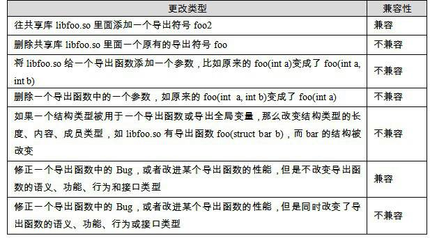

<h2>8.1 共用函式庫版本</h2>

8.1.1 共用函式庫相容性

共用函式庫的開發者會不停地更新共用函式庫的版本，以修正原有的Bug、增加新的功能或改進效能等。由於動態連結的靈活性，使得程式本身和程式所依賴的共用函式庫可以分別獨立開發和更新，比如當有程式A依賴於libfoo.so，當libfoo.so的開發者宣佈新版本開發完成之後，理論上我們只需要用新的libfoo.so將舊版本的替換掉即可享用新版libfoo.so提供的一切好處。但是共用函式庫版本的更新可能會導致介面的更改或刪除，這可能導致依賴於該共用函式庫的程式無法正常執行。最簡單的情況下，共用函式庫的更新可以被分為兩類。

• 相容更新。所有的更新只是在原有的共用函式庫基礎上新增一些內容，所有原有的介面都保持不變。

• 不相容更新。共用函式庫更新改變了原有的介面，使用該共用函式庫原有介面的程式可能不能執行或執行不正常。

介面這個詞有著很廣泛的含義，在軟體的很多層次上都有所謂的“介面”。但是這裡討論的介面是二進位介面，即ABI（Application Binary Interface）。共用函式庫的ABI跟程式語言有著很大的關係，不同的語言對於介面的相容性要求不同。ABI對於不同的語言來說，主要包括一些諸如函式呼叫的堆疊結構、符號命名、引數規則、資料結構的記憶體分佈等方面的規則。那麼對於一個C語言編寫的共用函式庫來說，什麼樣的更改會導致ABI變化呢？表8-1列舉了幾種常見的更改方式。

 表8-1 …

導致C語言的共用函式庫ABI改變的行為主要有如下4個：

匯出函式的行為發生改變，也就是說呼叫這個函式以後產生的結果與以前不一樣，不再滿足舊版本規定的函式行為準則。

匯出函式被刪除。

匯出資料的結構發生變化，比如共用函式庫定義的結構體變數的結構發生改變：結構成員刪除、順序改變或其他引起結構體記憶體佈局變化的行為（不過通常來講，往結構體的尾部新增成員不會導致不相容，當然這個結構體必須是共用函式庫內部分配的，如果是外部分配的，在分配該結構體時必須考慮成員新增的情況）。

匯出函式的介面發生變化，如函式返回值、引數被更改。

如果能夠保證上述4種情況不發生，那麼絕大部分情況下，C語言的共用函式庫將會保持ABI相容。注意，僅僅是絕大部分情況，要破壞一個共用函式庫的ABI十分容易，要保持ABI的相容卻十分困難。很多因素會導致ABI的不相容，比如不同版本的編譯器、作業系統和硬體平台等，使得ABI相容尤為困難。使用不同版本的編譯器或系統庫可能會導致結構體的成員對齊方式不一致，從而導致了ABI的變化。這種ABI不相容導致的問題可能非常微妙，表面上看可能無關緊要，但是一旦發生故障，相關的Bug非常難以定位，這也是共用函式庫很大的一個問題。

對於C++來說，ABI問題就更為嚴重了。由於C++非常複雜，它支援諸如模板等一些高階特性，這些特性對於ABI相容來說簡直就是災難。因為C++標準對於C++的ABI沒有做出規定，所以不同的編譯器甚至同一個編譯器的不同版本對於C++的一些特性的實現都有著各自的方案，而且相互不相容，比如虛擬函式表、模板例項化、多重繼承等。對於Linux來說，如果你要開發一個匯出介面為C++的共用函式庫（當然我十分不推薦這麼做，使用C的介面會讓事情變得簡單得多），需要注意以下事項，以防止ABI不相容（完全遵循以下準則還是不能保證ABI完全相容）：

不要在介面類中使用虛擬函式，萬不得已要使用虛擬函式時，不要隨意刪除、新增或在子類中新增新的實現函式，這樣會導致類的虛擬函式表結構發生變化。

不要改變類中任何成員變數的位置和型別。

不要刪除非內嵌的public或protected成員函式。

不要將非內嵌的成員函式改變成內嵌成員函式。

不要改變成員函式的訪問許可權。

不要在介面中使用模板。

最重要的是，不要改變介面的任何部分或幹脆不要使用C++作為共用函式庫介面！

8.1.2 共用函式庫版本命名

既然共用函式庫存在這樣那樣的相容性問題，那麼保持共用函式庫在系統中的相容性，保證依賴於它們的應用程式能夠正常執行是必需要解決的問題。有幾種辦法可用於解決共用函式庫的相容性問題，有效辦法之一就是使用共用函式庫版本的方法。Linux有一套規則來命名系統中的每一個共用函式庫，它規定共用函式庫的檔名規則必須如下：

libname.so.x.y.z

最前面使用字首“lib”、中間是庫的名字和字尾“.so”，最後面跟著的是三個數字組成的版本號。“x”表示主版本號（Major Version Number），“y”表示次版本號（Minor Version Number），“z”表示發布版本號（Release Version Number）。三個版本號的含義不一樣。

主版本號表示庫的重大升級，不同主版本號的庫之間是不相容的，依賴於舊的主版本號的程式需要改動相應的部分，並且重新編譯，才可以在新版的共用函式庫中執行；或者，系統必須保留舊版的共用函式庫，使得那些依賴於舊版共用函式庫的程式能夠正常執行。

次版本號表示庫的增量升級，即增加一些新的介面符號，且保持原來的符號不變。在主版本號相同的情況下，高的次版本號的庫向後相容低的次版本號的庫。一個依賴於舊的次版本號共用函式庫的程式，可以在新的次版本號共用函式庫中執行，因為新版中保留了原來所有的介面，並且不改變它們的定義和含義。比如系統中有個共用函式庫為libfoo.so.1.2.x，後來在升級過程中新增了一個函式，版本號變成了1.3.x。因為1.2.x的所有介面都被保留到1.3.x中了，所以那些依賴於1.1.x或1.2.x的程式都可以在1.3.x中正常執行。

發布版本號表示庫的一些錯誤的修正、效能的改進等，並不新增任何新的介面，也不對介面進行更改。相同主版本號、次版本號的共用函式庫，不同的發布版本號之間完全相容，依賴於某個發布版本號的程式可以在任何一個其他發布版本號中正常執行，而無須做任何修改。

當然現在Linux中也存在不少不遵守上述規定的“頑固分子”，比如最基本的C語言庫Glibc就不使用這種規則，它的基本C語言庫使用libc-x.y.z.so這種命名方式。Glibc有許多元件，C語言庫只是其中一個，動態連結器也是Glibc的一部分，它使用ld-x.y.z.so這樣的命名方式，還有Glibc的其他部分，比如數學庫libm、執行時載入庫libdl等。

Reference: Library Interface Versioning in Solaris and Linux

http://www.usenix.org/publications/library/proceedings/als00/2000papers/papers/full_ papers/browndavid/browndavid_html/

這篇論文對Salaris和Linux的共用函式庫版本機制和符號版本機制做了非常詳細的介紹。

8.1.3 SO-NAME

程式需要記錄什麼

可以這麼說，共用函式庫的主版本號和次版本號決定了一個共用函式庫的介面。那麼從一個可執行程式的角度看，如何表示它依賴於哪些版本的哪些共用函式庫？或者說在執行時，動態連結器怎樣知道程式依賴於哪些共用函式庫，它們的版本號又是什麼？

我們假設程式中有一個它所依賴的共用函式庫的列表，其中每一項對應於它所依賴的一個共用函式庫。可以肯定的是，程式中必須包含被依賴的共用函式庫的名字和主版本號。因為我們知道不同主版本號之間的共用函式庫是完全不相容的，所以程式中儲存一個諸如libfoo.so.2的記錄，以防止動態連結器在執行時意外地將程式與libfoo.so.1或libfoo.so.3連結到一起。透過這個可以發現，如果在系統中執行舊的應用程式，就需要在系統中保留舊應用程式所需要的舊的主版本號的共用函式庫。

SO-NAME

對於新的系統來說，包括Solaris和Linux，普遍採用一種叫做SO-NAME的命名機制來記錄共用函式庫的依賴關係。每個共用函式庫都有一個對應的“SO-NAME”，這個SO-NAME即共用函式庫的檔名去掉次版本號和發布版本號，保留主版本號。比如一個共用函式庫叫做libfoo.so.2.6.1，那麼它的SO-NAME即libfoo.so.2。很明顯，“SO-NAME”規定了共用函式庫的介面，“SO-NAME”的兩個相同共用函式庫，次版本號大的相容次版本號小的。在Linux系統中，系統會為每個共用函式庫在它所在的目錄建立一個跟“SO-NAME”相同的並且指向它的軟連結（Symbol Link）。比如系統中有存在一個共用函式庫“/lib/libfoo.so.2.6.1”，那麼Linux中的共用函式庫管理程式就會為它產生一個軟連結“/lib/libfoo.so.2”指向它。比如Linux系統的Glibc共用函式庫：

<pre>$ ls -l /lib/libc*
-rwxr-xr-x 1 root root 1249520 2007-10-25 09:03 libc-2.6.1.so
…
lrwxrwxrwx 1 root root      13 2007-11-10 15:49 libc.so.6 -&gt; libc-2.6.1.so
…
</pre>

由於歷史原因，動態連結器和C語言庫的共享物件檔名規則不按Linux標準的共用函式庫命名方法，但是C語言的SO-NAME還是按照正常的規則：Glibc的C語言庫libc-2.6.1.so，它的SO-NAME是libc.so.6；為了“彰顯”動態聯結器的與眾不同，它的SO-NAME命名也不按照普通的規則，比如動態連結器的檔名是ld-2.6.1.so，它的SO-NAME是ld-linux.so。

那麼以“SO-NAME”為名字建立軟連結有什麼用處呢？實際上這個軟連結會指向目錄中主版本號相同、次版本號和發布版本號最新的共用函式庫。也就是說，比如目錄中有兩個共用函式庫版本分別為：/lib/libfoo.so.2.6.1和/lib/libfoo.2.5.3，那麼軟連結/lib/libfoo.so.2會指向/lib/libfoo.so.2.6.1。這樣保證了所有的以SO-NAME為名的軟連結都指向系統中最新版的共用函式庫。

建立以SO-NAME為名字的軟連結目的是，使得所有依賴某個共用函式庫的模組，在編譯、連結和執行時，都使用共用函式庫的SO-NAME，而不使用詳細的版本號。我們在前面介紹動態連結檔案中的“.dynamic”段時已經提到過，如果某檔案A依賴於某檔案B，那麼A的“.dynamic”段中會有DT_NEED型別的欄位，欄位的值就是B。現在有一個問題是，這個欄位值該如何表示B這個檔案呢？如果儲存的是B的檔名，即包含次版本號和發布版本號，那麼會有什麼問題呢？很直接的問題是，這個檔案A只能依賴於某個特定版本的B。比如程式A依賴於C語言庫，它在編譯時，系統中存在的C語言庫版本是/lib/libc-2.6.1.so，那麼編譯完成後，它的“.dynamic”中的DT_NEED型別如果儲存了/lib/libc-2.6.1.so。當系統將C語言庫版本升級至2.6.2或2.7.1時，系統必須保留原來的2.6.1的共用函式庫，否則這個這個程式A就無法正常執行。

但是我們知道，因為根據Linux的共用函式庫版本規定，實際上2.6.2或2.7.1版本的共用函式庫是相容2.6.1的，我們不需要繼續保留原來的2.6.1，否則系統中將遺留大量的各種版本的共用函式庫，大大浪費了磁碟和記憶體空間。所以一個可行的方法就是編譯輸出ELF檔案時，將被依賴的共用函式庫的SO-NAME儲存到“.dynamic”中，這樣當動態連結器進行共用函式庫依賴檔案查詢時，就會根據系統中各種共用函式庫目錄中的SO-NAME軟連結自動定向到最新版本的共用函式庫。比如之前Lib.so的依賴檔案：

<pre>$ readelf -d Lib.so

Dynamic section at offset 0x4f4 contains 21 entries:
  Tag        Type                         Name/Value
 0x00000001 (NEEDED)                     Shared library: [libc.so.6]
…
</pre>

當共用函式庫進行升級的時候，如果只是進行增量升級，即保持主版本號不變，只改變次版本號或發布版本號，那麼我們可以直接將新版的共用函式庫替換掉舊版，並且修改SO-NAME的軟連結指向新版本共用函式庫，即可實現升級；當共用函式庫的主版本號升級時，系統中就會存在多個SO-NAME，由於這些SO-NAME並不相同，所以已有的程式並不會受影響。

總之，SO-NAME表示一個庫的介面，介面不向後相容，SO-NAME就發生變化，這是基本的原則。

Linux中提供了一個工具叫做“ldconfig”，當系統中安裝或更新一個共用函式庫時，就需要執行這個工具，它會遍曆所有的預設共用函式庫目錄，比如/lib、/usr/lib等，然後更新所有的軟連結，使它們指向最新版的共用函式庫；如果安裝了新的共用函式庫，那麼ldconfig會為其建立相應的軟連結。

連結名

當我們在編譯器裡面使用共用函式庫的時候（比如使用GCC的“-l”引數連結某個共用函式庫），我們使用了更為簡潔的方式，比如需要連結一個libXXX.so.2.6.1的共用函式庫，只需要在編譯器命令列裡面指定-lXXX即可，可省略所有其他部分。編譯器會根據當前環境，在系統中的相關路徑（往往由-L引數指定）查詢最新版本的“XXX”庫。

這個“XXX”又被稱為共用函式庫的連結名（Link Name）。不同型別的庫可能會有同樣的連結名，比如C語言執行庫有靜態版本（libc.a）和動態版本（libc.so.x.y.z）的區別，如果在連結時使用引數“-lc”，那麼連結器會根據輸出檔案的情況（動態/靜態）來選擇適合版本的庫。比如ld使用“-static”引數時，“-lc”會查詢libc.a；如果使用“-Bdynamic”（這也是預設情況），它會查詢最新版本的libc.so.x.y.z。

