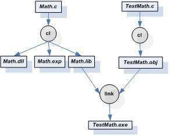

<h2>9.1 DLL 簡介</h2>

DLL即動態連結庫（Dynamic-Link Library）的縮寫，它相當於Linux下的共享物件。Window系統中大量採用了這種DLL機制，甚至包括Windows的核心的結構都很大程度依賴於DLL機制。Windows下的DLL檔案和EXE檔案實際上是一個概念，它們都是有PE格式的二進位檔案，稍微有些不同的是PE檔案頭部中有個符號位表示該檔案是EXE或是DLL，而DLL檔案的副檔名不一定是.dll，也有可能是別的比如.ocx（OCX控制元件）或是.CPL（控制面板程式）。

DLL的設計目的與共享物件有些出入，DLL更加強調模組化，即微軟希望透過DLL機制加強軟體的模組化設計，使得各種模組之間能夠鬆散地組合、重用和升級。所以我們在Windows平台上看到大量的大型軟體都透過升級DLL的形式進行自我完善，微軟經常將這些升級補丁積累到一定程度以後形成一個軟體更新包（Service Packs）。比如我們常見的微軟Office係列、Visual Studio係列、Internet Explorer甚至Windows本身也透過這種方式升級。

另外，我們知道ELF的動態連結可以實現執行時載入，使得各種功能模組能以外掛的形式存在。在Windows下，也有類似ELF的執行時載入，這種技術在Windows下被應用得更加廣泛，比如著名的ActiveX技術就是基於這種執行時載入機制實現的。

9.1.1 程式地址空間和記憶體管理

在早期版本的Windows中（比如Windows 1.x、2.x、3.x），也就是16-bit的Windows系統中，所有的應用程式都共享一個地址空間，即程式不擁有自己獨立的地址空間（或者在那個時候，這些程式的執行方式還不能被稱作為程式）。如果某個DLL被載入到這個地址空間中，那麼所有的程式都可以共享這個DLL並且隨意訪問。該DLL中的資料也是共享的，所以程式以此實現程式間通訊。但是由於這種沒有任何限製的訪問許可權，各個程式之間隨意的訪問很容易導致DLL中資料被損壞。

後來的Windows改進了這個設計，也就是所謂的32位版本的Windows開始支援程式擁有獨立的地址空間，一個DLL在不同的程式中擁有不同的私有資料副本，就像我們前面提到過的ELF共享物件一樣。在ELF中，由於程式碼段是地址無關的，所以它可以實現多個程式之間共享一份程式碼，但是DLL的程式碼卻並不是地址無關的，所以它只是在某些情況下可以被多個程式間共享。我們將在後面詳細探討DLL程式碼段的地址相關問題。

9.1.2 基地址和RVA

PE裡面有兩個很常用的概念就是基地址（Base Address）和相對地址（RVA，Relative Virtual Address）。當一個PE檔案被載入時，其程式地址空間中的起始地址就是基地址。對於任何一個PE檔案來說，它都有一個優先載入的基地址，這個值就是PE檔案頭中的Image Base。

對於一個可執行EXE檔案來說，Image Base一般值是0x400000，對於DLL檔案來說，這個值一般是0x10000000。Windows在載入DLL時，會先嚐試把它載入到由Image Base指定的虛擬地址；若該地址區域已被其他模組佔用，那PE載入器會選用其他空閑地址。而相對地址就是一個地址相對於基地址的偏移，比如一個PE檔案被載入到0x10000000，即基地址為0x10000000，那麼RVA為0x1000的地址為0x10001000。

9.1.3 DLL共享資料段

在Win32下，如果要實現程式間通訊，當然有很多方法，Windows系統提供了一係列API可以實現程式間的通訊。其中有一種方法是使用DLL來實現程式間通訊，這個原理與16位Windows中的DLL實現程式間通訊十分類似。正常情況下，每個DLL的資料段在各個程式中都是獨立的，每個程式都擁有自己的副本。但是Windows允許將DLL的資料段設定成共享的，即任何程式都可以共享該DLL的同一份資料段。當然很多時候比較常見的做法是將一些需要程式間共享的變數分離出來，放到另外一個資料段中，然後將這個資料段設定成程式間可共享的。也就是說一個DLL中有兩個資料段，一個程式間共享，另外一個私有。

當然這種程式間共享方式也產生了一定的安全漏洞，因為任意一個程式都可以訪問這個共享的資料段，那麼只要破壞了該資料段的資料就會導致所有使用該資料段的程式出現問題。甚至惡意攻擊者可以在GUEST的許可權下執行某個程式破壞該共享的資料，從而影響那些系統管理員許可權的使用者使用同一個DLL的程式。所以從這個角度講，這種DLL共享資料段來實現程式間通訊應該盡量避免。

9.1.4 DLL的簡單例子

我們透過簡單的例子來瞭解最簡單的DLL的建立和使用，最基本的概念是匯出（Export）的概念。在ELF中，共用函式庫中所有的全域性函式和變數在預設情況下都可以被其他模組使用，也就是說ELF預設匯出所有的全域性符號。但是在DLL中情況有所不同，我們需要顯式地“告訴”編譯器我們需要匯出某個符號，否則編譯器預設所有符號都不匯出。當我們在程式中使用DLL匯出的符號時，這個過程被稱為匯入（Import）。

Microsoft Visual C++(MSVC)編譯器提供了一係列C/C++的擴充套件來指定符號的匯入匯出，對於一些支援Windows平台的編譯器比如Intel C++、GCC Window版（mingw GCC, cygwin GCC）等都支援這種擴充套件。我們可以透過“__<code>declspec</code>”屬性關鍵字來修飾某個函式或者變數，當我們使用“__<code>declspec(dllexport</code>)”時表示該符號是從本DLL匯出的符號，“__<code>declspec(dllimport</code>)”表示該符號是從別的DLL匯入的符號。在C++中，如果你希望匯入或者匯出的符號符合C語言的符號修飾規範，那麼必須在這個符號的定義之前加上external “C”，以防止C++編譯器進行符號修飾。

除了使用“__<code>declspec</code>”擴充套件關鍵字指定匯入匯出符號之外，我們也可以使用“.def”檔案來宣告匯入匯出符號。“.def”副檔名的檔案是類似於ld連結器的連結指令碼檔案，可以被當作link連結器的輸入檔案，用於控制連結過程。“.def”檔案中的IMPORT或者EXPORTS段可以用來宣告匯入匯出符號，這個方法不僅對C/C++有效，對其他語言也有效。

除了使用“__<code>declspec</code>”擴充套件關鍵字指定匯入匯出符號之外，我們也可以使用“.def”檔案來宣告匯入匯出符號。“.def”副檔名的檔案是類似於ld連結器的連結指令碼檔案，可以被當作link連結器的輸入檔案，用於控制連結過程。“.def”檔案中的IMPORT或者EXPORTS段可以用來宣告匯入匯出符號，這個方法不僅對C/C++有效，對其他語言也有效。

9.1.5 建立DLL

假設我們的一個DLL提供3個數學運算的函式，分別是加（Add）、減（Sub）、乘（Mul），它的原始碼如下（Math.c）：

<pre>__declspec(dllexport) double Add( double a, double b ) 
{
    return a + b;
}

__declspec(dllexport) double Sub( double a, double b )
{
    return a - b;
}

__declspec(dllexport) double Mul( double a, double b )
{
    return a * b;
}
</pre>

程式碼很簡單，就是傳入兩個雙精度的值然後返回相應的計算結果（有人能告訴我為什麼沒有除法嗎？不要著急，我們留著除法到後面用）。然後我們使用MSVC的編譯器cl進行編譯：

cl /LDd Math.c

引數/LDd表示生產Debug版的DLL，不加任何引數則表示生產EXE執行檔；我們可以使用/LD來編譯生成Release版的DLL

上面的編譯結果生成了“Math.dll”、“Math.obj”、“Math.exp”和“Math.lib”這4個檔案。很明顯“Math.dll”就是我們需要的DLL檔案，“Math.obj”是編譯的目的檔，“Math.exp”和“Math.lib”將在後面作介紹。我們可以透過dumpbin工具看到DLL的匯出符號：

<pre>dumpbin /EXPORTS Math.dll
...
    ordinal hint RVA      name

          1    0 00001000 Add
          2    1 00001020 Mul
          3    2 00001010 Sub

...
</pre>

很明顯，我們可以看到DLL有3個匯出函式以及它們的相對地址。

9.1.6 使用DLL

程式使用DLL的過程其實是引用DLL中的匯出函式和符號的過程，即匯入過程。對於從其他DLL匯入的符號，我們需要使用“__declspec(dllimport)”顯式地宣告某個符號為匯入符號。這與ELF中的情況不一樣，在ELF中，當我們使用一個外部模組的符號的時候，我們不需要額外宣告該變數是從其他共享物件匯入的。

我們來看一個使用Math.dll的例子：

<pre>/* TestMath.c */
#include &lt;stdio.h&gt;

__declspec(dllimport) double Sub(double a, double b);

int main(int argc, char **argv)
{
        double result = Sub(3.0, 2.0);
        printf("Result = %f\n", result);
        return 0;
}
</pre>

在編譯時，我們透過下面的命令列：

<pre>cl /c TestMath.c
link TestMath.obj Math.lib
</pre>

第一行使用編譯器將TestMath.c編譯成TestMath.obj，然後使用連結器將TestMath.obj和Math.lib連結在一起產生一個執行檔TestMath.exe。整個過程如圖9-1所示。

在最終連結時，我們必須把與DLL一起產生的“Math.lib”與“TestMath.o”連結起來，形成最終的執行檔。在靜態連結的時候，我們介紹過“.lib”檔案是一組目的檔的集合，在動態連結裡面這一點仍然沒有錯，但是“Math.lib”裡面的目的檔是什麼呢？“Math.lib”中並不真正包含“Math.c”的程式碼和資料，它用來描述“Math.dll”的匯出符號，它包含了TestMath.o連結Math.dll時所需要的匯入符號以及一部分“樁”程式碼，又被稱作“膠水”程式碼，以便於將程式與DLL粘在一起。像“Math.lib”這樣的檔案又被稱為匯入庫（Import Library），我們在後面介紹匯入匯出表的時候還會再詳細分析。

 圖9-1 MSVC靜態函式庫連結 …

9.1.7 使用模組定義檔案

宣告DLL中的某個函式為匯出函式的辦法有兩種，一種就是前面我們演示過的使用“__declspec(dllexport)”擴充套件；另外一種就是採用模組定義（.def）檔案宣告。實際上.def檔案在MSVC連結過程中的作用與連結指令碼檔案（Link Script）檔案在ld連結過程中的作用類似，它是用於控制連結過程，為連結器提供有關連結程式的匯出符號、屬性以及其他資訊。不過相比於ld的連結指令碼檔案，.def檔案的語法要簡單的多，而且功能也更少。

假設我們在前面例子的Math.c中將所有的“__<code>declspec(dllexport</code>)”去掉，然後建立一個Math.def檔案，以下面作為內容：

<pre>LIBRARY Math
EXPORTS
Add
Sub
Mul
Div
</pre>

然後使用下面的命令列來編譯Math.c：

cl Math.c /LD /DEF Math.def

這樣編譯器（更準確地講是link連結器）就會使用Math.def檔案中的描述產生最終輸出檔案。那麼使用.def檔案來描述DLL檔案的匯出屬性有什麼好處呢？

首先，我們可以控制匯出符號的符號名。很多時候，編譯器會對源程式裡面的符號進行修飾，比如C++程式裡面的符號經過編譯器的修飾以後，都變得面目全非，這一點我們在本書的前面已經領教過了。除了C++程式以外，C語言的符號也有可能被修飾，比如MSVC支援幾種函式的呼叫規範“__cdecl”、“__stdcall”、“__fastcall”（我們在本書的第4章還會詳細介紹各種函式呼叫規範之間的區別），預設情況下MSVC把C語言的函式當作“_cdecl”型別，這種情況下它對該函式不進行任何符號修飾。但是一旦我們使用其他的函式呼叫規範時，MSVC編譯器就會對符號名進行修飾，比如使用“__stdcall”呼叫規範的函式Add就會被修飾成“_<code>Add@16</code>”，前面以“_”開頭，後面以“@n”結尾，n表示函式呼叫時引數所佔堆疊空間的大小。使用.def檔案可以將匯出函式重新命名，比如當Add函式採用“__stdcall”時，我們可以使用如下的.def檔案：

<pre>LIBRARY Math
EXPORTS
Add=_Add@16
Sub
Mul
Div
</pre>

當我們使用這個.def檔案來生產Math.dll時，可以看到：

<pre>cl /LD /DEF Math.def Math.c
dumpbin /EXPORTS Math.dll
…
    ordinal hint RVA      name

          1    0 00001000 Add
          3    1 00001030 Div
          4    2 00001020 Mul
          5    3 00001010 Sub
r&gt;          2    4 00001000 _Add@16
…
</pre>

Add作為一個與_Add@16等價的匯出函式被放到了Math.dll的匯出函式列表中，實際上有些類似於“別名”。當一個DLL被多個語言編寫的模組使用時，採用這種方法匯出一個函式往往會很有用。比如微軟的Visual Basic採用的是“__stdcall”的函式呼叫規範，實際上“__stdcall”呼叫規範也是大多數Windows下的程式語言所支援的通用呼叫規範，那麼作為一個能夠被廣泛使用的DLL最好採用“__stdcall”的函式呼叫規範。而MSVC預設採用的是“__cdecl”呼叫規範，否則它就會使用符號修飾，經過修飾的符號不便於維護和使用，於是採用.def檔案對匯出符號進行重新命名就是一個很好的方案。我們經常看到Windows的API都採用“WINAPI”這種方式宣告，而“WINAPI”實際上是一個被定義為“__stdcall”的宏。微軟以DLL的形式提供Windows的API，而每個DLL中的匯出函式又以這種“__stdcall”的方式被宣告。但是我們可以看到，Windows的API中從來沒有_Add@16這種古怪的命名方式，可見它也是採用了這種匯出函式重新命名的方法。

與ld的連結控制指令碼類似，使用.def檔案的另外一個優勢是它可以控制一些連結的過程。在微軟提供的文件中，除了前面例子中用到的“LIBRARY”、“EXPORTS”等關鍵字以為，還可以發現.def支援一些諸如“HEAPSIZE”、“NAME”、“SECTIONS”、“STACKSIZE”、“VERSION”等關鍵字，透過這些關鍵字可以控制輸出檔案的預設堆大小、輸出檔名、各個段的屬性、預設堆疊大小、版本號等。具體請參照MSDN中關於.def檔案的介紹，我們這裡就不詳細展開了。

9.1.8 DLL顯式執行時連結

與ELF類似，DLL也支援執行時連結，即執行時載入。Windows提供了3個API為：

LoadLibrary（或者LoadLibraryEx），這個函式用來載入一個DLL到程式的地址空間，它的功能跟dlopen類似。

GetProcAddress，用來查詢某個符號的地址，與dlsym類似。

FreeLibrary，用來解除安裝某個已載入的模組，與dlclose類似。

我們來看看Windows下的顯式執行時連結的例子：

<pre>#include &lt;windows.h&gt;
#include &lt;stdio.h&gt;

typedef double (*Func)(double, double);

int main(int argc, char **argv)
{
        Func function;
        double result;

        // Load DLL
        HINSTANCE hinstLib = LoadLibrary("Math.dll");
        if (hinstLib == NULL) {
            printf("ERROR: unable to load DLL\n");
            return 1;
        }

        // Get function address
        function = (Func)GetProcAddress(hinstLib, "Add");
        if (function == NULL) {
 printf("ERROR: unable to find DLL function\n");
            FreeLibrary(hinstLib);
            return 1;
        }

        // Call function.
        result = function(1.0, 2.0);

        // Unload DLL file
        FreeLibrary(hinstLib);

        // Display result
        printf("Result = %f\n", result);

        return 0;
}
</pre>
