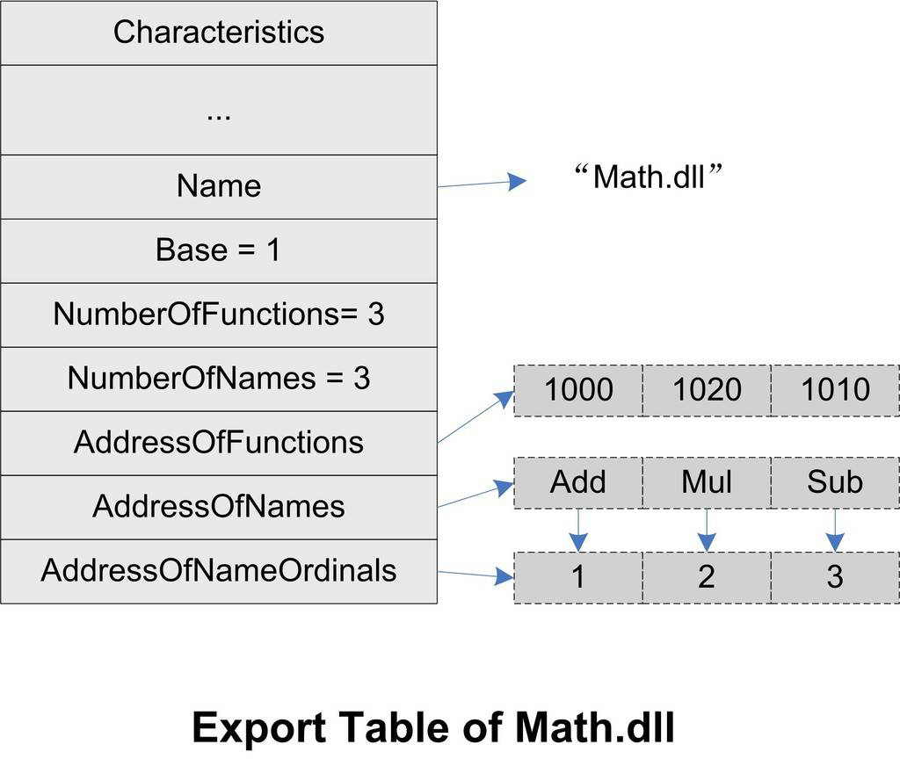
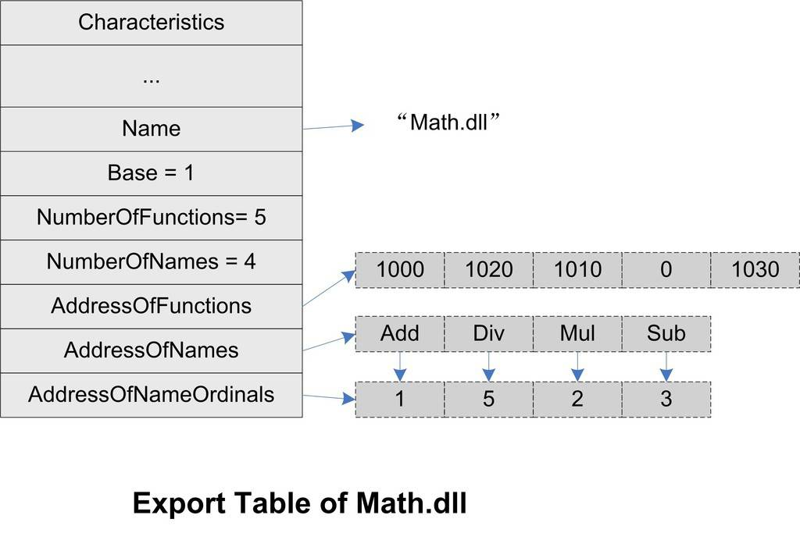
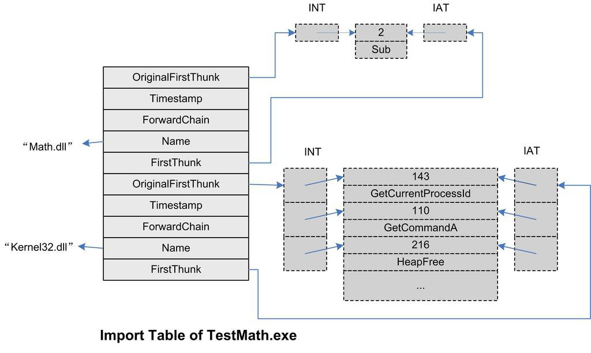

<h2>9.2 符號匯出匯入表</h2>

9.2.1 匯出表

當一個PE需要將一些函式或變數提供給其他PE檔案使用時，我們把這種行為叫做符號匯出（Symbol Exporting），最典型的情況就是一個DLL將符號匯出給EXE檔案使用。在前面介紹ELF動態連線時，我們已經接觸過了符號匯出的概念，ELF將匯出的符號儲存在“.dynsym”段中，供動態連結器查詢和使用。在Windows PE中，符號匯出的概念也是類似，所有匯出的符號被集中存放在了被稱作匯出表（Export Table）的結構中。事實上匯出表從最簡單的結構上來看，它提供了一個符號名與符號地址的對映關係，即可以透過某個符號查詢相應的地址。基本上這些每個符號都是一個ASCII字串，我們知道符號名可能跟相應的函式名或者變數名相同，也可能不同，因為有符號修飾這個機制存在。

很多時候，在討論到PE的匯入匯出時，經常把函式和符號混淆在一起，因為PE在絕大部分時候只匯入匯出函式，而很少匯入匯出變數，所以類似於匯出符號和匯出函式這種叫法很多時候可以相互替換使用。

我們在前面介紹過，PE檔案頭中有一個叫做DataDirectory的結構陣列，這個陣列共有16個元素，每個元素中儲存的是一個地址和一個長度。其中第一個元素就是匯出表的結構的地址和長度。匯出表是一個IMAGE_EXPORT_DIRECTORY的結構體，它被定義在“Winnt.h”中：

<pre>typedef struct _IMAGE_EXPORT_DIRECTORY {
    DWORD   Characteristics;
    DWORD   TimeDateStamp;
    WORD    MajorVersion;
    WORD    MinorVersion;
    DWORD   Name;
    DWORD   Base;
    DWORD   NumberOfFunctions;
    DWORD   NumberOfNames;
    DWORD   AddressOfFunctions;     // RVA from base of image
    DWORD   AddressOfNames;          // RVA from base of image
    DWORD   AddressOfNameOrdinals;  // RVA from base of image
} IMAGE_EXPORT_DIRECTORY
</pre>

匯出表結構中，最後的3個成員指向的是3個陣列，這3個陣列是匯出表中最重要的結構，它們是匯出地址表（EAT, Export Address Table）、符號名錶（Name Table）和名字序號對應表（Name-Ordinal Table）。對於“Math.dll”來說，這個匯出表的結構將會如圖9-2所示。

 圖9-2 Math.dll匯出表結構 …

這3個陣列中，前兩個比較好理解。第一個叫做匯出地址表EAT，它存放的是各個匯出函式的RVA，比如第一項是0x1000，它是Add函式的RVA；第二個表是函式名錶，它儲存的是匯出函式的名字，這個表中，所有的函式名是按照ASCII順序排序的，以便於動態連結器在查詢函式名字時可以速度更快（可以使用二分法查詢），那麼函式名錶和EAT之間有什麼關係呢？是不是一一對應呢？在上面的例子中似乎是這樣的，比如Add對應0x1000，Mul對應0x1020，Sub對應0x1010，這樣看起來很簡單，但實際上並非如此，因為還有一個叫做序號的概念夾在這兩個表之間；第三個名字序號對應表就有點另類了，匯出一個函式除了函式名和函式地址不就夠了嗎？為什麼要有序號？什麼是序號？

序號（Ordinals）

這還得從很早以前說起，早期的Windows是16位的，當時的16位Windows沒有很好的虛擬記憶體機制，而且當時的硬體條件也不好，記憶體一般只有幾個MB。而函式名錶對於當時的Windows來說，其實是很奢侈的。比如一個user.dll有600多個匯出函式，如果把這些函式的函式名錶全部放在記憶體中的話，將會消耗幾十KB的空間。除了user.dll之外，程式還會用到其他DLL，對於記憶體空間以KB計的年代來說，這是不可以容忍的。於是當時DLL的函式匯出的主要方式是序號（Ordinals）。其實序號的概念很簡單，一個匯出函式的序號就是函式在EAT中的地址下標加上一個Base值（也就是IMAGE_EXPORT_DIRECTORY中的Base，預設情況下它的值是1）。比如上面的例子中，Mul的RVA為0x1020，它在EAT中的下標是1，加上一個Base值1，Mul的匯出序號為2。如果一個模組A匯入了Math.dll中的Add，那麼它在匯入表中將不儲存“Add”這個函式名，而是儲存Add函式的序號，即1。當動態連結器進行連結時，它只需要根據模組A的匯入表中儲存的序號1，減去Math.dll的Base值，得到下標0，然後就可以直接在Math.dll的EAT中找到Add函式的RVA。

使用序號匯入匯出的好處是明顯的，那就是省去了函式名查詢過程，函式名錶也不需要儲存在記憶體中了。那麼使用序號匯入匯出的問題是什麼？最大的問題是，一個函式的序號可能會變化。假設某一次更新中，Math.dll裡面新增了一個函式或者刪除了一個函式，那麼原先函式的序號可能會因此發生變化，從而導致已有的應用程式執行出現問題。一種解決的方案是，由程式設計師手工指定每個匯出函式的序號，比如我們指定Add的匯出序號為1，Mul為2，Sub為3，以後加入函式則指定一個與其他函式不同的唯一的序號，如果刪除一個函式，那麼保持現有函式的序號不變。這種手工指定函式匯出序號的方法可以透過連結器的.def檔案實現，我們在後面關於DLL最佳化的章節中還會再詳細介紹。

由程式設計師手工維護匯出序號的方法在實際操作中頗為麻煩，為了節省那麼一點點記憶體空間和並不明顯的查詢速度的提升（相對於現在的硬體條件），實在得不償失。於是現在的DLL基本都不採用序號作為匯入匯出的手段，而是直接使用符號名。這種手段就顯得直觀多了，更加便於理解和程式除錯（試想在除錯DLL時看到一個匯入函式是序號1或者是Add哪個更容易理解？），而且它不需要額外的手工維護，省去了很多繁瑣的工作。

雖然現在的DLL匯出方式基本都是使用符號名，但是實際上序號的匯出方式仍然沒有被拋棄。為了保持向後相容性，序號匯出方式仍然被保留，相反，符號名作為匯出方式是可選的。一個DLL中的每一個匯出函式都有一個對應唯一的序號值，而匯出函式名卻是可選的，也就是說一個匯出函式肯定有一個序號值（序號值是肯定有的，因為函式在EAT的下標加上Base就是序號值），但是可以沒有函式名。

瞭解了序號的概念之後，我們又回到了原來的那個問題，函式名和函式地址之間的關係是怎樣的呢？符號名錶和EAT的元素之間的對映關係又是怎樣的？

上面問題的答案必須透過第三個表，即名字序號對應表。這個表擁有與函式名錶一樣多數目的元素，每個元素就是對應的函式名錶中的函式名所對應的序號值，比如Add的序號值是1，Mul的序號值是2等。實際上它就是一個函式名與序號的對應關係表。

那麼使用函式名作為匯入匯出方式，動態連結器如何查詢函式的RVA呢？假設模組A匯入了Math.dll中的Add函式，那麼A的匯入表中就儲存了“Add”這個函式名。當進行動態連結時，動態連結器在Math.dll的函式名錶中進行二分查詢，找到“Add”函式，然後在名字序號對應表中找到“Add”所對應的序號，即1，減去Math.dll的Base值1，結果為0，然後在EAT中找到下標0的元素，即“Add”的RVA為0x1000。

從上面的Math.dll來看，3個表的結構都非常規則，元素數目相等，而且是一一對應的。但實際上這3個表的內容有可能變得不是很規則：假設我們在Math.dll中新增了一個函式叫做Div，它的RVA為0x1030，並且將它的序號值指定為5。為了保持原來的幾個匯出函式的序號值不變，我們手工指定原來的3個匯出函式的序號值分別為Add = 1，Mul = 2，Sub = 3。那麼Math.dll的3個表的內容將如圖9-3所示。

 圖9-3 Math.dll匯出表結構（帶序號） …

對於連結器來說，它在連結輸出DLL時需要知道哪些函式和變數是要被匯出的，因為對於PE來說，預設情況下，全域性函式和變數是不匯出的。link連結器提供了了一個“/EXPORT”的引數可以指定匯出符號，比如：

link math.obj /DLL /EXPORT:_Add

就表示在產生math.dll時匯出符號_Add。另外一種匯出符號的方法是使用MSVC的__declspec(dllexport)擴充套件，它實際上是透過目的檔的編譯器指示來實現的（還記得前面關於PE/COFF目的檔的“.drectve”段的描述嗎？）。對於前面例子中的math.obj來說，它實際上在“.drectve”段中儲存了4個“/EXPORT”引數，用於傳遞給連結器，告知連結器匯出相應的函式：

<pre>dumpbin /DIRECTIVES math.obj
Microsoft (R) COFF/PE Dumper Version 9.00.21022.08
Copyright (C) Microsoft Corporation.  All rights reserved.

Dump of file math.obj

File Type: COFF OBJECT

   Linker Directives
   -----------------
   /DEFAULTLIB:"LIBCMT"
   /DEFAULTLIB:"OLDNAMES"
   /EXPORT:_Add
   /EXPORT:_Sub
   /EXPORT:_Mul
   /EXPORT:_Div
</pre>

9.2.2 EXP檔案

在建立DLL的同時也會得到一個EXP檔案，這個檔案實際上是連結器在建立DLL時的臨時檔案。連結器在建立DLL時與靜態連結時一樣採用兩遍掃描過程，DLL一般都有匯出符號，連結器在第一遍時會遍曆所有的目的檔並且收集所有匯出符號資訊並且建立DLL的匯出表。為了方便起見，連結器把這個匯出表放到一個臨時的目的檔叫做“.edata”的段中，這個目的檔就是EXP檔案，EXP檔案實際上是一個標準的PE/COFF目的檔，只不過它的副檔名不是.obj而是.exp。在第二遍時，連結器就把這個EXP檔案當作普通目的檔一樣，與其他輸入的目的檔連結在一起並且輸出DLL。這時候EXP檔案中的“.edata”段也就會被輸出到DLL檔案中並且成為匯出表。不過一般現在連結器很少會在DLL中單獨保留“.edata”段，而是把它合並到只讀資料段“.rdata”中。

9.2.3 匯出重定向

DLL有一個很有意思的機制叫做匯出重定向（Export Forwarding），顧名思義就是將某個匯出符號重定向到另外一個DLL。比如在Windows XP系統中，KERNEL32.DLL中的HeapAlloc函式被重新定向到了NTDLL.DLL中的RtlAllocHeap函式，呼叫HeapAlloc函式相當於呼叫RtlAllocHeap函式。如果我們要重新定向某個函式，可以使用模組定義檔案，比如HeapAlloc的重定向可以定義下面這樣一個“.DEF”檔案：

<pre>EXPORTS

HeapAlloc = NTDLL.RtlAllocHeap
</pre>

匯出重定向的實現機制也很簡單，正常情況下，匯出表的地址陣列中包含的是函式的RVA，但是如果這個RVA指向的位置位於匯出表中（我們可以得到匯出表的起始RVA和大小），那麼表示這個符號被重定向了。被重定向了的符號的RVA並不代表該函式的地址，而是指向一個ASCII的字串，這個字串在匯出表中，它是符號重定向後的DLL檔名和符號名。比如在這個例子中，這個字串就是“NTDLL.RtlAllocHeap”。

9.2.4 匯入表

如果我們在某個程式中使用到了來自DLL的函式或者變數，那麼我們就把這種行為叫做符號匯入（Symbol Importing）。在ELF中,“.rel.dyn”和“.rel.plt”兩個段中分別儲存了該模組所需要匯入的變數和函式的符號以及所在的模組等資訊，而“.got”和“.got.plt”則儲存著這些變數和函式的真正地址。Windows中也有類似的機制，它的名稱更為直接，叫做匯入表（Import Table）。當某個PE檔案被載入時，Windows載入器的其中一個任務就是將所有需要匯入的函式地址確定並且將匯入表中的元素調整到正確的地址，以實現動態連結的過程。

我們可以使用dumpbin來檢視一個模組依賴於哪些DLL，又匯入了哪些函式：

<pre>dumpbin /IMPORTS Math.dll
Microsoft (R) COFF/PE Dumper Version 9.00.21022.08
Copyright (C) Microsoft Corporation.  All rights reserved.

Dump of file Math.dll

File Type: DLL

  Section contains the following imports:

    KERNEL32.dll
              1000B000 Import Address Table
              1000C5BC Import Name Table
                  0 time date stamp
                  0 Index of first forwarder reference

                  146 GetCurrentThreadId
                  110 GetCommandLineA
                  216 HeapFree
                  1E9 GetVersionExA
                  210 HeapAlloc
                  1A3 GetProcessHeap
                  1A0 GetProcAddress
                  17F GetModuleHandleA
                   B9 ExitProcess
                  365 TlsGetValue
                  363 TlsAlloc
                  366 TlsSetValue
                  364 TlsFree
                  22C InterlockedIncrement
                  328 SetLastError
                  171 GetLastError
                  228 InterlockedDecrement
                  356 Sleep
                  324 SetHandleCount
</pre>

可以看到Math.dll從Kernel32.dll中匯入了諸如GetCurrentThreadId、GetCommandLineA等函式（大約有數十個，這裡省略了一部分）。可能你會覺得很奇怪，明明我們在Math.c裡面沒有用到這些函式，怎麼會出現在匯入列表之中？這是由於我們在構建Windows DLL時，還連結了支援DLL執行的基本執行庫，這個基本執行庫需要用到Kernel32.dll，所以就有了這些匯入函式。

在Windows中，系統的載入器會確保任何一個模組的依賴條件都得到滿足，即每個PE檔案所依賴的檔案都將被載入。比如一般Windows程式都會依賴於KERNEL32.DLL，而KERNEL32.DLL又會匯入NTDLL.DLL，即依賴於NTDLL.DLL，那麼Windows在載入該程式時確保這兩個DLL都被載入。如果程式用到了Windows GDI，那麼就會需要從GDI32.DLL中匯入函式，而GDI32.DLL又依賴於USER32.DLL、ADVAPI32.DLL、NTDLL.DLL和KERNEL32.DLL，Windows將會保證這些依賴關係的正確，並且保證所有的匯入符號都被正確地解析。在這個動態連結過程中，如果某個被依賴的模組無法正確載入，那麼系統將會提示錯誤（我們經常會看到那種“缺少某個DLL”之類的錯誤），並且終止執行該程式。

在PE檔案中，匯入表是一個IMAGE_IMPORT_DESCRIPTOR的結構體陣列，每一個IMAGE_IMPORT_DESCRIPTOR結構對應一個被匯入的DLL。這個結構體被定義在“Winnt.h”中：

<pre>typedef struct {
    DWORD   OriginalFirstThunk; 
    DWORD   TimeDateStamp;
    DWORD   ForwarderChain;
    DWORD   Name;
    DWORD   FirstThunk;
} IMAGE_IMPORT_DESCRIPTOR;
</pre>

結構體中的FirstThunk指向一個匯入地址陣列（Import Address Table），IAT是匯入表中最重要的結構，IAT中每個元素對應一個被匯入的符號，元素的值在不同的情況下有不同的含義。在動態連結器剛完成對映還沒有開始重定位和符號解析時，IAT中的元素值表示相對應的匯入符號的序號或者是符號名；當Windows的動態連結器在完成該模組的連結時，元素值會被動態連結器改寫成該符號的真正地址，從這一點看，匯入地址陣列與ELF中的GOT非常類似。

那麼我們如何判斷匯入地址陣列的元素中包含的是匯入符號的序號還是符號的名字？事實上我們可以看這個元素的最高位，對於32位的PE來說，如果最高位被置1，那麼低31位值就是匯入符號的序號值；如果沒有，那麼元素的值是指向一個叫做IMAGE_IMPORT_BY_NAME結構的RVA。IMAGE_IMPORT_BY_NAME是由一個WORD和一個字串組成，那個WORD值表示“Hint”值，即匯入符號最有可能的序號值，後面的字串是符號名。當使用符號名匯入時，動態連結器會先使用“Hint”值的提示去定位該符號在目標匯出表中的位置，如果剛好是所需要的符號，那麼就命中；如果沒有命中，那麼就按照正常的二分查詢方式進行符號查詢。

在IMAGE_IMPORT_DESCRIPTOR結構中，還有一個指標OriginalFirstThrunk指向一個陣列叫做匯入名稱表（Import Name Table），簡稱INT。這個陣列跟IAT一摸一樣，裡面的數值也一樣。那麼為什麼要多儲存一份IAT的副本呢？答案我們將在後面的DLL繫結中揭曉（見圖9-4）。

 圖9-4 TestMath.exe匯入表 …

Windows的動態連結器會在載入一個模組的時候，改寫匯入表中的IAT，這一點很像ELF中的.got。其區別是，PE的匯入表一般是只讀的，它往往位於“.rdata”這樣的段中。這樣就產生了一個問題，對於一個只讀的段，動態連結器是怎麼改寫它的呢？解決方法是這樣的，對於Windows來說，由於它的動態連結器其實是Windows核心的一部分，所以它可以隨心所欲地修改PE載入以後的任意一部分內容，包括內容和它的頁面屬性。Windows的做法是，在載入時，將匯入表所在的位置的頁面改成可讀寫的，一旦匯入表的IAT被改寫完畢，再將這些頁面設回至只讀屬性。從某些角度來看，PE的做法比ELF要更加安全一些，因為ELF執行程式隨意修改.got，而PE則不允許。

延遲載入（Delayed Load）

Visual C++ 6.0開始引入了一個叫做延遲載入的新功能，這個功能有點類似於隱式載入和顯式載入的混合體。當你連結一個支援延遲載入的DLL時，連結器會產生與普通DLL匯入非常類似的資料。但是作業系統會忽略這些資料。當延遲載入的API第一次被呼叫時，由連結器新增的特殊的樁程式碼就會啟動，這個樁程式碼負責對DLL的載入工作。然後這個樁程式碼透過呼叫GetProcAddress來找到被呼叫API的地址。另外MSVC還做了一些額外的最佳化，使得接下來的對該DLL的呼叫速度與普通方式載入的DLL的速度相差無異。

9.2.5 匯入函式的呼叫

接下來我們來看看Windows PE對於匯入函式是怎麼呼叫的？__declspec(dllimport)又有什麼作用？

如果在PE的模組中需要呼叫一個匯入函式，仿照ELF GOT機制的一個辦法就是使用一個間接呼叫指令，比如：

CALL DWORD PTR [0x0040D11C]

我們在Windows下也入鄉隨俗，使用微軟組譯器語法。如果你不熟悉微軟組譯器語法也沒多大關係，上面這條指令的意思是間接呼叫0x0040D11C這個地址中儲存的地址，即從地址0x0040D11C開始取4個位元組作為目標地址（DWORD PTR表示4個位元組的操作字首），然後呼叫該目標地址。而0x0040D11C這個地址剛好是IAT中的某一項，即我們需要呼叫的外部函式在IAT中所對應的元素，比如TestMath.exe中，我們需要呼叫Math.dll中的Sub函式，那麼0x0040D11C正好對應Sub匯入函式在TestMath.exe的IAT中的位置。這個過程跟ELF透過GOT間接跳轉十分類似，IAT相當於GOT（不考慮PLT的情況下）。

PE DLL的地址無關性

如果ELF呼叫者本身所在的模組是地址無關的，那麼透過GOT跳轉之前，需要計算目標函式地址在GOT中的位置，然後再間接跳轉，以實現地址無關，這個原理我們在前面已經很詳細地分析過了。但是在這個現實方法中，我們可以看到，這個0x0040D11C是作為常量被寫入在指令中。而且事實上，PE對匯入函式呼叫的真正實現中，它的確是這麼做的，由此我們可以得出結論，PE DLL的程式碼段並不是地址無關的。

那麼PE是如何解決載入時模組在程式空間中地址衝突的問題的呢？事實上它使用了一種叫做重定基地址的方法，我們在後面將會詳細介紹。

PE採用上面的這個方法實現匯入函式的呼叫，但是與ELF一樣存在一個問題：對於編譯器來說，它無法判斷一個函式是本模組內部的，還是從外部匯入的。因為對於普通的模組內部函式呼叫來說，編譯器產生的指令是這樣的：

CALL XXXXXXXX

因為PE沒有類似ELF的共享物件有全域性符號介入的問題，所以對於模組內部的全域性函式呼叫，編譯器產生的都是直接呼叫指令。

其中XXXXXXXX是模組內部的函式地址。這是一個直接呼叫指令，與上面的間接呼叫指令形式不同。所以為了使得編譯器能夠區分函式是從外部匯入的還是模組內部定義的，MSVC引入了我們前面用過的擴充套件屬性“__declspec(dllimport)”，一旦一個函式被宣告為“__declspec(dllimport)”，那麼編譯器就知道它是外部匯入的，以便於產生相應的指令形式。

在“__declspec”關鍵字引入之前，微軟還提供了另外一個方法來解決這個問題。在這種情況下，對於匯入函式的呼叫，編譯器並不區分匯入函式和匯出函式，它統一地產生直接呼叫的指令。但是連結器在連結時會將匯入函式的目標地址導向一小段樁程式碼（Stub），由這個樁程式碼再將控制權交給IAT中的真正目標地址，實現如下：

<pre>CALL 0x0040100C
...
0x0040100C:
JMP DWORD PTR [0x0040D11C]
</pre>

即對於呼叫函式來說，它只是產生一般形式的指令“CALL XXXXXXXX”，然後在連結時，連結器把這個XXXXXXXX地址重定位到一段樁程式碼，即那條JMP指令處，然後這條JMP指令才透過IAT間接跳轉到匯入函式。我們知道，連結器一般情況下是不會產生指令的，那麼這段包含JMP指令的樁程式碼來自何處呢？答案是來自產生DLL檔案時伴隨的那個LIB檔案，即匯入庫。

編譯器在產生匯入庫時，同一個匯出函式會產生兩個符號的定義，比如對於函式<code>foo</code>來說，它在匯入庫中有兩個符號，一個是<code>foo</code>，另外一個是<code>__imp__foo</code>。這兩個符號的區別是，<code>foo</code>這個符號指向<code>foo</code>函式的樁程式碼，而<code>__imp__foo</code>指向<code>foo</code>函式在IAT中的位置。所以當我們透過“__declspec(dllimport)”來宣告foo匯入函式時，編譯器在編譯時會在該匯入函式前加上字首“__<code>imp</code>__”，以確保跟匯入庫中的“__<code>imp__foo</code>”能夠正確連結；如果不使用“__<code>declspec(dllimport</code>)”，那麼編譯器將產生一個正常的foo符號引用，以便於跟匯入庫中的foo符號定義相連結。

現在的MSVC編譯器對於以上兩種匯入方式都支援，即程式設計師可以透過“__declspec(dllimport)”來宣告匯入函式，也可以不使用。但我們還是推薦使用“__declspec(dllimport)”，畢竟從效能上來講，它比不使用該宣告少了一條跳轉指令。當然它還有其他的好處，我們到後面用到時還會提起。

