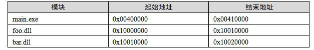
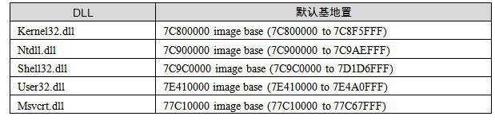

<h2>9.3 DLL最佳化</h2>

我們在前面經過對DLL的分析得知，DLL的程式碼段和資料段本身並不是地址無關的，也就是說它預設需要被載入到由ImageBase指定的目標地址中。如果目標地址被佔用，那麼就需要載入到其他地址，便會引起整個DLL的Rebase。這對於擁有大量DLL的程式來說，頻繁的Rebase也會造成程式啟動速度減慢。這是影響DLL效能的另外一個原因。

我們知道動態連結過程中，匯入函式的符號在執行時需要被逐個解析。在這個解析過程中，免不了會涉及到符號字串的比較和查詢過程，這個查詢過程中，動態連結器會在目標DLL的匯出表中進行符號字串的二分查詢。即使是使用了二分查詢法，對於擁有DLL數量很多，並且有大量匯入匯出符號的程式來說，這個過程仍然是非常耗時的。這是影響DLL效能的一個原因之一。

這兩個原因可能會導致應用程式的速度非常慢，因為系統需要在啟動程式時進行大量的符號解析和Rebase工作。

9.3.1 重定基地址（Rebasing）

從前面DLL的匯入函式的實現，我們得出結論：PE的DLL中的程式碼段並不是地址無關的，也就是說它在被載入時有一個固定的目標地址，這個地址也就是PE裡面所謂的基地址（Base Address）。預設情況下，PE檔案將被載入到這個基地址。一般來說，EXE檔案的基地址預設為0x00400000，而DLL檔案基地址預設為0x10000000。

我們前面花了很多篇幅討論了為什麼對於一個ELF共享物件，它的程式碼段要做到地址無關，並且討論了地址無關的實現。這一點對於DLL來說也一樣，一個程式中，多個DLL不可以被載入到同一個虛擬地址，每個DLL所佔用的虛擬地址區域之間都不可以重疊。

在討論共享物件的地址衝突問題時，我們已經介紹過了，有3種方案可供選擇。一個辦法是像靜態共享物件那樣，為每個DLL指定一個基地址，並且人為保證同一個程式中這些DLL的地址區域都不相互重疊，但是這樣做會有很多問題，在前面介紹靜態共享物件的時候已經討論過，這種將模組目標地址固定的做法有很多弊端。另外一個辦法就是ELF所採用的辦法，那就是程式碼段地址無關。

Windows PE採用了一種與ELF不同的辦法，它採用的是載入時重定位的方法。在DLL模組載入時，如果目標地址被佔用，那麼作業系統就會為它分配一塊新的空間，並且將DLL載入到該地址。這時候問題來了，因為DLL的程式碼段不是地址無關的，DLL中所有涉及到絕對地址的引用該怎麼辦呢？答案是對於每個絕對地址引用都進行重定位。

當然，這個重定位過程有些特殊，因為所有這些需要重定位的地方只需要加上一個固定的差值，也就是說加上一個目標載入地址與實際載入地址的差值。我們來看一個例子，比如有一個DLL的基地址是0x10000000，那麼如果它的程式碼中有這樣一條指令：

MOV DWORD PTR [0x10001000], 0x100

事實上，由於DLL內部的地址都是基於基地址的，或者是相對於基地址的RVA。那麼所有需要重定位的地方都只需要加上一個固定差值，在這個例子裡面是0x10000000。所以這個重定位的過程相對簡單一點，速度也要比一般的重定位要快。PE裡面把這種特殊的重定位過程又被叫做重定基地址（Rebasing）。

PE檔案的重定位資訊都放在了“.reloc”段，我們可以從PE檔案頭中的DataDirectory裡面得到重定位段的資訊。重定位段的結構跟ELF中的重定位段結構十分類似，在這裡就不再詳細介紹了。對於EXE檔案來說，MSVC編譯器預設不會產生重定位段，也就是預設情況下，EXE是不可以重定位的，不過這也沒有問題，因為EXE檔案是程式執行時第一個裝入到虛擬空間的，所以它的地址不會被人搶佔。而DLL則沒那麼幸運了，它們被載入的時間是不確定的，所以一般情況下，編譯器都會給DLL檔案產生重定位資訊。當然你也可以使用“/FIXED”引數來禁止DLL產生重定位資訊，不過那樣可能會造成DLL的載入失敗。

這種重定基地址的方法導致的一個問題是，如果一個DLL被多個程式共享，且該DLL被這些程式載入到不同的位置，那麼每個程式都需要有一份單獨的DLL程式碼段的副本。很明顯，這種方案相對於ELF的共享物件程式碼段地址無關的方案來說，它更加浪費記憶體，而且當被重定基址的程式碼段需要被換出時，它需要被寫到交換空間中，而不像沒有重定基址的DLL程式碼段，只需要釋放物理頁面，再次用到時可以直接從DLL檔案裡面重新讀取程式碼段即可。但是有一個好處是，它比ELF的PIC機制有著更快的執行速度。因為PE的DLL對資料段的訪問不需要透過類似於GOT的機制，對於外部資料和函式的引用不需要每次都計算GOT的位置，所以理論上會比ELF的PIC的方案快一些。這又是一個空間換時間的案例。

改變預設基地址

前面的重定基地址過程實際上是在DLL檔案載入時進行的，所以又叫做載入時重定位。對於一個程式來說，它所用到的DLL基本是固定的（除了透過LoadLibrary()載入的以外）。程式每次執行時，這些DLL的載入順序和地址也是一樣的。比如一個程式由程式主模組main.exe、foo.dll和bar.dll 3個模組組成，它們的大小都是64 KB。於是當程式執行起來以後程式虛擬地址空間的佈局應該如表9-1所示。

 表9-1 …

可以看到bar.dll原先預設的基地址是0x10000000，但是它被重定基址到了0x10010000，因為0x10000000到0x10010000這塊地址被先前載入的foo.dll佔用了（假設foo.dll比bar.dll先載入）。那麼既然bar.dll每次執行的時候基地址都是0x10010000，為什麼不把它的基地址就設成0x10010000呢？這樣就省掉了bar.dll每次載入時重定基址的過程，不是可以讓程式執行得更快嗎？

MSVC的連結器提供了指定輸出檔案的基地址的功能。那麼可以在連結時使用link命令中的“/BASE”引數為bar.dll指定基地址：

link /BASE:0x10010000, 0x10000 /DLL bar.obj

這個基地址必須是64 K的倍數，如果不是64 K的倍數，連結器將發出錯誤。這裡還有一個引數0x10000是指DLL佔用空間允許的最大的長度，如果超出這個長度，那麼編譯器會給出警告。這個看似沒用的選項實際上非常有用，比如我們的程式中用到了10個DLL，那麼我們就可以為每個DLL手工指定一塊區域，以防止它們在地址空間中相互衝突。假設我們為bar.dll指定的空間是0x10010000到0x10020000這塊空間，那麼在使用“/BASE”引數時，我們不光指定bar.dll的起始地址，還指定它的最長的長度。如果超出這個長度，它就會佔用其他DLL的地址塊，如果連結器能夠給出警告的話，我們就很快能發現問題並且進行調整。

除了在連結時可以指定DLL的基地址以外，MSVC還提供了一個叫做editbin的工具（早期版本的MSVC提供一個叫rebase.exe的工具），這個工具可以用來改變已有的DLL的基地址。比如：

editbin /REBASE:BASE=0x10020000 bar.dll

系統DLL

由於Windows系統本身自帶了很多系統的DLL，比如kernel32.dll、ntdll.dll、shell32.dll、user32.dll、msvcrt.dll等，這些DLL基本上是Windows的應用程式執行時都要用到的。Windows系統就在程式空間中專門劃出一塊0x70000000～0x80000000區域，用於對映這些常用的系統DLL。Windows在安裝時就把這塊地址分配給這些DLL，調整這些DLL的基地址使得它們相互之間不衝突，從而在載入時就不需要進行重定基址了。比如在我的機器中，這些DLL的基地址如表9-2所示。

 表9-2 …

9.3.2 序號

一個DLL中每一個匯出的函式都有一個對應的序號（Ordinal Number）。一個匯出函式甚至可以沒有函式名，但它必須有一個唯一的序號。另一方面，當我們從一個DLL匯入一個函式時，可以使用函式名，也可以使用序號。序號標示被匯出函式地址在DLL匯出表中的位置。

一般來說，那些僅供內部使用的匯出函式，它只有序號沒有函式名，這樣外部使用者就無法推測它的含義和使用方法，以防止誤用。對於大多數Windows API函式來說，它們的函式名在各個Windows版本之間是保持不變的，但是它們的序號是在不停地變化的。所以，如果我們匯入Windows API的話，絕對不能使用序號作為匯入方法。

在產生一個DLL檔案時，我們可以在連結器的.def檔案中定義匯出函式的序號。比如對於前面的Math.dll的例子，假設有如下.def檔案：

<pre>LIBRARY Math
EXPORTS
Add @1
Sub @2
Mul @3
Div @4  NONAME
</pre>

上面的.def檔案可以用於指定Math.dll的匯出函式的序號，@後面所跟的值就是每個符號的序號值。對於Div函式，序號值後面還有一個NONAME，表示該符號僅以序號的形式匯出，即Math.dll的使用者看不到Div這個符號名，只能看到序號為4的一個匯出函式：

<pre>cl /c Math.c
link /DLL /DEF:Math.def Math.obj
dumpbin /EXPORTS Math.dll
…
    ordinal hint RVA      name

          1    0 00001000 Add
          3    1 00001020 Mul
          2    2 00001010 Sub
          4    00001030 [NONAME]
</pre>

使用序號作為匯入方法比函式名匯入方法稍微快一點點，特別在現在的硬體條件下，這種效能的提高極為有限，而且DLL的匯入函式的查詢並不是效能瓶頸。因為在現在的DLL中，匯出函式表中的函式名是經過排序的，查詢的時候可以使用二分查詢法。最初在16位的Windows下，DLL的匯出函式名不是排序的，所以查詢過程會比較慢。所以綜合來看，一般情況下並不推薦使用序號作為匯入匯出的手段。

9.3.3 匯入函式繫結

試想一下，每一次當一個程式執行時，所有被依賴的DLL都會被載入，並且一係列的匯入匯出符號依賴關係都會被重新解析。在大多數情況下，這些DLL都會以同樣的順序被載入到同樣的記憶體地址，所以它們的匯出符號的地址都是不變的。既然它們的地址都不變，每次程式執行時都要重新進行符號的查詢、解析和重定位，是不是有些浪費呢？如果把這些匯出函式的地址儲存到模組的匯入表中，不就可以省去每次啟動時符號解析的過程嗎？這個思路是合理的，這種DLL效能最佳化方式被叫做DLL繫結（DLL Binding）。DLL繫結方法很簡單，我們可以使用editbin（之前的MSVC提供一個額外的bind.exe用於DLL繫結）這個工具對EXE或DLL進行繫結：

<pre>editbin /BIND TestMath.exe
dumpbin /IMPORTS TestMath.exe
Microsoft (R) COFF/PE Dumper Version 9.00.21022.08
Copyright (C) Microsoft Corporation.  All rights reserved.

Dump of file TestMath.exe

File Type: EXECUTABLE IMAGE

  Section contains the following imports:

    Math.dll
                40D11C Import Address Table
                40E944 Import Name Table
              FFFFFFFF time date stamp
              FFFFFFFF Index of first forwarder reference

      10001010      2 Sub

    KERNEL32.dll
                40D000 Import Address Table
                40E828 Import Name Table
              FFFFFFFF time date stamp
              FFFFFFFF Index of first forwarder reference

      7C8099B0    143 GetCurrentProcessId
…
  Header contains the following bound import information:
    Bound to Math.dll [483A6707] Mon May 26 15:30:15 2008
    Bound to KERNEL32.dll [4802A12C] Mon Apr 14 08:11:24 2008
      Contained forwarders bound to NTDLL.DLL [4802A12C] Mon Apr 14 08:11:24 2008
…
</pre>

DLL的繫結實現也比較簡單，editbin對被繫結的程式的匯入符號進行遍曆查詢，找到以後就把符號的執行時的目標地址寫入到被繫結程式的匯入表內。還記得前面介紹PE的匯入表中有個與IAT一樣的陣列叫做INT，這個陣列就是用來儲存繫結符號的地址的。

那麼什麼情況會導致DLL繫結的那些地址失效呢？一種情況是，被依賴的DLL更新導致DLL的匯出函式地址發生變化；另外一種情況是，被依賴的DLL在載入時發生重定基址，導致DLL的載入地址與被繫結時不一致。那麼如果地址失效，而被繫結的EXE或者DLL還使用失效了的地址的話，必然會導致程式執行錯誤。Windows必須提供相應的機制來保證繫結地址失效時，程式還能夠正確執行。

對於第一種情況的失效，PE的做法是這樣的，當對程式進行繫結時，對於每個匯入的DLL，連結器把DLL的時間戳（Timestamp）和校驗和（Checksum，比如MD5）儲存到被繫結的PE檔案的匯入表中。在執行時，Windows會核對將要被載入的DLL與繫結時的DLL版本是否相同，並且確認該DLL沒有發生重定基址，如果一切正常，那麼Windows就不需要再進行符號解析過程了，因為被載入的DLL與繫結時一樣，沒有發生變化；否則Windows就忽略繫結的符號地址，按照正常的符號解析過程對DLL的符號進行解析。

繫結過的執行檔如果在執行時的環境與它在繫結時的環境一樣，那麼它的載入速度將會比正常情況下快；如果是在不同的執行環境，那麼它的啟動速度跟沒繫結的情況下沒什麼兩樣。所以總的來說，DLL繫結至少不會有壞處。

事實上，Windows系統所附帶的程式都是與它所在的Windows版本的系統DLL繫結的。除了在編譯時可以繫結程式，另外一個繫結程式的很好的機會是在程式安裝的時候，這樣至少在DLL升級之前，這些“繫結”都是有效的。當然，繫結過程會改變執行檔本身，從而導致了執行檔的校驗和變化，這對於一些經過加密的，或者是經過數字簽名的程式來說可能會有問題。比如我們檢視Windows所附帶的Notepad.exe：

<pre>dumpbin /IMPORTS C:\WINDOWS\notepad.exe
…
Header contains the following bound import information:
    Bound to comdlg32.dll [4802A0C9] Mon Apr 14 08:09:45 2008
    Bound to SHELL32.dll [4802A111] Mon Apr 14 08:10:57 2008
    Bound to WINSPOOL.DRV [4802A127] Mon Apr 14 08:11:19 2008
    Bound to COMCTL32.dll [4802A094] Mon Apr 14 08:08:52 2008
    Bound to msvcrt.dll [4802A094] Mon Apr 14 08:08:52 2008
    Bound to ADVAPI32.dll [4802A0B2] Mon Apr 14 08:09:22 2008
    Bound to KERNEL32.dll [4802A12C] Mon Apr 14 08:11:24 2008
      Contained forwarders bound to NTDLL.DLL [4802A12C] Mon Apr 
        14 08:11:24 2008
    Bound to GDI32.dll [4802A0BE] Mon Apr 14 08:09:34 2008
    Bound to USER32.dll [4802A11B] Mon Apr 14 08:11:07 2008
</pre>
