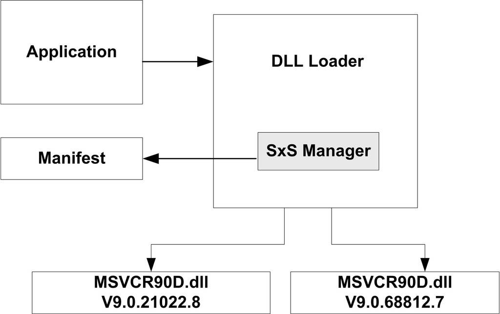

<h2>9.5 DLL HELL</h2>

DLL跟ELF類似也有版本更新時發生不相容的問題，我們在前面的關於C++和DLL的小節中也領教了DLL不相容問題的嚴重性。由於Windows中使用DLL比Linux中使用共用函式庫範圍更大，更新也更頻繁，並且早期的Windows缺乏一種很有效的DLL版本控制機制，從而導致這個問題在Windows下非常嚴重，以至於被人戲稱為DLL噩夢（DLL hell）。

很多Windows的應用程式在發布時會將它們所有需要用到的DLL都一起打包發布，很多應用程式的安裝程式並不是很成熟，經常在安裝時將一個舊版的DLL覆蓋掉一個更新版本的DLL，從而導致其他的應用程式執行失敗。有些安裝程式比較友好，如果碰到需要覆蓋新版的DLL時，它會彈出一個對話方塊提醒使用者是否要覆蓋，但是即使這樣，有些應用程式只能執行在舊版的DLL下，如果不覆蓋，那麼它可能無法在新版的DLL中執行。總得說來，三種可能的原因導致了DLL Hell的發生：

一是由使用舊版本的DLL替代原來一個新版本的DLL而引起。這個原因最普遍，是Windows 9x使用者通常遇到的問題DLL錯誤之一。

二是由新版DLL中的函式無意發生改變而引起。盡管在設計DLL時候應該“向下”相容，然而要保證DLL完全“向下”相容卻是不可能的。

三是由新版DLL的安裝引入一個新BUG.。這個原因發生的機率最小，但是它仍然會發生。

解決DLL Hell的方法

DLL的作用已經在前面介紹過，下面我們介紹幾種預防DLL Hell的方法。

靜態連結（Static linking）

對付DLL Hell的最簡單方法，或者說終極方法就是，在編譯產生應用程式時使用靜態連結的方法連結它所需要的執行庫，從而避免使用動態連結。這樣，在執行應用程式時候就不需要依賴DLL了。然而，它會喪失使用動態連結帶來的好處。

防止DLL覆蓋（DLL Stomping）

在Windows中，DLL的覆蓋問題可以使用 Windows 檔案保護（Windows File Protection簡稱WFP）技術來緩解。該技術從Windows 2000版本開始被使用。它能阻止未經授權的應用程式覆蓋系統的DLL。第三方應用程式不能覆蓋作業系統DLL檔案，除非它們的安裝程式捆綁了Windows 更新包，或者在它們的安裝程式執行時禁止了WFP服務（當然這是一件非常危險的事情）。

避免DLL衝突 （Conflicting DLLs）

解決不同應用程式依賴相同DLL不同版本的問題一個方案就是，讓每個應用程式擁有一份自己依賴的DLL，並且把問題DLL的不同版本放到該應用程式的資料夾中，而不是系統資料夾中。當應用程式需要裝置DLL時候，首先從自己的資料夾下尋找所需要的DLL,然後再到系統檔案中尋找。

.NET下DLL Hell的解決方案

在.NET框架中，一個程式集（Assembly）有兩種型別：應用程式程式（也就是exe執行檔）集以及庫程式（也就是DLL動態連結庫）集。一個程式集包括一個或多個檔案，所以需要一個清單檔案來描述程式集。這個清單檔案叫做Manifest檔案。Manifest檔案描述了程式集的名字，版本號以及程式集的各種資源，同時也描述了該程式集的執行所依賴的資源，包括DLL以及其他資原始檔等。Manifest是一個XML的描述檔案。每個DLL有自己的manifest檔案，每個應用程式也有自己的Manifest。對於應用程式而言，manifest檔案可以和執行檔在同一目錄下，也可以是作為一個資源嵌入到執行檔的內部(Embed Manifest)。

XP以前的windows版本，在執行執行檔是不會考慮manifest檔案的。它會直接到system32的目錄下查詢該執行檔所依賴的DLL。在這種情況下，Manifest只是個多餘的檔案。而XP以後的作業系統，在執行執行檔時則會首先讀取程式集的manifest檔案，獲得該執行檔需要呼叫的DLL列表，作業系統再根據DLL的manifest檔案去尋找對應的DLL並呼叫。一個典型的manifest檔案的例子如下：

<pre>&lt;?xml version="1.0" encoding="UTF-8" standalone="yes"?&gt;
&lt;assembly xmlns="urn:schemas-microsoft-com:asm.v1" manifestVersion="1.0"&gt;
  &lt;trustInfo xmlns="urn:schemas-microsoft-com:asm.v3"&gt;
    &lt;security&gt;
      &lt;requestedPrivileges&gt;
        &lt;requestedExecutionLevel level="asInvoker" uiAccess="false"&gt;&lt;/requestedExecutionLevel&gt;
      &lt;/requestedPrivileges&gt;
    &lt;/security&gt;
  &lt;/trustInfo&gt;
  &lt;dependency&gt;
    &lt;dependentAssembly&gt;
      &lt;assemblyIdentity type="win32" name="Microsoft.VC90.DebugCRT" version="9.0.21022.8" processorArchitecture="x86" publicKeyToken="1fc8b3b9a1e18e3b"&gt;&lt;/assemblyIdentity&gt;
    &lt;/dependentAssembly&gt;
  &lt;/dependency&gt;
&lt;/assembly&gt;
</pre>

在這個例子中<code>，&lt;dependency&gt;</code>這一部分指明瞭其依賴於一個名字叫做Microsoft.VC90. CRT的庫。但是我們發現<code>，&lt;assemblyIdentity&gt;</code>屬性裡面還有其他的資訊，分別是type系統型別，version版本號，processorArchitecture平台環境，publicKeyToken公匙。所有這些加在一起就成了“強檔名”。有了這種“強檔名”，我們就可以根據其區分不同的版本、不同的平台。有了這種強檔名，系統中可以有多個不同版本的相同的庫共存而不會發生衝突。

從Windows XP開始，可供應用程式並發使用的並行配件組越來越多。載入程式透過清單和配件的版本號為應用程式確定準確的繫結版本。下圖是並行程式集，它的manifest檔案及應用程式之間一起協同工作的例項如圖9-5所示。

 圖9-5 Manifest與DLL載入 …

圖9-5中的SxS Manager就是Side-by-side Manager, 它利用程式集manifest檔案的描述，實現對相應版本的DLL的載入。在這個例子中，我們假設系統中存在兩個版本的MSVCR90D.DLL：版本 9.0.21022.8 和版本 9.0.68812.7，都是在並行程式集cache中。當應用程式需要載入DLL時候，並行管理器根據該應用程式的manifest檔案中關於所需要的MSVCR90D的版本資訊來載入相應的DLL。Windows XP以後的作業系統在\WINDOWS目錄下面有個叫做WinSxS（Windows Side-By-Side）目錄，這個目錄下我們可以看到上面例子中的MSVCR90D.DLL位於這個位置：

\WINDOWS\WinSxS\x86_Microsoft.VC90.DebugCRT_1fc8b3b9a1e18e3b_9.0.21022.8_x-ww_597c3456\MSVCR90D.dll

除此之外，我們還能夠在WinSxS目錄下看到其他的不同版本的C/C++/MFC/ALT執行庫：

<pre>amd64_Microsoft.VC90.MFCLOC_1fc8b3b9a1e18e3b_9.0.21022.8_x-ww_43fdd01a
    amd64_Microsoft.VC90.MFC_1fc8b3b9a1e18e3b_9.0.21022.8_x-ww_d37d5c5a
    ia64_Microsoft.VC90.MFCLOC_1fc8b3b9a1e18e3b_9.0.21022.8_x-ww_414ed0da
    ia64_Microsoft.VC90.MFC_1fc8b3b9a1e18e3b_9.0.21022.8_x-ww_d0ce5d1a
    x86_Microsoft.VC80.ATL_1fc8b3b9a1e18e3b_8.0.50727.42_x-ww_6e805841
    x86_Microsoft.VC80.CRT_1fc8b3b9a1e18e3b_8.0.50727.1433_x-ww_5cf844d2
    x86_Microsoft.VC80.CRT_1fc8b3b9a1e18e3b_8.0.50727.163_x-ww_681e29fb
    x86_Microsoft.VC80.CRT_1fc8b3b9a1e18e3b_8.0.50727.42_x-ww_0de06acd
    x86_Microsoft.VC80.MFCLOC_1fc8b3b9a1e18e3b_8.0.50727.42_x-ww_3415f6d0
    x86_Microsoft.VC80.MFC_1fc8b3b9a1e18e3b_8.0.50727.42_x-ww_dec6ddd2
    x86_Microsoft.VC90.ATL_1fc8b3b9a1e18e3b_9.0.21022.8_x-ww_312cf0e9
    x86_Microsoft.VC90.CRT_1fc8b3b9a1e18e3b_9.0.21022.8_x-ww_d08d0375
    x86_Microsoft.VC90.CRT_1fc8b3b9a1e18e3b_9.0.30729.1_x-ww_6f74963e
    x86_Microsoft.VC90.DebugCRT_1fc8b3b9a1e18e3b_9.0.21022.8_x-ww_597c3456
    x86_Microsoft.VC90.DebugMFC_1fc8b3b9a1e18e3b_9.0.21022.8_x-ww_2a62a75b
    x86_Microsoft.VC90.DebugOpenMP_1fc8b3b9a1e18e3b_9.0.21022.8_x-ww_72b673b0
    x86_Microsoft.VC90.MFCLOC_1fc8b3b9a1e18e3b_9.0.21022.8_x-ww_11f3ea3a
    x86_Microsoft.VC90.MFCLOC_1fc8b3b9a1e18e3b_9.0.30729.1_x-ww_b0db7d03
    x86_Microsoft.VC90.MFC_1fc8b3b9a1e18e3b_9.0.21022.8_x-ww_a173767a
    x86_Microsoft.VC90.MFC_1fc8b3b9a1e18e3b_9.0.30729.1_x-ww_405b0943
</pre>

對於每個版本DLL，它在WinSxS目錄下都有一個獨立的目錄，這個目錄的命名中包含了機器型別、名字、公鑰和版本號，這樣如果多個不同版本的MSVCR90D.DLL都可以共存在系統中而不會相互衝突。當然有了Manifest這種機制之後，動態連結的C/C++程式在執行時必須在系統中有與它在Manifest裡面所指定的完全相同的DLL，否則系統就會提示執行出錯，這也是為什麼很多時候使用Visual C++ 2005或2008編譯的程式無法在其他機器上執行的原因，因為它們需要與編譯環境完全相同的執行庫的支援，所以這些程式發布的時候往往都要帶上相應的執行庫，比如Vistual C++ 2008的執行庫就位於“Program Files\Microsoft Visual Studio 9.0\VC\redist\x86\”，比如C語言執行庫就位於該目錄下的“Microsoft. VC90.CRT”；MFC執行庫位於“Microsoft.VC90.MFC”。我們在後面還會詳細介紹執行庫相關的內容。

