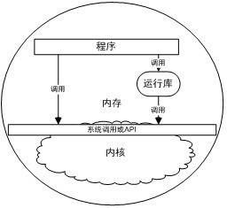

<h2>9.6 本章小結</h2>

動態連結機制對於Windows作業系統來說極其重要，整個Windows系統本身即基於動態連結機制，Windows的API也以DLL的形式提供給程式開發者，而不像Linux等系統是以系統呼叫作為作業系統的最終入口。DLL比Linux下的ELF共用函式庫更加複雜，提供的功能也更為完善。

我們在這一章中介紹了DLL在程式地址空間中的分佈、基地址和RVA、共享資料段、如何建立和使用DLL、如何使用模組檔案控制DLL的產生。接著我們還詳細分析了DLL的符號匯入匯出機制以及DLL的重定基地址、序號和匯入函式繫結、DLL與C++等問題。

最後我們探討了DLL HELL問題，並且介紹瞭解決DLL HELL問題的方法、manifest及相關問題。

第4部分 庫與執行庫

malloc是如何分配出記憶體的？區域性變數存放在哪裡？為什麼一個編譯好的簡單的HelloWorld程式也需要佔據好幾KB的空間？為什麼程式一啟動就有堆、I/O或異常系統可用？在這一部分裡，我們將詳細剖析在程式執行時，隱藏於背後的各種秘密：為什麼程式能夠執行，它是如何執行的，這些問題將在本部分一一得到解答。首先讓我們對程式的執行環境有一個總覽，下圖描述了一個典型的程式環境。

 程式環境 …

由此可以看到，程式的環境由以下三個部分組成：

• 記憶體。

• 執行庫。

• 系統呼叫。

此外，核心也可算作執行環境的一部分，但實際上系統呼叫部分充當了程式與核心互動的中介，因此在這裡不把內核算作執行環境。在接下來的幾章裡，我們會對這幾部分一一進行介紹。

