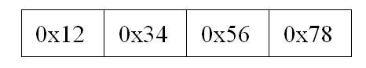
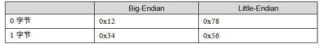
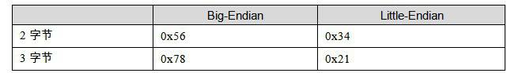

<h2>A.1 位元組序（Byte Order）</h2>

“endian”這個詞出自Jonathan Swift在1726年寫的諷刺小說《格列佛遊記》（Gulliver’s Travels）。小人國的內戰就源於吃水煮雞蛋時究竟是從大頭（Big-Endian）敲開還是從小頭（Little-Endian）敲開，由此曾發生過6次叛亂，其中一個皇帝送了命，另一個丟了王位。

在不同的計算機體係結構中，對於資料（位元、位元組、字）等的儲存和傳輸機制有所不同，因而引發了計算機領域中一個潛在但是又很重要的問題，即通訊雙方交流的資訊單元應該以什麼樣的順序進行傳送。如果達不成一致的規則，計算機的通訊與儲存將會無法進行。目前在各種體係的計算機中通常採用的位元組儲存機制主要有兩種：大端（Big-endian）和小端（Little-endian）。

首先讓我們來定義兩個概念：

MSB是Most Significant Bit/Byte的首字母縮寫，通常譯為最重要的位或最重要的位元組。它通常用來表明在一個bit序列（如一個byte是8個bit組成的一個序列）或一個byte序列（如word是兩個byte組成的一個序列）中對整個序列取值影響最大的那個bit/byte。

LSB是Least Significant Bit/Byte的首字母縮寫，通常譯為最不重要的位或最不重要的位元組。它通常用來表明在一個bit序列（如一個byte是8個bit組成的一個序列）或一個byte序列（如word是兩個byte組成的一個序列）中對整個序列取值影響最小的那個bit/byte。

比如一個十六進位的整數0x12345678裡面：

0x12就是MSB（Most Significant Byte），0x78就是LSB（Least Significant Byte）。而對於0x78這個位元組而言，它的二進位是01111000，那麼最左邊的那個0就是MSB（Most Significant Bit），最右邊的那個0就是LSB（Least Significant）。

Big-endian 和 little-endian的區別就是bit-endian規定MSB在儲存時放在低地址，在傳輸時MSB放在流的開始；LSB儲存時放在高地址，在傳輸時放在流的末尾。little-endian則相反。例如：0x12345678h這個資料在不同機器中的儲存是不同，如表A-1所示。

 表A-1 …

Little-Endian主要用於我們現在的PC的CPU中，即Intel的x86係列相容機；Big-Endian則主要應用在目前的Mac機器中，一般指PowerPC係列處理器。另外值得一提的是，目前的TCP/IP網路及Java虛擬機器的位元組序都是Big-endian的。這意味著如果透過網路傳輸0x12345678這個整形變數，首先被傳送的應該是0x12，接著是0x34，然後是0x56，最後是0x78。所以我們的程式在處理網路流的時候，必須注意位元組序的問題。

big-endian和little-endian的爭論由來已久，計算機界對兩種方式的優劣進行了長期的爭論，爭論雙方相互不妥協（至今仍未完全妥協）。Danny Cohen於1980年寫的一篇名叫“On Holy Wars and a Plea for Peace”著名的論文形象地將雙方比喻成《格列佛遊記》小人國裡徵戰的雙方。從此以後這兩個術語開始流行並且一直延用至今。

